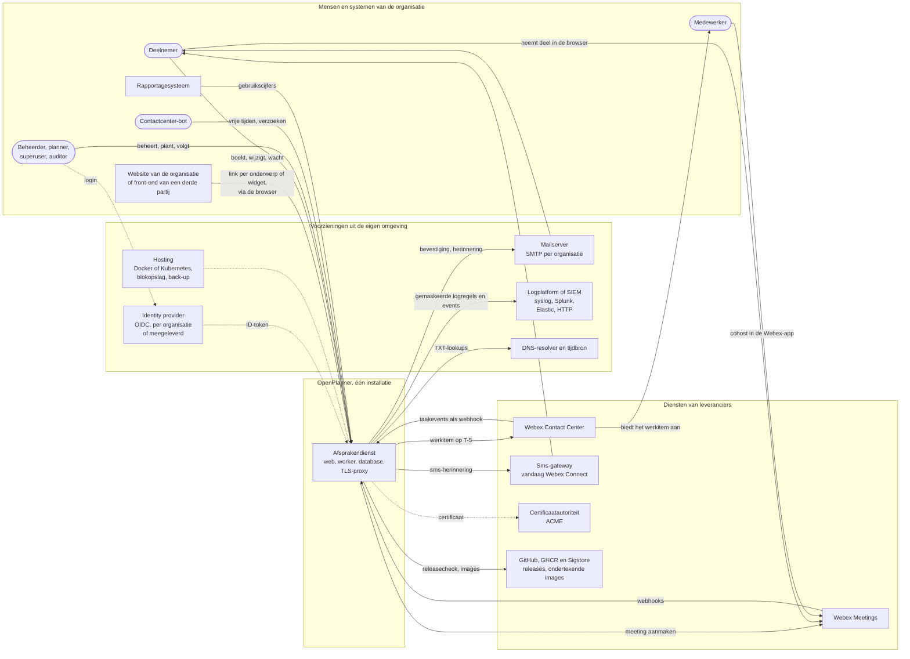
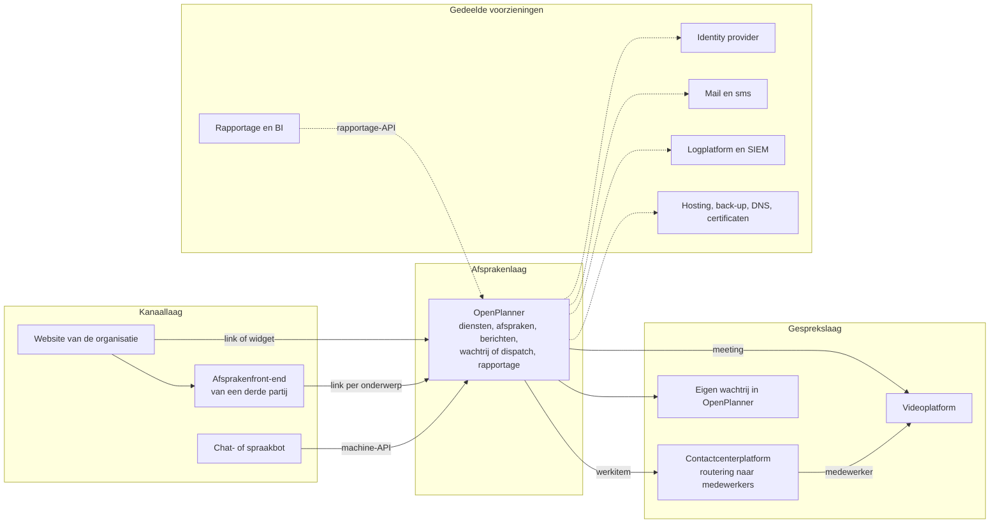
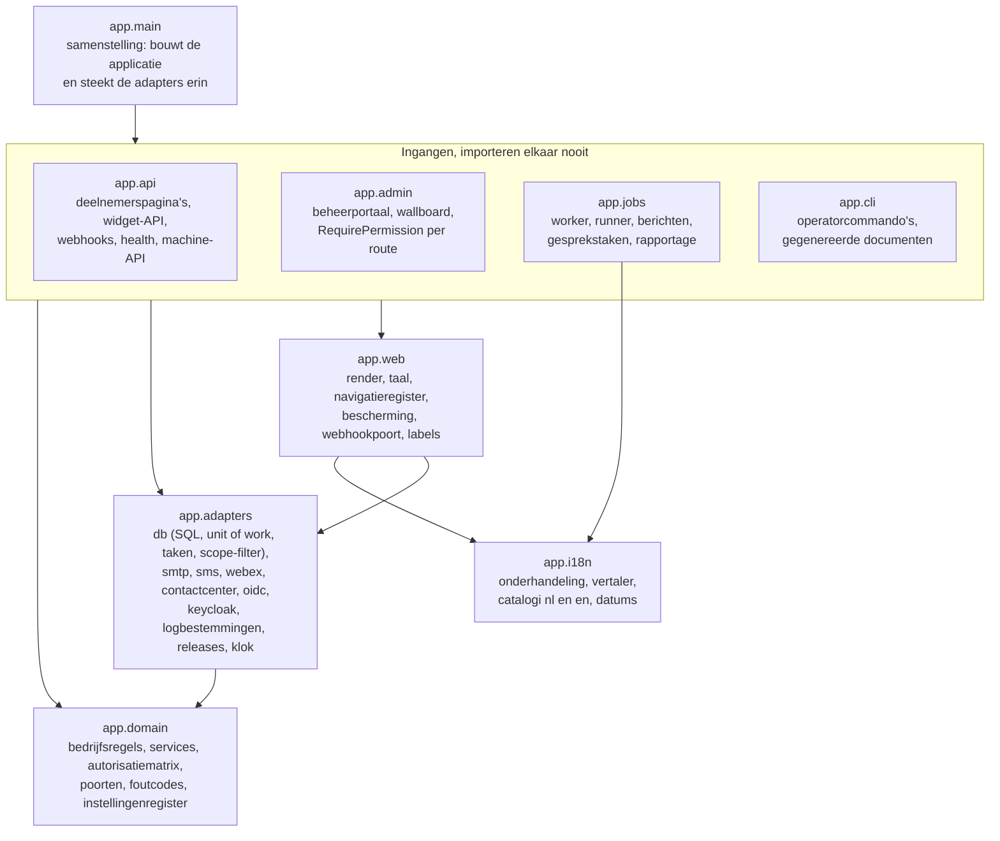
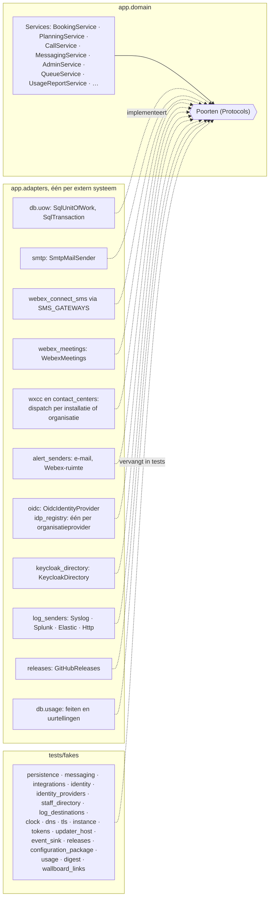
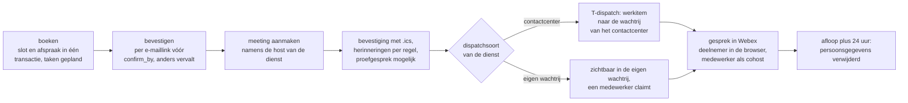
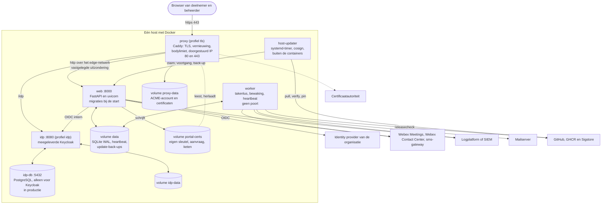
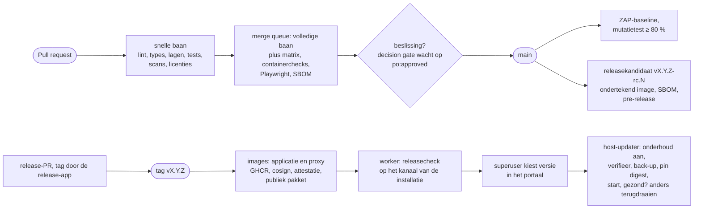
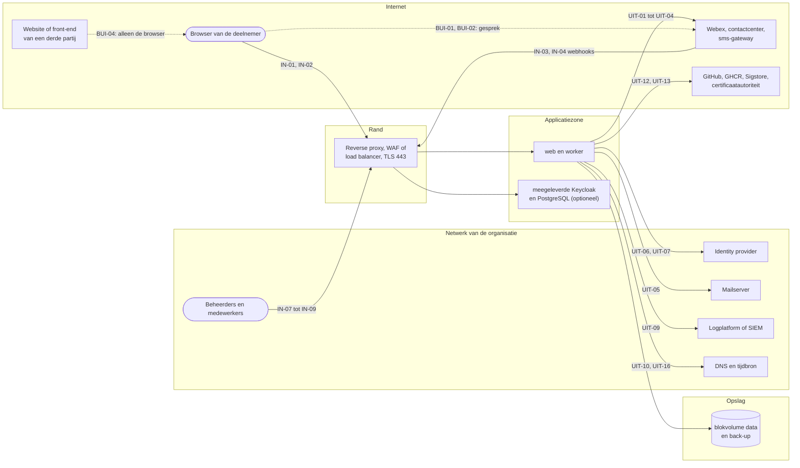
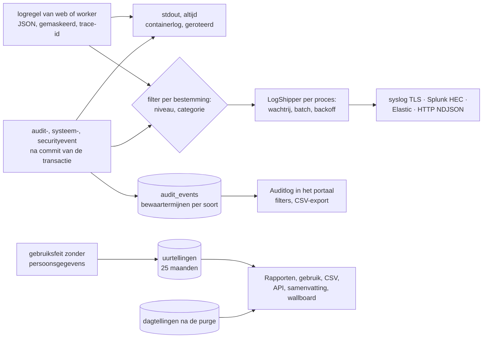

# Applicatiearchitectuur OpenPlanner

| | |
|---|---|
| Betreft | OpenPlanner 0.6.0, releasekandidaat `v0.6.0-rc.117` (commit `a9406441` op `main`, 13 november 2026). De laatst uitgebrachte release is `v0.5.1` van 7 november 2026. Wat deze kandidaat meer heeft, komt in productie met `v0.6.0`: een productie-installatie weigert een kandidaat (7.3) |
| Stand | Concept 2 van 14 november 2026, beschreven tegen de code van `v0.6.0-rc.117` en `docs/adr-status.md` (bijgewerkt op 8 november 2026 onder ADR 0119). Concept 1 beschreef `v0.4.0` |
| Taal | Nederlands, als stakeholderdocument naast `docs/HANDOVER.md`. Code, ADR's en de overige documentatie zijn Engels |
| Lezers | Architecten en ontwikkelaars van een organisatie die OpenPlanner in haar landschap inpast; het team dat de applicatie host op een container- of cloudplatform; identity-, netwerk-, security- en privacybeheer; het productteam |
| Bron van waarheid | De code op `main`, de ADR's en `docs/adr-status.md`. Dit document beschrijft en verwijst; het beslist niets |
| Raamwerk | arc42 voor de indeling, het C4-model voor de diagramniveaus, ISO/IEC/IEEE 42010 voor belanghebbenden en hun zorgen, ADR's voor besluiten (zie 1.3) |

## Leeswijzer

Dit document beschrijft OpenPlanner op het niveau van de applicatiearchitectuur. Het zegt wat de
applicatie doet, hoe zij is opgebouwd, welke keuzes daaronder liggen, welke maatregelen erin
zitten en hoe zij in een groter landschap past. Het is geen codereview en geen handleiding; voor
die diepte verwijst elk hoofdstuk naar de plek in de repository waar het detail staat.

Wie weinig tijd heeft, leest de managementsamenvatting, hoofdstuk 3 (context en datastromen) en
7.7 tot en met 7.10 (netwerk en hosting). Per lezer:

| Lezer | Begint bij | Daarna |
|---|---|---|
| Hosting- of platformteam | 3.3 (elke datastroom met poort en richting), 7 (deployment, netwerk, hostingvarianten, wat het platformteam levert) | 5.6 (ingangen), 8.5 (identiteit), 8.6 (gegevens en bewaartermijnen), 9.3 |
| Identity-beheer | 8.5 (OIDC, claims, JIT, sessies, uitdiensttreding) | 3.3, 7.7 |
| Security- en privacyofficer | 8.5 tot en met 8.7, 9 | 3.3, 7.9 |
| Ontwikkelaar | 5 (bouwblokken), 6 (ketens) | 8.1 tot en met 8.3 (uitbreiden met adapters) |
| Architect die inpast | 3.5, 7.9, 13 | 3.3, 8.2 |

Sinds ADR 0121 heet wat een organisatie aanbiedt in het portaal een *dienst*; tot dan heette dat
een groep. Code, URL's (`/g/{slug}`), rechten, claims en de rol `group_admin` houden de naam
`group`. Dit document volgt het portaal en zegt *groep* alleen waar het die namen bedoelt.

Dit document is neutraal: het noemt geen afnemer en geen leverancier van een afnemer. Hoe één
organisatie OpenPlanner inpast, met haar eigen website, leveranciers, zones en keuze voor
hosting, hoort in een eigen ontwerpdocument van die organisatie, buiten deze repository. 13.5
zegt wat zo'n document vastlegt.

Afkortingen staan in hoofdstuk 14. De voornaamste worden bij het eerste gebruik in een hoofdstuk
voluit geschreven, zodat elk hoofdstuk op zichzelf leesbaar is.

## Managementsamenvatting

OpenPlanner is een open-source boekingsplatform voor videoafspraken, uitgebracht onder de
EUPL-1.2. Een organisatie biedt per *dienst* vrije tijden aan op een eigen pagina of in een
inbedbare widget. Een deelnemer kiest een tijd, bevestigt per e-mail, ontvangt een
agenda-uitnodiging en neemt deel vanuit de browser, zonder account of app. Kort voor de start
landt het gesprek als werkitem in de wachtrij van het contactcenter, of in de eigen wachtrij van
OpenPlanner. Vierentwintig uur na afloop zijn de persoonsgegevens van de afspraak verwijderd.

De applicatie is bewust licht. Eén installatie bestaat uit een webproces, een workerproces en één
SQLite-database, met een meegeleverde TLS-proxy en optioneel een meegeleverde identity provider.
Eén installatie bedient meer organisaties, elk met eigen diensten, huisstijl, teksten en
beheerders. De bedrijfsregels staan in een framework-vrije domeinlaag achter 37 *poorten*; elk
extern systeem (video, contactcenter, mail, sms, identity provider, logplatform, releases) zit
achter een eigen *adapter*.

De architectuur is vastgelegd in 124 genummerde besluiten (ADR's), elk met een bouwstatus die tegen
de code wordt gecontroleerd. Sinds 0.4.0 kwamen er besluiten bij over rapportage zonder
persoonsgegevens (ADR 0117) en over diensten, flows en vaardigheden (ADR 0121 en 0122). Ook het
gesprek in een eigen pagina (ADR 0123) en één poort voor inkomende webhooks (ADR 0124) zijn nieuw.
Ze zijn deels gebouwd (10.2). Eén autorisatiematrix bepaalt alle rechten. Persoonsgegevens komen
niet in logs, taken, foutmeldingen of berichten naar het contactcenter.

Voor een hostingteam is de kern overzichtelijk. Eén installatie is één image in twee rollen met
één persistent volume, achter een TLS-rand op poort 443. Vanaf internet moeten de pagina's voor
deelnemers, de widget en de webhooks van Webex bereikbaar zijn; het beheerportaal mag binnen het
netwerk van de organisatie blijven. Uitgaand praat de applicatie met Webex, het contactcenter, de
mailserver, de sms-gateway, de identity provider, het logplatform en voor updates met GitHub en
Sigstore. OpenPlanner gebruikt geen websockets: het videogesprek loopt rechtstreeks tussen de
browser en Webex. Hoofdstuk 3.3 nummert elke stroom; 7.7 tot en met 7.10 geven de zones, de
impact van hosten binnen de eigen infrastructuur of bij een hoster, en wat het platformteam
levert.

De voornaamste open punten zijn Genesys achter de neutrale contactcenterpoort (O15; ADR 0032 is
grotendeels gebouwd) en sms via SMPP (O18). Daarnaast staan meer kanalen naar keuze van de
deelnemer (O17) en de menselijke review per PR (O10) open. Het rapportagescherm uit O16 is met ADR
0117 gebouwd.

## 1. Inleiding en doelen

### 1.1 Waarom dit document

De repository bevat veel architectuurdocumentatie, maar verspreid en in het Engels. Er zijn een
technisch architectuurdocument met diagrammen, 124 ADR's, een gegevensstroomdocument, een
dreigingsmodel, gegenereerde overzichten van rechten, instellingen en beheerschermen, en drie
platen met een bouwblokregister. Wat ontbrak is één Nederlandse beschrijving voor een
ontwikkelaar, architect of hostingteam van buiten het productteam. Die moet in één keer laten zien
wat de applicatie doet, hoe de modulariteit is opgebouwd en welke maatregelen erin zitten. Ook
toont zij welke verbindingen de applicatie nodig heeft en waar zij ophoudt en het landschap
begint. Dit document
vult dat gat en wijst voor elk onderwerp naar de primaire plek.

### 1.2 Belanghebbenden en hun vragen

| Belanghebbende | Vraag aan de architectuur | Waar het antwoord staat |
|---|---|---|
| Enterprise- of solution-architect van een organisatie | Waar past de applicatie in ons landschap, wat moeten wij leveren, welke standaarden volgt zij? | 3, 7, 9, 13 |
| Hosting- of platformteam | Wat draait er, wat moet de applicatie kunnen bereiken en wie moet haar kunnen bereiken, wat bewaart zij en hoe lang, wat verandert er als wij haar hosten of een hoster? | 3.3, 5.6, 7, 8.6, 9.3 |
| Identity-beheer | Welke claims verwacht de applicatie, wat gebeurt er bij de eerste login en bij uitdiensttreding? | 8.5 |
| Netwerk- en securitybeheer | Welke poorten, paden en bestemmingen, welke zones, welke maatregelen aan de rand? | 3.3, 7.7, 9.1 |
| Ontwikkelaar die aansluit | Hoe zit de code in elkaar, waar voeg ik iets toe zonder iets te breken? | 5, 6, 8, 11 |
| Securityofficer, privacyofficer | Welke maatregelen zitten erin, welke gegevens gaan waarheen en hoe lang blijven ze, wat moet mijn organisatie zelf aantonen? | 8.5 tot en met 8.7, 9 |
| Contactcenterbeheer | Hoe komt een gesprek bij een medewerker, en wat moet in het contactcenter worden ingericht? | 3.3, 6.2, 13.3 |
| Productowner | Welke besluiten staan, wat is gebouwd, wat is open? | 10, 12, 13 |

### 1.3 Raamwerk en notatie

- **arc42** (versie 8, open sjabloon van Starke en Hruschka) bepaalt de hoofdstukindeling:
  doelen, randvoorwaarden, context, oplossingsstrategie, bouwblokken, gedrag, deployment,
  concepten, besluiten, kwaliteit, risico's, begrippen. De technische context (3.3) en de
  deploymentview (7) zijn de hoofdstukken waar een hostingteam het meest aan heeft.
- **C4-model** (Simon Brown) bepaalt de diagramniveaus: systeemcontext (C1), containers (C2),
  componenten (C3). Code-niveau (C4) hoort niet in dit document.
- **Mermaid** is de notatie van de diagrammen, zoals in `docs/architecture.md`; GitHub rendert ze
  zonder hulpmiddel. De drie platen in `docs/diagrams/` (draw.io, PDF, Word, PNG) zijn de
  deelbare vorm voor presentaties en worden uit `scripts/diagrams/content.py` gegenereerd.
- **ISO/IEC/IEEE 42010** levert de denkwijze van belanghebbenden, zorgen en gezichtspunten (1.2
  en de hoofdstukkeuze); arc42 is daarmee verenigbaar.
- **ADR's** (architecture decision records, ADR 0001) zijn de enige vorm waarin een besluit wordt
  vastgelegd. Dit document herhaalt geen besluit; het verwijst op nummer.

### 1.4 Documentkaart

Elk onderwerp heeft één primaire plek. Dit document is de ingang en de samenhang; het detail
staat waar de tabel het noemt. Wie iets wijzigt, wijzigt de primaire plek en past hier alleen de
verwijzing of de consequentie aan.

| Laag | Document | Taal | Draagt |
|---|---|---|---|
| Werkafspraken | `CLAUDE.md`, `CONTRIBUTING.md` | en | Hoe er gewerkt wordt: stack, regels, poorten in CI, reviewvragen |
| Stakeholderontwerp | `docs/HANDOVER.md` | nl | Het oorspronkelijke ontwerp, domeinmodel, werkpakketten, open punten O1 tot en met O18 |
| Applicatiearchitectuur | dit document | nl | Samenhang, datastromen, hosting, uitbreidpunten, controls, vragen aan de omgeving |
| Technische architectuur | `docs/architecture.md` | en | Diagrammen per laag, sequentiediagrammen, toestandsdiagrammen, modulekaart |
| Platen | `docs/diagrams/`, `scripts/diagrams/content.py` | nl | Bouwblokken B1 tot en met B17, componenten per laag, integraties |
| Besluiten | `docs/adr/`, `docs/adr-status.md` | en | Elk besluit met context, keuze, instellingen, gevolgen en bouwstatus |
| Onderzoek | `docs/research/` | en | Onderbouwing van grotere keuzes, zoals de release- en updatemodellen van ADR 0116 |
| Gegevens en privacy | `docs/dataflow.md` | en | Elke gegevensstroom, elke uitgaande verbinding en de retentiematrix; invoer voor de DPIA |
| Dreigingen | `docs/threat-model.md` | en | STRIDE per keten, misbruikgevallen met test |
| Gegenereerd uit de code | `docs/authorization.md`, `docs/settings.md`, `docs/admin-map.md`, `docs/logging.md`, `docs/api.md` | en | Rechtenmatrix, instellingen, beheerstructuur, logacties, API; CI faalt als zij afwijken |
| Beveiligingsdossier | `docs/asvs.md`, `docs/cryptography.md`, `docs/authentication.md`, `docs/assurance/` | en | Maatregel per auditeis, sleutels en algoritmen, authenticatiepaden, checklists voor derden |
| Beheer | `docs/install.md`, `docs/kubernetes.md`, `docs/runbook.md`, `docs/try-it.md` | en | Installeren, draaien, herstellen, roteren |
| Handleiding | `docs/manual/{nl,en}/` | nl, en | Eén onderwerp per beheerscherm, ook in het portaal getoond |
| Koppelen | `docs/widget.md`, `docs/agent-api.md`, `docs/webhooks.md`, `docs/reporting-api.md` | en | Widget op een website, machine-API voor bots, webhooks van Webex en het contactcenter, rapportage-API |
| Rapportage | `docs/reporting.md` | en | Gebruiksgegevens zonder persoonsgegevens, schermen, export en API (ADR 0117) |
| Diensten en flows | `docs/service-flows-handover.md` en de andere `service-flows-*`-documenten | en | Ontwerp van diensten, flows, vaardigheden en capaciteit (ADR 0121, 0122) |
| Configuratie | `docs/configuration-document.md` | en | De configuratie als JSON-document met plan en toepassing (ADR 0099) |

### 1.5 Visie, herkomst en businesscontext

OpenPlanner is ontstaan uit één behoefte: mensen en bedrijven die een organisatie willen spreken
een videobelkanaal bieden op Webex Meetings, aansluitend op het contactcenter dat de gesprekken
al voert. Het platform dat daaruit groeide is in de kern een plannings- en boekingsdienst. Het
videogesprek is één van de uitkomsten van een afspraak. De eigenlijke dienst bestaat uit de keuze
van het kanaal, de capaciteit per tijdvak, het bevestigen en herinneren, het verdelen over
medewerkers en het opruimen van gegevens.

Drie uitgangspunten sturen elk besluit:

1. **De deelnemer hoeft niets te installeren en niets te onthouden.** Boeken, wijzigen en
   deelnemen gebeuren in de browser met een link uit de e-mail; er is geen account.
2. **De organisatie houdt haar eigen keuzes.** Website en keuzeboom, identity provider,
   mailprovider, contactcenter en huisstijl blijven van de organisatie; OpenPlanner is het
   eindstation per URL en geen routeringslaag (HANDOVER B14).
3. **Privacy en beveiliging zijn ontwerpregels, geen laag erbovenop.** Persoonsgegevens staan op
   een vaste plek en zijn na afloop weg; rechten komen uit één matrix; elke release gaat door
   dezelfde controles.

De eerste afnemer is een contactcenter. De repository is sinds ADR 0115 neutraal: geen namen van
afnemers en geen sectorwoorden, zodat het product voor elke organisatie bruikbaar is.

## 2. Scope, kaders en kwaliteitsdoelen

### 2.1 Wat de applicatie doet

| Functie | Voor wie | Bouwblok |
|---|---|---|
| Vrije tijden tonen en een afspraak boeken op `/g/{slug}`, met maandkalender en een kort formulier; per onderwerp of flow een eigen link (`?subject=`, `?flow=`) | deelnemer | B1, B4, B5 |
| Dezelfde boekflow als Web Component op een website | deelnemer, websitebeheerder | B2 |
| Bevestigen per e-maillink, wijzigen, annuleren en de eigen gegevens corrigeren met een persoonlijke beheerlink | deelnemer | B1, B5, B6 |
| Bevestiging, wijziging, herinnering en annulering per e-mail (met `.ics`) en sms | deelnemer | B6 |
| Per afspraak een Webex-meeting en een proefgesprek; deelnemen uit de browser via de link van Webex. Deelnemen in een eigen pagina van OpenPlanner is besloten en als lege huls gebouwd (ADR 0123) | deelnemer, medewerker | B7 |
| Het gesprek kort voor de start als werkitem naar de wachtrij van het contactcenter, via de verbinding van de installatie of een eigen verbinding van de organisatie; of naar de eigen wachtrij | medewerker, contactcenter | B7 |
| "Nu bellen" en verzoeken zonder afspraak, met een plafond en zicht op de wachtrij | deelnemer | B3 |
| Diensten, flows, onderwerpen, vaardigheden, capaciteitspools, bezetting, uitzonderingen, feestdagen, teksten, berichten, formuliervelden, huisstijl en inbedding beheren | beheerder | B4, B9 |
| Agenda per dienst met tekorten; een planner verzet, annuleert, stelt een nieuwe tijd voor of laat herboeken | planner | B9 |
| Noodsluiting van een dienst of organisatie met scenario's en alternatieve contactopties | beheerder | B4, B9 |
| Rapportage over gebruik zonder persoonsgegevens: rapportscherm, gebruikstabbladen, CSV-export, API, samenvatting per e-mail, wallboard | beheerder, auditor, rapportagesysteem | B9, B11 |
| Live overzicht met meldingen, auditlog, retentie-overzicht, probleemoplossing per afspraak; meldingen buiten het portaal per e-mail of in een Webex-ruimte | beheerder, auditor | B7, B9, B10 |
| Vrije tijden en wijzigingsverzoeken door een contactcenter-bot via de machine-API; de configuratie als JSON-document via dezelfde API | bot, provisioningpijplijn | B11, B13 |
| Medewerkers en rollen beheren in de meegeleverde identity provider; per organisatie een eigen identity provider | superuser, organisatiebeheerder | B17 |
| Logbestemmingen, updates vanuit het portaal, onderhoudsmodus, configuratiepakket en configuratiedocument | superuser | B13, B16 |

### 2.2 Wat buiten de applicatie valt

- **De keuzeboom.** De website van de organisatie, of een afsprakenfront-end van een derde
  partij, beslist welke dienst en welk onderwerp de deelnemer nodig heeft. Zij linkt naar de
  pagina van die dienst of bedt de widget in. OpenPlanner routeert niet.
- **Het roosteren van medewerkers.** Bezetting is een aantal medewerkers per tijdblok of in een
  capaciteitspool. Welke medewerker het gesprek krijgt, bepaalt de wachtrij van het contactcenter
  of de eigen wachtrij op het moment zelf (HANDOVER B5). Beschikbaarheid uit persoonlijke
  agenda's is een idee (O12), geen functie.
- **Het videogesprek zelf.** Webex Meetings voert het gesprek; OpenPlanner maakt de meeting en
  volgt de gebeurtenissen. Ook als de deelnemer straks in een eigen pagina deelneemt, lopen beeld,
  geluid en signalering rechtstreeks tussen browser en Webex (ADR 0123).
- **Authenticatie van beheerders.** Wachtwoorden, tweede factor en accountbeheer liggen bij de
  identity provider; OpenPlanner controleert tokens en leest het bewijs van de tweede factor.
- **Gespreksinhoud, opnames, transcripties.** Niets daarvan bereikt OpenPlanner.
- **Rapportage over gesprekken.** Het contactcenter rapporteert over gesprekken. OpenPlanner
  rapporteert over gebruik: afspraken, verzoeken, wachttijden en bezetting per uur, zonder
  persoonsgegevens (8.7).
- **De publieke website openplanner.nl.** Statisch, gebouwd uit `site/`, los van de applicatie
  (ADR 0087, 0113).

### 2.3 Kwaliteitsdoelen

De vijf doelen in volgorde van voorrang, overgenomen uit `docs/architecture.md` §2. Bij een
conflict wint het hogere doel.

| Prioriteit | Doel | Wat het in het ontwerp betekent |
|---|---|---|
| 1 | Privacy | Persoonsgegevens alleen op de afspraak of het verzoek, verwijderd 24 uur na afloop; nooit in logs, URL's, taken, foutmeldingen of uitgaande contactcenterberichten |
| 2 | Beveiliging | Standaard dicht, één autorisatiepunt, verplichte CI-poorten, externe pentest |
| 3 | Toegankelijkheid | WCAG 2.2 AA; werkt zonder JavaScript en zonder muis; axe en Lighthouse in CI |
| 4 | Onderhoudbaarheid | Zuiver domein achter poorten, afgedwongen lagen, docstrings op alles, geen kopieerwerk |
| 5 | Eenvoud | Twee containers, SQLite, geen message broker; ontworpen op ongeveer 80 boekingen per werkdag |

### 2.4 Normkader

Normen en standaarden die de applicatie volgt, en waar dat wordt getoetst. Elke norm wordt exact
aangehaald; eigen regels staan in `CLAUDE.md` en de ADR's en lenen geen gezag van een norm.

| Norm of standaard | Uitgever, versie | Toepassing | Toetsing |
|---|---|---|---|
| WCAG 2.2 niveau AA | W3C, 2023 | Deelnemerspagina's, widget, beheerportaal, e-mails | axe-core (nul schendingen), Lighthouse toegankelijkheid ≥ 95, toetsenbordtest in CI; handmatige test met schermlezers vóór livegang (open, O10) |
| OWASP ASVS 5.0.0, niveau 2 | OWASP, 2025 | Audit van 1 november 2026; per niet volledig aanvaarde eis de maatregel in `docs/asvs.md` | `tests/test_asvs_doc.py` controleert dat elke rij een bestaande bron noemt |
| OpenID Connect Core, OAuth 2.0 (RFC 6749), PKCE (RFC 7636), RFC 9207 | OpenID Foundation, IETF | Beheerderslogin, machine-API | Adapter `app/adapters/oidc.py`, `app/api/agent/`, tests |
| Elastic Common Schema en het OpenTelemetry-logdatamodel | Elastic, CNCF | Eventschema `openplanner.event/3` van audit- en logregels | `app/domain/event_schema.py`, `docs/audit-events.md` |
| iCalendar (RFC 5545, 5546) | IETF | Agenda-uitnodigingen | `app/jobs/calendar.py` |
| E.164 | ITU-T | Opslag van telefoonnummers | `phonenumbers`, ADR 0055 |
| CycloneDX, Sigstore cosign | OWASP, OpenSSF | SBOM per image, sleutelloze ondertekening | CI, host-updater verifieert |
| EUPL-1.2, REUSE | Europese Commissie, FSFE | Licentie van elk bestand | `reuse lint` in CI, ADR 0054 |
| NL Design System (tokens) | NL Design System | Standaardwaarden van de widget- en paginastijl | `--booking-*`-tokens, ADR 0020, 0041 |
| publiccode.yml | Developers Italia | Metadata van het open-sourceproduct | validatie in CI |

De TLS-, HSTS- en DNS-aanbevelingen waartegen het publieke adres wordt beoordeeld, staan met bron
in ADR 0086 (standaardentabel) en `docs/runbook.md`.

### 2.5 Technische randvoorwaarden

| Randvoorwaarde | Inhoud | Bron |
|---|---|---|
| Stack | Python 3.12, FastAPI, SQLAlchemy 2 (async), Alembic, Pydantic v2, Jinja2, httpx, structlog; widget in vanilla JavaScript, gebundeld met esbuild | `CLAUDE.md`, HANDOVER B2 |
| Database | SQLite in WAL-modus op één volume; Postgres is geen doel (besluit 2026-10-23); een stap verder vraagt een eigen ADR | ADR 0002, 0036 |
| Opslag | Het datavolume is een lokaal bestandssysteem op blokopslag (bijvoorbeeld ext4 of xfs op een eigen schijf). WAL werkt volgens de documentatie van SQLite niet op een netwerkbestandssysteem zoals NFS; er is één schrijver en dus één replica | ADR 0002, 0036; sqlite.org, *Write-Ahead Logging* |
| Vorm | Eén image met twee rollen (`web`, `worker`), één `docker-compose.yml` voor ontwikkeling en productie, een Helm-chart als proef | ADR 0002, 0114 |
| Geen extra infrastructuur | Geen Celery, Redis, APScheduler, message broker, cache of frontend-framework | `CLAUDE.md` |
| Deelnemers loggen nooit in | Rechten van deelnemers komen uit de beheerlink en de termijnen van de dienst | ADR 0011, 0093 |
| Geen derden op deelnemerspagina's | Geen CAPTCHA-puzzel, geen scripts of lettertypen van derden; een browsertest bewaakt het. De enige uitzondering is straks de belpagina van ADR 0123: die verbindt vanuit de browser met Webex, achter een schakelaar die standaard uit staat | HANDOVER B11, `e2e/tests/no-third-parties.spec.ts`, ADR 0123 |
| Hosting in de EU | Eis aan de host; de applicatie dwingt het niet af | HANDOVER §8 |
| Afhankelijkheden | Alleen actief onderhouden de-factostandaarden met een licentie uit MIT, BSD, Apache-2.0, PSF; uitzonderingen per ADR | `docs/dependencies.md`, ADR 0003, 0073 |
| Neutraal | Geen namen van afnemers en geen sectorwoorden in de repository; een test faalt erop | ADR 0115 |

### 2.6 Aannames

Uitspraken in dit document die niet uit de code volgen, staan hier als aanname. Een aanname die
onjuist blijkt, verandert het hoofdstuk dat haar gebruikt.

| ID | Aanname | Gebruikt in | Bevestigen door, of stand |
|---|---|---|---|
| A-1 | Het volume blijft in de orde van 80 boekingen per werkdag met pieken van 20 per minuut, zoals het ontwerp aannam | 2.3, 7, 12 | de organisatie die inpast |
| A-2 | Eén installatie bedient één verwerkingsverantwoordelijke; organisaties binnen die installatie delen de superuser, de database en de sleutels | 3.5, 9 | herzien op 5 november 2026 (V-13): de applicatie is multi-tenant en de hoster bepaalt de indeling; wat organisaties delen, blijft gelden |
| A-3 | De organisatie beschikt over een OIDC-identity provider, of aanvaardt de meegeleverde Keycloak | 3.3, 8.5 | beantwoord op 5 november 2026 (V-2): standaard de meegeleverde Keycloak, daarna elke OIDC-provider per organisatie |
| A-4 | Het contactcenter is Webex Contact Center, of de dienst gebruikt de eigen wachtrij; een ander platform vraagt een adapter achter ADR 0032 | 3.3, 6.2, 12 | beantwoord op 5 november 2026 (V-3): ook Genesys (O15) |
| A-5 | De host levert versleutelde opslag, back-up en herstel buiten de applicatie om (O7) | 7, 9.3 | beantwoord voor zelf hosten op 5 november 2026 (V-7): het platformteam van de afnemer |
| A-6 | De omgeving laat HTTPS vanaf internet toe op de deelnemerspaden en op het webhookadres. Zonder inkomende webhooks werken boeken, berichten en dispatch, maar ziet de applicatie niet wanneer een meeting begint of eindigt en wat het contactcenter met een werkitem doet | 3.3, 7.7, 12 | hosting- en netwerkbeheer |
| A-7 | Een afsprakenfront-end van een derde partij verwijst alleen door: een link of de widget in de browser van de deelnemer. Een koppeling van server naar server loopt via de machine-API | 3.1, 3.3, 7.7 | de organisatie die inpast |

## 3. Context, koppelvlakken en demarcatie

### 3.1 Actoren

| Actor (nl / en) | Wie | Wat zij doet | Logt in? |
|---|---|---|---|
| Deelnemer / participant | Iemand die een afspraak of contact wil met een dienst van de organisatie | Boekt, bevestigt, wijzigt, annuleert, corrigeert de eigen gegevens, doet een proefgesprek, dient een verzoek zonder afspraak in, neemt deel | Nee, met de link uit de e-mail |
| Medewerker / agent | De persoon die het gesprek voert | Krijgt het werkitem via het contactcenter of pakt het op in de eigen wachtrij; voert het gesprek in Webex | Alleen voor de eigen wachtrij (rol *agent*) |
| Planner | Een beheerder met het recht `bookings.manage` | Verzet, annuleert, stelt een nieuwe tijd voor en laat herboeken vanuit de agenda | Ja |
| Dienstbeheerder, organisatiebeheerder, superuser | Beheerders met oplopend bereik | Beheren diensten, organisaties en platform; de superuser beheert integraties, updates, logbestemmingen | Ja, via OIDC |
| Compliance en privacy (auditor) | Een lezende rol | Leest auditlog, retentie, instellingen en rapportage, ziet nooit persoonsgegevens | Ja |
| Website van de organisatie | De keuzeboom | Linkt naar de pagina van een dienst, eventueel per onderwerp of flow, of bedt de widget in | n.v.t. |
| Afsprakenfront-end van een derde partij | Een website van een leverancier die voor de organisatie de keuzeboom of het afsprakenloket draait | Opent per onderwerp een eigen URL van OpenPlanner in de browser van de deelnemer, of bedt de widget in | n.v.t.: verkeer loopt via de browser (A-7) |
| Contactcenter-bot | Bijvoorbeeld de AI-agent van het contactcenter | Vraagt vrije tijden op en dient wijzigingsverzoeken in via de machine-API | Ja, als API-client met client credentials |
| Rapportagesysteem | De BI- of rapportageomgeving van de organisatie | Haalt gebruikscijfers per uur op via de machine-API | Ja, als API-client |
| Wallboard | Een scherm op de werkvloer | Toont live cijfers van een dienst | Nee, met een eenmalige weergavelink die een cookie wordt |
| Webex en het contactcenter | Diensten van de leverancier | Sturen gebeurtenissen van meetings en werkitems als ondertekende webhook | n.v.t., ondertekend |
| Host, host-updater | Het beheerteam van de server | Installeert, bewaakt, werkt bij op verzoek uit het portaal | Niet in het portaal; via de command line op de host |

### 3.2 Systeemcontext

Het diagram zet OpenPlanner tussen drie groepen: de mensen en systemen van de organisatie, de
voorzieningen uit haar eigen omgeving, en de diensten van leveranciers. Elke pijl is een stroom
uit 3.3.

### 3.3 Koppelvlakken en datastromen

Elke stroom heeft een nummer, zodat een firewallregel, een netwerkpolicy, een DPIA of een
ontwerp voor één organisatie ernaar kan verwijzen. De kolom *start* zegt wie de verbinding
opent; voor een firewall is dat de richting. *PG* zegt of er persoonsgegevens over gaan. De
poorten zijn die van de standaardinstallatie. Waar een instelling het adres bepaalt, staat die
erbij; `docs/settings.md` geeft klasse, standaard en grenzen. `docs/dataflow.md` blijft de
primaire lijst van uitgaande verbindingen voor de DPIA; deze tabellen ordenen dezelfde stromen
voor netwerk- en hostingbeheer.

**Inkomend: wie verbindt met OpenPlanner.** Alle inkomende stromen komen binnen op de TLS-rand,
poort 443. De meegeleverde proxy beantwoordt poort 80 alleen met een doorverwijzing naar https;
`/api/` en `/webhooks/` krijgen over http een 403 zonder doorverwijzing.

| ID | Van, naar | Start | Wat erover gaat | Beveiliging | PG | Vanaf internet |
|---|---|---|---|---|---|---|
| IN-01 | Browser van de deelnemer naar `/g/…`, `/b/…`, `/r/…`, `/o/…`, `/static/…` | deelnemer | Pagina's van de dienst, boeken, beheerlink, wachten, verzoek zonder afspraak, huisstijl | Same-origin bij POST, honeypot, rate limits, beheerlink van 256 bits ingewisseld voor een cookie | ja | ja: de links staan in e-mails en op websites |
| IN-02 | Browser op een website naar `/widget/v1/…`, `/api/v1/widget/…` | deelnemer | Widgetscript, beschikbaarheid, boeking | CORS alleen voor toegestane origins van de organisatie, zonder cookies | ja | ja |
| IN-03 | Webex Meetings naar `/webhooks/webex` | Webex | Gebeurtenissen van meetings | HMAC-SHA1-handtekening over de body (Webex ondertekent geen tijd), de poort van ADR 0124, bronnetwerken | nee | ja, vanuit de Webex-cloud |
| IN-04 | Webex Contact Center naar `/webhooks/contact-center/{kind}`, per organisatie `/{kind}/{org}`, alias `/webhooks/wxcc` | contactcenter | Taakevents | HMAC-SHA256 met tijdstempel binnen 300 s, secret van de installatie of van de organisatie, bronnetwerken | nee | ja, vanuit de cloud van het contactcenter |
| IN-05 | Contactcenter-bot of provisioningpijplijn naar `/api/agent/v1/…` | bot | Vrije tijden, wijzigingsverzoeken, configuratiedocument | OAuth 2.0 client credentials, token van 10 minuten, scopes, optionele IP-allowlist per client; alleen als `AGENT_API_ENABLED` aan staat | nee | alleen als de bot buiten het netwerk draait |
| IN-06 | Rapportagesysteem naar `/api/agent/v1/reports/usage` | rapportagesysteem | Gebruikscijfers per uur (JSON, CSV, NDJSON) | Als IN-05, scope `reports:read`, 30 verzoeken per minuut | nee | waar het systeem staat |
| IN-07 | Browser van een beheerder of medewerker naar `/admin/…` | beheerder | Beheerportaal, agenda, eigen wachtrij, rapportage | OIDC-login, serversessie, één permissie per route, CSRF | ja, binnen het bereik van de rol | keuze van de organisatie (7.7) |
| IN-08 | Browser van een beheerder naar `/idp/…` | beheerder | Inlogscherm van de meegeleverde Keycloak | Keycloak, tweede factor | medewerkersgegevens | als IN-07 |
| IN-09 | Wallboardscherm naar `/display/…` | scherm | Live cijfers van een dienst | Eenmalige weergavelink, daarna een cookie die elke ververspoging wordt gecontroleerd | nee | waar het scherm staat |
| IN-10 | Identity provider van een organisatie naar `/admin/jwks.json` | identity provider | Publieke sleutels voor `private_key_jwt` | Publiek, alleen sleutels | nee | als die provider buiten het netwerk staat |
| IN-11 | Certificaatautoriteit naar poort 80, `/.well-known/acme-challenge/` | CA | Domeinvalidatie (ACME HTTP-01) | ACME | nee | ja, als de meegeleverde proxy het certificaat via ACME haalt |
| IN-12 | Orkestratie, monitoring, host-updater naar `/healthz`, `/readyz` | platform | Gezondheid van proces, database en schijf | Geen; geen gegevens | nee | nee: binnen de host of het cluster |

**Uitgaand: met wie OpenPlanner verbindt.** De HTTP-clients (`httpx`) hebben een timeout van 10 tot
15 seconden; logbestemmingen gebruiken `LOG_SHIP_TIMEOUT_SECONDS` (C, standaard 5). Syslog, SMTP,
DNS en de TLS-proef gaan niet over HTTP. Alleen de adressen van identity providers die een
beheerder in het portaal registreert, gaan door de uitgaande bewaker; andere bestemmingen stelt de
superuser of de host in (9.1).

| ID | Van, naar | Protocol, poort | Wat erover gaat | Authenticatie | PG | Adres en instelling |
|---|---|---|---|---|---|---|
| UIT-01 | web, worker naar de Webex-API | HTTPS 443 | Meetings aanmaken en verwijderen, OAuth-tokens vernieuwen, webhooks registreren; straks een gastentoken voor de belpagina (ADR 0123) | Service App met refresh token, daarna een bearer-token | geen deelnemersgegevens: dienstnaam, tijden, hostaccount van de dienst | `webexapis.com`, `WEBEX_API_BASE_URL` |
| UIT-02 | worker naar de Webex-API voor berichten | HTTPS 443 | Meldingen in een Webex-ruimte (ADR 0082) | Bottoken van platform of organisatie, verzegeld | bij een terugval voornaam en starttijd | `webexapis.com` |
| UIT-03 | worker, web naar Webex Contact Center | HTTPS 443 | Werkitem aanmaken en beëindigen, abonnementen, configuratie en flows lezen | OAuth van de Service App van de installatie, of de eigen verbinding van de organisatie | ja: referentie, voornaam, startlabel, dienstnaam, hostlink, soort, routerings- en vaardigheidscodes | `api.wxcc-<regio>.cisco.com`, `WXCC_API_BASE_URL` of per organisatie |
| UIT-04 | worker naar de sms-gateway | HTTPS 443 | Sms bezorgen | API-sleutel, verzegeld | ja: telefoonnummer, voornaam, datum, dienst, beheerlink | per organisatie in het portaal |
| UIT-05 | worker naar de SMTP-server (web voor de controle in het portaal) | SMTP, meestal 587 met STARTTLS of 465 met TLS; de terugval `SMTP_PORT` staat standaard op 25 | E-mail met `.ics` | Optionele login; productie weigert een server zonder TLS, tenzij de host `SMTP_PLAINTEXT_RELAY_ALLOWED` zet | ja: naam, e-mailadres, datum, links | per organisatie, terugval `SMTP_HOST` en `SMTP_PORT` |
| UIT-06 | web naar de identity provider van het platform | HTTPS 443 | Discovery (een uur in de cache), token, JWKS; geen userinfo | Client secret, PKCE | claims van de beheerder | `OIDC_DISCOVERY_URL`, `OIDC_ISSUER` |
| UIT-07 | web, worker naar de identity provider van een organisatie | HTTPS 443, door de uitgaande bewaker | Discovery, token, JWKS | `private_key_jwt` of client secret | claims van de beheerder | geregistreerd in het portaal |
| UIT-08 | web, worker naar de admin-API van de meegeleverde Keycloak | HTTP 8080 binnen de installatie, of HTTPS | Medewerkers aanmaken, rollen zetten, uitnodiging sturen | Client credentials van een serviceaccount | naam, gebruikersnaam en rollen van medewerkers | `KEYCLOAK_ADMIN_URL` |
| UIT-09 | web, worker naar logbestemmingen | syslog over TLS of TCP (poort uit het adres), UDP 514; Splunk HEC, Elastic `_bulk` en HTTP NDJSON over HTTPS | Gemaskeerde logregels en audit-, systeem- en securityevents | Token of API-sleutel per bestemming, verzegeld | geen deelnemersgegevens; pseudoniemen van beheerders en bellers | in het portaal (superuser); productie weigert onversleuteld transport |
| UIT-10 | worker naar de DNS-resolver | DNS 53, UDP en TCP | TXT-records: SPF, DKIM, DMARC en domeinclaims van identity providers | geen | nee | resolver van de host |
| UIT-11 | worker naar het eigen publieke adres | HTTPS 443 | Certificaatproef en rondgang via de rand naar `/api/v1/instance` | geen | nee | `PUBLIC_BASE_URL`, `WEBHOOK_BASE_URL` |
| UIT-12 | worker naar de GitHub-API | HTTPS 443 | Releasecheck en ondersteuningsbestand, standaard elk uur | Optioneel een token | nee | `api.github.com`, `UPDATE_REPOSITORY` |
| UIT-13 | host-updater en installer naar GHCR, Sigstore en GitHub | HTTPS 443 | Images ophalen, sleutelloze handtekening controleren, cosign installeren | geen | nee | `ghcr.io`, `github.com` en de diensten van Sigstore; welke hostnamen van Sigstore de controle op de host gebruikt, legt de repository niet vast: stel ze vast met egresslogging bij de eerste installatie |
| UIT-14 | proxy naar de certificaatautoriteit | HTTPS 443 | Certificaat aanvragen en vernieuwen | ACME-account | domeinnaam en e-mailadres van de beheerder | `ACME_CA`, standaard Let's Encrypt |
| UIT-15 | installer naar pakketbronnen | HTTPS 443 | Pakketten van het besturingssysteem en Docker; images van Keycloak, PostgreSQL en Mailpit van `quay.io` en Docker Hub | geen | nee | eenmalig, bij installatie en herstel |
| UIT-16 | host naar de tijdbron | NTP 123 | Kloksynchronisatie; vereist, want webhooks van het contactcenter worden op 300 s gecontroleerd en ID-tokens op 60 s | geen | nee | host of platform |

**Buiten OpenPlanner, maar wel nodig voor de dienst.** Deze stromen lopen niet via de servers van
OpenPlanner. Ze horen in het ontwerp van het netwerk van de deelnemer en van de werkplek van de
medewerker, niet in dat van de hosting.

| ID | Van, naar | Wat | Opmerking |
|---|---|---|---|
| BUI-01 | Browser van de deelnemer naar Webex (`*.webex.com`) | Deelnemen aan de meeting via de link uit de e-mail of de beheerpagina | Media en signalering van Webex; OpenPlanner stuurt alleen door naar de link |
| BUI-02 | Browser van de deelnemer op de belpagina naar Webex (`*.wbx2.com`, `*.webex.com`, `*.ciscospark.com`) | Het gesprek in een eigen pagina van OpenPlanner (ADR 0123) | Nog niet actief. Websockets (WSS) en media over UDP lopen rechtstreeks naar Webex; de pagina laat ze toe via haar Content Security Policy |
| BUI-03 | Webex-app of agentdesktop van de medewerker naar Webex en het contactcenter | Werkitem aannemen, gesprek voeren als cohost | Werkplekbeheer; niets loopt via OpenPlanner |
| BUI-04 | Browser van de deelnemer van de website of de front-end van een derde naar OpenPlanner | Doorverwijzing per onderwerp, of de widget | De front-end van de derde heeft zelf geen netwerktoegang tot OpenPlanner nodig (A-7) |

**Binnen de installatie.**

| ID | Van, naar | Protocol, poort | Opmerking |
|---|---|---|---|
| INT-01 | proxy naar `web` | HTTP 8000 op het netwerk `edge`, of HTTPS met `WEB_TLS_CERT_FILE` | Vastgelegde uitzondering op één host (ADR 0091); `web` vertrouwt doorgestuurde headers alleen van `FORWARDED_ALLOW_IPS` |
| INT-02 | `web` en `worker` naar het SQLite-bestand | bestandstoegang op volume `data` | Eén schrijver onder een schrijfslot; geen netwerkpoort, geen databaseserver |
| INT-03 | proxy naar de meegeleverde Keycloak | HTTP 8080, pad `/idp` | Alleen met de meegeleverde provider |
| INT-04 | `web`, `worker` naar de meegeleverde Keycloak | HTTP 8080 (`http://idp:8080/idp`) | OIDC en admin-API over het interne netwerk; de browser gebruikt `https://<publiek adres>/idp` |
| INT-05 | Keycloak naar PostgreSQL | TCP 5432 | Alleen in productie (`idp-db`); niet gepubliceerd |
| INT-06 | `web` naar volume `portal-certs`, proxy leest | bestand | Een certificaat uit het portaal; de proxy herlaadt bij een wijziging |
| INT-07 | host-updater naar Docker en `web` | lokaal | Images trekken, controleren en starten; verzoeken lezen via de command line in `web`; gezondheid via `127.0.0.1:8000/readyz` |

Drie dingen zijn bewust **niet** nodig. OpenPlanner heeft geen websocket-, SSE- of andere
langlopende verbinding: live pagina's vragen elke paar seconden een fragment op (7.7). De
databank heeft geen netwerkpoort. En een website of front-end van een derde partij praat niet
met de servers van OpenPlanner, maar stuurt de browser van de deelnemer door.

### 3.4 Demarcatie: wie is waarvoor verantwoordelijk

| Onderwerp | OpenPlanner | De organisatie en haar omgeving |
|---|---|---|
| Keuze van de dienst | Toont de pagina van de dienst in de URL, met het onderwerp of de flow uit de query | Keuzeboom op de eigen website of bij een derde partij; beheer van de links per onderwerp |
| Identiteit van beheerders | Controleert tokens, leidt rechten af uit claims, legt medewerkers just-in-time vast, legt sessies en beslissingen vast | Accounts, wachtwoorden, tweede factor, claims of entitlements, uitdiensttreding (8.5) |
| Identiteit van deelnemers | Een link per afspraak, ingewisseld voor een cookie | Geen |
| E-mail | Stelt berichten samen, verstuurt via de SMTP-server van de organisatie, controleert SPF, DKIM en DMARC van het afzenderdomein | Mailserver, afzenderdomein, DNS-records, relay voor het uitgaande adres van de installatie |
| Contactcenter | Maakt het werkitem met routerings- en vaardigheidscodes, volgt taakevents, registreert zijn webhookadres | Flow in het contactcenter die op de dienst routeert, wachtrijen, medewerkers, licenties (O6), de verbinding per organisatie |
| Video | Maakt en verwijdert meetings, volgt gebeurtenissen, biedt het proefgesprek | Webex-site, hostaccounts per dienst, meetingbeleid, netwerk van deelnemer en werkplek |
| Hosting | Image, compose-bestand, Helm-chart, installer, host-updater, healthchecks | Server of cluster, zones en firewall, DNS, certificaat, blokopslag met versleuteling, back-up en herstel, tijd (7.7 tot en met 7.10) |
| Logging | Schrijft gemaskeerde JSON-regels en events, levert aan logbestemmingen | Logplatform of SIEM, bewaartermijnen, regels, wie meekijkt |
| Beveiligingstoetsing | Dreigingsmodel, misbruiktests, ASVS-dossier, scans in CI | Pentest, toegankelijkheidsonderzoek, DPIA, verwerkersovereenkomsten (O7, O10) |
| Updates | Signaleert nieuwe versies, voert updates uit met back-up en terugdraaien op een host | Goedkeuring en moment (superuser of platformteam), of `helm upgrade` op Kubernetes |

### 3.5 Positionering in een groter geheel

OpenPlanner is in een landschap een **afsprakendienst tussen het kanaal en het contactcenter**.
Zij staat na de keuzeboom en vóór de routering van het contactcenter, en gebruikt onderweg de
gedeelde voorzieningen van de organisatie. Het volgende beeld plaatst de applicatie in zo'n
landschap; de namen van de gedeelde voorzieningen zijn capabilities uit 3.3, geen producten.

Zes eigenschappen bepalen hoe de applicatie in zo'n geheel past:

- **Het kanaal kan bij een derde liggen.** De keuze van dienst en onderwerp ligt op de website van
  de organisatie, of bij een front-end van een derde partij die zij daarvoor inzet. Die opent de
  bijbehorende URL van OpenPlanner. Dat is verkeer van de browser van de deelnemer. OpenPlanner
  hoeft de front-end niet te kennen, behalve als die de widget inbedt: dan staat haar origin op de
  lijst van de organisatie (ADR 0035).
- **Meerdere organisaties, één verwerkingsverantwoordelijke.** Eén installatie bedient meer
  organisaties met eigen diensten, huisstijl, teksten, kanalen, identity provider, verbinding met
  het contactcenter en beheerders. De scheiding tussen organisaties is applicatielogica (de scope
  in elke query), niet fysiek. Superuser, database, bootstrapsleutels en de SMTP-terugval zijn
  gedeeld. Een tweede verwerkingsverantwoordelijke krijgt een eigen installatie
  (`docs/threat-model.md`, *Shared trust boundaries*).
- **Gesloten naar buiten, open naar de eigen omgeving.** Deelnemerspagina's roepen geen derden
  aan, met straks de belpagina als enige uitzondering. Alles wat de installatie verlaat, staat in
  3.3 en in `docs/dataflow.md`. Elke verbinding met persoonsgegevens is versleuteld of een
  vastgelegde uitzondering (ADR 0091).
- **Kleine, zelfstandige voetafdruk.** Twee processen en één bestand als database; geen
  afhankelijkheid van een message broker, cache of databaseserver. De prijs is dat de installatie
  op één host of in één pod draait en niet horizontaal schaalt (ADR 0036, hoofdstuk 12).
- **Drie exploitatievormen.** ADR 0116 legt drie vormen vast. Privé: in het datacenter van een
  klant, mogelijk zonder internet. Toegewijd: één installatie per klant, gehost door de
  leverancier. Mogelijk gedeeld: één installatie met meer klanten als organisaties. Alle drie
  draaien dezelfde ondertekende images; wat verschilt is wie bijwerkt, binnen welk venster, en
  wie de back-up draagt. Het gedeelde model raakt de regel over één verwerkingsverantwoordelijke
  hierboven (R-13). 7.9 beschrijft de impact van de hostinglocatie.
- **De afnemer kiest het model.** De applicatie is multi-tenant; de partij die haar afneemt,
  bepaalt hoeveel organisaties en diensten een installatie draagt. Wie bijwerkt en bewaakt, kiest
  de afnemer ook: het platformteam, met of zonder superuser-account, of de superuser in het
  portaal. OpenPlanner volgt standaarden en niet één leverancier (13.4).

Wat de omgeving aan OpenPlanner levert en wat zij terugkrijgt, staat als vragenlijst in 13.3.

## 4. Oplossingsstrategie

De tien keuzes die de vorm van de applicatie bepalen, elk met het besluit erachter.

| # | Vraagstuk | Keuze | Besluit |
|---|---|---|---|
| 1 | Hoe klein kan de infrastructuur zijn? | Eén host of één pod, twee processen, SQLite in WAL-modus met een schrijfslot; meer workers mogen, meer hosts niet zonder nieuw besluit | ADR 0002, 0036 |
| 2 | Hoe blijft de code begrijpelijk als zij grotendeels met AI-ondersteuning wordt geschreven? | Zuiver domein zonder framework, lagen afgedwongen door import-linter, docstring op elke module, kopieerdetectie, mutatietests | ADR 0005 |
| 3 | Hoe worden externe systemen vervangbaar? | Elk extern systeem achter een Protocol (poort) met één adapter per systeem; soorten (kanaal, provider, bestemming, contactcenter) als data in het domein; fakes in de tests | ADR 0005, 0009, 0028, 0032, 0085 |
| 4 | Waar komen rechten vandaan? | Eén matrix rol × permissie × niveau; elke beheerroute één permissie; elke query gefilterd op de scope; elke beslissing vastgelegd | ADR 0014, 0039, 0049 |
| 5 | Hoe blijven persoonsgegevens beperkt? | Alleen op de afspraak of het verzoek; verwijderd 24 uur na afloop door een taak met vangnet; nooit in logs, taken, URL's of contactcenterberichten; lijsten en rapportage zonder persoonsgegevens | ADR 0011, 0063, 0102, 0117, 0121 |
| 6 | Hoe werkt de interface zonder afhankelijkheden? | Server-rendered HTML dat zonder JavaScript en zonder muis werkt; kleine gedeelde scripts als eilanden op een pagina die zonder hen compleet is; de widget als Web Component in Shadow DOM | ADR 0016, 0020, 0035, 0072, 0118 |
| 7 | Wie kan wat instellen? | Vier klassen: bootstrap en deployment in de omgeving, platform en organisatie in het portaal met vergrendeling vanuit de omgeving; een beveiliging gaat nooit uit via het portaal | ADR 0042 |
| 8 | Hoe wordt tijdgebonden werk betrouwbaar? | Een eigen takentabel, gevuld in dezelfde transactie als de afspraak; een worker claimt onder het schrijfslot; een taak met vastgepinde starttijd doet niets als de afspraak intussen veranderde | HANDOVER B3, ADR 0002 |
| 9 | Hoe komt een release veilig op een host? | Ondertekende images met SBOM, releasekandidaat per merge, versiebeheer in het portaal, host-updater met back-up en automatisch terugdraaien | ADR 0006, 0029, 0052, 0059, 0067, 0116 |
| 10 | Hoe blijven besluit en bouw bij elkaar? | ADR met bouwstatustabel, een status-overzicht dat tegen de code wordt gecontroleerd, een beslispoort die alleen de productowner opent, bewaking van de guardrails | ADR 0001, 0059, 0078, 0088, 0109, 0119 |

## 5. Bouwblokken

### 5.1 Niveau 1: zeventien bouwblokken in vier families

De platen in `docs/diagrams/` verdelen de applicatie in zeventien bouwblokken (B1 tot en met B17)
in vier families. Dit document gebruikt dezelfde nummers, zodat plaat, register en tekst naar
elkaar verwijzen. De kolom *stand* volgt `docs/adr-status.md`. De platen tonen de stand van 5
november 2026; rapportage, diensten en flows, de belpagina en de webhookpoort staan er nog niet
op (R-11).

| Familie | Blok | Naam | Verantwoordelijkheid in één zin | Stand in rc.117 |
|---|---|---|---|---|
| Deelnemerskanaal | B1 | Deelnemersportaal | Pagina van de dienst met maandkalender, bevestigen, beheerpagina voor verzetten, annuleren en de eigen gegevens, proefgesprek, deelnamepagina; zonder JavaScript en zonder muis | gebouwd |
| Deelnemerskanaal | B2 | Widget | Dezelfde boekflow als Web Component in Shadow DOM met `--booking-*`-tokens en `part`-attributen, op toegestane origins | gebouwd (ADR 0035) |
| Deelnemerskanaal | B3 | Direct videobellen en verzoeken | "Nu bellen" per bezettingsblok en verzoeken zonder afspraak, plafond op open gesprekken, plek in de rij en gebruikelijke wachttijd | gebouwd; verzoeken zonder afspraak deels (ADR 0121) |
| Kern | B4 | Planning en beschikbaarheid | Bezettingsblokken, uitzonderingen, feestdagkalenders, noodsluiting; diensten, flows, onderwerpen, vaardigheden en capaciteitspools; slotberekening in de tijdzone van de dienst | gebouwd; flows, vaardigheden en pools deels, pools in productie nog uit (ADR 0121, 0122) |
| Kern | B5 | Afspraken en tokens | Boeken, bevestigen, verzetten en annuleren in één transactie onder het schrijfslot; capaciteitssnapshot op het slot; beheertoken afgeleid van salt en serversleutel | gebouwd |
| Kern | B6 | Berichten en herinneringen | Vaste lay-outs met bewerkbare tekstblokken, herinneringsregels per dienst, e-mail met `.ics`, sms; afzenderdomeincontrole | gebouwd |
| Kern | B7 | Gespreksregie | Meeting namens de host van de dienst, werkitem naar het contactcenter op T-dispatch of claim in de eigen wachtrij, ondertekende webhooks terug, tijdlijn en gespreksstatus per afspraak | gebouwd; neutraal contactcenter en verbinding per organisatie deels (ADR 0032); webhookpoort deels (ADR 0124); belpagina als huls (ADR 0123) |
| Kern | B8 | Privacy en retentie | `purge_pii` 24 uur na afloop met bewuste uitstelregels, verwijdering van verzoekgegevens, dagelijkse veegronde, retentie-overzicht, dagtellingen na de purge | gebouwd |
| Beheer | B9 | Beheerportaal | Scope, object, tabblad uit één navigatieregister; organisaties, diensten, bezetting, teksten, kanalen, huisstijl, agenda, planner, wachtrij, overzicht met widgets, rapportage, handleiding in het portaal | gebouwd; rapportage deels (ADR 0117), structuur deels (ADR 0047) |
| Beheer | B10 | Autorisatie en audit | Eén matrix, 54 permissies op drie niveaus, vijf vaste rollen en eigen rollen binnen grenzen, scope in elke query, audit van weigeringen, logins en wijzigingen, CSV-export | gebouwd |
| Beheer | B11 | Machine-API | `/api/agent/v1` voor bots en systemen: client credentials, opake tokens van tien minuten, scopes per client, standaard uit; vrije tijden, wijzigingsverzoeken, gebruikscijfers, configuratiedocument | gebouwd (ADR 0023, 0117); configuratiedocument deels (ADR 0099) |
| Beheer | B17 | Inlog | OIDC met PKCE, state en nonce, vastgepinde issuer, serversessies van acht uur, verse login voor wijzigingen, bewijs van tweede factor, medewerkers just-in-time vastgelegd; een provider per organisatie gekozen op e-maildomein | gebouwd |
| Platform | B12 | Taakplanner | Takentabel gevuld in de boekingstransactie; worker claimt onder het schrijfslot; retry na 1, 5 en 15 minuten; `pinned_start` maakt taken idempotent; bewakingstaken per lus | gebouwd |
| Platform | B13 | Opslag | SQLite in WAL-modus op één volume, Alembic-migraties (alleen `web` migreert), secrets AES-256-GCM verzegeld en alleen-schrijven, sleutelrotatie zonder verlies, configuratie als JSON-document | gebouwd; configuratiedocument deels (ADR 0099) |
| Platform | B14 | Taal en huisstijl | Nederlands standaard, Engels verplicht; taalkeuze via `?lang=`, cookie, browser, organisatie; teksten per organisatie en dienst; huisstijl per organisatie via tokens met contrastcontrole | gebouwd |
| Platform | B15 | Rand en beveiliging | Caddy met automatisch vernieuwde certificaten of eigen certificaat, strikte responsheaders, CSRF via Fetch Metadata, rate limits, honeypot, uitgaande bewaker, één poort voor inkomende webhooks | gebouwd; webhookpoort deels (ADR 0124) |
| Platform | B16 | Updates en levering | Ondertekende images met SBOM, releasekandidaten, versiekeuze in het portaal, host-updater met back-up en terugdraaien, configuratiepakket, onderhoudslijnen | gebouwd; onderdelen deels (ADR 0067, 0089, 0116), updates op Kubernetes niet (ADR 0114) |
| Platform | (geen nummer) | Logging en health | JSON-regels in één eventschema, PII-masker, trace-id per verzoek en taak, logbestemmingen, `/healthz`, `/readyz`, heartbeat van de worker | gebouwd |

### 5.2 Niveau 2: lagen en pakketten

De code onder `app/` is in lagen verdeeld; import-linter dwingt de pijlen in CI af (ADR 0005).
Ingangen importeren elkaar nooit; het domein importeert geen framework en geen ander pakket; de
taalmodule staat los van alles.

| Laag | Pakket | Verantwoordelijkheid | Mag niet |
|---|---|---|---|
| Samenstelling | `app.main`, `app.jobs.worker` | Leest instellingen, bouwt adapters, steekt ze in services en routers; één plek voor web en worker (`app/adapters/integrations.py`) | Bedrijfsregels bevatten |
| Ingangen | `app.api`, `app.admin`, `app.jobs`, `app.cli` | HTTP-routes, taakuitvoering en commando's; vertalen invoer naar domeinaanroepen en foutcodes naar pagina's of JSON | Elkaar importeren; zelf over rechten beslissen; SQL schrijven |
| Web | `app.web` | Gedeelde HTML-plumbing: `render()`, taalkeuze, navigatieregister, bescherming (CSRF, rate limits, webhookpoort), foutpagina's, labels | Routes definiëren |
| Adapters | `app.adapters` | Implementaties van de poorten; het enige pakket met SQL, HTTP-clients en cryptografie | Bedrijfsregels bevatten; persoonsgegevens loggen |
| Domein | `app.domain` | Entiteiten, regels, services (use cases), de autorisatiematrix, de poorten, foutcodes, het instellingenregister | FastAPI, SQLAlchemy, httpx, pydantic-settings of structlog importeren; gebruikerstekst bevatten |
| Taal | `app.i18n` | Taalonderhandeling, gettext-catalogi, vertaler met overschrijvingen, datum- en tijdnotatie | Iets uit de rest van `app/` importeren |

### 5.3 Niveau 3: modules per bouwblok

De tabel noemt per bouwblok de kern van de modules in elke laag; `docs/architecture.md` (*Module
map*) is de volledige lijst. Elke module heeft een docstring die haar verantwoordelijkheid stelt
(ADR 0005), zodat een documentatiegenerator de referentie kan maken.

| Blok | Domein (regels en services) | Adapters | Ingangen en web |
|---|---|---|---|
| B1 | `services` (boeken, vinden, annuleren, verzetten), `confirmation`, `participant_links`, `participant_contact`, `trial_call`, `form_fields` | `db/uow`, `db/participant_links`, `db/form_fields` | `api/booking_pages`, `api/slot_picker`, `api/participant`, `api/join_pages`, `api/trial_pages`, `api/link_session`, `web/static/calendar.js` |
| B2 | `embedding`, `embedding_service` | `web/widget_bundle` | `api/widget_api`, `api/widget_schemas`, `api/widget_script`, `widget/src/` |
| B3 | `direct_queue`, `direct_leave`, `queue_wait`, `immediate_intake`, `immediate_requests`, `service_requests`, `request_watch` | `db/service_requests`; verder zie B7 | `api/direct_pages`, `api/immediate_pages`, `admin/request_queue_routes` |
| B4 | `scheduling`, `availability`, `planning`, `holidays`, `closure`, `scenarios`, `agenda`, `rebooking`, `service_flows`, `flow_service`, `flow_resolution`, `skills`, `capacity`, `pool_staffing`, `routing` | `db/scenarios`, `db/service_flows`, `db/skills`, `db/capacity_pools`, `db/pool_staffing` | `admin/group_routes`, `closure_routes`, `agenda_routes`, `planner_routes`, `flow_routes`, `skill_routes`, `capacity_routes`, `api/flow_choice` |
| B5 | `booking`, `tokens`, `booking_changes`, `planner_service`, `reschedule_proposal`, `change_requests`, `lookups`, `errors` | `db/uow`, `db/engine` (schrijfslot), `db/proposals`, `db/change_requests` | `web/errors`, `web/error_pages`, `admin/proposal_routes`, `api/agent/change_routes` |
| B6 | `channels`, `channel_settings`, `channel_service`, `messaging_service`, `message_texts`, `mail_domain` | `smtp`, `sms`, `webex_connect_sms`, `senders`, `mail_dns`, `db/credentials` | `jobs/messages`, `jobs/calendar`, `admin/channel_routes`, `message_routes` |
| B7 | `calls`, `call_service`, `integration`, `own_queue`, `queue_service`, `request_log`, `contact_center`, `contact_center_connection`, `contact_center_dispatch`, `guest_access`, `inbound_gate`, `webhook_sources`, `webhook_replay`, `alert_delivery` | `webex_auth`, `webex_meetings`, `wxcc`, `contact_centers`, `contact_center_connections`, `organisation_dispatch`, `webhooks`, `webhook_registration`, `alert_senders` | `jobs/calls`, `api/webhooks`, `api/call_pages`, `web/webhook_gate`, `admin/call_routes`, `queue_routes`, `contact_center_routes`, `alert_routes` |
| B8 | `privacy`, `job_plan` (purge), `retention`, `retention_sweep`, `closure_retention`, `booking_rollup`, `group_erase` | `db/retention`, `db/rollup` | `jobs/runner`, `admin/retention_routes` |
| B9 | `admin`, `organisations`, `branding`, `text_overrides`, `form_service`, `alerts`, `tasks`, `evidence`, `overview_layout`; rapportage: `usage`, `usage_rollup`, `usage_report`, `report_digest`, `wallboard`, `csv_export` | `db/text_overrides`, `db/images`, `db/usage`, `db/usage_rollup`, `db/report_digest`, `db/wallboard_links`, `staff_addresses` | `admin/pages`, `overview_routes`, `help_routes`, `usage_routes`, `wallboard_routes`, `display_routes`, `jobs/usage`, `web/navigation`, `web/help` |
| B10 | `authorization`, `audit`, `audit_export`, `roles`, `entitlements`, `login_mapping`, `login_service`, `staff`, `diagnostics` | `db/scope`, `db/roles`, `db/staff`, `event_sink` | `admin/authz`, `audit_routes`, `role_routes`, `staff_routes`, `web/authz_report` |
| B11 | `api_clients`, `api_access`, `usage_api_service` | `db/api_clients` | `api/agent/` (token, `RequireScope`, routes, rapportage, wijzigingsverzoeken, configuratie), `admin/api_routes` |
| B17 | `identity`, `identity_providers`, `identity_provider_service`, `login_domains`, `login_domain_watch`, `admin_sessions`, `mfa`, `staff_directory`, `user_names` | `oidc`, `idp_registry`, `discovery`, `outbound`, `signing_keys`, `keycloak_directory`, `db/identity_providers`, `db/admin_sessions` | `admin/routes` (login, callback), `admin/session`, `idp_routes`, `session_routes`, `staff_directory_routes` |
| B12 | `job_plan`, `tasks`, `system_log` | `db/jobs`, `heartbeat` | `jobs/worker`, `jobs/runner`, `jobs/housekeeping`, `jobs/flows`, `jobs/healthcheck` |
| B13 | `configuration_package`, `configuration_document`, `configuration_plan`, `configuration_v1`, `key_rotation`, `storage` | `db/engine`, `db/models`, `crypto`, `db/sealed`, `db/backup`, `db/configuration_document`, `configuration_json`, `configuration_seal`, `migrations/` | `app/cli` (`init`, `rekey`, `config`), `admin/configuration_routes` |
| B14 | `branding`, `theme`, `text_overrides`, `agent_term`, `role_names` | `db/text_overrides` | `app/i18n/`, `web/locale`, `web/branding`, `api/brand_assets`, `admin/branding_routes` |
| B15 | `proxy_watch`, `public_address`, `address_check`, `tls`, `tls_check`, `own_certificate`, `web_transport`, `security_log`, `client_pseudonym`, `networks`, `source_networks` | `tls_probe`, `instance_probe`, `certificate_pem`, `certificate_volume`, `internal_ca`, `db/certificate`, `db/public_address` | `api/security_headers`, `web/protection`, `web/proxy_headers`, `web/security_policy`, `api/instance`, `deploy/proxy/` |
| B16 | `updates`, `update_service`, `update_policy`, `maintenance`, `backup_age` | `releases`, `db/updates`, `db/maintenance_state`, `bootstrap` | `admin/update_routes`, `maintenance_routes`, `settings_routes`, `app/cli`, `scripts/updater/`, `scripts/install.sh` |
| Logging | `event_schema`, `event_context`, `log_events`, `log_destinations`, `diagnostic_mode`, `usage_log` | `event_sink`, `log_senders`, `log_shipping`, `http_trace`, `db/log_destinations` | `app/logging`, `api/trace`, `admin/logging_routes`, `web/logging_doc` |

### 5.4 Poorten en adapters

Elke poort is een `Protocol` in `app/domain/ports.py`; in rc.117 zijn dat er 37, tegen 23 in
0.4.0. De domeinservices kennen alleen de poort; `app/main.py` en `app/jobs/worker.py` steken de
adapter erin. Tests vervangen elke adapter door een fake uit `tests/fakes/`. `tests/test_fakes.py`
faalt als een poort daar geen fake heeft, of als een test er zelf een definieert. De in-memory
unit of work heeft hetzelfde commit- en rollbackgedrag als de SQL-versie.

| Poort | Doel | Adapter | Fake |
|---|---|---|---|
| `Transaction`, `UnitOfWork` | Alles wat het domein leest en schrijft binnen één transactie; `locked()` neemt het schrijfslot | `db/uow.py` (SQLite, `BEGIN IMMEDIATE`) | `persistence` |
| `Clock` | De huidige tijd, injecteerbaar | `clock.py` | `clock` |
| `MessageSender`, `SenderDirectory` | Eén kanaal bezorgen; de afzender van een organisatiekanaal vinden | `smtp.py`, `webex_connect_sms.py`, `senders.py` | `messaging` |
| `VideoProvider` | Meetings aanmaken en verwijderen | `webex_meetings.py` | `integrations` |
| `ContactCenterDispatcher` | Werkitems aanmaken en beëindigen | `wxcc.py`, `contact_centers.py` | `integrations` |
| `ContactCenterConnections`, `OrganisationConnections`, `OrganisationDispatchers`, `ConnectionRegistrar` | De eigen contactcenterverbinding van een organisatie: verzegeld bewaren, ermee dispatchen, het webhookadres registreren (ADR 0032) | `contact_center_connections.py`, `organisation_dispatch.py`, `integrations.py` | `integrations` |
| `IntegrationChecker`, `ProbeRegistry` | De integratieketen van een dienst controleren, de proefmeeting en haar events onthouden | `group_check.py`, `db/probes.py` | `integrations` |
| `RequestLog` | Elke aanroep naar een provider als systeemevent | `RequestEvents` in `app/domain/request_log.py` | `integrations` (`FakeRequestLog`) |
| `AlertSender`, `AlertSenders`, `BotTokenStore` | Meldingen buiten het portaal bezorgen per e-mail of in een Webex-ruimte; de bottokens verzegeld (ADR 0082) | `alert_senders.py` | `integrations` |
| `IdentityProvider` | Beheerderslogin via OIDC | `oidc.py`, `idp_registry.py` | `identity` |
| `DiscoveryFetcher`, `SigningKeys` | Discovery-document ophalen via de uitgaande bewaker; sleutelpaar per provider voor `private_key_jwt` | `discovery.py`, `signing_keys.py` | `identity_providers` |
| `StaffDirectory` | Medewerkers beheren in de meegeleverde provider | `keycloak_directory.py` | `staff_directory` |
| `EventSink` | Vastgelegde events naar de logstroom na commit | `event_sink.py` (stdout) | `event_sink` |
| `LogDestinationSender` | Batches logregels naar één bestemming | `log_senders.py` | `log_destinations` |
| `ReleaseSource` | Gepubliceerde releases opzoeken | `releases.py` (GitHub) | `releases` |
| `CertificateProbe`, `InstanceProbe` | TLS-handshake met het publieke adres; de rondgang naar `/api/v1/instance` | `tls_probe.py`, `instance_probe.py` | `tls`, `instance` |
| `MailDomainResolver` | TXT-records opzoeken | `mail_dns.py` | `dns` |
| `PemReader`, `CertificateVolume` | Geüploade certificaatketen en sleutel lezen; de map die de proxy leest | `certificate_pem.py`, `certificate_volume.py` | `tls` |
| `ConfigurationTransfer` | Configuratiepakketten lezen en schrijven | `db/configuration_package.py` | `configuration_package` |
| `UsageStore`, `UsageUnitOfWork` | Gebruiksfeiten en uurtellingen voor rapportage (ADR 0117) | `db/usage.py` en verwante modules | `usage` |
| `DigestStore`, `DigestUnitOfWork`, `StaffAddresses` | Samenvattingen per e-mail en het adres van de ontvanger | `db/report_digest.py`, `staff_addresses.py` | `digest` |
| `WallboardLinkStore`, `WallboardLinkUnitOfWork` | Weergavelinks van het wallboard | `db/wallboard_links.py` | `wallboard_links` |

### 5.5 Gegevens op hoofdlijnen

Het volledige entiteitendiagram staat in `docs/architecture.md` §6; hier het beeld dat een
architect nodig heeft. Alle tijden worden in UTC opgeslagen en alleen aan de randen omgezet naar
de tijdzone van de dienst. Hoe lang elk soort gegeven blijft en wat het verwijdert, staat in
8.6.

| Entiteit | Inhoud | Persoonsgegevens | Opmerking |
|---|---|---|---|
| Organisatie | Naam, slug, standaardtaal, huisstijl, teksten, kanalen (SMTP, sms), toegestane origins, identity providers, contactcenterverbinding, vaardigheden, capaciteitspools, instellingen van klasse D | Nee | Eén installatie, meer organisaties |
| Dienst (in de code `group`) | Slug, tijdzone, slotlengte, aanlooptijd, horizon, dispatchsoort, termijnen, maximum per e-mailadres, formuliervelden, routering en onderwerpen | Nee | Wat de organisatie aanbiedt (ADR 0121) |
| Flow, onderwerp | Een benoemde manier van afhandelen met intakevorm, soort gesprek, duur, pool en vereiste vaardigheden; onderwerpen per dienst | Nee | ADR 0081, 0121 |
| Bezettingsblok, uitzondering, feestdagkalender, capaciteitspool | Weekregels met aantal medewerkers, afwijkingen per datum, herbruikbare kalenders, gedeelde capaciteit | Nee | ADR 0025, 0027, 0122 |
| Slot | Start, einde, capaciteitssnapshot | Nee | Ontstaat bij de eerste afspraak |
| Afspraak (`bookings`) | Status, voornaam, achternaam, e-mail, telefoon, antwoorden op formuliervelden, taal, salt en hash van het beheertoken, deelnamelinks, meeting- en taakverwijzingen, `pii_purged_at` | **Ja** | `app/domain/privacy.py` is de ene lijst van velden |
| Verzoek zonder afspraak (`service_requests`, `request_personal_data`, `work_items`) | Het verzoek, de gegevens van de deelnemer in een eigen record met dezelfde veldnamen, het werkitem in de eigen wachtrij | **Ja**, alleen in `request_personal_data` | ADR 0121, besluit D1 |
| Taak (`jobs`) | Type, uitvoermoment, `pinned_start`, kanaal, status, pogingen, afspraak-id | Nee | Nooit een payload met persoonsgegevens |
| Medewerker (`staff`) en beheersessie (`admin_sessions`) | Subject, weergavenaam, geverifieerd e-mailadres, rollen en lidmaatschappen, logintijden; per sessie alleen een hash van de verwijzing plus de claims van de login | Gegevens van medewerkers | Just-in-time vastgelegd bij de login (8.5) |
| Noodsluiting, scenario, contactblok | Periode, teksten, afbeelding met tekstalternatief, alternatieve contactopties | Nee | ADR 0024, 0037 |
| Audit- en systeemevents | Actor (subject van een beheerder, nooit een naam), actie, uitkomst, reden, organisatie, dienst, detail, trace-id; securityevents met een pseudoniem van de beller | Pseudoniemen van medewerkers en bellers, geen deelnemersgegevens | Schema `openplanner.event/3`; bewaartermijnen als instelling |
| Gebruiksfeiten en uurtellingen (`usage_events`, `usage_hour`, `usage_staff_hour`) | Feiten afgerond op het uur, codes en aantallen; een medewerker-id alleen als de teamweergave aan staat | Nee | ADR 0117 |
| Dagtellingen | Aantallen afspraken per dag na de purge | Nee | ADR 0102 |
| Verzegelde secrets | Kanaalsecrets, Webex-tokens, contactcenterverbindingen, providersecrets en -sleutels, logbestemmingen; AES-256-GCM onder een afgeleide sleutel | Nee | Alleen-schrijven in het portaal; `db/sealed.py` is de ene lijst |
| Platforminstellingen | Eén JSON-waarde per instelling van klasse C of D, met versieteller | Nee | ADR 0042 |

Wat de installatie verlaat, en naar wie, staat per stroom in 3.3 en in `docs/dataflow.md`; dat
document is de invoer voor de DPIA.

### 5.6 Ingangen van de applicatie

De kolom *stroom* verwijst naar 3.3; *internet* zegt of het pad vanaf internet bereikbaar moet
zijn. 7.7 zet de paden om in regels voor de rand.

| Ingang | Pad | Voor wie | Bescherming | Stroom | Internet |
|---|---|---|---|---|---|
| Pagina van de dienst en boeken | `/g/{slug}`, `/g/{slug}/book`, `/g/{slug}/direct`; per onderwerp `?subject=`, per flow `?flow=` | deelnemer | same-origin, rate limits (10 boekingen per IP per uur, 60 leesacties per minuut), honeypot, formuliervalidatie | IN-01 | ja |
| Beheerlink en beheerpagina | `/b/{token}` wisselt de link in voor een cookie en stuurt door naar `/b/m/{ref}` met bevestigen, annuleren, verzetten, gegevens, voorstel, proefgesprek, deelnemen, wachten | deelnemer | token van 256 bits, cookie, termijnen van de dienst | IN-01 | ja |
| Verzoek zonder afspraak | `/r/{ref}`, `/r/{ref}/status` | deelnemer | cookie, plafond per dienst | IN-01 | ja |
| Belpagina | `/b/m/{ref}/call` | deelnemer | cookie; 404 zolang `EMBEDDED_CALL_ENABLED` uit staat | IN-01 | ja, als de belpagina aan staat |
| Huisstijl en statische bestanden | `/o/{slug}/theme.css`, `/o/{slug}/logo`, `/o/{slug}/font/…`, `/static/…` | browser | toegestane tokens, gevalideerde uploads | IN-01 | ja |
| Widget en widget-API | `/widget/v1/openplanner-booking.js`, `/api/v1/widget/texts`, `/api/v1/widget/{org}/{group}/…` | website van de organisatie of een derde partij | CORS op toegestane origins, dezelfde limieten en honeypot | IN-02 | ja |
| Webhooks | `/webhooks/webex`, `/webhooks/contact-center/{kind}`, `/webhooks/contact-center/{kind}/{org}`, alias `/webhooks/wxcc` | Webex, Webex Contact Center | de poort van ADR 0124: adres, bronnetwerken, 64 KiB, handtekening over de ruwe body, voor het contactcenter een tijdvenster van 300 s, rate limit, pauze, replay-sleutel | IN-03, IN-04 | ja |
| Machine-API | `/api/agent/v1/…`, waaronder `/reports/usage` en `/configuration` | contactcenter-bot, rapportagesysteem, provisioningpijplijn | uit tenzij ingeschakeld, client credentials, token van tien minuten, `RequireScope`, optionele IP-allowlist | IN-05, IN-06 | als de client buiten het netwerk staat |
| Beheerportaal | `/admin/…` | beheerders, medewerkers | OIDC-login, serversessie, één permissie per route, CSRF | IN-07 | keuze |
| Login | `/admin/login`, `/admin/callback`, `/admin/logout`, `/admin/logged-out` | beheerders | OIDC met PKCE | IN-07 | als het portaal |
| Sleutels voor providers | `/admin/jwks.json` | identity provider van een organisatie | publiek, alleen sleutels | IN-10 | als die provider buiten het netwerk staat |
| Meegeleverde identity provider | `/idp/…` | beheerders | Keycloak | IN-08 | als het portaal |
| Wallboard | `/display/start/{token}`, `/display`, `/display/live` | scherm op de werkvloer | eenmalige link, cookie | IN-09 | waar het scherm staat |
| Instantie | `/api/v1/instance` | de worker (rondgang), een beheerder | publiek, zonder cookie, leeslimiet | UIT-11 | nee |
| Health | `/healthz`, `/readyz` | orkestratie, monitoring, host-updater | geen | IN-12 | nee |
| OpenAPI | `/openapi.json`, `/api/agent/v1/openapi.json` | ontwikkelaars | interactieve documentatie uit; de machine-API alleen zolang de superuser haar publiceert | n.v.t. | nee |
| Operator-CLI | `python -m app.cli …` | host | alleen op de host | n.v.t. | nee |

## 6. Ketens: het gedrag tijdens uitvoering

### 6.1 De hoofdketen van een afspraak

Elke stap is een transactie of een taak; `docs/architecture.md` §7 toont de sequentiediagrammen.
Wat vast ligt:

- **Boeken** gebeurt in één transactie onder het schrijfslot. Het slot ontstaat bij de eerste
  afspraak met een capaciteitssnapshot, de afspraak krijgt salt en tokenhash, en de taken worden
  in dezelfde transactie gepland. Twee gelijktijdige boekingen van de laatste plaats slagen nooit
  allebei.
- **Bevestigen** (ADR 0056): een nieuwe afspraak houdt haar plaats tot `confirm_by`; de deelnemer
  bevestigt met de link uit de e-mail, anders vervalt de afspraak met een bericht. De deelnemer
  kan zijn eigen gegevens daarna nog corrigeren.
- **Wijzigen en annuleren** vervangen de openstaande taken van de afspraak in dezelfde transactie
  en verwijderen de meeting. De deelnemer kan annuleren tot de start en verzetten tot de termijn
  van de dienst (standaard 60 minuten, ADR 0069). Een planner kan een nieuwe tijd voorstellen; de
  herboekassistent houdt die plaats vast tot de deelnemer kiest (ADR 0057).
- **De dispatch** gebeurt op `dispatch_lead_minutes` vóór de start (standaard vijf minuten), via
  de verbinding van de installatie of de eigen verbinding van de organisatie (ADR 0032). Verzetten
  kan dan niet meer, want de wijzigingstermijn is nooit korter dan de dispatch. Annuleren blijft
  mogelijk tot de start; het werkitem wordt dan beëindigd (ADR 0021).
- **Terugkoppeling** van Webex en het contactcenter komt als ondertekende webhook binnen via de
  poort van ADR 0124 en wordt een gebeurtenis op de tijdlijn van de afspraak. Zonder inkomende
  webhooks blijven boeken, berichten en dispatch werken, maar ontbreekt die terugkoppeling (A-6).
- **Deelnemen** gaat vandaag via de link naar Webex. De belpagina van ADR 0123 laat de deelnemer
  straks in een eigen pagina deelnemen; ook dan loopt het gesprek rechtstreeks met Webex (BUI-02).

Een **verzoek zonder afspraak** (ADR 0121) volgt een kortere keten. De deelnemer meldt zich op
`/r/…` en het verzoek komt als werkitem in de eigen wachtrij. Een waakhond sluit het als niemand
het binnen de termijn oppakt. De gegevens van de deelnemer staan in een eigen record en worden 24
uur na afloop of na de waakhondtermijn verwijderd (8.6).

### 6.2 Twee manieren om een gesprek bij een medewerker te brengen

| | Contactcenter (`contact_center`) | Eigen wachtrij (`openplanner_queue`) |
|---|---|---|
| Wie verdeelt | De wachtrij van het contactcenter, op het startmoment | Medewerkers met het recht `queue.work` en, als de flow vaardigheden vraagt, die vaardigheden (ADR 0121) |
| Wat OpenPlanner stuurt | Een werkitem met referentie, voornaam, startlabel, dienstnaam, hostlink, soort, onderwerp- en attribuutcodes (ADR 0081) en vaardigheidscodes (ADR 0121) | Niets naar buiten; optioneel een agenda-uitnodiging aan het teamadres |
| Wat terugkomt | Taakevents (aangemaakt, verbonden, beëindigd, mislukt) via webhook | Claims en vrijgaven in het portaal, pseudoniem van wie claimde |
| Verbinding | De Service App van de installatie, of een eigen verbinding van de organisatie met eigen host, Service App en webhooksecret (ADR 0032 CC-4) | Geen |
| Inrichting bij de organisatie | Een flow in het contactcenter die op de dienst routeert; `wxcc-config-check` leest de keten na, `wxcc-sample-flow` levert een importeerbare flow | Geen |
| Wanneer kiezen | De dienst werkt in het contactcenter en wil de verdeling daar | De dienst heeft geen contactcenter, of wil zelf kiezen |
| Besluit | ADR 0018, 0021, 0032, 0082 | ADR 0043, 0121 |

"Nu bellen" (B3) volgt dezelfde splitsing, maar maakt meeting en werkitem direct. Een plafond per
dienst begrenst het aantal open gesprekken, en de deelnemer ziet de plek in de rij en de
gebruikelijke wachttijd uit eigen gegevens (ADR 0019, 0026, 0072).

### 6.3 Achtergrondverwerking: taken, bewaking en opruimen

De worker is één proces met één lus. Per ronde claimt hij de taken die aan de beurt zijn onder
het schrijfslot, voert ze uit en doet daarna zijn bewakingswerk. Er zijn 29 taaksoorten
(`JobType`, 23 in 0.4.0).

| Soort werk | Taken (`JobType`) of bewaking | Regel |
|---|---|---|
| Gesprek | `create_video_room`, `delete_video_room`, `delete_trial_call`, `dispatch_contact_center_task` (opgeslagen als `dispatch_wxcc_task`), `end_wxcc_task` | Idempotent: een afspraak die haar meeting of taak al heeft, wordt overgeslagen; een werkitem wordt na een onduidelijke fout niet opnieuw aangemaakt |
| Bevestigen en vervallen | `send_confirm_request`, `send_confirm_reminder`, `expire_unconfirmed`, `send_unconfirmed_lapsed` | Een afspraak die niet vóór `confirm_by` is bevestigd, vervalt en de deelnemer krijgt bericht (ADR 0056) |
| Berichten aan de deelnemer | `send_confirmation`, `send_change`, `send_reminder`, `send_cancellation`, `send_refusal` | Tekstblokken uit de taalketen; kanaal uit de herinneringsregel; overslaan als het kanaal niet bereikbaar is; een geweigerde boeking krijgt uitleg (ADR 0066) |
| Noodsluiting en herboeken | `send_suspension`, `send_closure_update`, `send_reinstatement`, `send_rebook_request`, `send_rebook_reminder`, `send_rebook_lapsed`, `lapse_rebook` | ADR 0024, 0044 |
| Voorstel van een nieuwe tijd | `send_reschedule_proposal`, `send_proposal_reminder`, `expire_proposal`, `send_proposal_released` | De herboekassistent houdt de voorgestelde plaats vast tot de deelnemer kiest (ADR 0057) |
| Verzoeken van een bot | `send_change_request` | De deelnemer bevestigt een wijziging die een bot aanvroeg (ADR 0023) |
| Eigen wachtrij | `send_team_invite`, `send_team_cancel` | Agenda-uitnodiging als `REQUEST` aan het teamadres (ADR 0043) |
| Verwijderen | `purge_pii` | Afloop plus 24 uur, annulering plus 24 uur, of een van de uitstelregels (8.6) |
| Uitvoering | elke taak | Retry na 1, 5 en 15 minuten, daarna mislukt; een claim ouder dan tien minuten wordt overgenomen (worker gecrasht); `pinned_start` laat een taak stil stoppen als de afspraak veranderde |
| Per lus | opslag meten (vrije ruimte, databasegrootte), heartbeat, wachttijd in eigen wachtrijen, waakhond voor verzoeken zonder afspraak | Grenzen als instelling; een overschrijding is een systeemevent en een melding in het portaal |
| Elk uur | vrije pagina's teruggeven; verlopen beheersessies en update-back-ups van meer dan een dag verwijderen; verlopen wijzigingsverzoeken opruimen | De termijnen zijn instellingen of vaste beschermingen |
| Op interval | releasecheck, certificaatproef, rondgang naar het publieke adres, TXT-records van logindomeinen, afzenderdomeinen, rapportage-rollup (standaard elke 15 minuten) | Intervallen als instelling van klasse C |
| Dagelijks | retentieveegronde (`retention_sweep`), oude afspraakrijen samenvoegen tot dagtellingen, gearchiveerde diensten wissen waar niets meer naar verwijst, medewerkersrecords zonder login na de bewaartermijn wissen | Alarm als een afspraak 48 uur na het einde van het slot of de annulering nog gegevens heeft, dus 24 uur na het moment van verwijderen; de termijnen zijn instellingen |
| Logverzending | één `LogShipper` per proces | Wachtrij per bestemming, batches, backoff; levering loopt nooit in een verzoek of taak |

### 6.4 Beheerketen: inloggen, autoriseren, vastleggen

1. Een beheerder zonder sessie vult eerst een e-mailadres of gebruikersnaam in als er providers
   per organisatie zijn; het langste geverifieerde domeinsuffix kiest de provider (ADR 0083).
   Daarna gaat de browser naar de identity provider met `state`, `nonce` en een PKCE-verifier.
2. Na terugkomst wisselt `web` de code in en controleert het ID-token: handtekening tegen de
   JWKS, alleen asymmetrische algoritmen, issuer vastgepind, `aud`, `nonce` en `exp`. Daarna leest
   `web` het bewijs van de tweede factor (ADR 0100).
3. De claims worden via de mapping of de entitlements (ADR 0049) een principal met rollen en
   bereik. Het medewerkersrecord wordt aangemaakt of bijgewerkt; de login wordt vastgelegd als
   auditevent en een serversessie start (ADR 0098). 8.5 geeft de claims en de regels.
4. Elke route vraagt één permissie aan `RequirePermission`. De matrix beslist en levert een
   `Scope`; de SQL-adapter filtert elke lijst erop. Een weigering is een auditevent en een
   403-pagina binnen het portaal.
5. Een wijziging vereist een login van hooguit 60 minuten (ADR 0015) en wordt met haar auditevent
   in dezelfde transactie geschreven. Na de commit gaat het event ook naar de logstroom (ADR
   0034).

`docs/architecture.md` §7 bevat de sequentiediagrammen van de login en de login via een
organisatieprovider.

### 6.5 Uitzonderingen: noodsluiting, onderhoud en storing bij een leverancier

| Situatie | Wat de applicatie doet | Wie bedient het | Besluit |
|---|---|---|---|
| Noodsluiting van een dienst of organisatie | Geen boekingen of directe gesprekken in de periode; bevestigde afspraken worden opgeschort (niet verwijderd), deelnemers krijgen bericht en kiezen zelf een nieuwe tijd; beheer kan verzetten, herstellen of annuleren, ook in bulk; voorbereide scenario's met contactopties en afbeelding | Dienstbeheerder, organisatiebeheerder | ADR 0024, 0037 |
| Onderhoudsmodus | Gegevens bevroren: beheerpagina's leesbaar, wijzigingen geweigerd behalve integraties en updates door de superuser; deelnemers zien een onderhoudspagina met `Retry-After`; webhooks, health en de purge lopen door | Superuser, host-updater (automatisch rond een update), host-CLI | ADR 0038 |
| Webex of het contactcenter antwoordt niet | De taak probeert opnieuw en meldt zich als systeemevent met de reden van de provider; de tijdlijn van de afspraak en de controle "Koppeling controleren" tonen de keten; een melding gaat naar de beheerders, en per dienst is een terugval in te stellen | Beheerder, host | ADR 0065, 0068, 0082 |
| Een webhookbron misdraagt zich | De poort weigert met een lege respons en telt per bron; een beheerder kan het adres van een verbinding pauzeren; een replay wordt herkend aan de sleutel of de hash van de body | Superuser, organisatiebeheerder | ADR 0124 |
| Mailserver onbereikbaar | Retry per taak; de kanaalinstelling toont de laatste fout; terugval op `SMTP_HOST` alleen als de organisatie geen eigen server heeft | Superuser | ADR 0022 |
| Identity provider onbereikbaar | Niemand kan inloggen; er is bewust geen noodlogin. De host-CLI biedt `oidc-check` en de noodsluiting | Host | ADR 0013, 0042 §10 |
| Schijf vol of database groot | `readyz` meldt `degraded`; systeemevent en melding; pagina's worden teruggegeven | Host | ADR 0040 |
| Update mislukt | De host-updater draait automatisch terug naar de vorige digest en laat de onderhoudsmodus aan; het portaal toont de stappen live | Host-updater | ADR 0029, 0048 |

## 7. Technologie, deployment en beheer

### 7.1 Technologiekeuzes

| Capability | Technologie | Waarom deze | Besluit |
|---|---|---|---|
| Taal en webframework | Python 3.12, FastAPI, uvicorn | Lichte, breed gebruikte stack; OpenAPI uit de code | HANDOVER B2 |
| Persistentie | SQLAlchemy 2 async, aiosqlite, SQLite WAL, Alembic | Eén bestand, geen databaseserver, transacties en een schrijfslot; migraties altijd omkeerbaar | ADR 0002 |
| Validatie en instellingen | Pydantic v2, pydantic-settings | Invoer aan de grens gevalideerd; klasse A en B uit de omgeving | ADR 0042 |
| Sjablonen | Jinja2, server-rendered | Werkt zonder JavaScript; geen SPA | ADR 0016 |
| Live delen van een pagina | Kleine gedeelde scripts (`live-region.js`) die een fragment opvragen | Geen websockets, geen tweede mechanisme; de pagina is compleet zonder script | ADR 0072, 0118 |
| HTTP-client | httpx | Eén client voor OIDC, Webex, het contactcenter, sms en logbestemmingen; één tracepunt per uitgaande aanroep | `CLAUDE.md`, ADR 0085 |
| Logging | structlog, JSON | Eén eventschema, PII-masker als processor | ADR 0040, 0103 |
| Cryptografie | `cryptography` (AES-256-GCM, HKDF), PyJWT, hmac uit de standaardbibliotheek | De-factostandaarden; parameters zijn constanten | ADR 0008, 0011, 0094 |
| Taal | Babel, gettext-catalogi | Standaard voor meertaligheid in Python | ADR 0004 |
| Rate limiting | slowapi, `limits` | Gevestigd framework, centraal geplaatst, grenzen als instelling; tellers in het geheugen van het proces | `CLAUDE.md`, ADR 0042 §7 |
| Widget | Vanilla JavaScript, esbuild | Geen framework te onderhouden; één ES-module met SRI-hash | ADR 0035 |
| Video in de eigen pagina | Webex Meetings SDK, meegeleverd vanaf de eigen origin | Gesprek zonder app of doorverwijzing; wacht op de licentie van de SDK | ADR 0123 |
| TLS-rand | Caddy met ACME | Automatische vernieuwing, eigen image in `deploy/proxy/` | ADR 0030, 0064 |
| Identity provider (meegeleverd) | Keycloak, in productie op PostgreSQL | Open source, OIDC, beheer via REST | ADR 0090, 0106 |
| Levering | Docker, Compose, GHCR, cosign, CycloneDX | Ondertekende images met SBOM; een host bouwt nooit zelf | ADR 0006, 0052 |
| Kubernetes (proef) | Helm 3 | Dezelfde images als één pod | ADR 0114 |

Elke afhankelijkheid staat met doel, licentie en onderhoudscontrole in `docs/dependencies.md`.

### 7.2 Containers en volumes op één host

Vaste eigenschappen van deze vorm:

- Eén image met twee rollen. `web` controleert het upgradepad, draait de migraties en start dan
  uvicorn; `worker` start pas als `web` gezond is. Beide draaien als uid 10001 op een
  alleen-lezen bestandssysteem zonder capabilities en met `no-new-privileges`, met `/tmp` in het
  geheugen; alleen het datavolume en het certificaatvolume zijn beschrijfbaar.
- `web` luistert op poort 8000 en is op de host alleen op `127.0.0.1` gepubliceerd; de proxy
  publiceert 80 en 443. Keycloak (8080) en Mailpit (8025) zijn alleen lokaal gepubliceerd,
  PostgreSQL (5432) helemaal niet.
- Het netwerk `edge` (172.31.240.0/28 plus een IPv6-reeks) verbindt proxy, `web` en Keycloak.
  `web` vertrouwt `X-Forwarded-For` alleen van het vaste adres van de proxy (172.31.240.2); een
  eigen proxy op een andere machine krijgt HTTPS van uvicorn (`WEB_TLS_CERT_FILE`, ADR 0091).
- Containerlogs roteren (vijf bestanden van 20 MB); het `json-file`-stuurprogramma blijft, zodat
  een logagent van de host de bestanden kan lezen.
- De private sleutel van een eigen certificaat uit het portaal leeft in het volume `portal-certs`
  en nooit in de database of de back-up (ADR 0070).
- Health: `/healthz` (proces), `/readyz` (database en schijf), heartbeatbestand van de worker met
  een eigen containerhealthcheck; de proxy heeft een eigen healthcheck.

### 7.3 Installatievormen

| Vorm | Hoe | Diensten | Voor |
|---|---|---|---|
| Host, modus `production` | `scripts/install.sh --mode production` op Ubuntu 24.04 of Debian 12; installeert pakketten, schrijft `.env`, `proxy.env`, `secrets/`, pint de ondertekende release, installeert de host-updater; een tweede run repareert; een releasekandidaat wordt geweigerd | web, worker, proxy (Let's Encrypt of een eigen certificaat; de interne CA is voor labs en geeft in productie een waarschuwing), meegeleverde Keycloak op PostgreSQL of een eigen provider (`--idp own`) | Echte deelnemers; publieke DNS-naam, poorten 80 en 443 |
| Host, modus `test` | Idem, `ENVIRONMENT=test` | Idem, meegeleverde Keycloak in ontwikkelmodus onder `/idp`; `--no-tls` achter een eigen proxy | Acceptatie op een eigen DNS-naam |
| Host, modus `lab` | Idem | web, worker, Keycloak, Mailpit; proxy alleen met `--tls-domain` | Interne demo en integratietests |
| Kubernetes (proef) | Helm-chart `deploy/helm/openplanner`: één pod met `web` en `worker`, één replica, `Recreate`, één `ReadWriteOnce`-volume, ingress en certificaten van het cluster, eigen identity provider, het publieke image | web, worker | Hosting op een cluster; alleen door rendering getest, de eerste echte run is open (ADR 0114) |
| Proberen op een laptop | `scripts/try.sh` of `try.ps1`: controleert Docker, bouwt, start, laadt de demodienst; niets bereikbaar van buiten | web, worker, Mailpit, ontwikkel-Keycloak | Kennismaken |

Waar alles op een host staat (checkout, `.env`, secrets, pinbestand, updater, volumes), staat in
`docs/install.md`; back-up en herstel in `docs/runbook.md` en `docs/kubernetes.md`. 7.8 vertaalt
de vormen naar Docker, Kubernetes en OpenStack.

### 7.4 Levering en updates

- **Alleen een tag op `main` is een versie** (ADR 0052); de tag komt uitsluitend van de
  release-app (ADR 0107). Elk image draagt zijn commit, zichtbaar op de updatespagina.
- **Elke merge is een releasekandidaat** (ADR 0059); een test- of labhost op het kanaal `rc` kan
  die automatisch toepassen, een productiehost niet. Kandidaten zijn nooit publiek.
- **Publieke images.** Releases en sinds ADR 0116 ook patches staan als publiek pakket
  (`…-public`, `…-proxy-public`) op GHCR, zonder login, met dezelfde digest en handtekening.
- **Versiebeheer in het portaal** (ADR 0067): kanaal, versiekeuze, terugzetten binnen 24 uur en
  de historie uit het auditlog zijn van de superuser. Automatisch toepassen in productie mag
  alleen binnen een updatevenster; een installatie kan één minor volgen (`UPDATE_LINE`).
- **Een update is omkeerbaar**: back-up vooraf, controle van het upgradepad, automatisch
  terugdraaien bij een ongezonde start, onderhoudsmodus eromheen (ADR 0029, 0038, 0048, 0116).
- **Op Kubernetes** is een update `helm upgrade` met enkele minuten onderbreking; de updater en
  de knop in het portaal doen daar nog niets (ADR 0114, stap 4).
- **Zonder internet** is er nog geen route: een ondertekende bundel voor offline levering is
  besloten maar niet gebouwd (ADR 0116, stap 7). Een eigen register kan als bron dienen
  (`UPDATE_IMAGE`, `image.repository`), maar de releasecheck vraagt nog GitHub en de controle van
  de handtekening gebruikt Sigstore (R-15).
- **Wie bijwerkt, kiest de afnemer** (13.4, V-14). Het platformteam werkt handmatig bij, met of
  zonder superuser-account, of de superuser doet het in het portaal, los van het platformteam.

### 7.5 Configuratie in vier klassen

Elke instelling heeft precies één klasse en één thuis (ADR 0042). Het register
`app/domain/settings_registry.py` is de ene bron; `docs/settings.md` wordt eruit gegenereerd en
CI faalt bij een verschil.

| Klasse | Thuis | Wie wijzigt | Voorbeelden | Aantal in rc.117 (0.4.0) |
|---|---|---|---|---|
| A. Bootstrap | omgeving, of een bestand via `X_FILE` | host | database-URL, de sleutels, login van het platform | 14 (14) |
| B. Deployment | omgeving | host | publiek adres, webhookadres, proxyadressen, killswitches (`RATE_LIMIT_ENABLED`, `LOG_SHIPPING_ENABLED`, `AGENT_API_ENABLED`), claimmodus | 41 (38) |
| C. Platform | database, scherm *Geavanceerde instellingen* | superuser | intervallen, limieten binnen grenzen, bewaartermijnen, bronnetwerken van webhooks, rapportage, updatekanaal | 133 (93) |
| D. Organisatie | database, organisatie-instellingen | organisatiebeheerder | tijdnotatie, tijdzone, afzender, herinneringen, termijnen van uitstelregels, capaciteit | 36 (15) |

Volgorde van kracht voor C en D: standaardwaarde uit de code, dan de portaalwaarde, dan een
vergrendeling vanuit de omgeving (de variabele wint en het portaal toont de instelling
alleen-lezen). Secrets zijn alleen-schrijven. Een beveiliging gaat nooit uit via klasse C of D.
Een **configuratiepakket** (ADR 0089) exporteert en importeert alle instellingen en teksten van
een installatie onder een wachtwoordzin, met de secrets opnieuw verzegeld; de bootstrapsleutels
reizen nooit mee. Het **configuratiedocument** (ADR 0099) beschrijft dezelfde configuratie als
JSON met een plan en een toepassing, via het portaal, de CLI, de machine-API en de installer.

### 7.6 Beheer en observatie

| Wat | Waar | Voor wie |
|---|---|---|
| Systeemstatus: versie, adres en proxy, certificaat, worker, opslag, sleutelrotatie, back-upleeftijd, logbestemmingen | *Platform › Geavanceerde instellingen* | superuser, auditor |
| Overzicht met widgets en meldingen (eigen rol, afspraken van vandaag als aantallen, wachtrij, lopende taken, systeemstatus, recente wijzigingen) | *Bewaken › Overzicht* | elke beheerder, binnen bereik |
| Rapporten en gebruik: grafieken, tabellen, CSV, samenvatting per e-mail, wallboard met weergavelinks | *Bewaken › Rapporten* en het tabblad *Gebruik* van organisatie en dienst | beheerder, auditor |
| Auditlog met filters en CSV-export; systeemevents per niveau; diagnosemodus per dienst | *Bewaken › Auditlog* | beheerder, auditor |
| Retentie-overzicht: afspraken die nog gegevens dragen, achterstand | *Bewaken › Bewaartermijnen* | organisatiebeheerder, auditor |
| Logbestemmingen met tellers en reden per bestemming | *Platform › Logbestemmingen* | superuser |
| Probleemoplossing per afspraak: verzoeken, versies, retries, de worker | de afspraak in de agenda | planner, beheerder |
| Koppeling controleren per dienst, met een proefmeeting en een proefwerkitem; meldingen naar e-mail of een Webex-ruimte | tabblad van de dienst, meldingsinstellingen | wie de dienst mag bewerken |
| Operatorcommando's: `oidc-check`, `address-check`, `tls-check`, `wxcc-check`, `wxcc-config-check`, `webhooks-health`, `settings list`, `sessions end-all`, `maintenance`, `rekey`, `purge-overdue`, `backup-db`, `restore-db`, `evidence`, `config plan` en `config apply` | host-CLI | host |
| Bewijsrapport voor een audit: versie, controles, externe hosts, logbestemmingen, retentie, rotatie, instellingen zonder secrets | `python -m app.cli evidence` | auditor, securityofficer |

### 7.7 Netwerk: zones, poorten en paden

Het beeld deelt de omgeving in vijf zones. De nummers op de pijlen zijn de stromen uit 3.3; een
firewallregel of netwerkpolicy volgt uit één rij daar.

**Paden en bereikbaarheid.** De meegeleverde proxy stuurt alle paden door. Wie het portaal alleen
intern wil, zet een eigen rand of WAF ervoor die per pad op bronnetwerk filtert, of laat de rand
van de organisatie dat doen. Eén naam blijft leidend (`PUBLIC_BASE_URL`): de links in e-mails en
de OIDC-callback gebruiken haar, dus beheerders bereiken het portaal onder dezelfde naam.

| Paden | Vanaf internet | Mag intern blijven | Toelichting |
|---|---|---|---|
| `/g/`, `/b/`, `/r/`, `/o/`, `/static/`, `/widget/`, `/api/v1/widget/` | ja | nee | Deelnemers en websites; de links staan in e-mails |
| `/webhooks/` | ja, vanuit de cloud van Webex en het contactcenter | nee | Desgewenst beperkt tot de bronnetwerken van de leverancier (`WEBHOOK_SOURCE_NETWORKS_VIDEO`, `WEBHOOK_SOURCE_NETWORKS_CONTACT_CENTER`; met `WEBHOOK_SOURCE_NETWORKS_REQUIRED` verplicht) of onder een eigen naam (`WEBHOOK_BASE_URL`) |
| `/api/agent/v1/` | als een bot of rapportagesysteem buiten het netwerk staat | ja | IP-allowlist per client; de API bestaat alleen met `AGENT_API_ENABLED` |
| `/admin/`, `/idp/`, `/display/` | nee | ja | Portaal, meegeleverde Keycloak en wallboard; medewerkers die van buiten werken, komen via de toegangsvoorziening van de organisatie |
| `/admin/jwks.json` | als een identity provider van een organisatie buiten het netwerk staat | ja | Alleen publieke sleutels |
| `/api/v1/instance` | nee | ja | De worker moet het publieke adres wel zelf kunnen bereiken (UIT-11) |
| `/healthz`, `/readyz` | nee | ja | Blokkeer ze aan een publieke rand |

**Poorten.** Inkomend alleen 443, en 80 als de meegeleverde proxy het certificaat via ACME haalt
of naar https doorverwijst. Binnen de installatie luisteren `web` op 8000, Keycloak op 8080 en
PostgreSQL op 5432; geen van drieën hoort op een publieke interface. Uitgaand: 443 voor bijna
alles, 587, 465 of 25 voor SMTP, 53 voor DNS, 123 voor NTP en de poort van elke syslogbestemming.

**Geen websockets.** OpenPlanner gebruikt geen websockets, server-sent events of andere
langlopende verbindingen. Live pagina's vragen met een gewoon HTTP-verzoek een fragment op: de
wachtrij, het overzicht en het wallboard standaard elke 10 seconden, de meetingstatus elke 30.
De intervallen zijn instellingen van klasse C. Een rand die websockets blokkeert, raakt
OpenPlanner dus niet. De websockets en media van Webex lopen tussen browser of app en Webex
(BUI-01 tot en met BUI-03). Voor de deelnemer gaat dat over internet, voor de medewerker over het
netwerk van de werkplek.

**Eisen aan een eigen rand** (`docs/runbook.md`, *Address and proxy*):

- Stuur `X-Forwarded-Proto` mee en laat `FORWARDED_ALLOW_IPS` het adres van de rand zijn, zoals
  `web` dat ziet. Het PROXY-protocol kent de applicatie niet.
- Beperk bodies zoals de meegeleverde proxy: 64 KB op `/g/` en `/b/`, 512 MiB op de import van
  configuratie, 1 MB elders.
- Bewaar geen toegangslog met volledige paden: een beheerlink in een pad is een sleutel.
- Weiger `/api/` en `/webhooks/` over http zonder doorverwijzing.
- Laat HSTS en de Content Security Policy van de applicatie ongemoeid; de belpagina laat via die
  policy de domeinen van Webex toe.
- Bronnetwerken voor webhooks werken alleen als `FORWARDED_ALLOW_IPS` losse adressen noemt.
  Achter een CDN of een brede reeks ziet de poort de bron niet.

**IPv6.** Het netwerk `edge` is dual-stack: met Docker 27 of nieuwer houden bezoekers hun eigen
IPv6-adres. Containers op `edge` hebben daardoor ook een IPv6-route naar buiten; een
egressfirewall dekt IPv4 en IPv6.

**Uitgaande proxy.** De HTTP-clients van `web` en `worker` volgen `HTTPS_PROXY` en `NO_PROXY` uit
de omgeving. Dat is niet beproefd en niet gedocumenteerd. Logverzending en de rondgang gaan er
bewust buitenom, en SMTP, syslog, DNS en NTP kunnen niet via een HTTP-proxy. Een omgeving die
alleen via een proxy naar buiten mag, beproeft dit eerst (R-15).

### 7.8 Containerplatforms: Docker, Kubernetes en OpenStack

De applicatie kent geen platform; zij draait als dezelfde images op een host met Docker of in
een pod op Kubernetes. OpenStack levert daar de infrastructuur onder.

| Platform | Vorm | Wat het platform levert | Let op |
|---|---|---|---|
| Docker op een VM | De installer (`scripts/install.sh`) op Ubuntu 24.04 of Debian 12: compose met `web`, `worker`, proxy en optioneel Keycloak met PostgreSQL; de host-updater als systemd-timer | VM, naam, poort 80 en 443, blokopslag voor de volumes, back-up, egressregels, NTP | De host-updater draait als root en bestuurt Docker; updates vanuit het portaal werken alleen hier |
| Kubernetes | De Helm-chart: één pod met `web` en `worker`, één replica, `Recreate`, een PVC `ReadWriteOnce` van 5 GiB, ingress en certificaat van het cluster, secrets als `*_FILE`, een eigen identity provider | Ingresscontroller, certificaat (bijvoorbeeld cert-manager), opslagklasse op blokopslag, NetworkPolicy, beleid voor ondertekende images | Nog nooit op een echt cluster gedraaid (ADR 0114). Egress staat per CIDR in de chart; leveranciers vragen dan hun adresreeksen of een CNI die op naam filtert. Geen `ReadWriteMany` |
| OpenStack | Een VM met Docker (eerste regel), of Kubernetes op OpenStack (tweede regel) | Security groups als firewall per stroom uit 3.3, een blokvolume voor de data met één aankoppeling, een load balancer als rand, een publiek adres | Geen gedeeld bestandssysteem zoals NFS of CephFS onder de database (2.5); volumeversleuteling en snapshots horen bij de back-upafspraak (9.3) |

**Capaciteit.** De Helm-chart vraagt voor `web` 100m CPU en 256 MiB geheugen, met een limiet van
768 MiB. Voor `worker` is dat 50m en 128 MiB, limiet 512 MiB; het volume is 5 GiB. Voor een VM noemt de
repository geen maat. Het ontwerp gaat uit van ongeveer 80 boekingen per werkdag met pieken van
20 per minuut (A-1).

**Eén replica.** Een tweede pod of host op hetzelfde bestand geeft `database is locked`. Hoge
beschikbaarheid komt uit snel herstel, niet uit een tweede instantie (R-1).

### 7.9 Binnen de eigen infrastructuur of bij een hoster: impactanalyse

De applicatie is in beide varianten gelijk: dezelfde images, dezelfde configuratie, dezelfde
stromen. Wat verschilt, is welke stromen een grens van de organisatie oversteken, wie welke
voorziening levert en wie technisch bij de gegevens kan. De tabel zegt per onderwerp wat er
gebeurt. Een oordeel over voor- en nadelen hoort in het ontwerp van de organisatie (13.5).

| Onderwerp | Binnen de eigen infrastructuur | Bij een externe hoster | Stromen |
|---|---|---|---|
| Bereikbaarheid voor deelnemers en websites | De rand van de organisatie publiceert de deelnemerspaden op internet, bijvoorbeeld via een DMZ met WAF | De rand van de hoster publiceert ze; de naam kan in het domein van de organisatie blijven, met een DNS-record naar de hoster | IN-01, IN-02 |
| Webhooks | Inkomend verkeer vanuit de cloud van Webex en het contactcenter tot in de applicatiezone, op het webhookpad, eventueel beperkt tot hun bronnetwerken | Hetzelfde bij de hoster; de organisatie opent zelf niets | IN-03, IN-04 |
| Beheerportaal en medewerkers | Kan volledig intern blijven | Bereikbaar vanaf internet, tenzij de rand van de hoster per pad op bronadres filtert of een private verbinding (VPN, private link) het verkeer draagt; de tweede factor weegt dan zwaarder | IN-07 tot en met IN-09 |
| Identity provider | `web` bereikt token- en JWKS-eindpunt over het interne netwerk | Die eindpunten moeten vanaf de hoster bereikbaar zijn, over internet of een private verbinding; de doorverwijzing van de browser werkt in beide. Met de meegeleverde Keycloak staan de accounts bij de applicatie | UIT-06, UIT-07, IN-08, IN-10 |
| Mail | Een interne relay | De relay van de organisatie aanvaardt het uitgaande adres van de hoster over TLS met login, of de hoster levert een relay; SPF van het afzenderdomein dekt het verzendende adres | UIT-05 |
| Leveranciersdiensten | Uitgaand via de internetuitgang van de organisatie, per bestemming toegestaan, rechtstreeks of via een proxy (R-15) | Rechtstreeks vanaf de hoster | UIT-01 tot en met UIT-04 |
| Logging en SIEM | Rechtstreeks naar het interne platform | Over internet of een private verbinding met TLS; vaak twee bestemmingen: operationele regels naar de hoster, audit en security naar de SIEM van de organisatie (ADR 0085) | UIT-09 |
| Updates en toeleverketen | Uitgaand naar GitHub, GHCR en Sigstore, of een eigen register; zonder internet ontbreekt de offline bundel nog | Idem, bij de hoster | UIT-12, UIT-13 |
| Certificaat en DNS | Een certificaat uit de eigen PKI als bestanden, of ACME met poort 80 open; de publieke naam blijft nodig voor deelnemers en webhooks | ACME bij de hoster of het certificaat van de organisatie; een DNS-record naar de hoster | IN-11, UIT-14 |
| Opslag, back-up en herstel | Blokopslag, versleuteling, back-up en herstelproef bij het eigen platformteam | Bij de hoster; versleuteling, termijnen, vernietiging en herstelproef vastgelegd in de afspraken. Back-ups bevatten persoonsgegevens tot hun eigen termijn verloopt | 8.6, 9.3 |
| Toegang tot host, database en sleutels | Eigen beheerders | De hoster kan technisch bij volume en sleutels en is daarmee verwerker; een verwerkersovereenkomst en een toegangsregime zijn nodig | 8.6, `docs/assurance/hosting.md` |
| Tijd, monitoring en incidenten | Eigen tijdbron en bewaking van `/healthz`, `/readyz` en de heartbeat | Van de hoster, met afspraken over meldingen en servicevensters | UIT-16, IN-12 |
| Locatie van de gegevens | Het datacenter van de organisatie | Het datacenter van de hoster; hosting in de EU is een eis (2.5) | 8.6 |
| Updatemodel (ADR 0116) | Privé; een omgeving zonder internet wacht op de offline bundel | Toegewijd, of gedeeld met meer klanten als organisaties (R-13) | 7.4 |

Een tussenvorm komt voor: de applicatie bij een hoster, met de identity provider, de mailserver
en de SIEM van de organisatie. Dan steken UIT-05, UIT-06 en UIT-09 de grens over. Die stromen
vragen TLS en een vastgelegde route. In elke variant blijft gelijk dat deelnemers en webhooks
internet nodig hebben, dat leveranciers alleen via webhooks binnenkomen en dat niemand de
database over het netwerk benadert.

### 7.10 Wat het platformteam levert

De lijst is de technische kant van een installatie; `docs/assurance/hosting.md` is de checklist
waarmee de hostingpartij het aantoont.

| Onderwerp | Wat | Waarom of bron |
|---|---|---|
| Naam en certificaat | Een publieke naam (`PUBLIC_BASE_URL`), eventueel een aparte voor webhooks (`WEBHOOK_BASE_URL`); een CAA-record dat de CA toestaat; ACME met poort 80 open, of een eigen certificaat | IN-11, UIT-14 |
| Rand | 443 (en 80) naar de proxy of een eigen rand met de eisen uit 7.7; filtering per pad als het portaal intern blijft | 7.7 |
| Uitgaand verkeer | Een allowlist volgens 3.3, voor IPv4 en IPv6; DNS en NTP | UIT-01 tot en met UIT-16 |
| Opslag | Een versleuteld blokvolume van minstens enkele GiB voor `data`, plus de volumes van proxy en Keycloak; geen netwerkbestandssysteem | 2.5, 7.8 |
| Back-up en herstel | Volume `data` en de database van Keycloak, met de sleutels apart; een vaste termijn (referentie: de termijn van de persoonsgegevens plus zeven dagen); jaarlijkse herstelproef. Herstel eindigt met `purge-overdue` en `sessions end-all` | `docs/runbook.md`, *Backup and restore*; 8.6 |
| Geheimen | `SETTINGS_ENCRYPTION_KEY`, `MANAGEMENT_TOKEN_KEY`, `SESSION_SECRET`, `OIDC_CLIENT_SECRET` en zo nodig `KEYCLOAK_DIRECTORY_CLIENT_SECRET`, via `*_FILE`; los van de database bewaard; rotatie met `_PREVIOUS` | `docs/cryptography.md` |
| Identity provider | Een client met redirect `{PUBLIC_BASE_URL}/admin/callback`, post-logout `{PUBLIC_BASE_URL}/admin/logged-out`, scopes `openid profile email`, de claims uit 8.5 en bewijs van een tweede factor | 8.5 |
| Mail | Een relay met TLS en login; SPF, DKIM en DMARC voor het afzenderdomein | UIT-05, ADR 0073 |
| Logging | Een of twee bestemmingen met versleuteld transport en een filter per bestemming | UIT-09, 8.7 |
| Bewaking | `/healthz`, `/readyz`, de heartbeat van de worker, de containerlogs, de meldingen in het portaal | 7.6 |
| Updates | Kanaal en venster, wie goedkeurt, bron van de images (GHCR of een spiegel), controle van de handtekening | 7.4 |
| Toegang | Benoemde houders van hosttoegang en van de rol superuser, die niet bij een andere verwerkingsverantwoordelijke horen | `docs/assurance/hosting.md` |

## 8. Overkoepelende concepten en integratie

### 8.1 Uitbreiden met adapters: het patroon

Een uitbreiding met een extern systeem volgt in OpenPlanner altijd dezelfde vijf stappen. Het
domein kent *soorten*, nooit API's; de adapter kent de API, nooit de bedrijfsregels.

1. **Een soort in het domein.** Een waarde in een enum, zoals `ChannelKind`, `SmsProvider`,
   `DestinationKind`, `DispatchKind` of `ContactCenterKind`. Daarbij hoort wat die soort nodig
   heeft van een afspraak of een organisatie, bijvoorbeeld een telefoonnummer of toestemming.
2. **Een poort.** Een bestaand `Protocol` in `app/domain/ports.py`, of een nieuw als de
   capability nieuw is. De poort beschrijft wat het domein nodig heeft, in domeinbegrippen.
3. **Een adapter.** Eén module in `app/adapters/` die de poort implementeert op de API van het
   systeem; fouten worden korte codes, antwoorden van de provider komen nooit in logs.
4. **Een registratie.** De adapter wordt bekend gemaakt in de registry van zijn soort, zoals
   `SMS_GATEWAYS`, `build_sender`, de descriptor van een contactcenter of `integrations.py`. Ook
   de samenstelling van `web` en `worker` neemt hem op. Een test faalt als een soort
   geen adapter heeft.
5. **Bewijs en documentatie.** Een fake in `tests/fakes/` voor de domeintests, een contracttest
   op opgenomen fixtures voor de adapter, en een rij in `docs/dataflow.md` (uitgaande verbinding
   en verwerker) en in 3.3. Daarbij labels in `nl` en `en`, een regel in de handleiding en een
   ADR als er een keuze in zit.

Wat daarbij *niet* verandert: de domeinservices, de taken, de routes en de sjablonen. Dat is het
toetsbare kenmerk van een goede uitbreiding, en de reviewvraag bij elke PR.

### 8.2 Uitbreidpunten

| Wil je toevoegen | Uitbreidpunt | Vandaag | Zonder wijziging van de domeinservices | Besluit |
|---|---|---|---|---|
| Een berichtkanaal | `ChannelKind` + `MessageSender` | e-mail, sms; WhatsApp als waarde met toestemmingsregel, zonder adapter. Gevraagd: RCS, WhatsApp, Signal en iMessage naar keuze van de deelnemer, elk gevalideerd (O17) | per kanaal ja; de keuze door de deelnemer en de validatie per kanaal raken het domein | ADR 0009, 0056 |
| Een sms-gateway | `SmsProvider` + `SMS_GATEWAYS` | Webex Connect; gevraagd: gateways via de open standaard SMPP (O18) | ja | ADR 0028 |
| Een logbestemming | `DestinationKind` + `build_sender` | syslog, Splunk HEC, Elastic, HTTP NDJSON | ja | ADR 0085 |
| Een contactcenterplatform | `ContactCenterKind` + `ContactCenterDispatcher` + descriptor | Webex Contact Center; poort, taak, routering, webhookroute en verbinding per organisatie zijn neutraal; gevraagd: Genesys Engage via GMS nu en Genesys Cloud CX later (O15) | grotendeels: CC-1 tot en met CC-5 zijn gebouwd; de WxCC-kolommen zijn nog de bron tot een volgende expand- en contractstap | ADR 0032 |
| Een videoplatform | `VideoProvider` | Webex Meetings | beperkt: poort bestaat, contract volgt Webex; tweede platform vraagt een ADR naar het model van 0032 | ADR 0017 |
| Een wachtrijgedrag | `DispatchKind` | contactcenter, eigen wachtrij | een derde soort raakt het domein (regels voor zicht en claim) | ADR 0043 |
| Een identity provider | registratie in het portaal, geen code | elke OIDC-provider met asymmetrische handtekening; keuze op e-maildomein met DNS-bewijs | ja | ADR 0083 |
| Een medewerkersdirectory | `StaffDirectory` | Keycloak; SCIM 2.0 ontworpen, niet gebouwd | beperkt | ADR 0046, 0095 |
| Een meldingskanaal | `AlertSender` | e-mail, Webex-ruimte | ja | ADR 0082 |
| Een taaksoort | `JobType` + handler in `jobs/runner.py` + planning in `job_plan.py` | 29 soorten | nee, bewust: een taak is domeingedrag | HANDOVER B3 |
| Een formulierveldtype | `FieldType` met eigen validator | negen typen, gesloten catalogus, PII-markering, blokkadelijst voor identificatienummers | nee, bewust (geen vrije regex voor beheerders) | ADR 0055 |
| Een flow of vaardigheid | configuratie in het portaal, geen code | intakevormen, soort gesprek, duur, pool, vereiste vaardigheden | ja; gedrag hangt nooit aan een naam | ADR 0121 |
| Een beheerscherm of instelling | navigatieregister + permissie in de matrix + registeringang + handleidingonderwerp | scope, object, tabblad | ja, binnen de bestaande objecten; een nieuwe sectie of zevende tab vraagt een ADR | ADR 0042, 0047 |
| Een rapport of export | gebruiksfeiten en uurtellingen, de rapportage-API | rapportscherm, CSV, API, samenvatting, wallboard, auditexport, bewijsrapport | ja, binnen het schema zonder persoonsgegevens | ADR 0040, 0102, 0117 |
| Een releasebron | `ReleaseSource` | GitHub releases | beperkt: updater verwacht GHCR en cosign | ADR 0029 |

### 8.3 Recepten

**Een nieuw berichtkanaal** (bijvoorbeeld een chatkanaal met toestemming):

1. Voeg de waarde toe aan `ChannelKind` met zijn `ChannelRequirement` (telefoonnummer,
   toestemming) in `app/domain/channels.py`; de herinneringsregels en de taakplanning werken er
   direct mee.
2. Schrijf een adapter die `MessageSender` implementeert en laat `ConfiguredSenders` hem vinden;
   voeg kanaalinstellingen toe aan `channel_settings` als het kanaal eigen configuratie heeft
   (secrets verzegeld, alleen-schrijven).
3. Voeg de tekstblokken van het kanaal toe aan de catalogi `nl` en `en`
   (`message.<doel>.<kanaal>.<blok>`) en de placeholders aan de toegestane lijst.
4. Laat de privacyofficer de verwerker beoordelen vóór een dienst het kanaal kan inschakelen
   (voor WhatsApp staat die voorwaarde in ADR 0009).
5. Laat de deelnemer het kanaal bevestigen, zoals de bevestiging per e-mail van ADR 0056, en geef
   de plaats vrij als binnen de termijn geen reactie komt (13.4, V-15).

**Een nieuwe sms-gateway** (een adapter):

1. `SmsProvider` krijgt een waarde; `app/adapters/sms.py` levert de gedeelde configuratie en de
   GSM-7-controle.
2. Eén module implementeert `MessageSender` op de API van de gateway; `SMS_GATEWAYS` wijst de
   waarde naar de module.
3. Een label in `nl` en `en`, een contracttest met een opgenomen verzoek, een rij in
   `docs/dataflow.md` en in 3.3. Routes, taken en sjablonen blijven ongewijzigd (ADR 0028).

**Een tweede contactcenterplatform** (een adapter met een eigen ADR):

1. ADR 0032 legde de neutrale basis: `ContactCenterKind` in het domein, één verbinding per
   organisatie en neutrale routering per dienst. Daarbij horen een descriptor per adapter die het
   beheerformulier aanstuurt, `ContactCenterTask` als neutrale taak en webhooks op
   `/webhooks/contact-center/{kind}`. Migratie 0098 nam de WxCC-velden over als expandstap (ADR
   0116); de oude kolommen verdwijnen pas een minor later.
2. Een platform is daarna één adapter met descriptor, opgenomen fixtures en een eigen ADR voor API,
   authenticatie en webhooks (CC-6 in `docs/backlog-architecture-gaps.md`).
3. De privacyregel voor uitgaande berichten (alleen referentie, voornaam, startlabel, dienstnaam,
   hostlink, soort en codes uit een gesloten lijst) krijgt per adapter een test op de opgenomen
   payload.

**Een nieuwe logbestemming** (bijvoorbeeld een OpenTelemetry-collector):

1. Waarde in `DestinationKind` met de velden die het portaalformulier vraagt (adres, secret,
   transport); het transport is in productie altijd versleuteld.
2. Een sender-klasse in `app/adapters/log_senders.py` die een batch regels aflevert;
   `build_sender` wijst de soort toe. De wachtrij, backoff en tellers zijn gedeeld.
3. Het eventschema (`openplanner.event/3`, ECS en OpenTelemetry) blijft hetzelfde; de nieuwe
   bestemming vraagt dus geen mapping.

**Rapportage uitbreiden** (zie ook 8.7). De gebruiksfeiten en uurtellingen van ADR 0117 zijn de
bron voor het rapportscherm, de CSV, de API en het wallboard. Een nieuwe maat is een nieuwe
afleiding daaruit, nooit een query op afspraken met persoonsgegevens. Een cel onder de drempel
wordt onderdrukt: standaard vijf (`REPORTING_MIN_CELL_SIZE`, C, 3-20), een organisatie kan hem
verhogen (`REPORTING_ORG_MIN_CELL_SIZE`, D), en nooit lager dan drie. Audit-, systeem- en securityevents
staan in het logplatform, in ECS-vorm en zonder persoonsgegevens; dashboards daarover horen in dat
platform. Een nieuw leesscherm in het portaal vraagt een permissie in de matrix, een ingang in het
navigatieregister, een query via de scope en een onderwerp in de handleiding.

### 8.4 Teksten en meertaligheid

- Elke gebruikerstekst gaat door `app/i18n` met een stabiele sleutel; nooit een letterlijke tekst
  in code. Een nieuwe sleutel vraagt `nl` en `en` in dezelfde PR (ADR 0004).
- Taalkeuze: `?lang=`, dan de cookie, dan de browser, dan de standaardtaal van de organisatie,
  dan Nederlands.
- Ketting van teksten: catalogus, overschrijving per organisatie (toegestane sleutels, ADR 0074),
  tekst per dienst. Beheerders bewerken tekstblokken met placeholders uit een toegestane lijst,
  nooit sjablonen of HTML (ADR 0009).
- Twee woorden zijn per organisatie en dienst instelbaar: het woord voor de medewerker (*agent*,
  bijvoorbeeld "behandelaar") en de namen van de beheerdersfuncties (ADR 0077). Namen van diensten
  en flows zijn labels in `nl` en `en`; gedrag hangt nooit aan een naam (ADR 0121).

### 8.5 Identiteit en toegang

| Wie | Bewijs | Sterkte | Intrekking | Ligt bij de identity provider (IdP) |
|---|---|---|---|---|
| Beheerder, medewerker | OIDC code flow met PKCE, daarna een serversessie met een ondertekende cookie (`__Host-op_admin`, `HttpOnly`, `SameSite=Lax`) | Die van de IdP; bewijs van tweede factor vereist bij `ADMIN_MFA_REQUIRED` of per provider (ADR 0100) | Uitloggen (ook bij de IdP), 8 uur einde, 60 minuten inactief, hooguit 5 sessies, beheerder beëindigt sessies of schort iemand op, IdP schakelt uit | Wachtwoorden, tweede factor, accountbeheer, rollen |
| Contactcenter-bot, rapportagesysteem | OAuth 2.0 client credentials, bearer-token van 10 minuten | Eén secret per client, als hash opgeslagen; scopes; optionele IP-allowlist | Client uitschakelen of verwijderen; de API uitzetten is de noodstop | Niets |
| Deelnemer | Bezit van de link uit de e-mail (32 willekeurige bytes), ingewisseld voor een cookie | Bearer-link | Afloop of verwijdering van de afspraak | Niets |

Rechten komen uit één matrix (ADR 0014) met 54 permissies op drie niveaus: portaal, organisatie
en dienst. Er zijn vijf vaste rollen (superuser, organisatiebeheerder, dienstbeheerder,
compliance en privacy, agent) en eigen rollen die de superuser binnen vaste grenzen afleidt van
een sjabloon (ADR 0039). Er is geen noodlogin en geen rolwisselaar.

**De login, stap voor stap.**

1. De browser opent `/admin/login`. Met providers per organisatie (`ORGANISATION_IDPS_ENABLED`)
   vraagt de pagina eerst een e-mailadres of gebruikersnaam; het langste geverifieerde
   domeinsuffix kiest de provider, en anders de provider van het platform.
2. `web` haalt het discovery-document, dat een uur in de cache blijft. Daarna stuurt het de
   browser naar de autorisatie met `code`, `state`, `nonce` en PKCE (S256). Daarbij komen
   `prompt=login` voor een verse login, `acr_values` als die zijn ingesteld en `login_hint` na de
   vraag om een e-mailadres.
3. De browser komt terug op `{PUBLIC_BASE_URL}/admin/callback`. `web` wisselt de code in bij het
   tokeneindpunt: de provider van het platform met `client_secret_basic`, een provider van een
   organisatie met `client_secret_basic` of `private_key_jwt` (ES256).
4. `web` controleert het ID-token tegen de JWKS: RS256, RS384, RS512, PS256, PS384, PS512, ES256
   of ES384; nooit `none` of HS. Verplicht zijn `exp`, `iat`, `iss`, `aud` en `sub`. De issuer
   moet exact gelijk zijn aan de vastgepinde waarde, `aud` bevat de client-id, `azp` klopt en de
   nonce wordt in constante tijd vergeleken. De klok mag 60 seconden afwijken.
5. Er is geen aanroep van userinfo; het access token wordt niet gebruikt. Uitloggen stuurt de
   browser naar het `end_session_endpoint` van de provider (RP-initiated logout). Back-channel
   logout is niet gebouwd.

**Claims uit het ID-token.** De instellingen van klasse C zijn in het portaal te wijzigen; die van
klasse A en B alleen in de omgeving.

| Claim | Instelbaar | Gebruik | Als hij ontbreekt |
|---|---|---|---|
| `sub` | nee | Identiteitssleutel; van een organisatieprovider opgeslagen als `idp:<sleutel>:` | Login geweigerd |
| `name`, anders `preferred_username`, anders `sub` | nee | Weergavenaam, ten hoogste 200 tekens | Terugval op de volgende |
| `email` met `email_verified` | nee | E-mailadres op het medewerkersrecord, alleen als `email_verified` waar is; bij een organisatieprovider ook het bewijs dat het adres op een van haar domeinen ligt | Platformprovider: login zonder adres. Organisatieprovider: geweigerd |
| `openplanner_entitlements` | `OIDC_ENTITLEMENT_CLAIM` (C); voorvoegsel `OIDC_ENTITLEMENT_PREFIX` (C, `openplanner`); hooguit `OIDC_ENTITLEMENTS_MAX_VALUES` (C, 200) waarden | Rol en bereik in de entitlementmodus | Geen rechten |
| `roles`, `organisations`, `groups` | `OIDC_ROLE_CLAIM`, `OIDC_ORGANISATION_CLAIM`, `OIDC_GROUP_CLAIM` (C); rolwaarden `OIDC_ROLE_*` (C, `openplanner-<rol>`) | Rol en bereik in de legacy-modus, alleen voor de platformprovider | Geen rechten |
| `acr`, `amr` | `OIDC_ACR_VALUES` (B, `mfa`; ook meegestuurd als `acr_values`), `OIDC_MFA_ACR_VALUES` (B, leeg: dezelfde waarden), `OIDC_MFA_AMR_VALUES` (B, `hwk mfa otp swk`) | Bewijs van een tweede factor | Geweigerd als de tweede factor vereist is |

Niet gelezen worden een UPN-claim, groepen uit een directory en het access token. De scopes zijn
`openid profile email` (`OIDC_SCOPES`, A).

**Rol en bereik.** `OIDC_CLAIM_MODE` (B) kiest waar rechten vandaan komen: `legacy` (de drie
claims hierboven, standaard), `shadow` (vergelijkt beide en meldt verschillen) of `entitlements`.
Een provider van een organisatie werkt altijd in de entitlementmodus en alleen binnen die
organisatie. Een entitlement heeft de vorm `<voorvoegsel>:<rol>[:<organisatie>[/<dienst>]]`. De
organisatie en de dienst zijn de sleutels aan de kant van de IdP (`idp_key`), die beginnen als
de slug.

| Bereik | Waarde | Voorbeeld |
|---|---|---|
| alles | `<voorvoegsel>:superuser` | `openplanner:superuser` |
| een organisatie (`org_admin`, `auditor`) | `<voorvoegsel>:<rol>:<organisatie>` | `openplanner:org_admin:acme` |
| een dienst (`group_admin`, `agent`) | `<voorvoegsel>:<rol>:<organisatie>/<dienst>` | `openplanner:agent:acme/advies` |
| een eigen rol | `<voorvoegsel>:custom.<id>:…` | `openplanner:custom.7:acme` |

Een waarde die niet klopt, geeft geen recht en wordt met een reden vastgelegd (`malformed`,
`unknown_role`, `unknown_organisation`, `unknown_group`, `group_not_in_organisation`,
`scope_not_allowed_for_role`, `outside_provider_scope`). Meer dan 60 rechten in één sessie
weigert de login.

**Just-in-time vastleggen.** Bij elke geslaagde login maakt OpenPlanner het medewerkersrecord aan
of werkt het bij. Er is geen voorafgaande aanlevering en geen synchronisatie; SCIM is ontworpen
(ADR 0046), niet gebouwd.

- Vastgelegd worden het subject, de weergavenaam, de ingebouwde rollen en de lidmaatschappen
  (rol, organisatie, dienst). Daarnaast het geverifieerde e-mailadres met het moment daarvan, de
  tijden van eerste login, laatste login, laatste activiteit en laatste uitlog, geweigerde
  entitlementwaarden met reden en een status. Een login zonder e-mailadres wist een eerder opgeslagen adres.
- Rechten komen uit de claims die de sessie bewaart, niet uit de opgeslagen rollen; bij elk
  verzoek worden ze tegen de huidige diensten en organisaties opnieuw bepaald. Nieuwe claims
  gelden pas na de volgende login.
- Auditevents: `staff.created` bij de eerste login, `staff.membership_changed` als rollen of
  lidmaatschappen veranderen, `auth.entitlement_refused` per geweigerde waarde, `admin.login` en
  `admin.logout`. Een geweigerde login is `admin.login` met uitkomst `denied` en een redencode.

**Sessies en uitdiensttreding.**

| Instelling | Klasse, standaard, grenzen | Betekenis |
|---|---|---|
| `ADMIN_SESSION_HOURS` | C, 8, 1-8 | Maximale levensduur van een sessie |
| `ADMIN_IDLE_MINUTES` | C, 60, 15-120 | Einde na inactiviteit |
| `ADMIN_MAX_SESSIONS_PER_PERSON` | C, 5 | Gelijktijdige sessies per persoon |
| `ADMIN_REAUTH_MINUTES` | C, 60, 5-60 | Hoe vers de login moet zijn voor een wijziging; een oudere sessie gaat terug naar de IdP |
| `ADMIN_MFA_REQUIRED` | B, uit; aan met de meegeleverde Keycloak in productie | Tweede factor vereist voor de platformprovider; per organisatieprovider uit, vastleggen of vereisen |
| `STAFF_RETENTION_DAYS` | C, 365, 90-1825 | Na zoveel dagen zonder login worden naam, rollen en lidmaatschappen gewist |

Wie bij de IdP verdwijnt, kan niet meer inloggen, maar een open sessie loopt door tot 60 minuten
inactiviteit of het einde na 8 uur. Een beheerder met `staff.manage` kan alle sessies van iemand
beëindigen of de persoon opschorten. Een wijziging van rollen geldt bij de volgende login (R-16).

**Providers per organisatie en de meegeleverde Keycloak.**

- Een provider van een organisatie (ADR 0083) hoort bij precies één organisatie, hooguit
  `IDP_MAX_PER_ORGANISATION` (C, 2) per organisatie. De superuser registreert haar met een
  begeleide proeflogin. Haar domeinen bewijst zij met een TXT-record
  `_openplanner-challenge.<domein>` met waarde `openplanner-domain-verification=<token>`. De worker
  controleert dat elke `IDP_DOMAIN_RECHECK_HOURS` (C, 24); na een gemist record loopt de routering
  nog `IDP_DOMAIN_GRACE_DAYS` (C, 7) door.
- De meegeleverde Keycloak heeft één realm `openplanner` met de client `openplanner-admin`
  (vertrouwelijk, PKCE, redirect `/admin/callback`). Mappers zetten de gebruikersattributen
  `roles`, `organisations`, `groups` en `entitlements` als claims in het token. Een serviceaccount
  `openplanner-directory` beheert medewerkers via de admin-API (UIT-08). Gebruikersnamen hebben de
  vorm `<naam>@<organisatie>.openplanner.internal` (`BUNDLED_IDP_LOGIN_SUFFIX`, C). De tweede
  factor is TOTP of WebAuthn.
- Wie de accounts in de eigen provider van de organisatie wil houden, kan die provider registreren
  per organisatie, of de meegeleverde Keycloak laten federeren met de eigen provider. Dat laatste
  is configuratie van Keycloak en geen functie van OpenPlanner.

**Machine-identiteiten.** De machine-API (ADR 0023) staat los van de IdP. Een client hoort bij één
organisatie, eventueel beperkt tot enkele diensten, en haalt een token met client credentials.

| Scope | Geeft toegang tot |
|---|---|
| `availability:read` | Diensten en vrije tijden |
| `bookings:request_change` | Wijzigings- en annuleringsverzoeken die de deelnemer bevestigt |
| `reports:read` | Gebruikscijfers per uur (ADR 0117) |
| `configuration:transfer` | Het configuratiedocument van de hele installatie exporteren, plannen en toepassen; een zeer sterke scope |

**Wie heeft het portaal nodig.** Medewerkers die afspraken oppakken in de eigen wachtrij (rol
`agent` met `queue.work`), en wie diensten, medewerkers of het platform beheert. Een medewerker
die alleen in het contactcenter werkt, heeft geen toegang tot OpenPlanner nodig. Een agent ziet
van een deelnemer alleen de voornaam (ADR 0043).

### 8.6 Privacy, gegevens en bewaartermijnen

**Welke persoonsgegevens, en waar.** Persoonsgegevens van deelnemers zijn `first_name`,
`last_name`, `email`, `phone`, `form_answers`, `guest_join_url`, `host_join_url` en
`trial_join_url`. Ze staan op de afspraak en, voor een verzoek zonder afspraak, in het record
`request_personal_data` met dezelfde veldnamen (ADR 0121, D1); nergens anders.
`app/domain/privacy.py` is de ene lijst en een test bewaakt dat de verwijdering ervan werkt. De
verwijzingen naar meeting, proefgesprek en werkitem, wie claimde en de routeringscodes zijn op
zichzelf geen persoonsgegevens. Ze vinden ze wel terug bij de provider, dus de verwijdering neemt
ze mee.

**Wanneer de persoonsgegevens van een afspraak verdwijnen.** De taak `purge_pii` verwijdert ze.
De 24 uur, de 30 dagen en de 48 uur zijn vaste beschermingen, geen instellingen.

| Status van de afspraak | Moment van verwijderen |
|---|---|
| Bevestigd, afgerond, niet verschenen, direct gesprek | Einde van het slot plus 24 uur |
| Geannuleerd | Moment van annuleren plus 24 uur |
| Geweigerd (ADR 0066) | Moment van aanmaken plus 24 uur |
| Wacht op een nieuwe tijd (ADR 0044) | `rebook_by` plus 24 uur; `PLANNER_REBOOK_DAYS` (D, 14, 1-30) |
| Wacht op bevestiging (ADR 0056) | `confirm_by` plus 24 uur; het venster is een instelling (D, 24 uur, 1-72) |
| Opgeschort door een noodsluiting (ADR 0024) | Einde van de sluiting plus 30 dagen, en nooit later dan het einde van het slot plus `CLOSURE_MAX_RETENTION_DAYS` (D, 90, 30-180) |
| Verzoek zonder afspraak (ADR 0121) | Afhandeling of het verlopen van de waakhondtermijn plus 24 uur; daarna gaat het record weg |

De verwijdering zet de velden op leeg en maakt de berichten op de tijdlijn leeg. Zij vervangt de
hash van het beheertoken door een willekeurige waarde, maakt de koppeling met de
deelnemerslinksessie los en zet `pii_purged_at`. Een dagelijkse veegronde en `python -m app.cli
purge-overdue` vangen wat de taak miste. Heeft een afspraak 48 uur na het begin van de retentie nog
gegevens, dan geeft de veegronde alarm. Daarna draait SQLite
met `secure_delete` en wordt de write-ahead log afgekapt, zodat de waarden ook uit de
bestandspagina's verdwijnen. Wat blijft, is een rij zonder gegevens met status en tijden; na
`BOOKING_ROW_RETENTION_DAYS` (C, 730, 365-3650) wordt die een dagtelling. De tekst zegt
"verwijderd", nooit iets anders (ADR 0102).

**Wat de installatie verder bewaart, en hoe lang.**

| Gegeven | Persoonsgegevens | Bewaartermijn | Instelling |
|---|---|---|---|
| Afspraakrij na de verwijdering | nee | 730 dagen, daarna een dagtelling | `BOOKING_ROW_RETENTION_DAYS` (C, 365-3650) |
| Dagtellingen per dienst | nee | Zolang de dienst bestaat | geen |
| Gebruiksfeiten (rapportage) | nee | 35 dagen, nadat ze zijn samengevat | `REPORTING_EVENT_RETENTION_DAYS` (C, 35, 7-90) |
| Uurtellingen (rapportage) | nee | 25 maanden | `REPORTING_RETENTION_MONTHS` (C, 25, 13-60) |
| Auditevents van beheerders | subject van de beheerder | 2 jaar | `AUDIT_RETENTION_DAYS` (C, 730, 365-3650) |
| Systeemevents | nee | 90 dagen | `SYSTEM_EVENT_RETENTION_DAYS` (C, 30-3650) |
| Securityevents | pseudoniem van de beller | 365 dagen | `SECURITY_EVENT_RETENTION_DAYS` (C, 30-3650) |
| Diagnose-events | nee | 7 dagen | `DIAGNOSTIC_EVENT_RETENTION_DAYS` (C, 1-90) |
| Verzoeken aan providers (request log) | nee; geen body, query of headers | 30 dagen | `INTEGRATION_REQUEST_RETENTION_DAYS` (C, 1-365) |
| Replay-sleutels van webhooks | nee; de body wordt nooit bewaard | 30 dagen | vast |
| Beheersessies | subject en claims van de login | Tot het einde van de sessie; elk uur opgeruimd | zie 8.5 |
| Medewerkers | naam, e-mail, rollen | Tot 365 dagen na de laatste login; het subject blijft voor het auditlog | `STAFF_RETENTION_DAYS` (C, 90-1825) |
| Deelnemerslinksessies | nee; alleen een hash | 24 uur inactief | `PARTICIPANT_LINK_SESSION_HOURS` (C, 20-168) |
| Wijzigingsverzoeken van bots | niet nagegaan | 30 dagen na het verlopen | `AGENT_CHANGE_REQUEST_RETENTION_DAYS` (C, 1-365) |
| Weergavelinks van het wallboard | nee; alleen een hash | Hooguit 30 dagen | `REPORTING_WALLBOARD_LINK_MAX_DAYS` (C, 1-90) |
| Verzegelde secrets en verbindingen | nee | Tot vervanging of verwijdering | geen |
| Terugdraaikopie van een update | ja, tot hun eigen verwijdering | 24 uur, op het datavolume | vast |
| Containerlogs (stdout) | geen deelnemersgegevens; pseudoniemen | Vijf bestanden van 20 MB per container | platform |
| Logbestemmingen | als de containerlogs | Termijn van het logplatform | bij de organisatie |
| Accounts in de meegeleverde Keycloak | gegevens van medewerkers | Niet ingesteld door OpenPlanner | Keycloak |

**Bij leveranciers.** Een meeting wordt bij annuleren of verzetten verwijderd; na een gewone
afspraak verwijdert OpenPlanner haar niet en kan zij er na de verwijdering ook niet meer bij. Hoe
lang Webex de meeting bewaart, bepaalt Cisco. Een proefmeeting verdwijnt bij Webex enkele
minuten nadat zij sluit. Werkitems, sms en e-mail volgen de termijnen van hun leverancier. Een
melding in een Webex-ruimte en een agenda-uitnodiging aan een teamadres vallen buiten de
verwijdering (`docs/dataflow.md`).

**Back-ups.** De terugdraaikopie van een update is de enige back-up die de applicatie maakt. Een
back-up voor herstel na een ramp is van de host (O7). De eisen daaraan staan in
`docs/runbook.md`: versleuteld, een vaste termijn, benoemde toegang, vernietiging met verslag en
een jaarlijkse herstelproef. Herstel uit een oudere kopie eindigt altijd met `purge-overdue` en
`sessions end-all`, omdat de kopie gegevens kan bevatten die op het levende systeem al weg waren.
De database van de meegeleverde Keycloak zit nog niet in de terugdraaikopie (ADR 0106, stap 5c).

**Nergens anders.** Niet in logs (masker als processor plus een semgrep-regel), niet in
taakpayloads en niet in URL's (de toegangslog van uvicorn staat uit). Ook niet in auditevents,
foutmeldingen, lijsten of rapportage van het portaal (ADR 0063, 0117). De auditor ziet nooit
persoonsgegevens. Wie afspraken mag inzien, ziet de contactgegevens van een deelnemer pas na een
klik per afspraak, en elke keer wordt vastgelegd (ADR 0044). Een agent ziet alleen de voornaam.

**Naar buiten** gaan alleen naar mail en sms wat de deelnemer zelf leest. Naar het contactcenter
gaan referentie, voornaam, startlabel, dienstnaam, hostlink, soort en de routerings- en
vaardigheidscodes. Naar Webex gaan dienstnaam en tijden. `docs/dataflow.md` is de invoer voor de
DPIA.

**Rol van de leverancier.** Bij zelf hosten is de afnemer verwerkingsverantwoordelijke en heeft
3Corners geen toegang tot gegevens (13.4, V-10). Ondersteuning loopt via de gemaskeerde logs en
het bewijsrapport. Bij een externe hoster is de hoster verwerker (7.9).

### 8.7 Logging, audit en rapportage

- **Eén schema** voor regel, tabel, export en logplatform: `openplanner.event/3`, naar Elastic
  Common Schema en het OpenTelemetry-logdatamodel. Elke regel draagt `event.category`,
  `event.action` uit een register van acties, een leesbare `message`, `actor` zonder naam,
  `trace.id`, organisatie en dienst (ADR 0040, 0103). De tabel kent de categorieën audit, system,
  security en diagnostic; logregels kennen daarnaast authz en operations.
- **Niveaus** van `critical` tot `trace`; het niveau is een instelling met vervaltijd.
  Bibliotheken loggen nooit onder `warning`, als vaste bescherming. Zes vaste tracepunten
  (`http.request`, `job.run`, `job.step`, `outbound.request`, `sql.slow`, `template.render`)
  nemen alleen hun geregistreerde velden mee; een test voert persoonsgegevens in elk veld en
  controleert dat de stroom schoon blijft.
- **Audit** bevat elke login, elke geweigerde beslissing en elke wijziging, met de uitkomst en de
  reden. Securityevents (verkeerde handtekening, floods, honeypot, falende credentials) worden
  per venster ontdubbeld en dragen een pseudoniem van de aanroeper (ADR 0053).
- **Rapportage over gebruik** (ADR 0117) leest uit een eigen opslag zonder persoonsgegevens:
  gebruiksfeiten afgerond op het uur en uurtellingen. Een rollup in de worker houdt ze bij,
  standaard elke 15 minuten. Daaruit komen het rapportscherm met grafieken, de tabbladen *Gebruik*
  van organisatie en dienst, een CSV in het vaste formaat `openplanner.usage/1`, de API voor een
  rapportagesysteem en de samenvatting per e-mail. Ook het wallboard met weergavelinks put eruit.
  Cellen onder de drempel (standaard vijf, nooit lager dan drie) worden onderdrukt; elke export is
  een auditevent met de hash van het bestand. Een weergave per medewerker staat standaard uit.
- **Retentie-overzicht, dagtellingen en bewijsrapport** blijven als vóór ADR 0117; wie verder wil
  analyseren, leest de events in het logplatform (8.3).

### 8.8 Tijd en tijdzones

Alle tijden worden als UTC met tijdzone opgeslagen; de omzetting naar de tijdzone van de dienst
gebeurt alleen bij tonen en lezen. Slots worden in lokale tijd berekend en per slot naar UTC
omgezet, zodat zomer- en wintertijd kloppen. De tijdzonedatabase komt uit het vastgepinde pakket
`tzdata`, niet uit het basisimage, zodat een wijziging altijd via een gereviewde PR komt. De klok
van de host moet gesynchroniseerd zijn: webhooks van het contactcenter worden op 300 seconden
gecontroleerd en ID-tokens op 60 (UIT-16).

### 8.9 Toegankelijkheid

De deelnemerspagina's, de widget en het beheerportaal voldoen per ontwerp aan WCAG 2.2 AA. Alles
werkt zonder JavaScript en zonder muis. Het kalenderraster heeft toetsenbordnavigatie met
zichtbare focus, en een live-regio meldt beschikbaarheid, fouten en het resultaat. Formulieren
kennen geen tijdslimiet en geen puzzel, doelen zijn minstens 24 bij 24 pixel, en
`prefers-reduced-motion` en `prefers-contrast` worden gevolgd. De widget houdt alle ARIA binnen
de Shadow DOM. CI toetst elke pagina uit `e2e/pages.json` in elke taal met axe-core, Lighthouse
en een toetsenbordtest. Een handmatige test met schermlezers en gebruikers met een beperking vóór
livegang is afgesproken en nog open (O10). De toegankelijkheid van het videogesprek zelf
(ondertiteling, gebarentolk) is open punt O8.

## 9. Controls en assurance

### 9.1 Controls per laag

De tabel groepeert de maatregelen naar de laag waar zij zitten. *Soort* is preventief (P),
detectief (D) of correctief (C). Elke rij heeft een thuis in de code of de CI en een besluit.

| Laag | Control | Soort | Thuis | Besluit |
|---|---|---|---|---|
| Rand | TLS met automatisch vernieuwd of eigen certificaat; certificaat en publiek adres periodiek geproefd en getoond | P, D | `deploy/proxy/`, `tls_check`, `address_check` | ADR 0030, 0064, 0086 |
| Rand | Elke hop met persoonsgegevens versleuteld, of een vastgelegde uitzondering (proxy naar `web` op één host); productie weigert een mailserver zonder TLS, tenzij de host `SMTP_PLAINTEXT_RELAY_ALLOWED` zet | P | `docs/dataflow.md`, `web_transport` | ADR 0091 |
| Rand | Responsheaders standaard dicht: CSP die alleen eigen scripts toelaat, en alleen op de pagina's die ze gebruiken, HSTS, frame-weigering, COOP, COEP, CORP, Permissions-Policy; de belpagina krijgt een eigen CSP met alleen de domeinen van Webex | P | `api/security_headers.py`, `web/security_policy.py` | dreigingsmodel, ADR 0123 |
| Rand | Doorgestuurde headers alleen van de bekende proxy; een onbekende afzender is een event | P, D | `proxy_watch`, compose | ADR 0086 |
| Verzoek | CSRF in drie lagen: Fetch Metadata, Origin-terugval, `SameSite=Lax` | P | `web/protection.py` | dreigingsmodel |
| Verzoek | Rate limits (10 boekingen per IP per uur, 60 leesacties per minuut; instelbaar binnen grenzen) en honeypot; floods als securityevent | P, D | `web/protection.py`, `security_log` | ADR 0042 §7, 0053 |
| Verzoek | Widget alleen vanaf toegestane origins; CORS zonder credentials | P | `widget_api`, `embedding` | ADR 0035 |
| Verzoek | Uploads gevalideerd op structuur, metadata gestript, tekstalternatief verplicht; geen virusscanner (bewust) | P | `images` | ADR 0092 |
| Verzoek | De adressen van identity providers die een beheerder registreert, gaan door de uitgaande bewaker: alleen https, publieke adressen, geen redirects, groottelimiet. Andere bestemmingen stelt alleen de superuser of de host in, met https of een versleuteld transport in productie | P | `adapters/outbound.py`, `docs/dataflow.md` | ADR 0083, 0091 |
| Integratie | Eén poort voor alle inkomende webhooks: adres, bronnetwerken (verplicht te maken met `WEBHOOK_SOURCE_NETWORKS_REQUIRED`), 64 KiB, handtekening over de ruwe body vóór het parsen, voor het contactcenter een tijdvenster van 300 s, rate limit per bron, pauze per verbinding, replay-sleutel van 30 dagen; elke weigering met een lege respons | P, D | `web/webhook_gate.py`, `domain/inbound_gate.py` | ADR 0017, 0018, 0124 |
| Integratie | Elke aanroep naar een provider als systeemevent met de reden van de provider (zonder persoonsgegevens); keten controleerbaar per dienst; meldingen naar beheerders | D | `request_log`, `group_check`, `alert_delivery` | ADR 0065, 0068, 0082 |
| Identiteit | OIDC met PKCE, state, nonce, alleen asymmetrische algoritmen, vastgepinde issuer, RP-initiated logout | P | `adapters/oidc.py` | ADR 0013, 0097 |
| Identiteit | Serversessies: 8 uur, 60 minuten inactief, hooguit 5, verse login van 60 minuten voor wijzigingen, sessies beëindigen door beheerder en host | P, C | `admin_sessions` | ADR 0015, 0098 |
| Identiteit | Bewijs van tweede factor in het ID-token (`acr`, `amr`), vereist zodra `ADMIN_MFA_REQUIRED` of het beleid van een geregistreerde provider het vraagt; in productie met de meegeleverde Keycloak staat het aan | P | `mfa` | ADR 0100, 0106 |
| Identiteit | Machine-API standaard uit, noodstop door de superuser, hash van secrets, tokens van 10 minuten, scopes, een optionele netwerk-allowlist per client, nooit persoonsgegevens | P | `api/agent/`, `api_access` | ADR 0023 |
| Identiteit | Deelnemerslink ingewisseld voor een cookie; token nooit opgeslagen, alleen salt en hash, vergelijking in constante tijd | P | `tokens`, `participant_links` | ADR 0011, 0093 |
| Autorisatie | Eén matrix, één permissie per route, scope in elke query, weigeringen vastgelegd; een test loopt elke rol over elk eindpunt met eigen en andermans dienst | P, D | `authorization`, `admin/authz`, `db/scope` | ADR 0014, 0039 |
| Autorisatie | Onderhoudsmodus: wijzigingen geweigerd behalve door de superuser voor integraties en updates | P | `maintenance` | ADR 0038 |
| Gegevens | Secrets AES-256-GCM onder een HKDF-afgeleide sleutel, met de recordnaam als associated data; alleen-schrijven; rotatie met `_PREVIOUS` en `rekey` zonder verlies; inventaris van elke sleutel | P | `crypto`, `db/sealed`, `docs/cryptography.md` | ADR 0008, 0094 |
| Gegevens | Persoonsgegevens alleen op de afspraak en het verzoek; verwijdering met vangnet; `secure_delete` en het afkappen van de write-ahead log; nergens in logs, taken, URL's, events, lijsten | P, C | `privacy`, `retention_sweep`, `app/logging.py`, semgrep | ADR 0063, 0102, 0121 |
| Gegevens | Contactgegevens van een deelnemer alleen na een klik per afspraak, elke keer vastgelegd, een melding bij veel opvragingen per uur | P, D | `participant_contact` | ADR 0044 |
| Gegevens | Rapportage zonder persoonsgegevens: een eigen opslag, cellen onder de drempel onderdrukt (standaard vijf, nooit lager dan drie), elke export een auditevent met hash | P, D | `usage`, `usage_suppress`, `csv_export` | ADR 0117 |
| Gegevens | Uitgaand contactcenterbericht uit één module met een test op de payload | P | `adapters/wxcc.py` | ADR 0018, 0081 |
| Gegevens | Private TLS-sleutel nooit in de database; bootstrapsleutels nooit in back-up, configuratiepakket of configuratiedocument | P | `certificate_volume`, `docs/cryptography.md` | ADR 0070, 0089, 0099 |
| Observatie | Eén eventschema, trace-id per verzoek en taak, audit na commit, logbestemmingen met tellers, securityevents ontdubbeld | D | `event_schema`, `event_sink`, `log_shipping` | ADR 0034, 0040, 0085, 0103 |
| Observatie | Opslagbewaking, heartbeat, health, meldingen in het portaal en daarbuiten | D | `storage`, `heartbeat`, `alerts` | ADR 0040, 0061, 0082 |
| Levering | Images ondertekend met cosign (sleutelloos), SBOM geattesteerd, host-updater verifieert vóór elke start, controle van het upgradepad, pin op digest, automatisch terugdraaien | P, C | CI, `scripts/updater/` | ADR 0006, 0029, 0116 |
| Levering | Containers niet-root, alleen-lezen, zonder capabilities, `no-new-privileges`; alleen `web` migreert | P | `docker-compose.yml`, `Dockerfile`, Helm-chart | ADR 0002 |
| Levering | Releasetags alleen door de release-app; beslis-PR's alleen met `po:approved` door een beheerder; guardrails elk uur tegen een baseline bewaakt | P, D | `.github/`, `scripts/guardrail_audit.py` | ADR 0078, 0088, 0104, 0107, 0109 |
| Toeleverketen | Afhankelijkheden vastgepind met hashes, Renovate wekelijks en security direct, deprecaties laten de build falen, licentiecontrole, `pip-audit`, `npm audit`, `gitleaks`, `trivy`, `grype` | P, D | CI, `docs/dependencies.md` | ADR 0051, 0054 |
| Code | Lagen afgedwongen, `mypy --strict`, `bandit`, `semgrep` met eigen regels, kopieerdetectie, mutatietests, dekking per laag | P | CI, `pyproject.toml`, `.semgrep/` | ADR 0005, 0058 |

### 9.2 Wat de applicatie zelf aantoont

- `docs/asvs.md`: voor elke eis van OWASP ASVS 5.0.0 niveau 2 die de audit van 1 november 2026
  niet volledig aanvaardde, waar de maatregel nu zit. Het zegt ook of de kloof gesloten is, als
  beperking aanvaard of nog open. Een test bewaakt dat elke rij een bestaande bron noemt. Het
  document is geen certificaat en geen conformiteitsverklaring.
- `docs/threat-model.md`: STRIDE per keten; elk misbruikgeval heeft een test.
- `docs/cryptography.md`: elke sleutel en elk algoritme met plaats, lezer, rotatie en
  vernietiging.
- `docs/authentication.md`: de authenticatiepaden, hun sterkte en intrekking.
- `python -m app.cli evidence`: het bewijsrapport van een installatie voor een audit, zonder
  secrets en zonder persoonsgegevens.
- Gegenereerde documenten (rechten, instellingen, beheerstructuur, logacties) die CI tegen de
  code controleert, zodat documentatie en code niet uiteen kunnen lopen.

### 9.3 Wat de omgeving moet aantonen

`docs/assurance/` bevat per partij een checklist met de eisen die de applicatie niet zelf kan
bewijzen. Elke eis staat in precies één checklist; een test bewaakt dat.

| Checklist | Eigenaar bij de organisatie | Onderwerpen |
|---|---|---|
| `idp.md` | IdP-beheerder, CISO | Wachtwoordbeleid, tweede factor, OAuth- en OpenID-instellingen, met de Keycloak-referentie van de meegeleverde realm |
| `hosting.md` | Hostingpartij, security operations | TLS aan de rand, verkeer achter de proxy, uitgaande allowlist voor IPv4 en IPv6, componenten, tijd, logs, gedeelde vertrouwensgrenzen, verwijdering uit bestanden en snapshots |
| `cisco.md` | Integratiebeheerder, via Cisco | Media en signalering, wat Cisco ontvangt, instellingen in Control Hub |
| `dpia-input.md` | Verwerkingsverantwoordelijke, functionaris gegevensbescherming | Retentiematrix, besluiten over retentie en installaties, verwerkerssjabloon per ontvanger |
| `pentest-scope.md` | Pentester | Wat te testen |

De checklists worden herhaald bij elke hoofdrelease, bij een wissel van identity provider of
host, en jaarlijks. De afnemer regelt de pentest en het toegankelijkheidsonderzoek zelf (13.4,
V-11); `pentest-scope.md` is de invoer voor hun pentester.

## 10. Architectuurbesluiten (ADR's)

### 10.1 Hoe een besluit tot stand komt

Elk besluit is een genummerd bestand in `docs/adr/` met context, keuze, instellingen, gevolgen en
een bouwstatustabel. Een PR die een stap bouwt, werkt die tabel bij; `docs/adr-status.md` is het
overzicht en wordt tegen de code gecontroleerd (een test faalt als de statusregel en het
overzicht verschillen). Een PR die een besluit wijzigt, is een *beslissing* en wacht op de
beslispoort. Die opent alleen met het label `po:approved` van een beheerder van de repository
(ADR 0078, 0088, 0104). Sinds ADR 0119 merget een besluit samen met zijn eerste bouwstap. Bouwwerk
merget zodra alle controles groen zijn. Een audit door een tweede model van alles sinds de vorige
release is sinds ADR 0128 optioneel en af en toe; geen release wacht erop.

### 10.2 Besluiten per thema en hun bouwstand

De stand volgt `docs/adr-status.md` van 8 november 2026. "Deels" betekent dat ten minste één stap
van het besluit nog niet in de code staat; het overzicht zegt welke.

| Thema | Besluiten | Stand in rc.117 |
|---|---|---|
| Fundament en werkwijze | 0001 ADR's, 0002 runtime, 0003 licentie-uitzondering certifi, 0005 modulariteit, 0012 merge op instructie, 0051 afhankelijkheden, 0054 licentie, 0058 twee banen, 0078 soorten PR, 0088 beslispoort, 0104 label, 0107 tags, 0109 guardrails, 0115 neutraal, 0119 besluit met eerste bouwstap, 0120 `pull_request_target` alleen voor de beslispoort | beleid: 0001, 0005, 0012; deels: 0002, 0058, 0115, 0119, 0120; de rest gebouwd |
| Domein en afspraak | 0011 tokens, 0019 direct bellen, 0024 noodsluiting, 0025 feestdagen, 0026 plafond, 0027 bezettingsblokken, 0043 eigen wachtrij, 0044 planner, 0055 formuliervelden, 0056 bevestigen, 0057 herboeken, 0066 per e-mailadres, 0069 wijzigingstermijn, 0071 proefgesprek, 0072 direct bellen per blok, 0075 deelnamelink, 0076 reis van de deelnemer, 0084 wijzigbaar en verwijderbaar, 0121 diensten, flows en vaardigheden, 0122 capaciteit van een gedeelde pool | deels: 0027, 0043, 0072, 0075, 0076, 0121, 0122; de rest gebouwd |
| Berichten en teksten | 0004 i18n, 0009 kanalen, 0022 kanalen per organisatie, 0028 sms-gateway, 0073 afleverbaarheid, 0074 organisatieteksten, 0077 terminologie | deels: 0004, 0073, 0074; de rest gebouwd |
| Video en contactcenter | 0007 en 0018 werkitems, 0010 live status, 0017 Webex Meetings, 0021 beëindigen, 0032 neutraal contactcenter, 0045 Webex-site, 0065 reden van Webex, 0068 probleemoplossing, 0081 onderwerpen en routering, 0082 bewaking en terugval, 0123 gesprek in een eigen pagina, 0124 één poort voor webhooks | niet gebouwd: 0045; deels: 0032, 0123, 0124; de rest gebouwd |
| Deelnemerspagina's en widget | 0016 zonder JavaScript, 0020 kalender en tokens, 0035 inbedding, 0037 sluitingspagina, 0041 huisstijl, 0060 productlogo, 0080 paginabreedte, 0093 link naar cookie, 0118 eilanden | deels: 0080, 0118; de rest gebouwd |
| Beheerportaal | 0014 matrix, 0015 verse login, 0033 handleiding, 0038 onderhoudsmodus, 0039 rollen en auditor, 0042 instellingen, 0047 structuur, 0061 overzicht, 0062 persoonlijke indeling, 0063 persoonsgegevens, 0096 widgets, 0101 subtabbladen, 0105 deelnemerstab | deels: 0042, 0047; 0062 vervangen door 0096; de rest gebouwd |
| Identiteit | 0013 OIDC, 0046 medewerkersdirectory en SCIM, 0049 claim, 0083 provider per organisatie, 0090 meegeleverde provider, 0095 medewerkers in de provider, 0097 issuer, 0098 serversessies, 0100 tweede factor, 0106 standaard meegeleverd | deels: 0046, 0049, 0090, 0095, 0100, 0106; de rest gebouwd |
| Privacy en beveiliging | 0008 secrets, 0023 machine-API, 0053 securityevents, 0091 versleutelde hops, 0092 uploads, 0094 cryptografie-inventaris, 0102 retentie | deels: 0008, 0091; de rest gebouwd |
| Logging en rapportage | 0031 audit per niveau, 0034 events naar logplatform, 0040 schema en opslag, 0085 logbestemmingen, 0103 zelfbeschrijvende regels, 0117 rapportage zonder persoonsgegevens | deels: 0103, 0117; de rest gebouwd |
| Levering en beheer | 0006 ondertekening, 0029 updates, 0030 HTTPS, 0048 live voortgang, 0050 installer, 0052 releases, 0059 kandidaten, 0064 HTTPS standaard, 0067 versiebeheer, 0070 certificaatbron, 0079 release als workflow, 0086 publiek adres, 0089 configuratiepakket, 0099 configuratie als JSON, 0108 publieke images, 0112 interne CA, 0114 Kubernetes, 0116 één editie en geteste upgradepaden | deels: 0067, 0089, 0099, 0112, 0114, 0116; de rest gebouwd |
| Schaal | 0036 schaalgrenzen en naden | niet gebouwd (de triggers zijn beleid) |
| Website | 0087, 0110, 0111, 0113 | deels; 0111 deels vervangen door 0113 |

### 10.3 Open besluiten

De open punten O1 tot en met O18 staan in `docs/HANDOVER.md` §11 en worden daar bijgehouden. Voor
de inpassing in een landschap wegen deze het zwaarst: O3 (claimnamen van de identity provider),
O6 (licentie van het contactcenter) en O7 (hosting, back-up en verwerkingsverantwoordelijke). Ook
O8 (toegankelijkheid van het videogesprek), O10 (reviewer, pentest, toegankelijkheidsonderzoek)
en O15 (Genesys) tellen zwaar.

## 11. Kwaliteitseisen en quality gates

### 11.1 Kwaliteitsscenario's

| ID | Kwaliteit | Scenario | Maat | Waar geborgd |
|---|---|---|---|---|
| KE-1 | Privacy | Een afspraak is geweest; 24 uur na het einde van het slot | geen van de velden uit `privacy.py` nog gevuld; de veegronde meldt 0 achterstand | `purge_pii`, `retention_sweep`, retentie-overzicht |
| KE-2 | Privacy | Een beheerder exporteert het auditlog of een rapport | geen persoonsgegevens in de export; alleen rijen binnen het eigen bereik; cellen onder de drempel onderdrukt | `audit_export`, `csv_export`, tests |
| KE-3 | Beveiliging | Een dienstbeheerder vraagt een pagina van een andere dienst | 403 binnen het portaal, een auditevent met reden | matrixtest over elke rol en elk eindpunt |
| KE-4 | Beveiliging | Een webhook met een verkeerde handtekening, van het contactcenter ouder dan 300 s, groter dan 64 KiB of van buiten de bronnetwerken | geweigerd met een lege respons, securityevent, geen verwerking | `web/webhook_gate.py`, dreigingsmodel |
| KE-5 | Correctheid | Twee deelnemers boeken tegelijk de laatste plaats | precies één slaagt | schrijfslot in `db/uow.py`; contracttest zonder SQLite-naam is bouwstap SC-2 (open) |
| KE-6 | Betrouwbaarheid | Webex antwoordt niet bij het aanmaken van de meeting | retry na 1, 5, 15 min; systeemevent met de reden; tijdlijn toont het | `jobs/runner.py`, ADR 0065 |
| KE-7 | Betrouwbaarheid | Een update levert een ongezonde `web` | automatisch terug naar de vorige digest; onderhoudsmodus blijft aan tot een mens kijkt | host-updater, ADR 0029 |
| KE-8 | Toegankelijkheid | Een deelnemer boekt met alleen het toetsenbord in `nl` en `en` | geslaagd; axe nul schendingen; Lighthouse ≥ 95 | Playwright in CI |
| KE-9 | Prestatie | Ongeveer 80 boekingen per werkdag, pieken van 20 per minuut | geen `database is locked`; p95 van een boeking onder 1 s | ADR 0036 noemt de triggers; metingen (SC-4) nog niet gebouwd |
| KE-10 | Beschikbaarheid | 99,5 % tijdens kantoortijd | één host met geteste back-up; buiten kantoortijd mag "gesloten" | HANDOVER §8; herstelproef is van de host (O7) |
| KE-11 | Onderhoudbaarheid | Een nieuwe sms-gateway | één adapter, één registry-rij, labels, contracttest; geen wijziging in domein, taken, routes | ADR 0028, kopieerdetectie, lagenregel |
| KE-12 | Controleerbaarheid | Een auditor vraagt welke versie draait en welke maatregelen gelden | `evidence`-rapport en Systeemstatus in minuten | `app/cli evidence` |

### 11.2 Quality gates

| Wanneer | Controle | Drempel |
|---|---|---|
| Elke PR (snelle baan) | `ruff` (ook docstrings), `mypy --strict`, import-linter, `pytest` met dekking, `bandit`, `semgrep` (`p/python`, `p/owasp-top-ten`, `p/secrets`, eigen regels), `jscpd`, `pip-audit`, `uv lock --check`, `pip-licenses`, `reuse lint`, `gitleaks`, migraties op en af, pins, geen deprecaties | dekking domein en i18n ≥ 90 %, totaal ≥ 75 %; kopieerwerk ≤ 1 %; elke deprecatie faalt |
| Merge queue (volledige baan) | Alles hierboven plus de autorisatiematrix over elke rol en elk eindpunt, `hadolint`, `trivy`, `schemathesis`, SBOM met `grype`, Playwright (toetsenbord, axe, Lighthouse) voor elke pagina in elke taal | axe 0, Lighthouse ≥ 95 |
| Beslis-PR | Beslispoort | label `po:approved` van een beheerder |
| Merge naar `main` | OWASP ZAP-baseline tegen de gestarte container, `mutmut` op domein en i18n, kandidaat-image bouwen, ondertekenen, SBOM attesteren | mutatiescore ≥ 80 % |
| Elk uur, wekelijks | Guardrail-audit tegen de baseline; Renovate; `freshness` (geen update-PR ouder dan 14 dagen); ADR-drift | afwijking is een issue |

### 11.3 Testarchitectuur

- **Domein** met fakes: elke poort heeft een fake in `tests/fakes/`, en een test bewaakt dat; de
  in-memory unit of work gedraagt zich als de SQL-versie. Mutatietests bewaken dat de tests meer
  dan het blijde pad raken.
- **Adapters** met contracttests op opgenomen fixtures; nooit een stub in `app/`.
- **Autorisatie** uitputtend: elke rol × elk beheereindpunt × eigen en andermans dienst; plus een
  test dat de scope en de enkele beslissing nooit verschillen.
- **Misbruikgevallen** uit het dreigingsmodel als tests: slots vol laten lopen, tokens raden,
  verzetten naar het slot van een andere dienst, persoonsgegevens via een foutmelding.
- **Documenten** als tests: rechten, instellingen, beheerstructuur, logacties, ADR-status, ASVS,
  assurance, terminologie en de platen falen in CI als zij van de code afwijken.
- **Browser** met Playwright: toetsenbordflow, axe, Lighthouse, geen derden, de videoreis met de
  simulator, de login via een organisatieprovider, het beheerportaal op drie schermbreedtes.
- **Lokaal**: `make fast` tijdens het werk (ongeveer twee minuten), `make check` vóór een PR.

## 12. Risico's en technische schuld

| ID | Risico of schuld | Gevolg | Beheersing of besluit | Eigenaar |
|---|---|---|---|---|
| R-1 | Eén host of pod, één SQLite-bestand: geen horizontale schaal en geen hoge beschikbaarheid | Een uitval is uitval tot herstel; de eis "RTO onder 15 minuten" is niet haalbaar in deze vorm | ADR 0036 noemt de triggers en het pad (Postgres, meer `web`-replica's); de naden (rate-limitopslag, contracttest schrijfslot, back-upinterface) en de metingen zijn niet gebouwd | productowner |
| R-2 | Het contactcenterkoppelvlak is neutraal gemaakt, maar de WxCC-kolommen zijn nog de bron | Genesys Engage via GMS en later Genesys Cloud CX zijn gevraagd (V-3); elk vraagt een adapter | ADR 0032 grotendeels gebouwd (CC-1 tot en met CC-5); de contractstap en per Genesys-variant een adapter met een eigen ADR (CC-6, O15) volgen | productowner |
| R-3 | Het videokoppelvlak is niet leveranciersneutraal | Een tweede videoplatform vraagt een ADR en een aanpassing van het contract van `VideoProvider` | Hetzelfde patroon als ADR 0032; nog geen besluit | productowner |
| R-4 | Kubernetes alleen door rendering getest | De eerste echte run kan verrassingen geven; updates uit het portaal werken daar niet; egress per CIDR is bewerkelijk voor clouddiensten | ADR 0114 stappen 3 tot en met 5 | hostingpartij |
| R-5 | Hosting, back-up, herstelproef en verwerkingsverantwoordelijke zijn niet overal belegd (O7); de database van de meegeleverde Keycloak zit nog niet in de terugdraaikopie | Zonder eigenaar geen aantoonbaar herstel en geen DPIA | Checklists in `docs/assurance/`; 7.10; ADR 0106 stap 5c | opdrachtgever |
| R-6 | Pentest, toegankelijkheidsonderzoek met schermlezers en menselijke reviewer niet belegd (O10) | Geen livegang zonder | HANDOVER §12 | opdrachtgever |
| R-7 | De identity provider is een enkel punt: bij uitval kan niemand inloggen | Bewust: geen noodlogin | Host-CLI voor noodsluiting en `oidc-check`; beschikbaarheid van de IdP is een eis aan de omgeving | identity-beheer |
| R-8 | Organisaties binnen één installatie delen superuser, database en sleutels | Een fout of compromis bij de superuser raakt elke organisatie | Vertrouwensgrenzen in het dreigingsmodel; een tweede verwerkingsverantwoordelijke krijgt een eigen installatie | privacyofficer |
| R-9 | `httpx` kende in 2026 een stille periode in onderhoud | Een kwetsbaarheid zonder patch zou de hele uitgaande laag raken | Gemarkeerd als *watch* in `docs/dependencies.md`; één client, dus één vervangpunt | productteam |
| R-10 | Een deel van de besluiten is deels gebouwd (zie 10.2), en `docs/adr-status.md` loopt op enkele rijen achter op de bouwtabel van de ADR zelf | Een lezer kan meer of minder verwachten dan er draait | Bouwstatus per ADR en het overzicht; de vraag "wat draait op de testhost" wordt uit de code beantwoord | productteam |
| R-11 | De platen in `docs/diagrams/` tonen de stand van 5 november 2026 | Rapportage, diensten en flows, de belpagina en de webhookpoort ontbreken op de platen | De platen opnieuw genereren uit `scripts/diagrams/content.py`; de test van de platen controleert alleen de poorten | productteam |
| R-12 | De geschiedenis van de repository is op 4 november 2026 herschreven (ADR 0115) | Oudere clones, images van eerdere releases en externe verwijzingen wijzen naar commits die niet meer bestaan | Eenmalig, vastgelegd; iedereen begint van een verse clone | productteam |
| R-13 | ADR 0116 noemt een mogelijk gedeeld model: één installatie met meer klanten als organisaties. Het dreigingsmodel zegt dat een tweede verwerkingsverantwoordelijke een eigen installatie krijgt | Zolang niet is vastgelegd wie in een gedeelde installatie verwerkingsverantwoordelijke is, spreken de twee elkaar tegen | Een besluit nemen voordat het gedeelde model wordt aangeboden; zie V-13 | productowner, privacyofficer |
| R-14 | Inkomende webhooks vragen een adres dat vanaf internet bereikbaar is; bronnetwerken zijn standaard optioneel | Een omgeving zonder inkomend verkeer mist de status van meetings en werkitems; een te open adres krijgt ongewenst verkeer | De poort van ADR 0124 (handtekening, tijdvenster, grootte, rate limit, pauze, replay); bronnetwerken per leverancier, verplicht te maken met `WEBHOOK_SOURCE_NETWORKS_REQUIRED` (B); een eigen naam via `WEBHOOK_BASE_URL` | hosting, netwerkbeheer |
| R-15 | Updates en de releasecheck vragen uitgaand verkeer naar GitHub, GHCR en Sigstore; een offline bundel is niet gebouwd en een uitgaande proxy is niet beproefd | Een afgesloten omgeving kan niet zonder handwerk bijwerken | ADR 0116 stap 7; een eigen register als bron; de proxyroute beproeven en documenteren | productteam, hosting |
| R-16 | Uitdiensttreding werkt via de identity provider en de sessieduur: zonder SCIM of back-channel logout blijft een open sessie tot 60 minuten inactiviteit of 8 uur geldig | Iemand die vertrekt, kan kort na het blokkeren nog in een open sessie werken | Beheerders beëindigen sessies of schorten op; SCIM (ADR 0046) en back-channel logout zijn niet gebouwd | identity-beheer, productowner |

## 13. Transitie en roadmap

### 13.1 Roadmap

Wat na `v0.6.0-rc.117` nog openstaat, zoals `docs/adr-status.md` en de ADR's het noemen:

- Het neutrale contactcenter afronden: de nieuwe plaatsen eerst lezen, een minor later de oude
  WxCC-kolommen verwijderen, en daarna per Genesys-variant een adapter met een eigen ADR (ADR
  0032, O15).
- Diensten, flows en vaardigheden: de deelnemer kiest een flow, en de capaciteitspool gaat in
  productie aan zodra terugdraaien bewezen is (ADR 0121, 0122).
- Het gesprek in een eigen pagina: de SDK na de licentie, het gastentoken, chat via het
  contactcenter (ADR 0123).
- De webhookpoort: melding bij weigeringen, rotatie van secrets met overlap, een regel voor de
  proxy en een ondertekende proeflevering (ADR 0124).
- Eilanden op pagina's: browsertests en regels voor `live-region.js` (ADR 0118).
- Configuratie als JSON-document afronden (ADR 0099, stap 5).
- Rapportage: de bezetting van een team, die een nieuw feit vraagt (ADR 0117, S2).
- Kubernetes: eerste echte run, de updateknop verbergen, de chart als OCI-artefact (ADR 0114).
- Release- en updatemodellen: offline bundel, gegevensmigraties op de achtergrond, documentatie
  (ADR 0116, stappen 7 tot en met 9).
- Medewerkers aanleveren via SCIM (ADR 0046).
- De naden van ADR 0036 (rate-limitopslag als instelling, contracttest van het schrijfslot,
  back-upinterface, metingen), zodat de stap voorbij één host een adapterwijziging wordt.
- Gevraagd op 5 november 2026 en nog open: meer berichtkanalen naar keuze van de deelnemer met
  validatie per kanaal (O17) en sms via SMPP (O18).

### 13.2 Stappenplan voor inpassing in een omgeving

Dit document is de eerste stap. De inpassing zelf is geen doel van dit document; de volgorde
hieronder is het voorstel voor het vervolg, met per stap het resultaat.

| Stap | Wat | Resultaat | Invoer |
|---|---|---|---|
| 1 | Dit document bespreken met de architecten en het hostingteam van de omgeving | Begrip van wat de applicatie is, wat zij nodig heeft en waar zij ophoudt | hoofdstukken 2, 3, 7, 8 |
| 2 | De vragen uit 13.3 beantwoorden | Een ingevulde landschapskaart: welke voorziening is welke capability | 3.3, 3.5 |
| 3 | Per koppelvlak de realisatie kiezen | Per stroom in 3.3: bestaande adapter, configuratie, of een bouwstap | 8.2, 8.3 |
| 4 | Hostingvariant, platform, zones en eigenaren vastleggen | Eigen infrastructuur of hoster, Docker of Kubernetes, firewallregels per stroom, TLS-bron, identity provider, logplatform; eigenaar per checklist in `docs/assurance/` | 7.7 tot en met 7.10, 9.3 |
| 5 | Privacy en beveiliging beleggen | DPIA op basis van `docs/dataflow.md` en 8.6, verwerkersovereenkomsten, pentest met `pentest-scope.md`, toegankelijkheidsonderzoek | 8.6, 9 |
| 6 | Proefinstallatie in modus `test` met de eigen identity provider en het eigen contactcenter | De keten boeken, bevestigen, dispatch, gesprek, webhooks en verwijdering werkt end to end; `Koppeling controleren` groen | 6, 7 |
| 7 | Besluiten vastleggen die uit stap 2 tot 6 volgen | Nieuwe ADR's of open punten in HANDOVER §11; dit document bijgewerkt | 10 |
| 8 | Go-live-checklist en beheerafspraken | Runbook aangevuld met de keuzes van de omgeving; updatekanaal, venster en goedkeuring belegd | 7.4, 7.6 |

### 13.3 Vragen aan de omgeving

De antwoorden bepalen de inpassing. Per vraag staat de voorgestelde eigenaar en wat het antwoord
in dit document of in de applicatie verandert. Een vraag die een besluit vraagt, wordt na het
antwoord een open punt in HANDOVER §11 of een ADR. V-1 tot en met V-15 zijn op 5 november 2026
beantwoord (13.4); V-16 tot en met V-22 zijn de vragen aan een hostingteam.

| ID | Onderwerp | Vraag | Eigenaar (voorstel) | Raakt |
|---|---|---|---|---|
| V-1 | Kanaal | Welke website of websites linken naar de pagina's van de diensten, en wordt de widget ingebed? Wie beheert slugs, teksten en toegestane origins? | websitebeheer | 3.3, B1, B2 |
| V-2 | Identiteit | Welke identity provider gebruiken beheerders: een eigen OIDC-provider per organisatie of de meegeleverde Keycloak? Welke claims of entitlements dragen rol en bereik (O3)? Is een tweede factor afgedwongen en hoe toont het token dat? | identity-beheer | 8.5, `docs/assurance/idp.md` |
| V-3 | Contactcenter | Is het contactcenter Webex Contact Center of een ander platform? Welke diensten gebruiken de eigen wachtrij? Wie beheert de flow en de wachtrijen, en dekt de licentie werkitems (O6)? | contactcenterbeheer | 6.2, R-2, ADR 0032 |
| V-4 | Video | Welke Webex-site en welke hostaccounts per dienst; is een toegewijde site met meetingbeleid gewenst (ADR 0045)? Ondertiteling of tolk (O8)? | integratiebeheer | 3.3, 8.9 |
| V-5 | Mail | Welke SMTP-server per organisatie, welk afzenderdomein, staan SPF, DKIM en DMARC goed? | mailbeheer | B6, ADR 0073 |
| V-6 | Sms | Welke sms-gateway: Webex Connect of een andere (dan een adapter)? | contactcenterbeheer | 8.3, ADR 0028 |
| V-7 | Hosting | Welke exploitatievorm: privé, toegewijd of gedeeld (ADR 0116)? Eigen host met de installer, Kubernetes, of een hostingpartij? Wie is eigenaar van back-up en herstelproef (O7)? | hosting | 7, R-1, R-4, R-5 |
| V-8 | Logging | Welk logplatform of SIEM, welk transport (syslog TLS, Splunk, Elastic, HTTP), welke bewaartermijnen, wie leest de audit- en securityevents? | security operations | 8.7 |
| V-9 | Monitoring | Wie bewaakt `/healthz`, `/readyz`, de heartbeat en de meldingen, en naar welk adres of welke Webex-ruimte gaan meldingen buiten het portaal (ADR 0082)? | beheer | 7.6 |
| V-10 | Privacy | Wie is verwerkingsverantwoordelijke, wie doet de DPIA op `docs/dataflow.md`, welke verwerkersovereenkomsten (Cisco, mail, sms, hosting)? Zijn de uitstelregels van de retentie aanvaard? | privacyofficer | 8.6, `docs/assurance/dpia-input.md` |
| V-11 | Toetsing | Wie voert de pentest en het toegankelijkheidsonderzoek uit, en wie is de menselijke reviewer (O10)? | opdrachtgever | 9, 11 |
| V-12 | Rapportage | Welke rapportage over afspraken is nodig buiten het portaal, en volstaan de rapportage-API en de events in het logplatform? | dienstverlening | 8.7 |
| V-13 | Meer organisaties | Hoeveel organisaties komen in één installatie, en vallen zij onder één verwerkingsverantwoordelijke? Welke huisstijl per organisatie (O5)? | opdrachtgever, privacyofficer | 3.5, R-8, R-13 |
| V-14 | Wijzigingsbeheer | Wie keurt updates goed en wanneer; welk kanaal (release of kandidaat) per installatie; past de onderhoudsmodus in de afspraken over servicevensters? Welk updatevenster en welke onderhoudslijn zijn nodig (ADR 0116)? | beheer | 7.4 |
| V-15 | Kanalen later | Is een chatkanaal met toestemming (WhatsApp) gewenst, en keurt de privacyofficer de verwerker goed? | dienstverlening, privacyofficer | 8.3, ADR 0009 |
| V-16 | Zones en blootstelling | Welke paden komen via welke rand op internet (7.7)? Blijft het beheerportaal intern? Mag het contactcenter het webhookadres bereiken, en met welke bronnetwerken? | netwerkbeheer, hosting | 3.3, 7.7, R-14 |
| V-17 | Uitgaand verkeer | Welke uitgaande stromen uit 3.3 staan open, rechtstreeks of via een proxy? Komen updates van GHCR en Sigstore, of uit een eigen register? | netwerkbeheer, hosting | 7.4, 7.7, R-15 |
| V-18 | Opslag en herstel | Welke blokopslag, versleuteling, snapshots en back-uptermijn; hoe worden snapshots vernietigd; wie test herstel en hoe vaak? | hosting | 2.5, 7.10, 8.6 |
| V-19 | Identiteit en levenscyclus | Welke claims levert de provider (8.5), in welke claimmodus; hoe snel moet uitdiensttreding effectief zijn, en volstaat het beëindigen van sessies zolang SCIM ontbreekt? | identity-beheer | 8.5, R-16 |
| V-20 | Namen en certificaten | Welke publieke naam, eventueel een aparte voor webhooks; welke certificaatbron (ACME, eigen PKI)? | hosting | 7.10 |
| V-21 | Tijd en logging | Welke tijdbron; welke logbestemmingen met welk filter; welke bewaartermijnen gelden daar? | hosting, security operations | 8.7, 8.8 |
| V-22 | Hostingvariant | Binnen de eigen infrastructuur of bij een hoster (7.9); wie heeft toegang tot host, sleutels en de rol superuser; welke verwerkersafspraken gelden? | opdrachtgever, privacyofficer | 7.9, 8.6 |

### 13.4 Antwoorden van 5 november 2026

De productowner beantwoordde de vragen V-1 tot en met V-15 op 5 november 2026. De antwoorden gaan
over de positionering van het product en niet over één afnemer. Hoe een omgeving OpenPlanner
inricht, kiest de partij die de applicatie afneemt. Antwoorden die een besluit of bouwwerk
vragen, staan als open punt O15 tot en met O18 in HANDOVER §11.

| ID | Antwoord | Gevolg voor de architectuur |
|---|---|---|
| V-1 | Een link per onderwerp vanuit de keuzeboom, en daarnaast de widget op de website. | Beide routes van 3.3 blijven nodig. Een organisatie die inbedt, registreert haar toegestane origins (ADR 0035). |
| V-2 | Standaard de meegeleverde Keycloak, waarin de organisatie medewerkers en rollen volledig zelf beheert. Daarna elke OIDC-provider per organisatie, gekozen op het domeinsuffix van gebruikersnaam of e-mailadres. Standaarden gaan boven één leverancier. | Bevestigt ADR 0083 en 0106. Claimnamen (O3) zijn alleen nodig voor een eigen provider; een koppeling voor één leverancier komt er niet. |
| V-3 | Alle vier: Webex Contact Center, Genesys Engage via GMS, de eigen wachtrij en de agenda-uitnodiging aan een teamadres. Van Genesys worden beide varianten ondersteund: nu Engage via GMS, later ook Genesys Cloud CX. | Een tweede contactcenterplatform vraagt de neutrale basis van ADR 0032, met per Genesys-variant een adapter en een eigen ADR (O15). |
| V-4 | De bestaande Webex-site van de afnemer, met hostaccounts per dienst. | Een eigen site met afgedwongen beleid (ADR 0045) is niet nodig. Het meetingbeleid ligt bij de Webex-beheerder van de afnemer. |
| V-5 | De SMTP-server van de afnemer. | Elke organisatie mailt vanaf haar eigen afzender; de controle van ADR 0073 laat zien of SPF, DKIM en DMARC kloppen. |
| V-6 | Webex Connect, en daarnaast gateways op basis van een open standaard. | De open standaard tussen applicatie en aggregator is SMPP. Een SMPP-adapter dekt de meeste aanbieders en vraagt een ADR (O18). |
| V-7 | Het platform van de afnemer. | Bij zelf hosten liggen hosting, back-up en herstel bij het platformteam van de afnemer. Dat beantwoordt O7 voor dit model. |
| V-8 | De SIEM van de afnemer en het logplatform van de hostingpartij. | Twee logbestemmingen met elk een eigen filter: audit en security naar de SIEM, de operationele regels naar het platform (ADR 0085). |
| V-9 | Bij zelf hosten bewaakt het platformteam van de afnemer de installatie volledig. | `/healthz`, `/readyz` en de heartbeat zijn hun meetpunten. Meldingen buiten het portaal (ADR 0082) zijn inmiddels gebouwd. |
| V-10 | De afnemer is verwerkingsverantwoordelijke; 3Corners heeft geen toegang tot gegevens. | Dan is 3Corners in deze opzet geen verwerker, zolang ondersteuning zonder toegang tot gegevens kan; de privacyofficer van de afnemer bevestigt dat in de DPIA. Ondersteuning loopt via de gemaskeerde logs en het bewijsrapport, die geen persoonsgegevens bevatten. |
| V-11 | De afnemer regelt de pentest en het toegankelijkheidsonderzoek. | `docs/assurance/pentest-scope.md` is de invoer voor hun pentester. Open blijft de menselijke review per PR (O10); bouwwerk merget nu op groen (ADR 0078). |
| V-12 | Een rapportagescherm in het portaal, de events in de SIEM of BI-omgeving van de afnemer, en een export als CSV. | Gebouwd met ADR 0117: rapportscherm, CSV, API voor een BI-omgeving, samenvatting en wallboard, zonder persoonsgegevens (O16). |
| V-13 | De applicatie is multi-tenant. De hoster bepaalt hoe hij organisaties en diensten indeelt, en dus hoeveel organisaties een installatie draagt. | Een keuze van de afnemer. 3.5 en R-8 beschrijven wat organisaties in één installatie delen: superuser, database en sleutels. |
| V-14 | Dat kiest de afnemer. Het platformteam werkt handmatig bij, met of zonder superuser-account, of de superuser doet het in het portaal, los van het platformteam. | Op een host bestaan beide routes (7.4); op Kubernetes alleen die van het platformteam, tot ADR 0114 stap 4. Het zijn deploymentmodellen van de afnemer, geen vaste rol van 3Corners. |
| V-15 | Op termijn meer kanalen: e-mail, sms, RCS, WhatsApp, Signal en iMessage, naar keuze van de deelnemer, één of meer. Elk kanaal wordt gevalideerd zoals de e-mail, en een plaats komt vrij als de deelnemer niet binnen een termijn reageert. | Een uitbreiding van ADR 0009 en 0056 (O17). Per kanaal: een adapter, toestemming, een verwerkersbeoordeling en een bevestigingsronde. |

### 13.5 Wat een ontwerp voor één organisatie vastlegt

Dit document blijft neutraal. Een organisatie die OpenPlanner inpast, legt haar keuzes vast in een
eigen ontwerpdocument buiten deze repository, en verwijst voor het generieke deel naar dit
document. Zo'n ontwerp vult ten minste dit in:

| Onderwerp | Wat het ontwerp vastlegt | Verwijst naar |
|---|---|---|
| Kanaal | Welke websites en front-ends van derden naar welke diensten, onderwerpen en flows verwijzen; welke URL's dat zijn; of de widget wordt ingebed en vanaf welke origins | 3.1, 3.5, 5.6 |
| Hostingvariant | Eigen infrastructuur of hoster, platform (Docker, Kubernetes, OpenStack), exploitatievorm, en de impactpunten uit 7.9 met de keuze per punt | 7.8, 7.9 |
| Netwerk | Zones, de rand, en per stroom uit 3.3 de firewallregel of netwerkpolicy, met bron, bestemming, poort en eigenaar | 3.3, 7.7 |
| Identiteit | Provider, claimmodus, de mapping naar entitlements per rol, tweede factor, termijnen voor uitdiensttreding | 8.5 |
| Contactcenter en video | Platform, verbinding per organisatie, flows en wachtrijen, Webex-site en hostaccounts, netwerk van de werkplek | 6.2, BUI-01 tot en met BUI-03 |
| Mail, sms en logging | Relay, afzenderdomeinen, gateway, logbestemmingen met filters en bewaartermijnen | 3.3, 8.7 |
| Gegevens | Retentie-instellingen binnen de grenzen, back-up en herstel, verwerkersovereenkomsten, DPIA | 8.6, 9.3 |
| Beheer | Wie host, wie superuser is, updatekanaal en venster, bewaking, servicevensters | 7.4, 7.6, 7.10 |
| Open punten | Wat de organisatie nog moet beslissen, en wat zij van het productteam nodig heeft | 10.3, 13.1 |

## 14. Begrippen en afkortingen

| Begrip of afkorting | Betekenis |
|---|---|
| Afspraak (booking) | De boeking van een deelnemer in een slot; met het verzoek zonder afspraak het enige object met persoonsgegevens van deelnemers |
| ACME | Automatic Certificate Management Environment: het protocol waarmee de proxy een certificaat aanvraagt en vernieuwt |
| ADR | Architecture decision record: één genummerd besluit in `docs/adr/` |
| Agent, medewerker | De persoon die het videogesprek voert; een organisatie kan een ander woord tonen |
| ASVS | OWASP Application Security Verification Standard, versie 5.0.0 |
| Bezettingsblok | Een tijdvak met een aantal medewerkers; nul betekent gesloten |
| BI | Business intelligence: rapportage en analyse op verzamelde gegevens |
| Capaciteitspool | Capaciteit die meer diensten of flows delen, per interval geteld (ADR 0122) |
| CI | Continuous integration: de controles die elke wijziging doorloopt |
| CIDR | Notatie voor een reeks IP-adressen, zoals `192.0.2.0/24` |
| C4 | Diagrammodel met de niveaus context, containers, componenten en code |
| CORS | Cross-origin resource sharing: de regel waarmee een browser een andere website toegang geeft tot een API |
| CSP, HSTS | Content Security Policy en HTTP Strict Transport Security, responsheaders |
| CSRF | Cross-site request forgery, een aanval die de applicatie met Fetch Metadata afweert |
| Deelnemer (participant) | De persoon die boekt en deelneemt; logt nooit in |
| Dienst (service) | Wat een organisatie aanbiedt, met een eigen pagina `/g/{slug}`; heette tot ADR 0121 groep, en in code, URL en rechten nog steeds `group` |
| Dispatch | Het moment waarop het gesprek naar de wachtrij gaat, standaard vijf minuten vóór de start |
| DMZ | Gedemilitariseerde zone: het deel van een netwerk tussen internet en de interne zones |
| DPIA | Gegevensbeschermingseffectbeoordeling; `docs/dataflow.md` is de invoer |
| ECS | Elastic Common Schema, de veldnamen van het eventschema |
| Egress, ingress | Uitgaand en inkomend netwerkverkeer |
| Eigen wachtrij | De wachtrij in OpenPlanner waarin medewerkers afspraken en verzoeken claimen (ADR 0043) |
| Entitlement | Eén claimwaarde die rol en bereik samen draagt, zoals `openplanner:agent:acme/advies` (ADR 0049) |
| Flow | Een benoemde, gevalideerde manier om een verzoek af te handelen (ADR 0121) |
| GMS | Genesys Mobile Services, een API-laag van Genesys Engage voor onder meer callback |
| HMAC, AES-GCM, HKDF | Cryptografische primitieven voor tokens, verzegelde secrets en sleutelafleiding |
| IdP | Identity provider: het systeem waar beheerders inloggen |
| JIT | Just-in-time: het medewerkersrecord ontstaat of verandert bij de login, niet vooraf |
| Noodsluiting | Het tijdelijk sluiten van een dienst of organisatie met opschorting van afspraken (ADR 0024) |
| NTP | Network Time Protocol: synchronisatie van de klok |
| OIDC, PKCE | OpenID Connect en Proof Key for Code Exchange, het loginprotocol |
| Onderhoudsmodus | Toestand waarin gegevens bevroren zijn en alleen de superuser integraties en updates mag bedienen (ADR 0038) |
| Onderwerp (subject) | Waar een verzoek over gaat; stuurt welke blokken een dienst toont en hoe het contactcenter routeert (ADR 0081) |
| Organisatie | Een klantorganisatie binnen een installatie, met eigen diensten en beheerders |
| PII | Persoonsgegevens; in dit document de velden uit `app/domain/privacy.py` |
| Poort, adapter | Een Protocol in het domein en zijn implementatie op een extern systeem |
| Proefgesprek (trial call) | Een echte Webex-meeting waarin de deelnemer vooraf camera en microfoon test |
| Purge | Het verwijderen van de persoonsgegevens van een afspraak of verzoek |
| PVC, RWO | Persistent volume claim met toegang `ReadWriteOnce`: een volume dat één node tegelijk aankoppelt |
| RCS | Rich Communication Services, de opvolger van sms in de berichtenapp van de telefoon |
| SBOM | Software bill of materials (CycloneDX) per image |
| SCIM | System for Cross-domain Identity Management: een standaard om accounts aan te leveren; ontworpen, niet gebouwd |
| Scope | Het bereik waarbinnen een permissie geldt; de SQL-adapter filtert erop |
| SDK | Software development kit; hier de Webex Meetings SDK voor de belpagina |
| SIEM | Security information and event management: het systeem waarin het securityteam events verzamelt en bewaakt |
| Slot | Een tijdvak dat ontstaat bij de eerste afspraak, met een capaciteitssnapshot |
| SMPP | Short Message Peer-to-Peer, het open protocol tussen applicaties en sms-aggregators |
| Superuser | De beheerder van de hele installatie |
| UTC | De tijdzone waarin alles wordt opgeslagen |
| Vaardigheid (skill) | Wat een medewerker moet kunnen om een flow of onderwerp te behandelen; wordt afgedwongen bij het claimen (ADR 0121) |
| Verzoek zonder afspraak | Een vraag van een deelnemer die zonder vaste tijd in de eigen wachtrij komt (ADR 0121) |
| WAF | Web application firewall aan de rand |
| WAL | Write-ahead logging, de SQLite-modus waarin lezers nooit wachten |
| Wallboard | Een scherm met live cijfers, bereikbaar met een weergavelink |
| WCAG | Web Content Accessibility Guidelines, versie 2.2, niveau AA |
| Webhook | Een HTTP-bericht dat een leverancier stuurt als er iets gebeurt |
| WebSocket, WebRTC | Een langlopende verbinding tussen browser en server, en de standaard voor beeld en geluid in de browser; OpenPlanner gebruikt geen van beide, Webex wel |
| Werkitem (work item, task) | De taak die het contactcenter aan een medewerker aanbiedt |
| WxCC | Webex Contact Center |

## Bijlage A: bronnen

| Bron | Uitgever | Versie of datum | Geraadpleegd |
|---|---|---|---|
| OpenPlanner repository, releasekandidaat `v0.6.0-rc.117` (commit `a9406441`) | 3Corners en de bijdragers | 13 november 2026 | 14 november 2026 |
| `docs/adr-status.md` | idem | bijgewerkt op 8 november 2026 onder ADR 0119 | 14 november 2026 |
| `docs/adr/` 0116 tot en met 0124 | idem | 5 tot en met 13 november 2026 | 14 november 2026 |
| `docs/architecture.md`, `docs/HANDOVER.md`, `docs/dataflow.md`, `docs/threat-model.md`, `docs/asvs.md`, `docs/cryptography.md`, `docs/authentication.md`, `docs/dependencies.md`, `docs/install.md`, `docs/kubernetes.md`, `docs/runbook.md`, `docs/settings.md`, `docs/reporting.md`, `docs/assurance/` | idem | stand `a9406441` | 14 november 2026 |
| `docs/diagrams/` en `scripts/diagrams/content.py` | idem | 5 november 2026 | 14 november 2026 |
| *Write-Ahead Logging* | SQLite, sqlite.org | geen versienummer | niet geraadpleegd voor dit concept; te controleren |
| arc42-sjabloon | Dr. Gernot Starke, Dr. Peter Hruschka, arc42.org | versie 8 | niet geraadpleegd voor dit concept; te controleren |
| C4-model | Simon Brown, c4model.com | geen versienummer | niet geraadpleegd voor dit concept; te controleren |
| ISO/IEC/IEEE 42010 | ISO, IEC, IEEE | 2022 | niet geraadpleegd voor dit concept; te controleren |
| OWASP ASVS | OWASP | 5.0.0, 2025 | via `docs/asvs.md` |
| WCAG | W3C | 2.2, 2023 | via `CLAUDE.md` |

## Bijlage B: wijzigingen van dit document

| Datum | Wijziging |
|---|---|
| 5 november 2026 | Concept 1: eerste volledige opzet tegen 0.4.0 |
| 5 november 2026 | Concept 1a: feiten nagelopen tegen de code (annuleren tot de start, alle 23 taaksoorten, dagelijkse opruimtaken, Nederlandse menunamen, fakes per poort); ADR 0116 van na de release en risico R-13 toegevoegd; na de security-review de controls in 3.5 en 9.1 preciezer (uitgaande bewaker, versleutelde hops, tweede factor, netwerk-allowlist) |
| 5 november 2026 | Concept 1b: de antwoorden van de productowner op V-1 tot en met V-15 in 13.4, verwerkt in 2.6, 3.3, 3.5, 7.4, 8.2, 8.3, 8.6, 8.7, 9.3, 12 en 13.1; open punten O15 tot en met O18 in HANDOVER §11 |
| 5 november 2026 | Concept 1c: de platen zijn bijgewerkt (#547); risico R-11, paragraaf 5.1 en bijlage A volgen |
| 5 november 2026 | Concept 1d: elke fake staat in `tests/fakes/` (#549); paragraaf 5.4 en 11.3 volgen |
| 14 november 2026 | Concept 2: bijgewerkt naar releasekandidaat `v0.6.0-rc.117` (ADR 0117 tot en met 0124, 37 poorten, 54 permissies, 29 taaksoorten, 224 instellingen) en de term *dienst*. Voor het hostingteam: elke datastroom met nummer, poort en richting (3.3), de ingangen met hun blootstelling (5.6), netwerk en zones zonder websockets (7.7), Docker, Kubernetes en OpenStack (7.8), de impactanalyse van hosten in de eigen infrastructuur of bij een hoster (7.9), wat het platformteam levert (7.10), OIDC met de claims en JIT (8.5), en elke bewaartermijn met haar instelling (8.6). Aannames A-6 en A-7, risico's R-14 tot en met R-16, vragen V-16 tot en met V-22 en het kader voor een ontwerp per organisatie (13.5) zijn nieuw |
