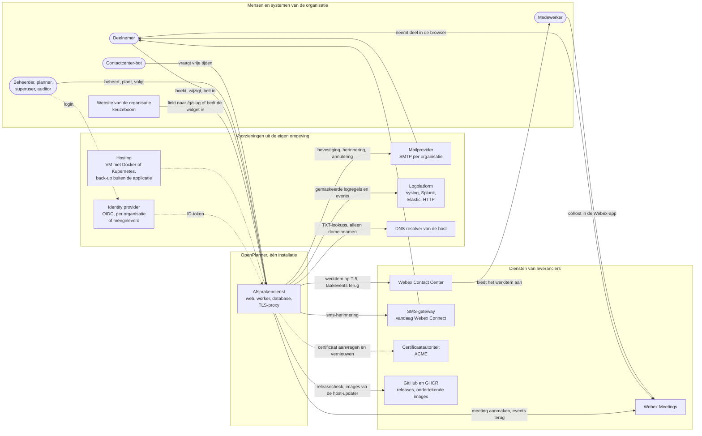
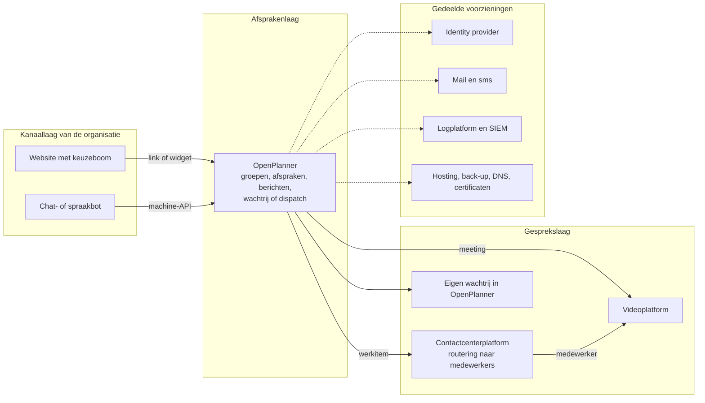
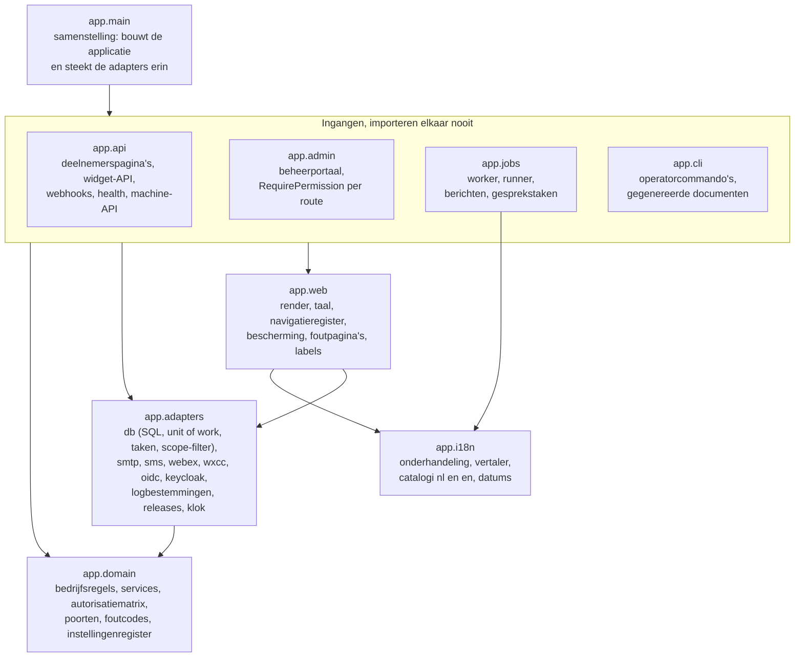
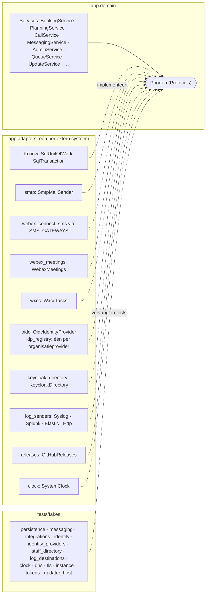
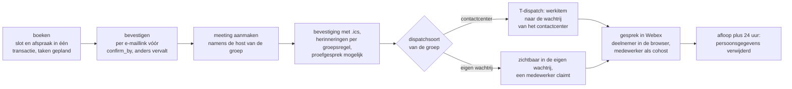
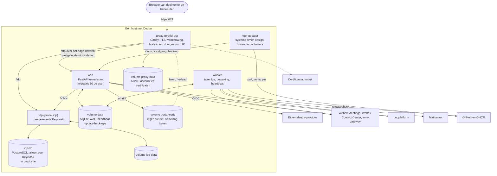
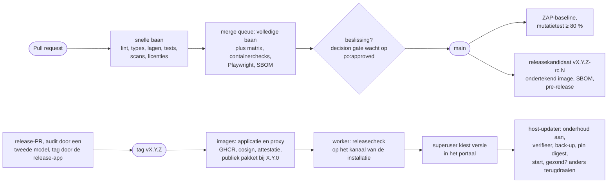
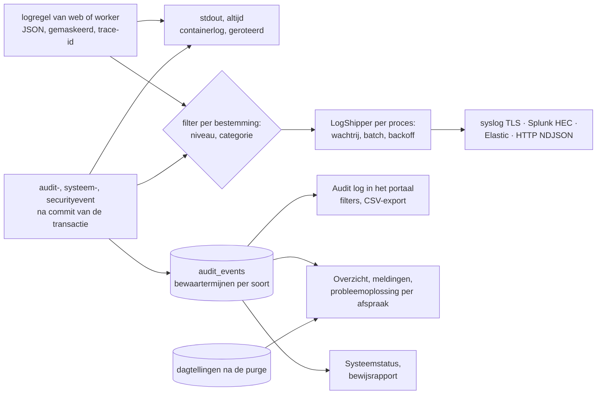

# Applicatiearchitectuur OpenPlanner

| | |
|---|---|
| Betreft | OpenPlanner 0.4.0 (tag `v0.4.0`, uitgebracht op 4 november 2026) |
| Stand | Concept 1a van 5 november 2026, beschreven tegen de code van `v0.4.0` en `docs/adr-status.md` (gecontroleerd tegen de code op 3 november 2026). Besluiten van na de release staan in 10.2 en 13.1 |
| Taal | Nederlands, als stakeholderdocument naast `docs/HANDOVER.md`. Code, ADR's en de overige documentatie zijn Engels |
| Lezers | Architecten en ontwikkelaars van een organisatie die OpenPlanner in haar landschap inpast, beheerders, en het productteam |
| Bron van waarheid | De code op `main`, de ADR's en `docs/adr-status.md`. Dit document beschrijft en verwijst; het beslist niets |
| Raamwerk | arc42 voor de indeling, het C4-model voor de diagramniveaus, ISO/IEC/IEEE 42010 voor belanghebbenden en hun zorgen, ADR's voor besluiten (zie 1.3) |

## Leeswijzer

Dit document beschrijft OpenPlanner op het niveau van de applicatiearchitectuur. Het zegt wat de
applicatie doet, hoe zij is opgebouwd, welke keuzes daaronder liggen, welke maatregelen erin
zitten en hoe zij in een groter landschap past. Het is geen codereview en geen handleiding; voor
die diepte verwijst elk hoofdstuk naar de plek in de repository waar het detail staat.

Wie weinig tijd heeft, leest de managementsamenvatting en de hoofdstukken 3 (context), 8.1 tot en
met 8.3 (uitbreiden met adapters) en 13 (inpassing). Een ontwikkelaar begint bij hoofdstuk 5
(bouwblokken) en 6 (ketens). Een securityofficer leest 9 (controls) en 8.5 tot en met 8.7. Een
architect die de applicatie in een landschap plaatst, leest 3.5 en 13.

Afkortingen staan in hoofdstuk 14. De voornaamste worden bij het eerste gebruik in een hoofdstuk
voluit geschreven, zodat elk hoofdstuk op zichzelf leesbaar is.

## Managementsamenvatting

OpenPlanner is een open-source boekingsplatform voor videoafspraken, uitgebracht onder de
EUPL-1.2. Een organisatie biedt per team (in OpenPlanner een *groep*) vrije tijden aan op een
eigen pagina of in een inbedbare widget. Een deelnemer kiest een tijd, bevestigt per e-mail,
ontvangt een agenda-uitnodiging en neemt deel vanuit de browser, zonder account of app. Kort voor
de start landt het gesprek als werkitem in de wachtrij van het contactcenter van het team, of in
de eigen wachtrij van OpenPlanner. Vierentwintig uur na afloop zijn de persoonsgegevens van de
afspraak verwijderd.

De applicatie is bewust licht: één installatie bestaat uit een webproces, een workerproces en één
SQLite-database, met een meegeleverde TLS-proxy en optioneel een meegeleverde identity provider.
Eén installatie bedient meer organisaties, elk met eigen groepen, huisstijl, teksten en
beheerders. De bedrijfsregels staan in een framework-vrije domeinlaag achter *poorten*; elk
extern systeem (video, contactcenter, mail, sms, identity provider, logplatform, releases) zit
achter een eigen *adapter*. Een nieuw kanaal, een nieuwe sms-gateway of een nieuwe logbestemming
is daardoor een nieuwe soort, een adapter en een registratie, zonder wijziging van de
domeinservices.

De architectuur van 0.4.0 is vastgelegd in 115 genummerde besluiten (ADR's) met per besluit een
bouwstatus die tegen de code wordt gecontroleerd. Daarna kwam ADR 0116 over de release- en
updatemodellen. Beveiliging en privacy zijn ontwerpuitgangspunten. Eén autorisatiematrix bepaalt
alle rechten. Persoonsgegevens staan alleen op de afspraak en komen niet in logs, taken,
foutmeldingen of berichten naar het contactcenter. Een CI-pijplijn die niet te omzeilen is,
bewaakt elke wijziging. Wat de applicatie zelf niet kan aantonen (identity provider, hosting,
leverancier van video en contactcenter, verwerkingsverantwoordelijke) staat als checklist in
`docs/assurance/`.

Voor inpassing in een landschap levert een omgeving vijf dingen. Dat zijn een website met
keuzeboom die naar de groepspagina linkt, een identity provider voor beheerders, een
mailprovider, een contactcenter of de eigen wachtrij, en hosting met logplatform en back-up.
Hoofdstuk 13 zet de vragen op een rij die de omgeving moet beantwoorden voordat de inpassing kan
worden ontworpen. De voornaamste open punten zijn de eigenaar van hosting en back-up (O7), wie de
pentest en het toegankelijkheidsonderzoek uitvoert (O10) en de niet gebouwde
leveranciersneutraliteit van het contactcenterkoppelvlak (ADR 0032).

## 1. Inleiding en doelen

### 1.1 Waarom dit document

De repository bevat veel architectuurdocumentatie, maar verspreid en in het Engels. Er zijn een
technisch architectuurdocument met diagrammen, 115 ADR's, een gegevensstroomdocument, een
dreigingsmodel, gegenereerde overzichten van rechten, instellingen en beheerschermen, en drie
platen met een bouwblokregister. Wat ontbrak is één Nederlandse beschrijving voor een
ontwikkelaar of architect van buiten het productteam. Die moet in één keer laten zien wat de
applicatie doet, hoe de modulariteit is opgebouwd, welke maatregelen erin zitten en waar de
applicatie ophoudt en het landschap begint. Dit document vult dat gat en wijst voor elk onderwerp
naar de primaire plek.

### 1.2 Belanghebbenden en hun vragen

| Belanghebbende | Vraag aan de architectuur | Waar het antwoord staat |
|---|---|---|
| Enterprise- of solution-architect van een organisatie | Waar past de applicatie in ons landschap, wat moeten wij leveren, welke standaarden volgt zij? | 3, 7, 9, 13 |
| Ontwikkelaar die aansluit | Hoe zit de code in elkaar, waar voeg ik iets toe zonder iets te breken? | 5, 6, 8, 11 |
| Securityofficer, privacyofficer | Welke maatregelen zitten erin, welke gegevens gaan waarheen, wat moet mijn organisatie zelf aantonen? | 8.5 tot en met 8.7, 9 |
| Beheerder (host, platform) | Wat draait er, hoe wordt het geleverd en bijgewerkt, wat bewaak ik? | 7 |
| Contactcenterbeheer | Hoe komt een gesprek bij een medewerker, en wat moet in het contactcenter worden ingericht? | 3.3, 6.2, 13.3 |
| Productowner | Welke besluiten staan, wat is gebouwd, wat is open? | 10, 12, 13 |

### 1.3 Raamwerk en notatie

- **arc42** (versie 8, open sjabloon van Starke en Hruschka) bepaalt de hoofdstukindeling:
  doelen, randvoorwaarden, context, oplossingsstrategie, bouwblokken, gedrag, deployment,
  concepten, besluiten, kwaliteit, risico's, begrippen. Het is een veelgebruikte open indeling
  voor software-architectuurdocumentatie en legt geen methode of notatie op.
- **C4-model** (Simon Brown) bepaalt de diagramniveaus: systeemcontext (C1), containers (C2),
  componenten (C3). Code-niveau (C4) hoort niet in dit document.
- **Mermaid** is de notatie van de diagrammen, zoals in `docs/architecture.md`; GitHub rendert ze
  zonder hulpmiddel. De drie platen in `docs/diagrams/` (draw.io, PDF, Word, PNG) zijn de
  deelbare vorm voor presentaties en worden uit `scripts/diagrams/content.py` gegenereerd.
- **ISO/IEC/IEEE 42010** levert de denkwijze van belanghebbenden, zorgen en gezichtspunten (1.2
  en de hoofdstukkeuze); arc42 is daarmee verenigbaar.
- **ADR's** (architecture decision records, ADR 0001) zijn de enige vorm waarin een besluit wordt
  vastgelegd. Dit document herhaalt geen besluit; het verwijst op nummer.

### 1.4 Documentkaart

Elk onderwerp heeft één primaire plek. Dit document is de ingang en de samenhang; het detail
staat waar de tabel het noemt. Wie iets wijzigt, wijzigt de primaire plek en past hier alleen de
verwijzing of de consequentie aan.

| Laag | Document | Taal | Draagt |
|---|---|---|---|
| Werkafspraken | `CLAUDE.md`, `CONTRIBUTING.md` | en | Hoe er gewerkt wordt: stack, regels, poorten in CI, reviewvragen |
| Stakeholderontwerp | `docs/HANDOVER.md` | nl | Het oorspronkelijke ontwerp, domeinmodel, werkpakketten, open punten O1 tot en met O14 |
| Applicatiearchitectuur | dit document | nl | Samenhang, positionering, uitbreidpunten, controls, vragen aan de omgeving |
| Technische architectuur | `docs/architecture.md` | en | Diagrammen per laag, sequentiediagrammen, toestandsdiagrammen, modulekaart |
| Platen | `docs/diagrams/`, `scripts/diagrams/content.py` | nl | Bouwblokken B1 tot en met B17, componenten per laag, integraties |
| Besluiten | `docs/adr/`, `docs/adr-status.md` | en | Elk besluit met context, keuze, instellingen, gevolgen en bouwstatus |
| Onderzoek | `docs/research/` | en | Onderbouwing van grotere keuzes, zoals de release- en updatemodellen van ADR 0116 |
| Gegevens en privacy | `docs/dataflow.md` | en | Elke gegevensstroom en uitgaande verbinding; invoer voor de DPIA |
| Dreigingen | `docs/threat-model.md` | en | STRIDE per keten, misbruikgevallen met test |
| Gegenereerd uit de code | `docs/authorization.md`, `docs/settings.md`, `docs/admin-map.md`, `docs/logging.md`, `docs/api.md` | en | Rechtenmatrix, instellingen, beheerstructuur, logacties, API; CI faalt als zij afwijken |
| Beveiligingsdossier | `docs/asvs.md`, `docs/cryptography.md`, `docs/authentication.md`, `docs/assurance/` | en | Maatregel per auditeis, sleutels en algoritmen, authenticatiepaden, checklists voor derden |
| Beheer | `docs/install.md`, `docs/kubernetes.md`, `docs/runbook.md`, `docs/try-it.md` | en | Installeren, draaien, herstellen, roteren |
| Handleiding | `docs/manual/{nl,en}/` | nl, en | Eén onderwerp per beheerscherm, ook in het portaal getoond |
| Koppelen | `docs/widget.md`, `docs/agent-api.md`, `docs/webhooks.md` | en | Widget op een website, machine-API voor bots, webhooks van Webex en het contactcenter |

### 1.5 Visie, herkomst en businesscontext

OpenPlanner is ontstaan uit één behoefte: mensen en bedrijven die een organisatie willen spreken
een videobelkanaal bieden op Webex Meetings, aansluitend op het contactcenter dat de gesprekken
al voert. Het platform dat daaruit groeide is in de kern een plannings- en boekingsdienst. Het
videogesprek is één van de uitkomsten van een afspraak. De eigenlijke dienst bestaat uit de keuze
van het kanaal, de capaciteit per tijdvak, het bevestigen en herinneren, het verdelen over
medewerkers en het opruimen van gegevens.

Drie uitgangspunten sturen elk besluit:

1. **De deelnemer hoeft niets te installeren en niets te onthouden.** Boeken, wijzigen en
   deelnemen gebeuren in de browser met een link uit de e-mail; er is geen account.
2. **De organisatie houdt haar eigen keuzes.** Website en keuzeboom, identity provider,
   mailprovider, contactcenter en huisstijl blijven van de organisatie; OpenPlanner is het
   eindstation per URL en geen routeringslaag (HANDOVER B14).
3. **Privacy en beveiliging zijn ontwerpregels, geen laag erbovenop.** Persoonsgegevens staan op
   één plek en zijn na afloop weg; rechten komen uit één matrix; elke release gaat door dezelfde
   controles.

De eerste afnemer is een contactcenter. De repository is sinds ADR 0115 neutraal: geen namen van
afnemers en geen sectorwoorden, zodat het product voor elke organisatie bruikbaar is.

## 2. Scope, kaders en kwaliteitsdoelen

### 2.1 Wat de applicatie doet

| Functie | Voor wie | Bouwblok |
|---|---|---|
| Vrije tijden tonen en een afspraak boeken op `/g/{slug}`, met maandkalender en een kort formulier | deelnemer | B1, B4, B5 |
| Dezelfde boekflow als Web Component op een website van de organisatie | deelnemer, websitebeheerder | B2 |
| Bevestigen per e-maillink, wijzigen en annuleren met een persoonlijke beheerlink | deelnemer | B1, B5, B6 |
| Bevestiging, wijziging, herinnering en annulering per e-mail (met `.ics`) en sms | deelnemer | B6 |
| Per afspraak een Webex-meeting; een proefgesprek vooraf; deelnemen uit de browser | deelnemer, medewerker | B7 |
| Het gesprek kort voor de start als werkitem naar de contactcenterwachtrij van het team, of naar de eigen wachtrij waar medewerkers het oppakken | medewerker, contactcenter | B7 |
| "Nu bellen" wanneer het team open is, met een plafond en zicht op de wachtrij | deelnemer | B3 |
| Groepen, bezetting, uitzonderingen, feestdagen, teksten, herinneringen, formuliervelden, huisstijl en inbedding beheren | beheerder | B9 |
| Agenda per groep met tekorten, planner die verzet, annuleert of laat herboeken | planner | B9 |
| Noodsluiting van een team of organisatie met scenario's en alternatieve contactopties | beheerder | B4, B9 |
| Live overzicht met meldingen, audit log, retentie-overzicht, probleemoplossing per afspraak | beheerder, auditor | B9, B10 |
| Vrije tijden opvragen door een contactcenter-bot via een machine-API | bot | B11 |
| Medewerkers en rollen beheren in de meegeleverde identity provider; per organisatie een eigen identity provider | superuser, organisatiebeheerder | B17 |
| Logbestemmingen (syslog, Splunk, Elastic, HTTP), updates vanuit het portaal, onderhoudsmodus, configuratiepakket | superuser | B16, platform |

### 2.2 Wat buiten de applicatie valt

- **De keuzeboom.** De website van de organisatie beslist welke groep de deelnemer nodig heeft en
  linkt naar de groepspagina. OpenPlanner routeert niet.
- **Het roosteren van medewerkers.** Bezetting is een aantal medewerkers per tijdblok; welke
  medewerker het gesprek krijgt, bepaalt de wachtrij van het contactcenter of de eigen wachtrij
  op het moment zelf (HANDOVER B5). Beschikbaarheid uit persoonlijke agenda's is een idee (O12),
  geen functie.
- **Het videogesprek zelf.** Webex Meetings voert het gesprek; OpenPlanner maakt de meeting en
  volgt de gebeurtenissen.
- **Authenticatie van beheerders.** Wachtwoorden, tweede factor en accountbeheer liggen bij de
  identity provider; OpenPlanner controleert tokens en leest het bewijs van de tweede factor.
- **Gespreksinhoud, opnames, transcripties.** Niets daarvan bereikt OpenPlanner.
- **Rapportage over gesprekken.** Het contactcenter rapporteert over gesprekken; OpenPlanner
  rapporteert over afspraken (8.7).
- **De publieke website openplanner.nl.** Statisch, gebouwd uit `site/`, los van de applicatie
  (ADR 0087, 0113).

### 2.3 Kwaliteitsdoelen

De vijf doelen in volgorde van voorrang, overgenomen uit `docs/architecture.md` §2. Bij een
conflict wint het hogere doel.

| Prioriteit | Doel | Wat het in het ontwerp betekent |
|---|---|---|
| 1 | Privacy | Persoonsgegevens alleen op de afspraak, verwijderd op afloop plus 24 uur; nooit in logs, URL's, taken, foutmeldingen of uitgaande contactcenterberichten |
| 2 | Beveiliging | Standaard dicht, één autorisatiepunt, verplichte CI-poorten, externe pentest |
| 3 | Toegankelijkheid | WCAG 2.2 AA; werkt zonder JavaScript en zonder muis; axe en Lighthouse in CI |
| 4 | Onderhoudbaarheid | Zuiver domein achter poorten, afgedwongen lagen, docstrings op alles, geen kopieerwerk |
| 5 | Eenvoud | Twee containers, SQLite, geen message broker; ontworpen op ongeveer 80 boekingen per werkdag |

### 2.4 Normkader

Normen en standaarden die de applicatie volgt, en waar dat wordt getoetst. Elke norm wordt exact
aangehaald; eigen regels staan in `CLAUDE.md` en de ADR's en lenen geen gezag van een norm.

| Norm of standaard | Uitgever, versie | Toepassing | Toetsing |
|---|---|---|---|
| WCAG 2.2 niveau AA | W3C, 2023 | Deelnemerspagina's, widget, beheerportaal, e-mails | axe-core (nul schendingen), Lighthouse toegankelijkheid ≥ 95, toetsenbordtest in CI; handmatige test met schermlezers vóór livegang (open, O10) |
| OWASP ASVS 5.0.0, niveau 2 | OWASP, 2025 | Audit van 1 november 2026; per niet volledig aanvaarde eis de maatregel in `docs/asvs.md` | `tests/test_asvs_doc.py` controleert dat elke rij een bestaande bron noemt |
| OpenID Connect Core, OAuth 2.0 (RFC 6749), PKCE (RFC 7636), RFC 9207 | OpenID Foundation, IETF | Beheerderslogin, machine-API | Adapter `app/adapters/oidc.py`, `app/api/agent/`, tests |
| Elastic Common Schema en het OpenTelemetry-logdatamodel | Elastic, CNCF | Eventschema `openplanner.event/3` van audit- en logregels | `app/domain/event_schema.py`, `docs/audit-events.md` |
| iCalendar (RFC 5545, 5546) | IETF | Agenda-uitnodigingen | `app/jobs/calendar.py` |
| E.164 | ITU-T | Opslag van telefoonnummers | `phonenumbers`, ADR 0055 |
| CycloneDX, Sigstore cosign | OWASP, OpenSSF | SBOM per image, sleutelloze ondertekening | CI, host-updater verifieert |
| EUPL-1.2, REUSE | Europese Commissie, FSFE | Licentie van elk bestand | `reuse lint` in CI, ADR 0054 |
| NL Design System (tokens) | NL Design System | Standaardwaarden van de widget- en paginastijl | `--booking-*`-tokens, ADR 0020, 0041 |
| publiccode.yml | Developers Italia | Metadata van het open-sourceproduct | validatie in CI |

De TLS-, HSTS- en DNS-aanbevelingen waartegen het publieke adres wordt beoordeeld, staan met bron
in ADR 0086 (standaardentabel) en `docs/runbook.md`.

### 2.5 Technische randvoorwaarden

| Randvoorwaarde | Inhoud | Bron |
|---|---|---|
| Stack | Python 3.12, FastAPI, SQLAlchemy 2 (async), Alembic, Pydantic v2, Jinja2, httpx, structlog; widget in vanilla JavaScript, gebundeld met esbuild | `CLAUDE.md`, HANDOVER B2 |
| Database | SQLite in WAL-modus op één volume; Postgres is geen doel (besluit 2026-10-23); een stap verder vraagt een eigen ADR | ADR 0002, 0036 |
| Vorm | Eén image met twee rollen (`web`, `worker`), één `docker-compose.yml` voor ontwikkeling en productie, een Helm-chart als proef | ADR 0002, 0114 |
| Geen extra infrastructuur | Geen Celery, Redis, APScheduler, message broker of frontend-framework | `CLAUDE.md` |
| Deelnemers loggen nooit in | Rechten van deelnemers komen uit de beheerlink en de wijzigingstermijn | ADR 0011, 0093 |
| Geen externe aanroepen vanuit deelnemerspagina's | Geen CAPTCHA-puzzel, geen scripts of lettertypen van derden; een browsertest bewaakt het | HANDOVER B11, `e2e/tests/no-third-parties.spec.ts` |
| Hosting in de EU | Eis aan de host; de applicatie dwingt het niet af | HANDOVER §8 |
| Afhankelijkheden | Alleen actief onderhouden de-factostandaarden met een licentie uit MIT, BSD, Apache-2.0, PSF; uitzonderingen per ADR | `docs/dependencies.md`, ADR 0003, 0073 |
| Neutraal | Geen namen van afnemers en geen sectorwoorden in de repository; een test faalt erop | ADR 0115 |

### 2.6 Aannames

Uitspraken in dit document die niet uit de code volgen, staan hier als aanname. Een aanname die
onjuist blijkt, verandert het hoofdstuk dat haar gebruikt.

| ID | Aanname | Gebruikt in | Bevestigen door |
|---|---|---|---|
| A-1 | Het volume blijft in de orde van 80 boekingen per werkdag met pieken van 20 per minuut, zoals het ontwerp aannam | 2.3, 7, 12 | de organisatie die inpast |
| A-2 | Eén installatie bedient één verwerkingsverantwoordelijke; organisaties binnen die installatie delen de superuser, de database en de sleutels | 3.5, 9 | privacyofficer (DPIA) |
| A-3 | De organisatie beschikt over een OIDC-identity provider, of aanvaardt de meegeleverde Keycloak | 3.3, 8.5 | identity-beheer (O3) |
| A-4 | Het contactcenter is Webex Contact Center, of het team gebruikt de eigen wachtrij; een ander platform vraagt de bouw van ADR 0032 | 3.3, 6.2, 12 | contactcenterbeheer |
| A-5 | De host levert versleutelde opslag, back-up en herstel buiten de applicatie om (O7) | 7, 9.3 | hostingpartij |

## 3. Context, koppelvlakken en demarcatie

### 3.1 Actoren

| Actor (nl / en) | Wie | Wat zij doet | Logt in? |
|---|---|---|---|
| Deelnemer / participant | Iemand die een afspraak wil met een team van de organisatie | Boekt, bevestigt, wijzigt, annuleert, doet een proefgesprek, neemt deel | Nee, met de link uit de e-mail |
| Medewerker / agent | De persoon die het gesprek voert | Krijgt het werkitem via het contactcenter of pakt het op in de eigen wachtrij; is cohost in Webex | Alleen voor de eigen wachtrij (rol *agent*) |
| Planner | Een beheerder met het recht `bookings.manage` | Verzet, annuleert en laat herboeken vanuit de agenda | Ja |
| Groepsbeheerder, organisatiebeheerder, superuser | Beheerders met oplopend bereik | Beheren groepen, organisaties, platform; de superuser beheert integraties, updates, logbestemmingen | Ja, via OIDC |
| Compliance en privacy (auditor) | Een lezende rol | Leest audit log, retentie en instellingen, ziet nooit persoonsgegevens | Ja |
| Website van de organisatie | De keuzeboom | Linkt naar `/g/{slug}` of bedt de widget in | n.v.t. |
| Contactcenter-bot | Bijvoorbeeld de AI-agent van het contactcenter | Vraagt vrije tijden op via de machine-API | Ja, als API-client met client credentials |
| Host, host-updater | Het beheerteam van de server | Installeert, bewaakt, werkt bij op verzoek uit het portaal | Niet in het portaal; via de command line op de host |

### 3.2 Systeemcontext

Het diagram zet OpenPlanner tussen drie groepen: de mensen en systemen van de organisatie, de
voorzieningen uit haar eigen omgeving, en de diensten van leveranciers. Elke pijl is een
koppelvlak uit 3.3.

### 3.3 Koppelvlakken per extern systeem

Per koppelvlak staat eerst de *capability* (wat de applicatie nodig heeft, leveranciersneutraal)
en dan de *realisatie* in 0.4.0. De kolom *poort* noemt het Protocol in `app/domain/ports.py`
waarachter de realisatie zit; de kolom *vervangbaar* zegt eerlijk hoe neutraal het koppelvlak
vandaag is.

| Capability | Realisatie 0.4.0 | Richting | Protocol | Wat erover gaat | Poort en adapter | Vervangbaar | ADR |
|---|---|---|---|---|---|---|---|
| E-mail versturen | SMTP-server van de organisatie; terugval op `SMTP_HOST` van de installatie | uit | SMTP met STARTTLS of TLS | Voornaam, e-mailadres, datum, team, beheerlink, `.ics` | `MessageSender`, `adapters/smtp.py` | Ja: elke SMTP-server | 0009, 0022 |
| Sms versturen | Webex Connect | uit | HTTPS | Telefoonnummer, voornaam, datum, tijd, team, beheerlink | `MessageSender`, `adapters/webex_connect_sms.py`, registry `SMS_GATEWAYS` | Ja: nieuwe gateway is één adapter | 0022, 0028 |
| Videomeeting aanmaken en volgen | Webex Meetings API via een Service App, namens de host van de groep | uit, in (webhooks) | HTTPS, webhooks met HMAC-SHA1 en replay-sleutel | Groepsnaam en tijden; terug: meeting-id, deelnamelink, gebeurtenissen | `VideoProvider`, `adapters/webex_meetings.py` | Beperkt: poort bestaat, contract is Webex-vormig; tweede platform vraagt een eigen ADR | 0017, 0010 |
| Gesprek bij een medewerker brengen | Webex Contact Center, Create Task API v2, taakevents via subscription | uit, in | HTTPS, webhooks met HMAC-SHA256 binnen 300 s | Referentie, voornaam, startlabel, groepsnaam, hostlink, soort en de routeringswaarde van de groep | `ContactCenterDispatcher`, `adapters/wxcc.py` | Beperkt: ontwerp voor neutraliteit in ADR 0032, niet gebouwd | 0018, 0021, 0032 |
| Eigen wachtrij | OpenPlanner zelf: medewerkers claimen afspraken in het portaal | intern | n.v.t. | Afspraken binnen de zichttermijn, pseudoniem van wie claimt | `DispatchKind.OPENPLANNER_QUEUE`, `domain/own_queue.py` | n.v.t. | 0043 |
| Beheerders authenticeren | OIDC-provider van het platform en per organisatie een eigen provider, gekozen op e-maildomein; meegeleverde Keycloak voor test en lab | in | OIDC code flow met PKCE, `private_key_jwt` of client secret | Claims: identiteit, e-mail, entitlements (rol en bereik), bewijs van tweede factor | `IdentityProvider`, `adapters/oidc.py`, `adapters/idp_registry.py` | Ja: elke OIDC-provider met asymmetrische handtekening | 0013, 0083, 0097, 0100 |
| Medewerkers beheren in de provider | Admin REST API van de meegeleverde Keycloak | uit | HTTPS | Naam, gebruikersnaam, rollen | `StaffDirectory`, `adapters/keycloak_directory.py` | Beperkt: alleen Keycloak; SCIM 2.0 is ontworpen (ADR 0046), niet gebouwd | 0095, 0046 |
| Logregels en events afleveren | syslog (TLS, TCP, UDP), Splunk HEC, Elastic `_bulk`, HTTP NDJSON | uit | per soort | Gemaskeerde regels en audit-, systeem- en securityevents | `LogDestinationSender`, `adapters/log_senders.py` | Ja: nieuwe bestemming is één sender | 0034, 0085 |
| Releases opzoeken en images ophalen | GitHub releases API; GHCR via de host-updater met cosign | uit | HTTPS | Versienummers; images en handtekeningen | `ReleaseSource`, `adapters/releases.py`; `scripts/updater/` | Beperkt: GitHub-vormig | 0029, 0059, 0067 |
| Certificaat verkrijgen | ACME (Let's Encrypt) door de meegeleverde Caddy-proxy; eigen certificaat; interne CA voor een lab | uit | ACME HTTP-01 | Domeinnaam, e-mailadres van de beheerder | buiten de applicatie, `deploy/proxy/` | Ja: eigen proxy of load balancer | 0030, 0064, 0070, 0112 |
| DNS raadplegen | Resolver van de host | uit | DNS | Domeinnamen (SPF, DKIM, DMARC, domeinclaims) | `MailDomainResolver`, `adapters/mail_dns.py` | Ja | 0073, 0083 |
| Vrije tijden leveren aan een bot | Machine-API `/api/agent/v1` | in | OAuth 2.0 client credentials, opake tokens van 10 minuten | Groepen en vrije tijden; geen persoonsgegevens | geen poort: een ingang, `app/api/agent/` | n.v.t. | 0023 |
| Widget op een website | `<openplanner-booking>` en de widget-API | in | HTTPS met CORS voor toegestane origins | Beschikbaarheid en boeking | geen poort: een ingang, `app/api/widget_api.py` | n.v.t. | 0035 |

De volledige lijst van uitgaande verbindingen, met versleuteling, wie de bestemming instelt en of
de uitgaande bewaker (`app/adapters/outbound.py`) eroverheen gaat, staat in `docs/dataflow.md`
(*Outbound connections and the hop to web*). Een PR die een verbinding toevoegt, voegt daar een
rij toe.

### 3.4 Demarcatie: wie is waarvoor verantwoordelijk

| Onderwerp | OpenPlanner | De organisatie en haar omgeving |
|---|---|---|
| Keuze van de groep | Toont de pagina van de groep in de URL | Keuzeboom op de website; beheer van de slugs |
| Identiteit van beheerders | Controleert tokens, leidt rechten af uit claims, legt sessies en beslissingen vast | Accounts, wachtwoorden, tweede factor, rolclaims of entitlements, uitdiensttreding |
| Identiteit van deelnemers | Een link per afspraak, ingewisseld voor een cookie | Geen |
| E-mail | Stelt berichten samen, verstuurt via de SMTP-server van de organisatie, controleert SPF, DKIM en DMARC van het afzenderdomein | Mailserver, afzenderdomein, DNS-records |
| Contactcenter | Maakt het werkitem met routeringsvariabelen en volgt taakevents | Flow in het contactcenter die op de groep routeert, wachtrijen, medewerkers, licenties (O6) |
| Video | Maakt en verwijdert meetings, volgt gebeurtenissen, biedt het proefgesprek | Webex-site, hostaccounts per groep, meetingbeleid (ADR 0045, niet gebouwd) |
| Hosting | Image, compose-bestand, installer, host-updater, healthchecks | Server of cluster, versleutelde opslag, back-up en herstel, netwerk, DNS (O7) |
| Logging | Schrijft gemaskeerde JSON-regels en events, levert aan logbestemmingen | Logplatform, bewaartermijnen, SIEM-regels, wie meekijkt |
| Beveiligingstoetsing | Dreigingsmodel, misbruiktests, ASVS-dossier, scans in CI | Pentest, toegankelijkheidsonderzoek, DPIA, verwerkersovereenkomsten (O7, O10) |
| Updates | Signaleert nieuwe versies, voert updates uit met back-up en terugdraaien op een host | Goedkeuring en moment (superuser), of `helm upgrade` op Kubernetes |

### 3.5 Positionering in een groter geheel

OpenPlanner is in een landschap een **afsprakendienst tussen het kanaal en het contactcenter**.
Zij staat na de keuzeboom van de website en vóór de routering van het contactcenter, en gebruikt
onderweg de gedeelde voorzieningen van de organisatie. Het volgende beeld plaatst de applicatie
in zo'n landschap; de namen van de gedeelde voorzieningen zijn de capabilities uit 3.3, niet
producten.

Drie eigenschappen bepalen hoe de applicatie in zo'n geheel past:

- **Meerdere organisaties, één verwerkingsverantwoordelijke.** Eén installatie bedient meer
  organisaties met eigen groepen, huisstijl, teksten, kanalen, identity provider en beheerders.
  De scheiding tussen organisaties is applicatielogica (de scope in elke query), niet fysiek:
  superuser, database, bootstrapsleutels, Webex Service App en de SMTP-terugval zijn gedeeld. Een
  tweede verwerkingsverantwoordelijke krijgt een eigen installatie (`docs/threat-model.md`,
  *Shared trust boundaries*).
- **Gesloten naar buiten, open naar de eigen omgeving.** Deelnemerspagina's roepen geen derden
  aan. Alles wat de installatie verlaat, staat in één tabel in `docs/dataflow.md`. Elke
  verbinding met persoonsgegevens is versleuteld of een vastgelegde uitzondering (ADR 0091). De
  adressen van identity providers die een beheerder registreert, gaan door een uitgaande bewaker;
  andere bestemmingen stelt alleen de superuser of de host in.
- **Kleine, zelfstandige voetafdruk.** Twee processen en één bestand als database; geen
  afhankelijkheid van een message broker, cache of databaseserver. De prijs is dat de installatie
  op één host draait en niet horizontaal schaalt (ADR 0036, hoofdstuk 12).
- **Drie exploitatievormen.** Na 0.4.0 legt ADR 0116 drie vormen vast. Privé: in het datacenter
  van een klant, mogelijk zonder internet. Toegewijd: één installatie per klant, gehost door de
  leverancier. Mogelijk gedeeld: één installatie met meer klanten als organisaties. Alle drie
  draaien dezelfde ondertekende images; wat verschilt is wie bijwerkt, binnen welk venster, en
  wie de back-up draagt. Het gedeelde model raakt de regel over één verwerkingsverantwoordelijke
  hierboven (R-13).

Wat de omgeving aan OpenPlanner levert en wat zij terugkrijgt, staat als vragenlijst in 13.3.

## 4. Oplossingsstrategie

De tien keuzes die de vorm van de applicatie bepalen, elk met het besluit erachter.

| # | Vraagstuk | Keuze | Besluit |
|---|---|---|---|
| 1 | Hoe klein kan de infrastructuur zijn? | Eén host, twee processen, SQLite in WAL-modus met een schrijfslot; meer workers mogen, meer hosts niet zonder nieuw besluit | ADR 0002, 0036 |
| 2 | Hoe blijft de code begrijpelijk als zij grotendeels met AI-ondersteuning wordt geschreven? | Zuiver domein zonder framework, lagen afgedwongen door import-linter, docstring op elke module, kopieerdetectie, mutatietests | ADR 0005 |
| 3 | Hoe worden externe systemen vervangbaar? | Elk extern systeem achter een Protocol (poort) met één adapter per systeem; soorten (kanaal, provider, bestemming) als data in het domein; fakes in de tests | ADR 0005, 0009, 0028, 0085 |
| 4 | Waar komen rechten vandaan? | Eén matrix rol × permissie × niveau; elke beheerroute één permissie; elke query gefilterd op de scope; elke beslissing vastgelegd | ADR 0014, 0039, 0049 |
| 5 | Hoe blijven persoonsgegevens beperkt? | Alleen op de afspraak; verwijderd op afloop plus 24 uur door een taak met vangnet; nooit in logs, taken, URL's of contactcenterberichten; lijsten zonder persoonsgegevens | ADR 0011, 0063, 0102 |
| 6 | Hoe werkt de interface zonder afhankelijkheden? | Server-rendered HTML dat zonder JavaScript en zonder muis werkt; kleine gedeelde scripts voor live delen; de widget als Web Component in Shadow DOM | ADR 0016, 0020, 0035, 0072 |
| 7 | Wie kan wat instellen? | Vier klassen: bootstrap en deployment in de omgeving, platform en organisatie in het portaal met vergrendeling vanuit de omgeving; een beveiliging gaat nooit uit via het portaal | ADR 0042 |
| 8 | Hoe wordt tijdgebonden werk betrouwbaar? | Een eigen takentabel, gevuld in dezelfde transactie als de afspraak; een worker claimt onder het schrijfslot; een taak met vastgepinde starttijd doet niets als de afspraak intussen veranderde | HANDOVER B3, ADR 0002 |
| 9 | Hoe komt een release veilig op een host? | Ondertekende images met SBOM, releasekandidaat per merge, versiebeheer in het portaal, host-updater met back-up en automatisch terugdraaien | ADR 0006, 0029, 0052, 0059, 0067 |
| 10 | Hoe blijven besluit en bouw bij elkaar? | ADR met bouwstatustabel, een status-overzicht dat tegen de code wordt gecontroleerd, een beslispoort die alleen de productowner opent, bewaking van de guardrails | ADR 0001, 0059, 0078, 0088, 0109 |

## 5. Bouwblokken

### 5.1 Niveau 1: zeventien bouwblokken in vier families

De platen in `docs/diagrams/` verdelen de applicatie in zeventien bouwblokken (B1 tot en met B17)
in vier families. Dit document gebruikt dezelfde nummers, zodat plaat, register en tekst naar
elkaar verwijzen. De kolom *stand* volgt `docs/adr-status.md` en is nieuwer dan de platen (stand
27 oktober 2026 op de platen): B2 is sindsdien gebouwd.

| Familie | Blok | Naam | Verantwoordelijkheid in één zin | Stand 0.4.0 |
|---|---|---|---|---|
| Deelnemerskanaal | B1 | Deelnemersportaal | Groepspagina met maandkalender, bevestigen, beheerpagina voor verzetten en annuleren, proefgesprek, deelnamepagina; zonder JavaScript en zonder muis | gebouwd |
| Deelnemerskanaal | B2 | Widget | Dezelfde boekflow als Web Component in Shadow DOM met `--booking-*`-tokens en `part`-attributen, op toegestane origins | gebouwd (ADR 0035) |
| Deelnemerskanaal | B3 | Direct videobellen | "Nu bellen" per bezettingsblok, plafond op open gesprekken, plek in de rij en gebruikelijke wachttijd | gebouwd; live status deels (ADR 0072) |
| Kern | B4 | Planning en beschikbaarheid | Bezettingsblokken met aantal medewerkers, uitzonderingen per datum, feestdagkalenders, noodsluiting; slotberekening in de tijdzone van de groep | gebouwd |
| Kern | B5 | Afspraken en tokens | Boeken, bevestigen, verzetten en annuleren in één transactie onder het schrijfslot; capaciteitssnapshot op het slot; beheertoken afgeleid van salt en serversleutel | gebouwd; bevestigen per e-mail deels (ADR 0056) |
| Kern | B6 | Berichten en herinneringen | Vaste lay-outs met bewerkbare tekstblokken, herinneringsregels per groep, e-mail met `.ics`, sms; afzenderdomeincontrole | gebouwd |
| Kern | B7 | Gespreksregie | Meeting namens de host van de groep, werkitem naar het contactcenter op T-dispatch of claim in de eigen wachtrij, ondertekende webhooks terug, tijdlijn en gespreksstatus per afspraak | gebouwd; neutraliteit niet (ADR 0032) |
| Kern | B8 | Privacy en retentie | `purge_pii` op afloop plus 24 uur met drie bewuste uitstelregels, dagelijkse veegronde, retentie-overzicht, dagtellingen na de purge | gebouwd |
| Beheer | B9 | Beheerportaal | Scope, object, tabblad uit één navigatieregister; organisaties, groepen, bezetting, teksten, kanalen, huisstijl, agenda, planner, wachtrij, overzicht met widgets, handleiding in het portaal | gebouwd; onderdelen deels (ADR 0033, 0047, 0096) |
| Beheer | B10 | Autorisatie en audit | Eén matrix, 46 permissies op drie niveaus, vijf vaste rollen en eigen rollen binnen grenzen, scope in elke query, audit van weigeringen, logins en wijzigingen, CSV-export | gebouwd |
| Beheer | B11 | Machine-API | `/api/agent/v1` voor contactcenter-bots: client credentials, opake tokens van tien minuten, scopes per client, standaard uit, geen persoonsgegevens | stap 1 gebouwd; wijzigen via bevestiging door de deelnemer niet (ADR 0023) |
| Beheer | B17 | Inlog | OIDC met PKCE, state en nonce, vastgepinde issuer, serversessies van acht uur, verse login voor wijzigingen, bewijs van tweede factor; een provider per organisatie gekozen op e-maildomein | gebouwd |
| Platform | B12 | Taakplanner | Takentabel gevuld in de boekingstransactie; worker claimt onder het schrijfslot; retry na 1, 5 en 15 minuten; `pinned_start` maakt taken idempotent; bewakingstaken per lus | gebouwd |
| Platform | B13 | Opslag | SQLite in WAL-modus op één volume, Alembic-migraties (alleen `web` migreert), secrets AES-256-GCM verzegeld en alleen-schrijven, sleutelrotatie zonder verlies | gebouwd |
| Platform | B14 | Taal en huisstijl | Nederlands standaard, Engels verplicht; taalkeuze via `?lang=`, cookie, browser, organisatie; teksten per organisatie en groep; huisstijl per organisatie via tokens met contrastcontrole | gebouwd |
| Platform | B15 | Rand en beveiliging | Caddy met automatisch vernieuwde certificaten of eigen certificaat, strikte responsheaders, CSRF via Fetch Metadata, rate limits, honeypot, uitgaande bewaker | gebouwd |
| Platform | B16 | Updates en levering | Ondertekende images met SBOM, releasekandidaten, versiekeuze in het portaal, host-updater met back-up en terugdraaien, configuratiepakket | gebouwd; onderdelen deels (ADR 0067, 0089, 0108) |
| Platform | (geen nummer) | Logging en health | JSON-regels in één eventschema, PII-masker, trace-id per verzoek en taak, logbestemmingen, `/healthz`, `/readyz`, heartbeat van de worker | gebouwd |

### 5.2 Niveau 2: lagen en pakketten

De code onder `app/` is in lagen verdeeld; import-linter dwingt de pijlen in CI af (ADR 0005).
Ingangen importeren elkaar nooit; het domein importeert geen framework en geen ander pakket; de
taalmodule staat los van alles.

| Laag | Pakket | Verantwoordelijkheid | Mag niet |
|---|---|---|---|
| Samenstelling | `app.main`, `app.jobs.worker` | Leest instellingen, bouwt adapters, steekt ze in services en routers; één plek voor web en worker (`app/adapters/integrations.py`) | Bedrijfsregels bevatten |
| Ingangen | `app.api`, `app.admin`, `app.jobs`, `app.cli` | HTTP-routes, taakuitvoering en commando's; vertalen invoer naar domeinaanroepen en foutcodes naar pagina's of JSON | Elkaar importeren; zelf over rechten beslissen; SQL schrijven |
| Web | `app.web` | Gedeelde HTML-plumbing: `render()`, taalkeuze, navigatieregister, bescherming (CSRF, rate limits), foutpagina's, labels | Routes definiëren |
| Adapters | `app.adapters` | Implementaties van de poorten; het enige pakket met SQL, HTTP-clients en cryptografie | Bedrijfsregels bevatten; persoonsgegevens loggen |
| Domein | `app.domain` | Entiteiten, regels, services (use cases), de autorisatiematrix, de poorten, foutcodes, het instellingenregister | FastAPI, SQLAlchemy, httpx, pydantic-settings of structlog importeren; gebruikerstekst bevatten |
| Taal | `app.i18n` | Taalonderhandeling, gettext-catalogi, vertaler met overschrijvingen, datum- en tijdnotatie | Iets uit de rest van `app/` importeren |

### 5.3 Niveau 3: modules per bouwblok

De tabel noemt per bouwblok de kern van de modules in elke laag; `docs/architecture.md` (*Module
map*) is de volledige lijst. Elke module heeft een docstring die haar verantwoordelijkheid stelt
(ADR 0005), zodat een documentatiegenerator de referentie kan maken.

| Blok | Domein (regels en services) | Adapters | Ingangen en web |
|---|---|---|---|
| B1 | `services` (boeken, vinden, annuleren, verzetten), `confirmation`, `participant_links`, `trial_call`, `form_fields` | `db/uow`, `db/participant_links`, `db/form_fields` | `api/booking_pages`, `api/slot_picker`, `api/participant`, `api/join_pages`, `api/trial_pages`, `api/link_session`, `web/static/calendar.js` |
| B2 | `embedding`, `embedding_service` | `web/widget_bundle` | `api/widget_api`, `api/widget_schemas`, `api/widget_script`, `widget/src/` |
| B3 | `direct_queue`, `direct_leave`, `queue_wait` | zie B7 | `api/direct_pages` |
| B4 | `scheduling`, `availability`, `planning`, `holidays`, `holiday_service`, `closure`, `closure_service`, `scenarios`, `contacts`, `agenda`, `rebooking` | `db/scenarios`, `db/images`, `db/contact_json` | `admin/group_routes`, `holiday_routes`, `closure_routes`, `scenario_routes`, `agenda_routes`, `planner_routes` |
| B5 | `booking`, `tokens`, `booking_changes`, `planner_service`, `lookups`, `errors` | `db/uow`, `db/engine` (schrijfslot) | `web/errors`, `web/error_pages` |
| B6 | `channels`, `channel_settings`, `channel_service`, `messaging_service`, `message_texts`, `mail_domain` | `smtp`, `sms`, `webex_connect_sms`, `senders`, `mail_dns`, `db/credentials` | `jobs/messages`, `jobs/calendar`, `admin/channel_routes`, `message_routes` |
| B7 | `calls`, `call_service`, `call_retry`, `integration`, `integration_check`, `checks`, `meeting_status_service`, `own_queue`, `queue_service`, `request_log`, `simulation` | `webex_auth`, `webex_meetings`, `wxcc`, `webhooks`, `webhook_registration`, `group_check`, `diagnostics`, `wxcc_config`, `db/probes`, `db/reports` | `jobs/calls`, `api/webhooks`, `admin/call_routes`, `queue_routes`, `check_routes`, `simulator_routes` |
| B8 | `privacy`, `job_plan` (purge), `retention`, `retention_sweep`, `closure_retention`, `booking_rollup`, `group_erase` | `db/retention`, `db/rollup` | `jobs/runner`, `admin/retention_routes` |
| B9 | `admin`, `organisations`, `branding`, `theme`, `text_overrides`, `organisation_text_service`, `form_service`, `alerts`, `tasks`, `evidence` | `db/text_overrides`, `db/images`, `settings_report` | `admin/pages`, `forms`, `organisation_routes`, `overview_routes`, `help_routes`, `web/navigation`, `web/help`, `admin/templates/` |
| B10 | `authorization`, `audit`, `audit_export`, `roles`, `entitlements`, `login_mapping`, `login_service`, `staff`, `diagnostics` | `db/scope`, `db/roles`, `db/staff`, `event_sink` | `admin/authz`, `audit_routes`, `role_routes`, `staff_routes`, `web/authz_report` |
| B11 | `api_clients`, `api_access` | `db/api_clients` | `api/agent/` (token, `RequireScope`, routes, docs), `admin/api_routes` |
| B17 | `identity`, `identity_providers`, `identity_provider_service`, `login_domains`, `login_domain_watch`, `admin_sessions`, `admin_session_service`, `mfa`, `staff_directory`, `user_names` | `oidc`, `idp_registry`, `discovery`, `outbound`, `signing_keys`, `keycloak_directory`, `db/identity_providers`, `db/admin_sessions` | `admin/routes` (login, callback), `admin/session`, `idp_routes`, `session_routes`, `staff_directory_routes` |
| B12 | `job_plan`, `tasks`, `system_log` | `db/jobs`, `heartbeat` | `jobs/worker`, `jobs/runner`, `jobs/housekeeping`, `jobs/healthcheck` |
| B13 | `configuration_package`, `configuration_service`, `key_rotation`, `storage` | `db/engine`, `db/models`, `db/base`, `db/types`, `crypto`, `db/credentials`, `db/sealed`, `db/backup`, `db/maintenance`, `db/configuration_package`, `migrations/` | `app/cli` (`init`, `rekey`) |
| B14 | `branding`, `theme`, `text_overrides`, `agent_term`, `role_names` | `db/text_overrides` | `app/i18n/`, `web/locale`, `web/branding`, `api/brand_assets`, `admin/branding_routes` |
| B15 | `proxy_watch`, `public_address`, `address_check`, `tls`, `tls_check`, `tls_source`, `own_certificate`, `web_transport`, `security_log`, `client_pseudonym` | `tls_probe`, `instance_probe`, `certificate_pem`, `certificate_volume`, `internal_ca`, `db/certificate`, `db/public_address`, `db/own_certificate` | `api/security_headers`, `web/protection`, `web/proxy_headers`, `api/instance`, `deploy/proxy/` |
| B16 | `updates`, `update_service`, `maintenance`, `maintenance_service`, `backup_age` | `releases`, `db/updates`, `db/maintenance_state`, `bootstrap` | `admin/update_routes`, `maintenance_routes`, `settings_routes`, `app/cli`, `scripts/updater/`, `scripts/install.sh` |
| Logging | `event_schema`, `event_context`, `log_events`, `log_destinations`, `log_destination_service`, `diagnostic_mode` | `event_sink`, `log_senders`, `log_shipping`, `http_trace`, `db/log_destinations` | `app/logging`, `api/trace`, `admin/logging_routes`, `web/logging_doc` |

### 5.4 Poorten en adapters

Elke poort is een `Protocol` in `app/domain/ports.py`. De domeinservices kennen alleen de poort;
`app/main.py` en `app/jobs/worker.py` steken de adapter erin. Tests vervangen elke adapter door
een fake. De gedeelde fakes staan in `tests/fakes/`, een paar staan in de test die ze gebruikt.
De in-memory unit of work heeft hetzelfde commit- en rollbackgedrag als de SQL-versie.

| Poort | Doel | Adapter in 0.4.0 | Fake |
|---|---|---|---|
| `Transaction`, `UnitOfWork` | Alles wat het domein leest en schrijft binnen één transactie; `locked()` neemt het schrijfslot | `db/uow.py` (SQLite, `BEGIN IMMEDIATE`) | `persistence` |
| `Clock` | De huidige tijd, injecteerbaar | `clock.py` | `clock` |
| `MessageSender`, `SenderDirectory` | Eén kanaal bezorgen; de afzender van een organisatiekanaal vinden | `smtp.py`, `webex_connect_sms.py`, `senders.py` | `messaging` |
| `VideoProvider` | Meetings aanmaken en verwijderen | `webex_meetings.py` | `integrations` |
| `ContactCenterDispatcher` | Werkitems aanmaken en beëindigen | `wxcc.py` | `integrations` |
| `IntegrationChecker`, `ProbeRegistry` | De integratieketen van een groep controleren, de proefmeeting en haar events onthouden | `group_check.py`, `db/probes.py` | `integrations` |
| `RequestLog` | Elke aanroep naar een provider als systeemevent | `RequestEvents` in `app/domain/request_log.py` | niet nodig: de poort is optioneel |
| `IdentityProvider` | Beheerderslogin via OIDC | `oidc.py`, `idp_registry.py` | `identity` |
| `DiscoveryFetcher`, `SigningKeys` | Discovery-document ophalen via de uitgaande bewaker; sleutelpaar per provider voor `private_key_jwt` | `discovery.py`, `signing_keys.py` | `identity_providers` |
| `StaffDirectory` | Medewerkers beheren in de meegeleverde provider | `keycloak_directory.py` | `staff_directory` |
| `EventSink` | Vastgelegde events naar de logstroom na commit | `event_sink.py` (stdout) | in de test (`RecordingSink`) |
| `LogDestinationSender` | Batches logregels naar één bestemming | `log_senders.py` | `log_destinations` |
| `ReleaseSource` | Gepubliceerde releases opzoeken | `releases.py` (GitHub) | in de test (`FakeReleases`) |
| `CertificateProbe`, `InstanceProbe` | TLS-handshake met het publieke adres; de rondgang naar `/api/v1/instance` | `tls_probe.py`, `instance_probe.py` | `tls`, `instance` |
| `MailDomainResolver` | TXT-records opzoeken | `mail_dns.py` | `dns` |
| `PemReader`, `CertificateVolume` | Geüploade certificaatketen en sleutel lezen; de map die de proxy leest | `certificate_pem.py`, `certificate_volume.py` | `tls` |
| `ConfigurationTransfer` | Configuratiepakketten lezen en schrijven | `db/configuration_package.py` | in de test (`FakeTransfer`) |

### 5.5 Gegevens op hoofdlijnen

Het volledige entiteitendiagram staat in `docs/architecture.md` §6; hier het beeld dat een
architect nodig heeft. Alle tijden worden in UTC opgeslagen en alleen aan de randen omgezet naar
de tijdzone van de groep.

| Entiteit | Inhoud | Persoonsgegevens | Opmerking |
|---|---|---|---|
| Organisatie | Naam, slug, standaardtaal, huisstijl, teksten, kanalen (SMTP, sms), toegestane origins, identity providers, instellingen van klasse D | Nee | Eén installatie, meer organisaties |
| Groep | Slug, tijdzone, slotlengte, aanlooptijd, horizon, dispatchsoort, wijzigingstermijn, maximum per e-mailadres, formuliervelden, routering naar het contactcenter | Nee | Een team met één wachtrij |
| Bezettingsblok, uitzondering, feestdagkalender | Weekregels met aantal medewerkers, afwijkingen per datum, herbruikbare kalenders | Nee | ADR 0025, 0027 |
| Slot | Start, einde, capaciteitssnapshot | Nee | Ontstaat bij de eerste afspraak |
| Afspraak (`bookings`) | Status, voornaam, achternaam, e-mail, telefoon, antwoorden op formuliervelden, taal, salt en hash van het beheertoken, deelnamelinks, meeting- en taakverwijzingen, `pii_purged_at` | **Ja, alleen hier** | `app/domain/privacy.py` is de ene lijst van velden |
| Taak (`jobs`) | Type, uitvoermoment, `pinned_start`, kanaal, status, pogingen, afspraak-id | Nee | Nooit een payload met persoonsgegevens |
| Noodsluiting, scenario, contactblok | Periode, teksten, afbeelding met tekstalternatief, alternatieve contactopties | Nee | ADR 0024, 0037 |
| Audit- en systeemevents | Actor (subject, nooit een naam), actie, uitkomst, reden, organisatie, groep, detail, trace-id | Nee | Schema `openplanner.event/3`; bewaartermijnen als instelling |
| Beheersessies, deelnemerslinksessies | Alleen een hash van de verwijzing; de rest op de server | Nee | ADR 0093, 0098 |
| Verzegelde secrets | Kanaalsecrets, Webex-tokens, providersecrets en -sleutels, logbestemmingen; AES-256-GCM onder een afgeleide sleutel | Nee | Alleen-schrijven in het portaal; `db/sealed.py` is de ene lijst |
| Platforminstellingen | Eén JSON-waarde per instelling van klasse C of D, met versieteller | Nee | ADR 0042 |
| Dagtellingen | Aantallen afspraken per dag na de purge | Nee | ADR 0102, vervangt oude rijen |

Wat de installatie verlaat, en naar wie, staat per stroom in `docs/dataflow.md`; dat document is
de invoer voor de DPIA.

### 5.6 Ingangen van de applicatie

| Ingang | Pad | Voor wie | Bescherming |
|---|---|---|---|
| Groepspagina en boeken | `/g/{slug}`, `/g/{slug}/book` | deelnemer | same-origin, rate limit (10 boekingen per IP per uur, 60 leesacties per minuut), honeypot, formuliervalidatie |
| Beheerlink en beheerpagina | `/b/{token}` wisselt de link in voor een cookie en stuurt door naar `/b/m/{ref}` met bevestigen, annuleren, verzetten, proefgesprek, deelnemen, wachten | deelnemer | token van 256 bits, cookie, wijzigingstermijn |
| Direct bellen | `/g/{slug}/direct`, `/b/m/{ref}/wait` | deelnemer | plafond per groep |
| Huisstijl | `/o/{slug}/theme.css`, `/o/{slug}/logo` | browser | toegestane tokens, gevalideerde uploads |
| Widget-API | `/api/v1/widget/{org}/{group}/…` | website van de organisatie | CORS op toegestane origins, dezelfde limieten en honeypot |
| Machine-API | `/api/agent/v1/…` | contactcenter-bot | uit tenzij ingeschakeld, client credentials, token van tien minuten, `RequireScope`, optionele IP-allowlist |
| Instantie | `/api/v1/instance` | de worker, een beheerder | publiek, zonder cookie, leeslimiet |
| Webhooks | `/webhooks/webex`, `/webhooks/wxcc` | Webex, Webex Contact Center | handtekening over de ruwe body, replay-sleutel, tijdvenster van 300 seconden; alleen met een geconfigureerd secret |
| Beheerportaal | `/admin/…` | beheerders | OIDC-login, serversessie, één permissie per route, CSRF |
| Health | `/healthz`, `/readyz` | orkestratie, monitoring | geen |
| OpenAPI | `/openapi.json`, `/api/agent/v1/openapi.json` | ontwikkelaars | interactieve documentatie uit; de machine-API alleen zolang de superuser haar publiceert |
| Operator-CLI | `python -m app.cli …` | host | alleen op de host |

## 6. Ketens: het gedrag tijdens uitvoering

### 6.1 De hoofdketen van een afspraak

Elke stap is een transactie of een taak; `docs/architecture.md` §7 toont de sequentiediagrammen.
Wat vast ligt:

- **Boeken** gebeurt in één transactie onder het schrijfslot: het slot ontstaat bij de eerste
  afspraak met een capaciteitssnapshot, de afspraak krijgt salt en tokenhash, en de taken worden
  in dezelfde transactie gepland. Twee gelijktijdige boekingen van de laatste plaats slagen nooit
  allebei.
- **Bevestigen** (ADR 0056): een nieuwe afspraak houdt haar plaats tot `confirm_by`; de deelnemer
  bevestigt met de link uit de e-mail, anders vervalt de afspraak met een bericht.
- **Wijzigen en annuleren** vervangen de openstaande taken van de afspraak in dezelfde transactie
  en verwijderen de meeting. De deelnemer kan annuleren tot de start en verzetten tot de termijn
  van de groep (standaard 60 minuten, ADR 0069).
- **De dispatch** gebeurt op `dispatch_lead_minutes` vóór de start (standaard vijf minuten).
  Verzetten kan dan niet meer, want de wijzigingstermijn is nooit korter dan de dispatch.
  Annuleren blijft mogelijk tot de start; het werkitem wordt dan als geannuleerd gemarkeerd en
  beëindigd (ADR 0021).
- **Terugkoppeling** van Webex en het contactcenter komt als ondertekende webhook binnen en wordt
  een gebeurtenis op de tijdlijn van de afspraak; de agenda in het portaal toont de
  gespreksstatus per dag.

### 6.2 Twee manieren om een gesprek bij een medewerker te brengen

| | Contactcenter (`contact_center`) | Eigen wachtrij (`openplanner_queue`) |
|---|---|---|
| Wie verdeelt | De wachtrij van het contactcenter, op het startmoment | Medewerkers met het recht `queue.work`, die een afspraak claimen |
| Wat OpenPlanner stuurt | Een werkitem met referentie, voornaam, startlabel, groepsnaam, hostlink, soort en de routeringswaarde van de groep; onderwerpen en attributen volgen met ADR 0081 | Niets naar buiten; optioneel een agenda-uitnodiging aan het teamadres |
| Wat terugkomt | Taakevents (aangemaakt, verbonden, beëindigd, mislukt) via webhook | Claims en vrijgaven in het portaal, pseudoniem van wie claimde |
| Inrichting bij de organisatie | Een flow in het contactcenter die op de groep routeert; `wxcc-config-check` leest de keten na, `wxcc-sample-flow` levert een importeerbare flow | Geen |
| Wanneer kiezen | Het team werkt in het contactcenter en wil de verdeling daar | Het team heeft geen contactcenter, of wil zelf kiezen |
| Besluit | ADR 0018, 0021, 0082 | ADR 0043 |

"Nu bellen" (B3) volgt dezelfde splitsing, maar maakt meeting en werkitem direct. Een plafond per
groep begrenst het aantal open gesprekken, en de deelnemer ziet de plek in de rij en de
gebruikelijke wachttijd uit eigen gegevens (ADR 0019, 0026, 0072).

### 6.3 Achtergrondverwerking: taken, bewaking en opruimen

De worker is één proces met één lus. Per ronde claimt hij de taken die aan de beurt zijn onder
het schrijfslot, voert ze uit en doet daarna zijn bewakingswerk.

| Soort werk | Taken (`JobType`) of bewaking | Regel |
|---|---|---|
| Gesprek | `create_video_room`, `delete_video_room`, `delete_trial_call`, `dispatch_wxcc_task`, `end_wxcc_task` | Idempotent: een afspraak die haar meeting of taak al heeft, wordt overgeslagen |
| Bevestigen en vervallen | `send_confirm_request`, `send_confirm_reminder`, `expire_unconfirmed`, `send_unconfirmed_lapsed` | Een afspraak die niet vóór `confirm_by` is bevestigd, vervalt en de deelnemer krijgt bericht (ADR 0056) |
| Berichten aan de deelnemer | `send_confirmation`, `send_change`, `send_reminder`, `send_cancellation` | Tekstblokken uit de taalketen; kanaal uit de herinneringsregel; overslaan als het kanaal niet bereikbaar is |
| Noodsluiting en herboeken | `send_suspension`, `send_closure_update`, `send_reinstatement`, `send_rebook_request`, `send_rebook_reminder`, `send_rebook_lapsed`, `lapse_rebook` | ADR 0024, 0044, 0057 |
| Eigen wachtrij | `send_team_invite`, `send_team_cancel` | Agenda-uitnodiging als `REQUEST` aan het teamadres (ADR 0043) |
| Verwijderen | `purge_pii` | Afloop plus 24 uur, annulering plus 24 uur, of een van de drie uitstelregels (8.6) |
| Uitvoering | elke taak | Retry na 1, 5 en 15 minuten, daarna mislukt; een claim ouder dan tien minuten wordt overgenomen (worker gecrasht); `pinned_start` laat een taak stil stoppen als de afspraak veranderde |
| Per lus en elk uur | opslag meten (vrije ruimte, databasegrootte), heartbeat, wachttijd in eigen wachtrijen; elk uur vrije pagina's teruggeven en verlopen beheersessies en update-back-ups van meer dan een dag verwijderen | Grenzen als instelling; een overschrijding is een systeemevent en een melding in het portaal |
| Bewaking op interval | releasecheck, certificaatproef, rondgang naar het publieke adres, TXT-records van logindomeinen, afzenderdomeinen | Intervallen als instelling van klasse C |
| Dagelijks | retentieveegronde (`retention_sweep`), oude afspraakrijen samenvoegen tot dagtellingen, gearchiveerde groepen wissen waar niets meer naar verwijst, medewerkersrecords zonder login na de bewaartermijn wissen | Alarm als een afspraak 48 uur na haar retentiemoment nog gegevens heeft; de termijnen zijn instellingen |
| Logverzending | één `LogShipper` per proces | Wachtrij per bestemming, batches, backoff; levering loopt nooit in een verzoek of taak |

### 6.4 Beheerketen: inloggen, autoriseren, vastleggen

1. Een beheerder zonder sessie wordt naar de identity provider gestuurd met `state`, `nonce` en
   een PKCE-verifier. Bij meer providers kiest OpenPlanner op het e-maildomein (ADR 0083).
2. Na terugkomst wisselt `web` de code in, controleert het ID-token (handtekening tegen de JWKS,
   alleen asymmetrische algoritmen, issuer vastgepind, `aud`, `nonce`, `exp`) en leest het bewijs
   van de tweede factor (ADR 0100).
3. De claims worden via de mapping of de entitlements (ADR 0049) een principal met rollen en
   bereik. De login wordt vastgelegd als auditevent; een serversessie start (ADR 0098).
4. Elke route vraagt één permissie aan `RequirePermission`. De matrix beslist en levert een
   `Scope`; de SQL-adapter filtert elke lijst erop. Een weigering is een auditevent en een
   403-pagina binnen het portaal.
5. Een wijziging vereist een login van hooguit 60 minuten (ADR 0015) en wordt met haar auditevent
   in dezelfde transactie geschreven. Na de commit gaat het event ook naar de logstroom (ADR
   0034).

`docs/architecture.md` §7 bevat de sequentiediagrammen van de login en de login via een
organisatieprovider.

### 6.5 Uitzonderingen: noodsluiting, onderhoud en storing bij een leverancier

| Situatie | Wat de applicatie doet | Wie bedient het | Besluit |
|---|---|---|---|
| Noodsluiting van een team of organisatie | Geen boekingen of directe gesprekken in de periode; bevestigde afspraken worden opgeschort (niet verwijderd), deelnemers krijgen bericht en kiezen zelf een nieuwe tijd; beheer kan verzetten, herstellen of annuleren, ook in bulk; voorbereide scenario's met contactopties en afbeelding | Groepsbeheerder, organisatiebeheerder | ADR 0024, 0037 |
| Onderhoudsmodus | Gegevens bevroren: beheerpagina's leesbaar, wijzigingen geweigerd behalve integraties en updates door de superuser; deelnemers zien een onderhoudspagina met `Retry-After`; webhooks, health en de purge lopen door | Superuser, host-updater (automatisch rond een update), host-CLI | ADR 0038 |
| Webex of het contactcenter antwoordt niet | De taak probeert opnieuw en meldt zich als systeemevent met de reden van de provider; de tijdlijn van de afspraak en de groepscontrole "Koppeling controleren" tonen de keten; `docs/runbook.md` zegt wat te doen | Beheerder, host | ADR 0065, 0068, 0082 |
| Mailserver onbereikbaar | Retry per taak; de kanaalinstelling toont de laatste fout; terugval op `SMTP_HOST` alleen als de organisatie geen eigen server heeft | Superuser | ADR 0022 |
| Identity provider onbereikbaar | Niemand kan inloggen; er is bewust geen noodlogin. De host-CLI biedt `oidc-check` en de noodsluiting | Host | ADR 0013, 0042 §10 |
| Schijf vol of database groot | `readyz` meldt `degraded`; systeemevent en melding; pagina's worden teruggegeven | Host | ADR 0040 |
| Update mislukt | De host-updater draait automatisch terug naar de vorige digest en laat de onderhoudsmodus aan; het portaal toont de stappen live | Host-updater | ADR 0029, 0048 |

## 7. Technologie, deployment en beheer

### 7.1 Technologiekeuzes

| Capability | Technologie | Waarom deze | Besluit |
|---|---|---|---|
| Taal en webframework | Python 3.12, FastAPI, uvicorn | Lichte, breed gebruikte stack; OpenAPI uit de code | HANDOVER B2 |
| Persistentie | SQLAlchemy 2 async, aiosqlite, SQLite WAL, Alembic | Eén bestand, geen databaseserver, transacties en een schrijfslot; migraties altijd omkeerbaar | ADR 0002 |
| Validatie en instellingen | Pydantic v2, pydantic-settings | Invoer aan de grens gevalideerd; klasse A en B uit de omgeving | ADR 0042 |
| Sjablonen | Jinja2, server-rendered | Werkt zonder JavaScript; geen SPA | ADR 0016 |
| HTTP-client | httpx | Eén client voor OIDC, Webex, het contactcenter, sms en logbestemmingen; één tracepunt per uitgaande aanroep | `CLAUDE.md`, ADR 0085 |
| Logging | structlog, JSON | Eén eventschema, PII-masker als processor | ADR 0040, 0103 |
| Cryptografie | `cryptography` (AES-256-GCM, HKDF), PyJWT, hmac uit de standaardbibliotheek | De-factostandaarden; parameters zijn constanten | ADR 0008, 0011, 0094 |
| Taal | Babel, gettext-catalogi | Standaard voor meertaligheid in Python | ADR 0004 |
| Rate limiting | slowapi, `limits` | Gevestigd framework, centraal geplaatst, grenzen als instelling | `CLAUDE.md`, ADR 0042 §7 |
| Widget | Vanilla JavaScript, esbuild | Geen framework te onderhouden; één ES-module met SRI-hash | ADR 0035 |
| TLS-rand | Caddy met ACME | Automatische vernieuwing, eigen image in `deploy/proxy/` | ADR 0030, 0064 |
| Identity provider (meegeleverd) | Keycloak | Open source, OIDC, beheer via REST; in productie op eigen PostgreSQL | ADR 0090, 0106 |
| Levering | Docker, Compose, GHCR, cosign, CycloneDX | Ondertekende images met SBOM; een host bouwt nooit zelf | ADR 0006, 0052 |
| Kubernetes (proef) | Helm 3 | Dezelfde images als één pod | ADR 0114 |

Elke afhankelijkheid staat met doel, licentie en onderhoudscontrole in `docs/dependencies.md`.

### 7.2 Containers en volumes op één host

Vaste eigenschappen van deze vorm:

- Eén image met twee rollen. `web` draait de migraties en dan uvicorn; `worker` start pas als
  `web` gezond is. Beide draaien als uid 10001 op een alleen-lezen bestandssysteem zonder
  capabilities en met `no-new-privileges`; alleen het datavolume en het certificaatvolume zijn
  beschrijfbaar.
- `web` vertrouwt `X-Forwarded-For` alleen van het vaste adres van de proxy op het
  `edge`-netwerk; een eigen proxy op een andere machine krijgt HTTPS van uvicorn
  (`WEB_TLS_CERT_FILE`, ADR 0091).
- Containerlogs roteren (vijf bestanden van 20 MB); het `json-file`-stuurprogramma blijft, zodat
  een logagent van de host de bestanden kan lezen.
- De private sleutel van een eigen certificaat uit het portaal leeft in het volume `portal-certs`
  en nooit in de database of de back-up (ADR 0070).
- Health: `/healthz` (proces), `/readyz` (database en schijf), heartbeatbestand van de worker met
  een eigen containerhealthcheck.

### 7.3 Installatievormen

| Vorm | Hoe | Diensten | Voor |
|---|---|---|---|
| Host, modus `production` | `scripts/install.sh --mode production` op Ubuntu 24.04 of Debian 12; installeert pakketten, schrijft `.env`, `proxy.env`, `secrets/`, pint de ondertekende release, installeert de host-updater; een tweede run repareert | web, worker, proxy (Let's Encrypt, eigen certificaat of interne CA), meegeleverde Keycloak op PostgreSQL of een eigen provider | Echte deelnemers; publieke DNS-naam, poorten 80 en 443 |
| Host, modus `test` | Idem, `ENVIRONMENT=test` | Idem, meegeleverde Keycloak onder `/idp`; `--no-tls` achter een eigen proxy | Acceptatie op een eigen DNS-naam |
| Host, modus `lab` | Idem | web, worker, Keycloak, Mailpit; proxy alleen met `--tls-domain` | Interne demo en integratietests |
| Kubernetes (proef) | Helm-chart `deploy/helm/openplanner`: één pod met `web` en `worker`, één replica, `Recreate`, één `ReadWriteOnce`-volume, ingress en certificaten van het cluster, eigen identity provider | web, worker | Externe hosting zonder eigen server; alleen door rendering getest, eerste echte run is open (ADR 0114) |
| Proberen op een laptop | `scripts/try.sh` of `try.ps1`: controleert Docker, bouwt, start, laadt de demogroep; niets bereikbaar van buiten | web, worker, Mailpit, ontwikkel-Keycloak | Kennismaken |

Waar alles op een host staat (checkout, `.env`, secrets, pinbestand, updater, volumes), staat in
`docs/install.md`; back-up en herstel in `docs/runbook.md` en `docs/kubernetes.md`.

### 7.4 Levering en updates

- **Alleen een tag op `main` is een versie** (ADR 0052); de tag komt uitsluitend van de
  release-app (ADR 0107). Elk image draagt zijn commit, zichtbaar op de updatespagina.
- **Elke merge is een releasekandidaat** (ADR 0059); een test- of labhost op het kanaal `rc` kan
  die automatisch toepassen, een productiehost niet.
- **Versiebeheer in het portaal** (ADR 0067): kanaal, versiekeuze, terugzetten binnen 24 uur en
  de historie uit het auditlog zijn van de superuser, niet van het hostteam.
- **Een update is omkeerbaar**: back-up vooraf, automatisch terugdraaien bij een ongezonde start,
  onderhoudsmodus eromheen (ADR 0029, 0038, 0048).
- **Op Kubernetes** is een update `helm upgrade`; de updater en de knop in het portaal doen daar
  nog niets (ADR 0114, stap 4).
- **Na 0.4.0** legt ADR 0116 het release- en updatemodel vast. Er is één editie: alles is
  EUPL-1.2 en gratis, en beveiligingsfixes staan nooit achter een betaling. Vanaf 1.0.0 krijgen
  de nieuwste twee minors beveiligingsfixes. Een onderhoudslijn `release/X.Y` ontstaat alleen als
  een fix moet uitkomen terwijl `main` al nieuwe functies bevat. Een patch bevat geen migratie,
  en elke migratie volgt expand en contract. Een upgradematrix in CI test migraties op gegevens
  van uitgebrachte versies. Elke release wordt publiek, updatevensters en lijnen komen in het
  portaal, en een ondertekende bundel maakt offline levering mogelijk. Gebouwd is alleen stap 2:
  een gewijzigde migratie maakt een minorrelease.

### 7.5 Configuratie in vier klassen

Elke instelling heeft precies één klasse en één thuis (ADR 0042). Het register
`app/domain/settings_registry.py` is de ene bron; `docs/settings.md` wordt eruit gegenereerd en
CI faalt bij een verschil.

| Klasse | Thuis | Wie wijzigt | Voorbeelden | Aantal in 0.4.0 |
|---|---|---|---|---|
| A. Bootstrap | omgeving, of een bestand via `X_FILE` | host | database-URL, de drie sleutels, login van het platform | 14 |
| B. Deployment | omgeving | host | publiek adres, proxyadressen, killswitches (`RATE_LIMIT_ENABLED`, `LOG_SHIPPING_ENABLED`), webhookbasis | 38 |
| C. Platform | database, scherm *Geavanceerde instellingen* | superuser | intervallen, limieten binnen grenzen, loglevel met vervaltijd, updatekanaal, bewaartermijnen | 93 |
| D. Organisatie | database, organisatie-instellingen | organisatiebeheerder | tijdnotatie, tijdzone, afzender, herinneringen bij bevestigen | 15 |

Volgorde van kracht voor C en D: standaardwaarde uit de code, dan de portaalwaarde, dan een
vergrendeling vanuit de omgeving (de variabele wint en het portaal toont de instelling
alleen-lezen). Secrets zijn alleen-schrijven. Een beveiliging gaat nooit uit via klasse C of D.
Een **configuratiepakket** (ADR 0089) exporteert en importeert alle instellingen en teksten van
een installatie onder een wachtwoordzin, met de secrets opnieuw verzegeld; de bootstrapsleutels
reizen nooit mee.

### 7.6 Beheer en observatie

| Wat | Waar | Voor wie |
|---|---|---|
| Systeemstatus: versie, adres en proxy, certificaat, worker, opslag, sleutelrotatie, back-upleeftijd, logbestemmingen | *Platform › Geavanceerde instellingen* | superuser, auditor |
| Overzicht met widgets en meldingen (eigen rol, afspraken van vandaag als aantallen, wachtrij, lopende taken, systeemstatus, recente wijzigingen) | *Bewaken › Overzicht* | elke beheerder, binnen bereik |
| Auditlog met filters en CSV-export; systeemevents per niveau; diagnosemodus per groep | *Bewaken › Auditlog* | beheerder, auditor |
| Retentie-overzicht: afspraken die nog gegevens dragen, achterstand | *Bewaken › Bewaartermijnen* | organisatiebeheerder, auditor |
| Logbestemmingen met tellers en reden per bestemming | *Platform › Logbestemmingen* | superuser |
| Probleemoplossing per afspraak: verzoeken, versies, retries, de worker | de afspraak in de agenda | planner, beheerder |
| Koppeling controleren per groep, met een proefmeeting en een proefwerkitem | tabblad van de groep | wie de groep mag bewerken |
| Operatorcommando's: `oidc-check`, `address-check`, `tls-check`, `wxcc-check`, `wxcc-config-check`, `webhooks-health`, `settings list`, `sessions end-all`, `maintenance`, `rekey`, `purge-overdue`, `evidence` | host-CLI | host |
| Bewijsrapport voor een audit: versie, controles, externe hosts, logbestemmingen, retentie, rotatie, instellingen zonder secrets | `python -m app.cli evidence` | auditor, securityofficer |

## 8. Overkoepelende concepten en integratie

### 8.1 Uitbreiden met adapters: het patroon

Een uitbreiding met een extern systeem volgt in OpenPlanner altijd dezelfde vijf stappen. Het
domein kent *soorten*, nooit API's; de adapter kent de API, nooit de bedrijfsregels.

1. **Een soort in het domein.** Een waarde in een enum (`ChannelKind`, `SmsProvider`,
   `DestinationKind`, `DispatchKind`) en wat die soort nodig heeft van een afspraak of een
   organisatie (bijvoorbeeld: een telefoonnummer, toestemming).
2. **Een poort.** Een bestaand `Protocol` in `app/domain/ports.py`, of een nieuw als de
   capability nieuw is. De poort beschrijft wat het domein nodig heeft, in domeinbegrippen.
3. **Een adapter.** Eén module in `app/adapters/` die de poort implementeert op de API van het
   systeem; fouten worden korte codes, antwoorden van de provider komen nooit in logs.
4. **Een registratie.** De adapter wordt bekend gemaakt in de registry van zijn soort
   (`SMS_GATEWAYS`, `build_sender`, de samenstelling in `integrations.py`) en in de samenstelling
   van `web` en `worker`. Een test faalt als een soort geen adapter heeft.
5. **Bewijs en documentatie.** Een fake in `tests/fakes/` voor de domeintests, een contracttest
   op opgenomen fixtures voor de adapter, en een rij in `docs/dataflow.md` (uitgaande verbinding
   en verwerker). Daarbij labels in `nl` en `en`, een regel in de handleiding en een ADR als er
   een keuze in zit.

Wat daarbij *niet* verandert: de domeinservices, de taken, de routes en de sjablonen. Dat is het
toetsbare kenmerk van een goede uitbreiding, en de reviewvraag bij elke PR.

### 8.2 Uitbreidpunten in 0.4.0

| Wil je toevoegen | Uitbreidpunt | Vandaag | Zonder wijziging van de domeinservices | Besluit |
|---|---|---|---|---|
| Een berichtkanaal | `ChannelKind` + `MessageSender` | e-mail, sms; WhatsApp als waarde met toestemmingsregel, zonder adapter | ja | ADR 0009 |
| Een sms-gateway | `SmsProvider` + `SMS_GATEWAYS` | Webex Connect | ja | ADR 0028 |
| Een logbestemming | `DestinationKind` + `build_sender` | syslog, Splunk HEC, Elastic, HTTP NDJSON | ja | ADR 0085 |
| Een contactcenterplatform | `ContactCenterDispatcher` | Webex Contact Center; de poort is neutraal van naam, het contract en de groepsvelden zijn WxCC-vormig | nee: ADR 0032 beschrijft de neutrale vorm (soort per organisatie, routering per groep, descriptor per adapter), niet gebouwd | ADR 0032 |
| Een videoplatform | `VideoProvider` | Webex Meetings | beperkt: poort bestaat, contract volgt Webex; tweede platform vraagt een ADR naar het model van 0032 | ADR 0017 |
| Een wachtrijgedrag | `DispatchKind` | contactcenter, eigen wachtrij | een derde soort raakt het domein (regels voor zicht en claim) | ADR 0043 |
| Een identity provider | registratie in het portaal, geen code | elke OIDC-provider met asymmetrische handtekening; keuze op e-maildomein met DNS-bewijs | ja | ADR 0083 |
| Een medewerkersdirectory | `StaffDirectory` | Keycloak; SCIM 2.0 ontworpen | beperkt | ADR 0046, 0095 |
| Een taaksoort | `JobType` + handler in `jobs/runner.py` + planning in `job_plan.py` | 23 soorten | nee, bewust: een taak is domeingedrag | HANDOVER B3 |
| Een formulierveldtype | `FieldType` met eigen validator | negen typen, gesloten catalogus, PII-markering, blokkadelijst voor identificatienummers | nee, bewust (geen vrije regex voor beheerders) | ADR 0055 |
| Een beheerscherm of instelling | navigatieregister + permissie in de matrix + registeringang + handleidingonderwerp | scope, object, tabblad | ja, binnen de bestaande objecten; een nieuwe sectie of zevende tab vraagt een ADR | ADR 0042, 0047 |
| Een rapport of export | zie 8.7 | auditexport, retentie, dagtellingen, bewijsrapport, logplatform | ja | ADR 0040, 0102 |
| Een releasebron | `ReleaseSource` | GitHub releases | beperkt: updater verwacht GHCR en cosign | ADR 0029 |

### 8.3 Recepten

**Een nieuw berichtkanaal** (bijvoorbeeld een chatkanaal met toestemming):

1. Voeg de waarde toe aan `ChannelKind` met zijn `ChannelRequirement` (telefoonnummer,
   toestemming) in `app/domain/channels.py`; de herinneringsregels en de taakplanning werken er
   direct mee.
2. Schrijf een adapter die `MessageSender` implementeert en laat `ConfiguredSenders` hem vinden;
   voeg kanaalinstellingen toe aan `channel_settings` als het kanaal eigen configuratie heeft
   (secrets verzegeld, alleen-schrijven).
3. Voeg de tekstblokken van het kanaal toe aan de catalogi `nl` en `en`
   (`message.<doel>.<kanaal>.<blok>`) en de placeholders aan de toegestane lijst.
4. Laat de privacyofficer de verwerker beoordelen vóór een groep het kanaal kan inschakelen (voor
   WhatsApp staat die voorwaarde in ADR 0009).

**Een nieuwe sms-gateway** (een adapter):

1. `SmsProvider` krijgt een waarde; `app/adapters/sms.py` levert de gedeelde configuratie en de
   GSM-7-controle.
2. Eén module implementeert `MessageSender` op de API van de gateway; `SMS_GATEWAYS` wijst de
   waarde naar de module.
3. Een label in `nl` en `en`, een contracttest met een opgenomen verzoek, een rij in
   `docs/dataflow.md`. Routes, taken en sjablonen blijven ongewijzigd (ADR 0028).

**Een tweede contactcenterplatform** (vandaag een bouwstap, geen adapter):

1. Bouw eerst ADR 0032: `ContactCenterKind` in het domein, één verbinding per organisatie,
   neutrale routering per groep in een eigen tabel, een descriptor per adapter die het
   beheerformulier aanstuurt, `ContactCenterTask` als neutrale taak, webhooks op
   `/webhooks/contact-center/{kind}`. Eén omkeerbare migratie neemt de WxCC-velden over.
2. Daarna is een platform één adapter plus descriptor, opgenomen fixtures en een eigen ADR voor
   API, authenticatie en webhooks (CC-6 in `docs/backlog-architecture-gaps.md`).
3. De privacyregel voor uitgaande berichten (alleen referentie, voornaam, startlabel, groepsnaam,
   hostlink, soort en routeringscodes uit een gesloten lijst) krijgt per adapter een test op de
   opgenomen payload.

**Een nieuwe logbestemming** (bijvoorbeeld een OpenTelemetry-collector):

1. Waarde in `DestinationKind` met de velden die het portaalformulier vraagt (adres, secret,
   transport); het transport is in productie altijd versleuteld.
2. Een sender-klasse in `app/adapters/log_senders.py` die een batch regels aflevert;
   `build_sender` wijst de soort toe. De wachtrij, backoff en tellers zijn gedeeld.
3. Het eventschema (`openplanner.event/3`, ECS en OpenTelemetry) blijft hetzelfde; de nieuwe
   bestemming vraagt dus geen mapping.

**Rapportage uitbreiden** (zie ook 8.7): de aanbevolen route is het logplatform. Alle audit-,
systeem- en securityevents zijn daar al, in ECS-vorm en zonder persoonsgegevens; dashboards horen
daar, niet in de applicatie. Een tweede route is een leesscherm in het portaal. Dat vraagt een
permissie in de matrix, een ingang in het navigatieregister, een query via de scope en een
onderwerp in de handleiding. Een lijst toont nooit persoonsgegevens (ADR 0063). Een derde route
is een export of een CLI-commando naar het model van de auditexport en het bewijsrapport.

### 8.4 Teksten en meertaligheid

- Elke gebruikerstekst gaat door `app/i18n` met een stabiele sleutel; nooit een letterlijke tekst
  in code. Een nieuwe sleutel vraagt `nl` en `en` in dezelfde PR (ADR 0004).
- Taalkeuze: `?lang=`, dan de cookie, dan de browser, dan de standaardtaal van de organisatie,
  dan Nederlands.
- Ketting van teksten: catalogus, overschrijving per organisatie (toegestane sleutels, ADR 0074),
  tekst per groep. Beheerders bewerken tekstblokken met placeholders uit een toegestane lijst,
  nooit sjablonen of HTML (ADR 0009).
- Twee woorden zijn per organisatie en groep instelbaar: het woord voor de medewerker (*agent*,
  bijvoorbeeld "behandelaar") en de namen van de beheerdersfuncties (ADR 0077).

### 8.5 Identiteit en toegang

| Wie | Bewijs | Sterkte | Intrekking | Ligt bij de identity provider (IdP) |
|---|---|---|---|---|
| Beheerder | OIDC code flow met PKCE, daarna een serversessie met een ondertekende cookie (`__Host-`, `HttpOnly`, `SameSite=Lax`) | Die van de IdP; bewijs van tweede factor vereist bij `ADMIN_MFA_REQUIRED` of per provider (ADR 0100) | Uitloggen (ook bij de IdP, `Clear-Site-Data`), 8 uur einde, 60 minuten inactief, hooguit 5 sessies, beheerder beëindigt sessies, IdP schakelt uit | Wachtwoorden, tweede factor, accountbeheer, rollen |
| Contactcenter-bot | OAuth 2.0 client credentials, bearer-token van 10 minuten | Eén secret per client, als hash opgeslagen | Client uitschakelen of verwijderen; de API uitzetten is de noodstop | Niets |
| Deelnemer | Bezit van de link uit de e-mail (32 willekeurige bytes), ingewisseld voor een cookie | Bearer-link | Afloop of verwijdering van de afspraak | Niets |

Rechten komen uit één matrix (ADR 0014) met 46 permissies op drie niveaus: portaal, organisatie
en groep. Er zijn vijf vaste rollen (superuser, organisatiebeheerder, groepsbeheerder, compliance
en privacy, agent) en eigen rollen die de superuser binnen vaste grenzen afleidt van een sjabloon
(ADR 0039). De rol en het bereik komen in één claimwaarde mee (ADR 0049), of via een mapping van
claims. De superuser kan per organisatie een eigen OIDC-provider registreren. De login wordt dan
op het e-maildomein gekozen na een DNS-bewijs en blijft beperkt tot die organisatie (ADR 0083).
Er is geen noodlogin en geen rolwisselaar.

### 8.6 Privacy en retentie

- **Persoonsgegevens** zijn `first_name`, `last_name`, `email`, `phone`, `form_answers`,
  `guest_join_url`, `host_join_url`, `trial_join_url`, alleen op de afspraak. De verwijzingen
  naar meeting, proefgesprek en taak zijn op zichzelf geen persoonsgegevens, maar vinden ze terug
  bij de provider; de purge verwijdert ze daarom mee. `app/domain/privacy.py` is de ene lijst en
  een test bewaakt dat de purge ervan werkt.
- **Verwijderen** gebeurt op afloop van het slot plus 24 uur of annulering plus 24 uur. Drie
  uitstelregels zijn bewust. Een opgeschorte afspraak (noodsluiting) blijft tot 30 dagen na het
  einde van de sluiting, met een maximum per instelling. Een afspraak die wacht op een nieuwe
  tijd blijft tot `rebook_by` plus 24 uur, en een onbevestigde afspraak tot `confirm_by` plus 24
  uur. Een dagelijkse veegronde vangt wat de taak miste en slaat alarm na 48 uur. Na de purge
  blijft een rij zonder gegevens voor aantallen; de tekst zegt "verwijderd", nooit iets anders
  (ADR 0102).
- **Nergens anders.** Niet in logs (masker als processor plus een semgrep-regel), niet in
  taakpayloads, niet in URL's (de toegangslog van uvicorn staat uit), niet in auditevents, niet
  in foutmeldingen, niet in lijsten en overzichten van het portaal (ADR 0063). De auditor ziet
  nooit persoonsgegevens. De beheerpagina van de deelnemer toont geen contactgegevens, zodat een
  doorgestuurde link alleen de afspraak prijsgeeft.
- **Naar buiten** gaan alleen: naar mail en sms wat de deelnemer zelf leest; naar het
  contactcenter referentie, voornaam, startlabel, groepsnaam, hostlink, soort en de
  routeringswaarde van de groep; naar Webex groepsnaam en tijden. `docs/dataflow.md` is de invoer
  voor de DPIA.
- **Back-ups.** De terugdraaikopie van een update leeft 24 uur op het datavolume. Herstel uit een
  oudere kopie eindigt altijd met `purge-overdue`, omdat de kopie gegevens kan bevatten die op
  het levende systeem al weg waren. Disaster recovery is van de host (O7).

### 8.7 Logging, audit en rapportage

- **Eén schema** voor regel, tabel, export en logplatform: `openplanner.event/3`, naar Elastic
  Common Schema en het OpenTelemetry-logdatamodel. Elke regel draagt `event.category` (audit,
  system, security, authz, operations, diagnostic), `event.action` uit een register van acties,
  een leesbare `message`, `actor` zonder naam, `trace.id`, organisatie en groep (ADR 0040, 0103).
- **Niveaus** van `critical` tot `trace`; het niveau is een instelling met vervaltijd.
  Bibliotheken loggen nooit onder `warning`, als vaste bescherming. Zes vaste tracepunten
  (`http.request`, `job.run`, `job.step`, `outbound.request`, `sql.slow`, `template.render`)
  nemen alleen hun geregistreerde velden mee; een test voert persoonsgegevens in elk veld en
  controleert dat de stroom schoon blijft.
- **Audit** bevat elke login, elke geweigerde beslissing en elke wijziging, met de uitkomst en de
  reden; securityevents (verkeerde handtekening, floods, honeypot, falende credentials) worden
  per venster ontdubbeld en dragen een pseudoniem van de aanroeper (ADR 0053).
- **Rapportage over afspraken** bestaat uit de overzichtwidgets met grafieken (zonder
  persoonsgegevens), het retentie-overzicht, de auditexport (CSV, binnen het bereik van de
  beheerder), de dagtellingen en het bewijsrapport. Er is geen BI-koppeling; wie meer wil, leest
  de events in het logplatform (8.3).

### 8.8 Tijd en tijdzones

Alle tijden worden als UTC met tijdzone opgeslagen; de omzetting naar de tijdzone van de groep
gebeurt alleen bij tonen en lezen. Slots worden in lokale tijd berekend en per slot naar UTC
omgezet, zodat zomer- en wintertijd kloppen. De tijdzonedatabase komt uit het vastgepinde pakket
`tzdata`, niet uit het basisimage, zodat een wijziging altijd via een gereviewde PR komt.

### 8.9 Toegankelijkheid

De deelnemerspagina's, de widget en het beheerportaal voldoen per ontwerp aan WCAG 2.2 AA. Alles
werkt zonder JavaScript en zonder muis. Het kalenderraster heeft toetsenbordnavigatie met
zichtbare focus, en een live-regio meldt beschikbaarheid, fouten en het resultaat. Formulieren
kennen geen tijdslimiet en geen puzzel, doelen zijn minstens 24 bij 24 pixel, en
`prefers-reduced-motion` en `prefers-contrast` worden gevolgd. De widget houdt alle ARIA binnen
de Shadow DOM. CI toetst elke pagina uit `e2e/pages.json` in elke taal met axe-core, Lighthouse
en een toetsenbordtest. Een handmatige test met schermlezers en gebruikers met een beperking vóór
livegang is afgesproken en nog open (O10). De toegankelijkheid van het videogesprek zelf
(ondertiteling, gebarentolk) is open punt O8.

## 9. Controls en assurance

### 9.1 Controls per laag

De tabel groepeert de maatregelen naar de laag waar zij zitten. *Soort* is preventief (P),
detectief (D) of correctief (C). Elke rij heeft een thuis in de code of de CI en een besluit.

| Laag | Control | Soort | Thuis | Besluit |
|---|---|---|---|---|
| Rand | TLS met automatisch vernieuwd of eigen certificaat; certificaat en publiek adres periodiek geproefd en getoond | P, D | `deploy/proxy/`, `tls_check`, `address_check` | ADR 0030, 0064, 0086 |
| Rand | Elke hop met persoonsgegevens versleuteld, of een vastgelegde uitzondering (proxy naar `web` op één host). Open rest van ADR 0091: een SMTP-configuratie zonder TLS van vóór die stap verstuurt nog; vanaf de volgende minor weigert ook het versturen | P | `docs/dataflow.md`, `web_transport` | ADR 0091 |
| Rand | Responsheaders standaard dicht: CSP die alleen eigen scripts toelaat, en alleen op de pagina's die ze gebruiken, HSTS, frame-weigering, COOP, COEP, CORP, Permissions-Policy | P | `api/security_headers.py`, `web/templates.py` | dreigingsmodel |
| Rand | Doorgestuurde headers alleen van de bekende proxy; een onbekende afzender is een event | P, D | `proxy_watch`, compose | ADR 0086 |
| Verzoek | CSRF in drie lagen: Fetch Metadata, Origin-terugval, `SameSite=Lax` | P | `web/protection.py` | dreigingsmodel |
| Verzoek | Rate limits (10 boekingen per IP per uur, 60 leesacties per minuut; instelbaar binnen grenzen) en honeypot; floods als securityevent | P, D | `web/protection.py`, `security_log` | ADR 0042 §7, 0053 |
| Verzoek | Widget alleen vanaf toegestane origins; CORS zonder credentials | P | `widget_api`, `embedding` | ADR 0035 |
| Verzoek | Uploads gevalideerd op structuur, metadata gestript, tekstalternatief verplicht; geen virusscanner (bewust) | P | `images` | ADR 0092 |
| Verzoek | De adressen van identity providers die een beheerder registreert, gaan door de uitgaande bewaker: alleen https, publieke adressen, geen redirects, groottelimiet. Andere bestemmingen (sms, logbestemmingen, contactcenter) stelt alleen de superuser of de host in, met https of een versleuteld transport in productie | P | `adapters/outbound.py`, `docs/dataflow.md` | ADR 0083, 0091 |
| Identiteit | OIDC met PKCE, state, nonce, alleen asymmetrische algoritmen, vastgepinde issuer, RP-initiated logout | P | `adapters/oidc.py` | ADR 0013, 0097 |
| Identiteit | Serversessies: 8 uur, 60 minuten inactief, hooguit 5, verse login van 60 minuten voor wijzigingen, sessies beëindigen door beheerder en host | P, C | `admin_sessions` | ADR 0015, 0098 |
| Identiteit | Bewijs van tweede factor in het ID-token (`acr`, `amr`), vereist zodra `ADMIN_MFA_REQUIRED` of het beleid van een geregistreerde provider het vraagt; in productie met de meegeleverde Keycloak staat het aan | P | `mfa` | ADR 0100, 0106 |
| Identiteit | Machine-API standaard uit, noodstop door de superuser, hash van secrets, tokens van 10 minuten, een optionele netwerk-allowlist per client, nooit persoonsgegevens | P | `api/agent/`, `api_access` | ADR 0023 |
| Identiteit | Deelnemerslink ingewisseld voor een cookie; token nooit opgeslagen, alleen salt en hash, vergelijking in constante tijd | P | `tokens`, `participant_links` | ADR 0011, 0093 |
| Autorisatie | Eén matrix, één permissie per route, scope in elke query, weigeringen vastgelegd; een test loopt elke rol over elk eindpunt met eigen en andermans groep | P, D | `authorization`, `admin/authz`, `db/scope` | ADR 0014, 0039 |
| Autorisatie | Onderhoudsmodus: wijzigingen geweigerd behalve door de superuser voor integraties en updates | P | `maintenance` | ADR 0038 |
| Gegevens | Secrets AES-256-GCM onder een HKDF-afgeleide sleutel, met de recordnaam als associated data; alleen-schrijven; rotatie met `_PREVIOUS` en `rekey` zonder verlies; inventaris van elke sleutel | P | `crypto`, `db/sealed`, `docs/cryptography.md` | ADR 0008, 0094 |
| Gegevens | Persoonsgegevens alleen op de afspraak; purge met vangnet; nergens in logs, taken, URL's, events, lijsten | P, C | `privacy`, `retention_sweep`, `app/logging.py`, semgrep | ADR 0063, 0102 |
| Gegevens | Uitgaand contactcenterbericht uit één module met een test op de payload | P | `adapters/wxcc.py` | ADR 0018, 0081 |
| Gegevens | Private TLS-sleutel nooit in de database; bootstrapsleutels nooit in back-up of configuratiepakket | P | `certificate_volume`, `docs/cryptography.md` | ADR 0070, 0089 |
| Integratie | Webhooks: handtekening over de ruwe body vóór het parsen, replay-sleutel, tijdvenster 300 s; alleen met geconfigureerd secret | P | `adapters/webhooks.py` | ADR 0017, 0018 |
| Integratie | Elke aanroep naar een provider als systeemevent met de reden van de provider (zonder persoonsgegevens); keten controleerbaar per groep | D | `request_log`, `group_check` | ADR 0065, 0068, 0082 |
| Observatie | Eén eventschema, trace-id per verzoek en taak, audit na commit, logbestemmingen met tellers, securityevents ontdubbeld | D | `event_schema`, `event_sink`, `log_shipping` | ADR 0034, 0040, 0085, 0103 |
| Observatie | Opslagbewaking, heartbeat, health, meldingen in het portaal | D | `storage`, `heartbeat`, `alerts` | ADR 0040, 0061 |
| Levering | Images ondertekend met cosign (sleutelloos), SBOM geattesteerd, host-updater verifieert vóór elke start, pin op digest, automatisch terugdraaien | P, C | CI, `scripts/updater/` | ADR 0006, 0029 |
| Levering | Containers niet-root, alleen-lezen, zonder capabilities, `no-new-privileges`; alleen `web` migreert | P | `docker-compose.yml`, `Dockerfile` | ADR 0002 |
| Levering | Releasetags alleen door de release-app; beslis-PR's alleen met `po:approved` door een beheerder; guardrails elk uur tegen een baseline bewaakt | P, D | `.github/`, `scripts/guardrail_audit.py` | ADR 0078, 0088, 0104, 0107, 0109 |
| Toeleverketen | Afhankelijkheden vastgepind met hashes, Renovate wekelijks en security direct, deprecaties laten de build falen, licentiecontrole, `pip-audit`, `npm audit`, `gitleaks`, `trivy`, `grype` | P, D | CI, `docs/dependencies.md` | ADR 0051, 0054 |
| Code | Lagen afgedwongen, `mypy --strict`, `bandit`, `semgrep` met eigen regels, kopieerdetectie, mutatietests, dekking per laag | P | CI, `pyproject.toml`, `.semgrep/` | ADR 0005, 0058 |

### 9.2 Wat de applicatie zelf aantoont

- `docs/asvs.md`: voor elke eis van OWASP ASVS 5.0.0 niveau 2 die de audit van 1 november 2026
  niet volledig aanvaardde, waar de maatregel nu zit en of de kloof gesloten, als beperking
  aanvaard of open is. Op 0.4.0: 77 eisen gesloten, 5 beperkingen, 10 open; een test bewaakt dat
  elke rij een bestaande bron noemt. Het document is geen certificaat en geen
  conformiteitsverklaring.
- `docs/threat-model.md`: STRIDE per keten; elk misbruikgeval heeft een test.
- `docs/cryptography.md`: elke sleutel en elk algoritme met plaats, lezer, rotatie en
  vernietiging.
- `docs/authentication.md`: de drie authenticatiepaden, hun sterkte en intrekking.
- `python -m app.cli evidence`: het bewijsrapport van een installatie voor een audit.
- Gegenereerde documenten (rechten, instellingen, beheerstructuur, logacties) die CI tegen de
  code controleert, zodat documentatie en code niet uiteen kunnen lopen.

### 9.3 Wat de omgeving moet aantonen

`docs/assurance/` bevat per partij een checklist met de eisen die de applicatie niet zelf kan
bewijzen. Elke eis staat in precies één checklist; een test bewaakt dat.

| Checklist | Eigenaar bij de organisatie | Onderwerpen |
|---|---|---|
| `idp.md` | IdP-beheerder, CISO | Wachtwoordbeleid, tweede factor, OAuth- en OpenID-instellingen, met de Keycloak-referentie van de meegeleverde realm |
| `hosting.md` | Hostingpartij, security operations | TLS aan de rand, verkeer achter de proxy, componenten, tijd, logs, gedeelde vertrouwensgrenzen, verwijdering uit bestanden en snapshots |
| `cisco.md` | Integratiebeheerder, via Cisco | Media en signalering, wat Cisco ontvangt, instellingen in Control Hub |
| `dpia-input.md` | Verwerkingsverantwoordelijke, functionaris gegevensbescherming | Retentiematrix, besluiten over retentie en installaties, verwerkerssjabloon per ontvanger |
| `pentest-scope.md` | Pentester | Wat te testen |

De checklists worden herhaald bij elke hoofdrelease, bij een wissel van identity provider of
host, en jaarlijks.

## 10. Architectuurbesluiten (ADR's)

### 10.1 Hoe een besluit tot stand komt

Elk besluit is een genummerd bestand in `docs/adr/` met context, keuze, instellingen, gevolgen en
een bouwstatustabel. Een PR die een stap bouwt, werkt die tabel bij; `docs/adr-status.md` is het
overzicht en wordt tegen de code gecontroleerd (een test faalt als de statusregel en het
overzicht verschillen). Een PR die een besluit wijzigt, is een *beslissing* en wacht op de
beslispoort. Die opent alleen met het label `po:approved` van een beheerder van de repository
(ADR 0078, 0088, 0104). Bouwwerk merget zodra alle controles groen zijn. Vóór elke release
`vX.Y.0` beoordeelt een tweede model alles sinds de vorige release (ADR 0078, 0079).

### 10.2 Besluiten per thema en hun bouwstand

De stand volgt `docs/adr-status.md` van 3 november 2026. "Deels" betekent dat ten minste één stap
van het besluit nog niet in de code staat; het overzicht zegt welke.

| Thema | Besluiten | Stand op 0.4.0 |
|---|---|---|
| Fundament en werkwijze | 0001 ADR's, 0002 runtime, 0003 licentie-uitzondering certifi, 0005 modulariteit, 0012 merge op instructie, 0051 afhankelijkheden, 0054 licentie, 0058 twee banen, 0078 soorten PR, 0088 beslispoort, 0104 label, 0107 tags, 0109 guardrails, 0115 neutraal | beleid: 0001, 0005, 0012; deels: 0002, 0058, 0078; de rest gebouwd |
| Domein en afspraak | 0011 tokens, 0019 direct bellen, 0024 noodsluiting, 0025 feestdagen, 0026 plafond, 0027 bezettingsblokken, 0043 eigen wachtrij, 0044 planner, 0055 formuliervelden, 0056 bevestigen, 0057 herboeken, 0066 per e-mailadres, 0069 wijzigingstermijn, 0071 proefgesprek, 0072 direct bellen per blok, 0075 deelnamelink, 0076 reis van de deelnemer, 0084 wijzigbaar en verwijderbaar | gebouwd; 0027, 0043, 0056, 0057, 0066, 0072, 0075, 0076 deels |
| Berichten en teksten | 0004 i18n, 0009 kanalen, 0022 kanalen per organisatie, 0028 sms-gateway, 0073 afleverbaarheid, 0074 organisatieteksten, 0077 terminologie | gebouwd; 0004, 0073, 0077 deels |
| Video en contactcenter | 0007 en 0018 werkitems, 0010 live status, 0017 Webex Meetings, 0021 beëindigen, 0032 neutraal contactcenter, 0045 Webex-site, 0065 reden van Webex, 0068 probleemoplossing, 0081 onderwerpen en routering, 0082 verificatie en terugval | gebouwd; 0032, 0045, 0081 niet gebouwd; 0082 deels |
| Deelnemerspagina's en widget | 0016 zonder JavaScript, 0020 kalender en tokens, 0035 inbedding, 0037 sluitingspagina, 0041 huisstijl, 0060 productlogo, 0080 paginabreedte, 0093 link naar cookie | gebouwd; 0060 deels |
| Beheerportaal | 0014 matrix, 0015 verse login, 0033 handleiding, 0038 onderhoudsmodus, 0039 rollen en auditor, 0042 instellingen, 0047 structuur, 0061 overzicht, 0062 persoonlijke indeling, 0063 persoonsgegevens, 0096 widgets, 0101 subtabbladen, 0105 deelnemerstab | gebouwd; 0033, 0042, 0047, 0096 deels; 0062 niet gebouwd |
| Identiteit | 0013 OIDC, 0046 medewerkersdirectory en SCIM, 0049 claim, 0083 provider per organisatie, 0090 meegeleverde provider, 0095 medewerkers in de provider, 0097 issuer, 0098 serversessies, 0100 tweede factor, 0106 standaard meegeleverd | gebouwd; 0046, 0049, 0090, 0095, 0106 deels |
| Privacy en beveiliging | 0008 secrets, 0023 machine-API, 0053 securityevents, 0091 versleutelde hops, 0092 uploads, 0094 cryptografie-inventaris, 0102 retentie | gebouwd; 0008, 0023, 0091 deels |
| Logging | 0031 audit per niveau, 0034 events naar logplatform, 0040 schema en opslag, 0085 logbestemmingen, 0103 zelfbeschrijvende regels | gebouwd; 0085, 0103 deels |
| Levering en beheer | 0006 ondertekening, 0029 updates, 0030 HTTPS, 0048 live voortgang, 0050 installer, 0052 releases, 0059 kandidaten, 0064 HTTPS standaard, 0067 versiebeheer, 0070 certificaatbron, 0079 release als workflow, 0086 publiek adres, 0089 configuratiepakket, 0099 configuratie als JSON, 0108 publieke images, 0112 interne CA, 0114 Kubernetes | gebouwd; 0067, 0079, 0089, 0108, 0112, 0114 deels; 0099 niet gebouwd |
| Schaal | 0036 schaalgrenzen en naden | niet gebouwd (de triggers zijn beleid) |
| Website | 0087, 0110, 0111, 0113 | deels |
| Na 0.4.0 | 0116 één editie, onderhoudslijnen en geteste upgradepaden | aanvaard op 5 november 2026; stap 2 gebouwd (een gewijzigde migratie maakt een minorrelease), stap 3 tot en met 9 niet |

### 10.3 Open besluiten

De open punten O1 tot en met O14 staan in `docs/HANDOVER.md` §11 en worden daar bijgehouden. Voor
de inpassing in een landschap wegen vijf punten het zwaarst. Dat zijn O3 (claimnamen van de
identity provider), O6 (licentie van het contactcenter), O7 (hosting, back-up en
verwerkingsverantwoordelijke), O8 (toegankelijkheid van het videogesprek) en O10 (reviewer,
pentest, toegankelijkheidsonderzoek).

## 11. Kwaliteitseisen en quality gates

### 11.1 Kwaliteitsscenario's

| ID | Kwaliteit | Scenario | Maat | Waar geborgd |
|---|---|---|---|---|
| KE-1 | Privacy | Een afspraak is geweest; 24 uur na het einde van het slot | geen van de velden uit `privacy.py` nog gevuld; de veegronde meldt 0 achterstand | `purge_pii`, `retention_sweep`, retentie-overzicht |
| KE-2 | Privacy | Een beheerder exporteert het auditlog | geen persoonsgegevens in de export; alleen rijen binnen het eigen bereik | `audit_export`, tests |
| KE-3 | Beveiliging | Een groepsbeheerder vraagt een pagina van een andere groep | 403 binnen het portaal, een auditevent met reden | matrixtest over elke rol en elk eindpunt |
| KE-4 | Beveiliging | Een webhook met een verkeerde handtekening of ouder dan 300 s | geweigerd, securityevent, geen verwerking | `adapters/webhooks.py`, dreigingsmodel |
| KE-5 | Correctheid | Twee deelnemers boeken tegelijk de laatste plaats | precies één slaagt | schrijfslot in `db/uow.py`; contracttest zonder SQLite-naam is bouwstap SC-2 (open) |
| KE-6 | Betrouwbaarheid | Webex antwoordt niet bij het aanmaken van de meeting | retry na 1, 5, 15 min; systeemevent met de reden; tijdlijn toont het | `jobs/runner.py`, ADR 0065 |
| KE-7 | Betrouwbaarheid | Een update levert een ongezonde `web` | automatisch terug naar de vorige digest; onderhoudsmodus blijft aan tot een mens kijkt | host-updater, ADR 0029 |
| KE-8 | Toegankelijkheid | Een deelnemer boekt met alleen het toetsenbord in `nl` en `en` | geslaagd; axe nul schendingen; Lighthouse ≥ 95 | Playwright in CI |
| KE-9 | Prestatie | Ongeveer 80 boekingen per werkdag, pieken van 20 per minuut | geen `database is locked`; p95 van een boeking onder 1 s | ADR 0036 noemt de triggers; metingen (SC-4) nog niet gebouwd |
| KE-10 | Beschikbaarheid | 99,5 % tijdens kantoortijd | één host met geteste back-up; buiten kantoortijd mag "gesloten" | HANDOVER §8; herstelproef is van de host (O7) |
| KE-11 | Onderhoudbaarheid | Een nieuwe sms-gateway | één adapter, één registry-rij, labels, contracttest; geen wijziging in domein, taken, routes | ADR 0028, kopieerdetectie, lagenregel |
| KE-12 | Controleerbaarheid | Een auditor vraagt welke versie draait en welke maatregelen gelden | `evidence`-rapport en Systeemstatus in minuten | `app/cli evidence` |

### 11.2 Quality gates

| Wanneer | Controle | Drempel |
|---|---|---|
| Elke PR (snelle baan) | `ruff` (ook docstrings), `mypy --strict`, import-linter, `pytest` met dekking, `bandit`, `semgrep` (`p/python`, `p/owasp-top-ten`, `p/secrets`, eigen regels), `jscpd`, `pip-audit`, `uv lock --check`, `pip-licenses`, `reuse lint`, `gitleaks`, migraties op en af, pins, geen deprecaties | dekking domein en i18n ≥ 90 %, totaal ≥ 75 %; kopieerwerk ≤ 1 %; elke deprecatie faalt |
| Merge queue (volledige baan) | Alles hierboven plus de autorisatiematrix over elke rol en elk eindpunt, `hadolint`, `trivy`, `schemathesis`, SBOM met `grype`, Playwright (toetsenbord, axe, Lighthouse) voor elke pagina in elke taal | axe 0, Lighthouse ≥ 95 |
| Beslis-PR | Beslispoort | label `po:approved` van een beheerder |
| Merge naar `main` | OWASP ZAP-baseline tegen de gestarte container, `mutmut` op domein en i18n, kandidaat-image bouwen, ondertekenen, SBOM attesteren | mutatiescore ≥ 80 % |
| Release `vX.Y.0` | Release-audit door een tweede model in de release-PR | `Verdict: pass`, anders geen tag |
| Elk uur, wekelijks | Guardrail-audit tegen de baseline; Renovate; `freshness` (geen update-PR ouder dan 14 dagen); ADR-drift | afwijking is een issue |

### 11.3 Testarchitectuur

- **Domein** met fakes: elke poort heeft een fake; de in-memory unit of work gedraagt zich als de
  SQL-versie. Mutatietests bewaken dat de tests meer dan het blijde pad raken.
- **Adapters** met contracttests op opgenomen fixtures; nooit een stub in `app/`.
- **Autorisatie** uitputtend: elke rol × elk beheereindpunt × eigen en andermans groep; plus een
  test dat de scope en de enkele beslissing nooit verschillen.
- **Misbruikgevallen** uit het dreigingsmodel als tests: slots vol laten lopen, tokens raden,
  verzetten naar het slot van een andere groep, persoonsgegevens via een foutmelding.
- **Documenten** als tests: rechten, instellingen, beheerstructuur, logacties, ADR-status, ASVS,
  assurance, terminologie en de platen falen in CI als zij van de code afwijken.
- **Browser** met Playwright: toetsenbordflow, axe, Lighthouse, geen derden, de videoreis met de
  simulator, de login via een organisatieprovider, het beheerportaal op drie schermbreedtes.
- **Lokaal**: `make fast` tijdens het werk (ongeveer twee minuten), `make check` vóór een PR.

## 12. Risico's en technische schuld

| ID | Risico of schuld | Gevolg | Beheersing of besluit | Eigenaar |
|---|---|---|---|---|
| R-1 | Eén host, één SQLite-bestand: geen horizontale schaal en geen hoge beschikbaarheid | Een hostuitval is uitval tot herstel; de eis "RTO onder 15 minuten" is niet haalbaar in deze vorm | ADR 0036 noemt de triggers en het pad (Postgres, meer `web`-replica's); de drie naden (rate-limitopslag, contracttest schrijfslot, back-upinterface) en de metingen zijn niet gebouwd | productowner |
| R-2 | Het contactcenterkoppelvlak is WxCC-vormig tot in groep, taak en webhook | Een tweede platform raakt domein, schema, taken en beheer | ADR 0032 (ontwerp klaar, niet gebouwd); bouwstappen CC-0 tot en met CC-6 | productowner |
| R-3 | Het videokoppelvlak is niet leveranciersneutraal | Een tweede videoplatform vraagt een ADR en een aanpassing van het contract van `VideoProvider` | Hetzelfde patroon als ADR 0032; nog geen besluit | productowner |
| R-4 | Kubernetes alleen door rendering getest | De eerste echte run kan verrassingen geven; updates uit het portaal werken daar niet | ADR 0114 stappen 3 en 4 | hostingpartij |
| R-5 | Hosting, back-up, herstelproef en verwerkingsverantwoordelijke zijn niet belegd (O7) | Zonder eigenaar geen aantoonbaar herstel en geen DPIA | Checklists in `docs/assurance/`; go-live-checklist | opdrachtgever |
| R-6 | Pentest, toegankelijkheidsonderzoek met schermlezers en menselijke reviewer niet belegd (O10) | Geen livegang zonder | HANDOVER §12 | opdrachtgever |
| R-7 | De identity provider is een enkel punt: bij uitval kan niemand inloggen | Bewust: geen noodlogin | Host-CLI voor noodsluiting en `oidc-check`; beschikbaarheid van de IdP is een eis aan de omgeving | identity-beheer |
| R-8 | Organisaties binnen één installatie delen superuser, database, sleutels en Service App | Een fout of compromis bij de superuser raakt elke organisatie | Vertrouwensgrenzen in het dreigingsmodel; een tweede verwerkingsverantwoordelijke krijgt een eigen installatie | privacyofficer |
| R-9 | `httpx` kende in 2026 een stille periode in onderhoud | Een kwetsbaarheid zonder patch zou de hele uitgaande laag raken | Gemarkeerd als *watch* in `docs/dependencies.md`; één client, dus één vervangpunt | productteam |
| R-10 | Een deel van de besluiten is deels gebouwd (zie 10.2) | Een lezer van een ADR kan meer verwachten dan er draait | Bouwstatus per ADR en `docs/adr-status.md`; de vraag "wat draait op de testhost" wordt uit de code beantwoord | productteam |
| R-11 | De platen in `docs/diagrams/` dateren van 27 oktober 2026 | B2 staat er als gepland en nieuwere poorten ontbreken. De gegenereerde bestanden tonen bovendien nog de term voor de deelnemer van vóór ADR 0077 (gecontroleerd in plaat 1 en het Word-bestand); de neutraliteitstest slaat afbeeldingen, PDF's en Word-bestanden over | `make diagrams` vanuit de neutrale bron `scripts/diagrams/content.py`, met B2 als gebouwd; dit document is nieuwer | productteam |
| R-12 | De geschiedenis van de repository is op 4 november 2026 herschreven (ADR 0115) | Oudere clones, images van eerdere releases en externe verwijzingen wijzen naar commits die niet meer bestaan | Eenmalig, vastgelegd; iedereen begint van een verse clone | productteam |
| R-13 | ADR 0116 noemt een mogelijk gedeeld model: één installatie met meer klanten als organisaties. Het dreigingsmodel zegt dat een tweede verwerkingsverantwoordelijke een eigen installatie krijgt | Zolang niet is vastgelegd wie in een gedeelde installatie verwerkingsverantwoordelijke is, spreken de twee elkaar tegen | Een besluit nemen voordat het gedeelde model wordt aangeboden; zie V-13 | productowner, privacyofficer |

## 13. Transitie en roadmap

### 13.1 Roadmap na 0.4.0

Wat na 0.4.0 op de rol staat, zoals `README.md` en `docs/adr-status.md` het noemen:

- Leveranciersneutraal contactcenter op dezelfde adapterlaag (ADR 0032) en daarna een tweede
  platform.
- Contactcenterbewaking met meldingen naar beheerders en een terugvaloptie per groep (ADR 0082,
  stap 1 gebouwd).
- Onderwerpen en routeringsattributen per groep (ADR 0081).
- De herboekassistent (ADR 0057) en wijzigen via de bot-API met bevestiging door de deelnemer
  (ADR 0023, stap 2).
- Medewerkers aanleveren via SCIM (ADR 0046).
- Configuratie als JSON-document met plan en toepassing (ADR 0099).
- Kubernetes: eerste echte run en updates (ADR 0114).
- De naden van ADR 0036 (rate-limitopslag als instelling, contracttest van het schrijfslot,
  back-upinterface, metingen), zodat de stap voorbij één host een adapterwijziging wordt.
- Release- en updatemodellen voor drie exploitatievormen (ADR 0116, aanvaard op 5 november 2026,
  stap 2 gebouwd): onderhoudslijnen, een upgradematrix, updatevensters en lijnen in het portaal,
  publieke patches en een offline bundel.

### 13.2 Stappenplan voor inpassing in een omgeving

Dit document is de eerste stap. De inpassing zelf is geen doel van dit document; de volgorde
hieronder is het voorstel voor het vervolg, met per stap het resultaat.

| Stap | Wat | Resultaat | Invoer |
|---|---|---|---|
| 1 | Dit document bespreken met de architecten van de omgeving | Begrip van wat de applicatie is en waar zij ophoudt | hoofdstukken 2, 3, 8 |
| 2 | De vragen uit 13.3 beantwoorden | Een ingevulde landschapskaart: welke voorziening is welke capability | 3.3, 3.5 |
| 3 | Per koppelvlak de realisatie kiezen | Per rij in 3.3: bestaande adapter, configuratie, of een bouwstap (bijvoorbeeld ADR 0032) | 8.2, 8.3 |
| 4 | Installatievorm en eigenaren vastleggen | Host of Kubernetes, modus, TLS-bron, identity provider, logplatform; eigenaar per checklist in `docs/assurance/` | 7.3, 9.3 |
| 5 | Privacy en beveiliging beleggen | DPIA op basis van `docs/dataflow.md`, verwerkersovereenkomsten, pentest met `pentest-scope.md`, toegankelijkheidsonderzoek | 8.6, 9 |
| 6 | Proefinstallatie in modus `test` met de eigen identity provider en het eigen contactcenter | De keten boeken, bevestigen, dispatch, gesprek, purge werkt end to end; `Koppeling controleren` groen | 6, 7 |
| 7 | Besluiten vastleggen die uit stap 2 tot 6 volgen | Nieuwe ADR's of open punten O15 en verder in HANDOVER §11; dit document bijgewerkt | 10 |
| 8 | Go-live-checklist en beheerafspraken | Runbook aangevuld met de keuzes van de omgeving; updatekanaal en goedkeuring belegd | 7.4, 7.6 |

### 13.3 Vragen aan de omgeving

De antwoorden bepalen de inpassing. Per vraag staat de voorgestelde eigenaar en wat het antwoord
in dit document of in de applicatie verandert. Een vraag die een besluit vraagt, wordt na het
antwoord een open punt in HANDOVER §11 of een ADR.

| ID | Onderwerp | Vraag | Eigenaar (voorstel) | Raakt |
|---|---|---|---|---|
| V-1 | Kanaal | Welke website of websites linken naar de groepspagina's, en wordt de widget ingebed? Wie beheert slugs, teksten en toegestane origins? | websitebeheer | 3.3, B1, B2 |
| V-2 | Identiteit | Welke identity provider gebruiken beheerders: een eigen OIDC-provider per organisatie of de meegeleverde Keycloak? Welke claims of entitlements dragen rol en bereik (O3)? Is een tweede factor afgedwongen en hoe toont het token dat? | identity-beheer | 8.5, `docs/assurance/idp.md` |
| V-3 | Contactcenter | Is het contactcenter Webex Contact Center of een ander platform? Welke teams gebruiken de eigen wachtrij? Wie beheert de flow en de wachtrijen, en dekt de licentie werkitems (O6)? | contactcenterbeheer | 6.2, R-2, ADR 0032 |
| V-4 | Video | Welke Webex-site en welke hostaccounts per groep; is een toegewijde site met meetingbeleid gewenst (ADR 0045)? Ondertiteling of tolk (O8)? | integratiebeheer | 3.3, 8.9 |
| V-5 | Mail | Welke SMTP-server per organisatie, welk afzenderdomein, staan SPF, DKIM en DMARC goed? | mailbeheer | B6, ADR 0073 |
| V-6 | Sms | Welke sms-gateway: Webex Connect of een andere (dan een adapter)? | contactcenterbeheer | 8.3, ADR 0028 |
| V-7 | Hosting | Welke exploitatievorm: privé, toegewijd of gedeeld (ADR 0116)? Eigen host met de installer, Kubernetes, of een hostingpartij? Welke zones, welke uitgaande verbindingen zijn toegestaan (tabel in `docs/dataflow.md`), eigen proxy of de meegeleverde, welke certificaatbron? Wie is eigenaar van back-up en herstelproef (O7)? | hosting | 7, R-1, R-4, R-5 |
| V-8 | Logging | Welk logplatform of SIEM, welk transport (syslog TLS, Splunk, Elastic, HTTP), welke bewaartermijnen, wie leest de audit- en securityevents? | security operations | 8.7 |
| V-9 | Monitoring | Wie bewaakt `/healthz`, `/readyz`, de heartbeat en de meldingen in het portaal, en hoe worden meldingen buiten het portaal bezorgd (ADR 0082 noemt een Webex-ruimte, niet gebouwd)? | beheer | 7.6 |
| V-10 | Privacy | Wie is verwerkingsverantwoordelijke, wie doet de DPIA op `docs/dataflow.md`, welke verwerkersovereenkomsten (Cisco, mail, sms, hosting)? Zijn de drie uitstelregels van de retentie aanvaard? | privacyofficer | 8.6, `docs/assurance/dpia-input.md` |
| V-11 | Toetsing | Wie voert de pentest en het toegankelijkheidsonderzoek uit, en wie is de menselijke reviewer (O10)? | opdrachtgever | 9, 11 |
| V-12 | Rapportage | Welke rapportage over afspraken is nodig buiten het portaal, en volstaan de events in het logplatform en de dagtellingen? | dienstverlening | 8.7 |
| V-13 | Meer organisaties | Hoeveel organisaties komen in één installatie, en vallen zij onder één verwerkingsverantwoordelijke? Welke huisstijl per organisatie (O5)? | opdrachtgever, privacyofficer | 3.5, R-8, R-13 |
| V-14 | Wijzigingsbeheer | Wie keurt updates goed en wanneer; welk kanaal (release of kandidaat) per installatie; past de onderhoudsmodus in de afspraken over servicevensters? Welk updatevenster en welke onderhoudslijn zijn nodig (ADR 0116, nog niet gebouwd)? | beheer | 7.4 |
| V-15 | Kanalen later | Is een chatkanaal met toestemming (WhatsApp) gewenst, en keurt de privacyofficer de verwerker goed? | dienstverlening, privacyofficer | 8.3, ADR 0009 |

## 14. Begrippen en afkortingen

| Begrip of afkorting | Betekenis |
|---|---|
| Afspraak (booking) | De boeking van een deelnemer in een slot; het enige object met persoonsgegevens |
| ADR | Architecture decision record: één genummerd besluit in `docs/adr/` |
| Agent, medewerker | De persoon die het videogesprek voert; een organisatie kan een ander woord tonen |
| ASVS | OWASP Application Security Verification Standard, versie 5.0.0 |
| Bezettingsblok | Een tijdvak met een aantal medewerkers; nul betekent gesloten |
| CI | Continuous integration: de controles die elke wijziging doorloopt |
| C4 | Diagrammodel met de niveaus context, containers, componenten en code |
| CSP, HSTS | Content Security Policy en HTTP Strict Transport Security, responsheaders |
| CSRF | Cross-site request forgery, een aanval die de applicatie met Fetch Metadata afweert |
| Deelnemer (participant) | De persoon die boekt en deelneemt; logt nooit in |
| Dispatch | Het moment waarop het gesprek naar de wachtrij gaat, standaard vijf minuten vóór de start |
| DPIA | Gegevensbeschermingseffectbeoordeling; `docs/dataflow.md` is de invoer |
| ECS | Elastic Common Schema, de veldnamen van het eventschema |
| Eigen wachtrij | De wachtrij in OpenPlanner waarin medewerkers afspraken claimen (ADR 0043) |
| Groep (group) | Een team met één wachtrij en een eigen pagina `/g/{slug}` |
| HMAC, AES-GCM, HKDF | Cryptografische primitieven voor tokens, verzegelde secrets en sleutelafleiding |
| IdP | Identity provider: het systeem waar beheerders inloggen |
| Noodsluiting | Het tijdelijk sluiten van een team of organisatie met opschorting van afspraken (ADR 0024) |
| OIDC, PKCE | OpenID Connect en Proof Key for Code Exchange, het loginprotocol |
| Onderhoudsmodus | Toestand waarin gegevens bevroren zijn en alleen de superuser integraties en updates mag bedienen (ADR 0038) |
| Organisatie | Een klantorganisatie binnen een installatie, met eigen groepen en beheerders |
| PII | Persoonsgegevens; in dit document de velden uit `app/domain/privacy.py` |
| Poort, adapter | Een Protocol in het domein en zijn implementatie op een extern systeem |
| Proefgesprek (trial call) | Een echte Webex-meeting waarin de deelnemer vooraf camera en microfoon test |
| Purge | Het verwijderen van de persoonsgegevens van een afspraak |
| SBOM | Software bill of materials (CycloneDX) per image |
| Scope | Het bereik waarbinnen een permissie geldt; de SQL-adapter filtert erop |
| Slot | Een tijdvak dat ontstaat bij de eerste afspraak, met een capaciteitssnapshot |
| Superuser | De beheerder van de hele installatie |
| UTC | De tijdzone waarin alles wordt opgeslagen |
| WAL | Write-ahead logging, de SQLite-modus waarin lezers nooit wachten |
| WCAG | Web Content Accessibility Guidelines, versie 2.2, niveau AA |
| Werkitem (work item, task) | De taak die het contactcenter aan een medewerker aanbiedt |
| WxCC | Webex Contact Center |

## Bijlage A: bronnen

| Bron | Uitgever | Versie of datum | Geraadpleegd |
|---|---|---|---|
| OpenPlanner repository, `main` op tag `v0.4.0` | 3Corners en de bijdragers | 4 november 2026 | 5 november 2026 |
| `docs/adr-status.md` | idem | gecontroleerd tegen de code op 3 november 2026 | 5 november 2026 |
| `docs/adr/0116-one-edition-maintenance-lines-on-demand-and-tested-upgrade-paths.md` | idem | 5 november 2026 | 5 november 2026 |
| `docs/architecture.md`, `docs/HANDOVER.md`, `docs/dataflow.md`, `docs/threat-model.md`, `docs/asvs.md`, `docs/cryptography.md`, `docs/authentication.md`, `docs/dependencies.md`, `docs/install.md`, `docs/kubernetes.md`, `docs/assurance/` | idem | stand `v0.4.0` | 5 november 2026 |
| `docs/diagrams/` en `scripts/diagrams/content.py` | idem | 27 oktober 2026 | 5 november 2026 |
| arc42-sjabloon | Dr. Gernot Starke, Dr. Peter Hruschka, arc42.org | versie 8 | niet geraadpleegd voor dit concept; te controleren |
| C4-model | Simon Brown, c4model.com | geen versienummer | niet geraadpleegd voor dit concept; te controleren |
| ISO/IEC/IEEE 42010 | ISO, IEC, IEEE | 2022 | niet geraadpleegd voor dit concept; te controleren |
| OWASP ASVS | OWASP | 5.0.0, 2025 | via `docs/asvs.md` |
| WCAG | W3C | 2.2, 2023 | via `CLAUDE.md` |

## Bijlage B: wijzigingen van dit document

| Datum | Wijziging |
|---|---|
| 5 november 2026 | Concept 1: eerste volledige opzet tegen 0.4.0 |
| 5 november 2026 | Concept 1a: feiten nagelopen tegen de code (annuleren tot de start, alle 23 taaksoorten, dagelijkse opruimtaken, Nederlandse menunamen, fakes per poort); ADR 0116 van na de release en risico R-13 toegevoegd; na de security-review de controls in 3.5 en 9.1 preciezer (uitgaande bewaker, versleutelde hops, tweede factor, netwerk-allowlist) |
