# Architecture

How OpenPlanner is built: context, containers, code structure, domain model, runtime flows,
security and quality assurance. The *why* behind each choice is in the ADRs (`docs/adr/`);
the stakeholder design is in `docs/HANDOVER.md` (Dutch).

Status: October 2026, after work package 3 (first demo slice). Parts drawn with a **dashed
border** are designed but not built yet; the roadmap at the end says when.

## 1. Purpose and scope

Citizens book a video call with a team of a government contact center (a *group*, one
Webex Contact Center queue). The service offers free time slots, takes the booking, sends
confirmation and reminders, hands the call to the queue just before the start, and deletes
personal data 24 hours after the appointment.

Out of scope: the organisation's decision tree (its website links to the group page), agent
scheduling (the WxCC queue assigns agents), and the video call itself (Webex).

## 2. Quality goals

| Priority | Goal | How |
|---|---|---|
| 1 | Privacy | PII only on bookings, purged at end + 24 h; no PII in logs, URLs, jobs or errors |
| 2 | Security | Deny by default, one authorisation dependency, mandatory CI gates, external pentest |
| 3 | Accessibility | WCAG 2.2 AA: works without JavaScript and without a mouse; axe and Lighthouse in CI |
| 4 | Maintainability | Pure domain behind ports, enforced layers, docstrings, no copy-paste |
| 5 | Simplicity | Two containers, SQLite, no message broker; about 80 bookings per working day |

## 3. System context

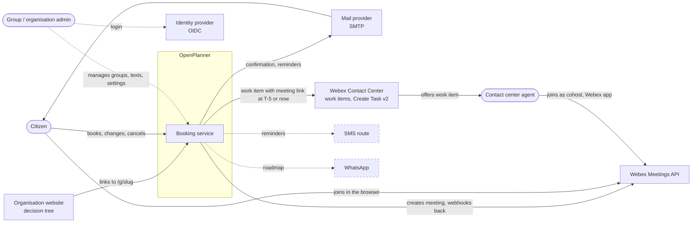

| External system | Direction | Purpose | Decision |
|---|---|---|---|
| Mail provider (SMTP) | out | Confirmation, change, reminder, cancellation | ADR 0009; per organisation in the admin UI (ADR 0008) |
| Webex Contact Center | out, in | Work item per booking or direct call; task events by signed webhook | ADR 0018 (supersedes 0007 in part) |
| Webex Meetings | out, in | Meeting per booking on behalf of the group's host; status by signed webhook | ADR 0017, 0010 |
| Identity provider | in | Admin login with roles | HANDOVER B8, O3 |
| SMS route / WhatsApp | out | Reminders | ADR 0009 (WhatsApp on the roadmap) |

## 4. Containers and deployment

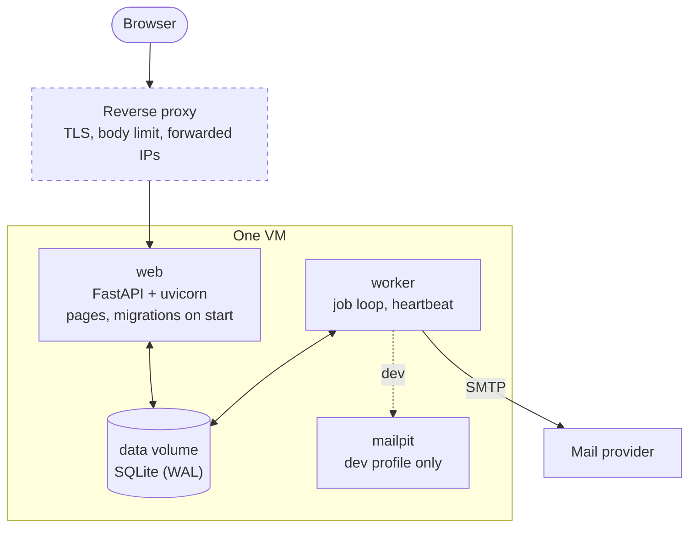

- **One image, two roles.** `web` runs `alembic upgrade head` and then uvicorn; `worker` runs
  `python -m app.jobs.worker` and starts only when `web` is healthy. Both run as uid 10001
  with a read-only root filesystem, no capabilities and `no-new-privileges`.
- **SQLite in WAL mode** on a shared volume: readers never wait; writers take
  `BEGIN IMMEDIATE`. Postgres is not a target (decided 2026-10-23).
- **Health.** `web`: `/healthz` (liveness) and `/readyz` (database). `worker`: a heartbeat file
  checked by `python -m app.jobs.healthcheck`.
- **Configuration** comes from the environment only. `ENVIRONMENT` defaults to `prod`, which
  requires `MANAGEMENT_TOKEN_KEY` and an `https` `PUBLIC_BASE_URL`.
- **Images** are built in CI, pushed to GHCR, signed keyless with cosign and carry an SBOM
  attestation (ADR 0006). Hosting and backups: open point O7.

## 5. Code structure

### Layers

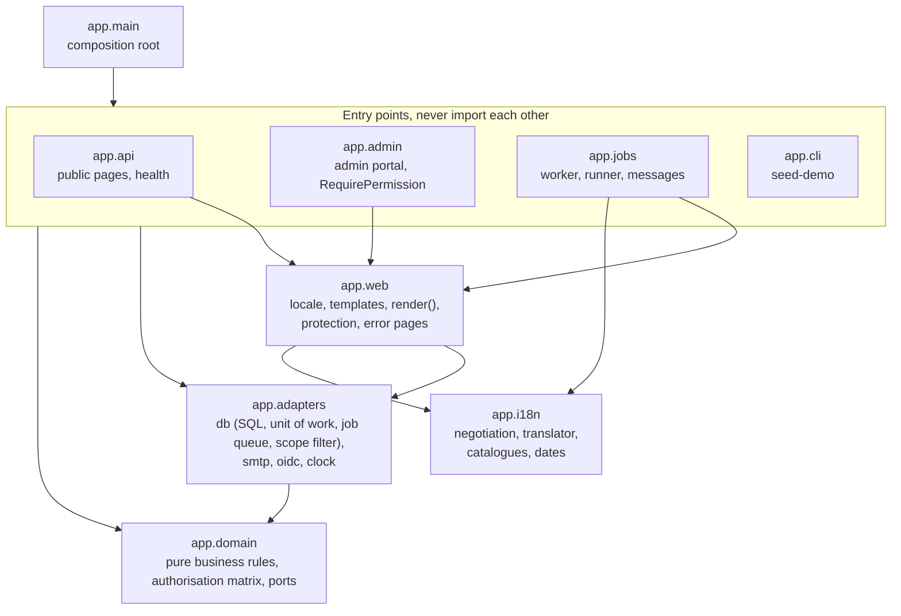

import-linter enforces these arrows in CI (ADR 0005):

- `app.domain` imports no framework and no other `app` package.
- `app.i18n` imports nothing from the rest of `app` (ADR 0004).
- The entry points (`api`, `admin`, `jobs`, `cli`) never import each other.

### Ports and adapters

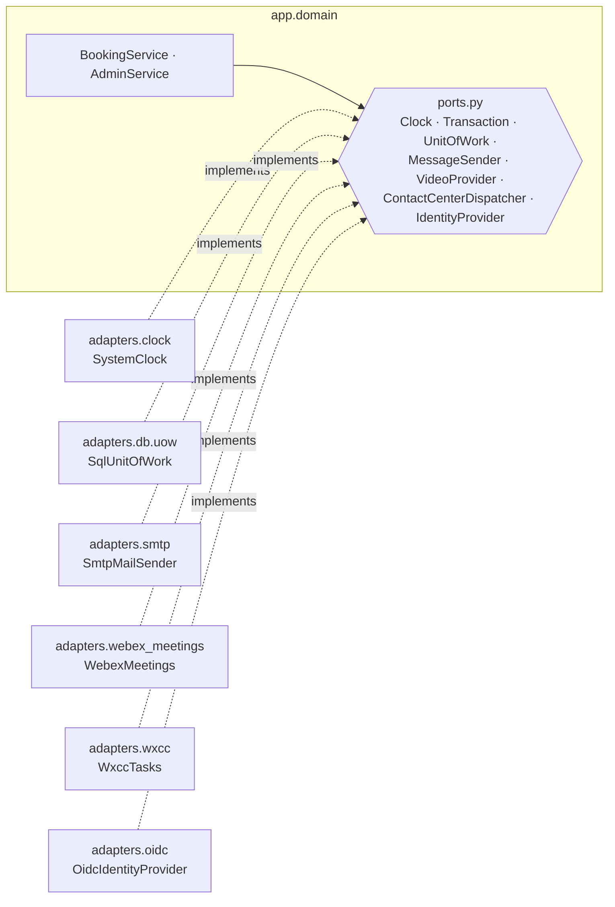

Tests replace every adapter with a fake from `tests/fakes/`. The in-memory unit of work has the
same commit and rollback behaviour as the SQL one.

### Module map

| Concern | Module |
|---|---|
| Opening hours, groups | `app/domain/scheduling.py` |
| Slot calculation (time zones, daylight saving) | `app/domain/availability.py` |
| Bookings, contact validation | `app/domain/booking.py` |
| Book, cancel, reschedule (use cases) | `app/domain/services.py` |
| Which jobs, when | `app/domain/job_plan.py` |
| Channels, reminder rules | `app/domain/channels.py` |
| Management tokens | `app/domain/tokens.py` |
| Error codes | `app/domain/errors.py` |
| Authorisation matrix, scopes (ADR 0014) | `app/domain/authorization.py` |
| Admin use cases, audit events | `app/domain/admin.py`, `app/domain/audit.py` |
| Groups, opening hours, exceptions, preview (admin) | `app/domain/planning.py` |
| What leaves for Webex/WxCC, timeline, call status, join window | `app/domain/calls.py` |
| Recording platform events, admin timeline and agenda | `app/domain/integration.py` |
| Creating meetings and work items (worker and direct calls) | `app/domain/call_service.py`, `app/jobs/calls.py` |
| Webex and WxCC adapters, encrypted tokens, webhooks | `app/adapters/webex_auth.py`, `webex_meetings.py`, `wxcc.py`, `webhooks.py`, `crypto.py`, `db/credentials.py` |
| Operator commands: `register-webhooks`, `wxcc-check` probes | `app/cli.py`, `app/adapters/webhook_registration.py`, `app/adapters/diagnostics.py` |
| Join page, direct call, webhook endpoints | `app/api/join_pages.py`, `direct_pages.py`, `webhooks.py` |
| Agenda, booking timeline, integrations page | `app/admin/call_routes.py`, `app/admin/routes.py` |
| OIDC login (ADR 0013) | `app/adapters/oidc.py` |
| Admin routes, permission dependency, session | `app/admin/routes.py`, `app/admin/authz.py`, `app/admin/session.py` |
| Group and planning screens, admin forms, shared page plumbing | `app/admin/group_routes.py`, `app/admin/forms.py`, `app/admin/pages.py` |
| Admin design (fixed look, no JavaScript, ADR 0016) | `app/web/static/admin.css`, `app/admin/templates/admin/` |
| Generated matrix document | `app/web/authz_report.py`, `app/cli.py` (`authz-matrix`) |
| Tables, migrations | `app/adapters/db/models.py`, `migrations/versions/` |
| Transactions, write lock | `app/adapters/db/uow.py`, `app/adapters/db/engine.py` |
| Job queue | `app/adapters/db/jobs.py` |
| Citizen pages | `app/api/booking_pages.py`, `app/api/templates/` |
| CSRF and rate limits | `app/web/protection.py` |
| Rendering and security headers | `app/web/templates.py`, `app/api/security_headers.py` |
| Translations and locale | `app/i18n/` |
| Messages and calendar files | `app/jobs/messages.py`, `app/jobs/calendar.py` |
| Job execution | `app/jobs/runner.py`, `app/jobs/worker.py` |

## 6. Domain model

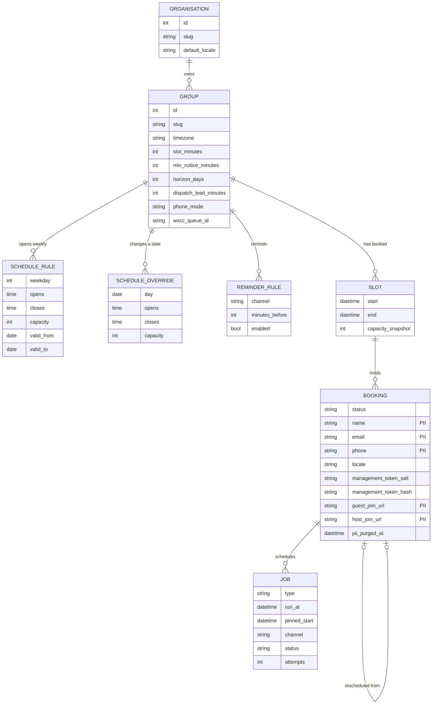

Rules that matter for the rest of the system:

- **Capacity** is one number per opening window, because the WxCC queue assigns the agent
  (HANDOVER B5). A slot row is created by the first booking and snapshots that capacity.
  Later schedule edits change new slots only.
- **An override replaces every rule on its date.** A closed override blocks new bookings,
  even in slots that already exist.
- **The dispatch lead** (`dispatch_lead_minutes`, default 5) sets two moments: when the WxCC
  task is created, and when the booking becomes read-only. The minimum notice can never be
  shorter than it.
- **All times are stored in UTC.** They are converted to the group's time zone only when
  rendering and parsing.

## 7. Runtime views

### Booking

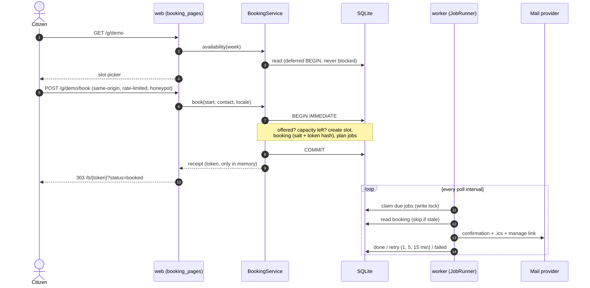

### Admin login and an authorised request

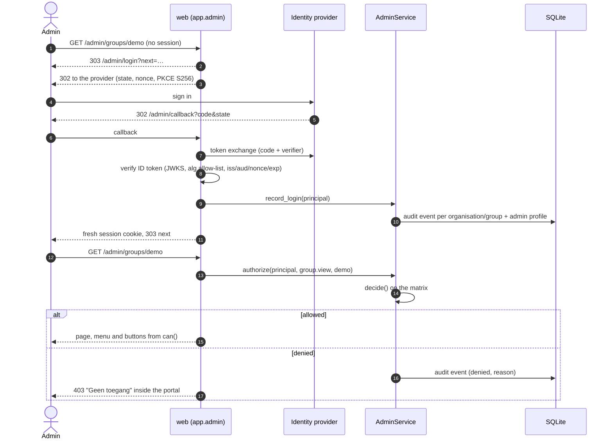

Listings never ask "may I see this row?" one by one: the matrix turns the permission into a
`Scope`, and the SQL adapter filters with it. A test checks exhaustively that the scope and the
single decision never disagree.

A change (WP7b) adds two steps to the authorised request: the route needs a login of at most
60 minutes (ADR 0015), and `PlanningService` authorises again before it validates the whole
schedule, writes and audits in one locked transaction.

### What happens to one booking over time

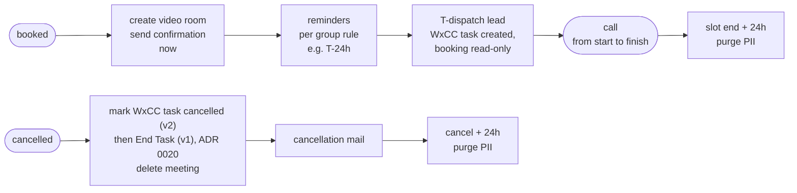

Every job that is tied to a start time stores that start (`pinned_start`). On run it does
nothing if the booking is no longer confirmed, its start changed, or its data was purged.
Cancelling or moving a booking replaces its pending jobs in the same transaction, including
deleting its meeting.

### A call: meeting, work item, agent and citizen

Every arrow back into OpenPlanner becomes a timeline event and updates the booking's call
status; the agenda in the admin portal shows it per day.

### Booking status

```mermaid
stateDiagram-v2
    [*] --> confirmed: book
    confirmed --> cancelled: cancel (before the dispatch lead)
    confirmed --> cancelled: reschedule (old booking; a new one is confirmed)
    confirmed --> completed: after the call (WP6)
    confirmed --> no_show: task not picked up (O2)
    cancelled --> [*]
    completed --> [*]
    no_show --> [*]
```

### Job status

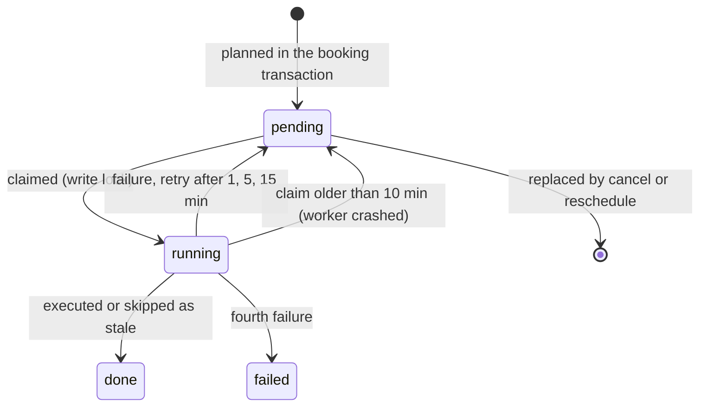

## 8. Security architecture

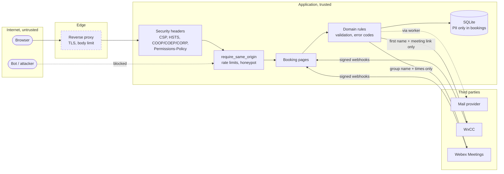

| Control | Where | Reference |
|---|---|---|
| Strict response headers: CSP without scripts, HSTS, frame denial, COOP/COEP/CORP, Permissions-Policy | `app/api/security_headers.py`, `app/web/templates.py` | threat model |
| CSRF through Fetch Metadata (`Sec-Fetch-Site`), with an Origin fallback | `app/web/protection.py` | threat model |
| Rate limits (10 writes/hour, 60 reads/minute) and a honeypot field | `app/web/protection.py`, `booking_pages.py` | CLAUDE.md |
| Management tokens: 256 bits, HMAC-derived, only the salt and hash stored | `app/domain/tokens.py` | ADR 0011 |
| No PII in logs (masking processor and semgrep rule), errors, URLs or jobs | `app/logging.py`, `.semgrep/` | CLAUDE.md |
| Authorisation matrix: one `RequirePermission` per admin route, scoped SQL, audit of denials and logins | `app/domain/authorization.py`, `app/admin/authz.py` | ADR 0014 |
| OIDC with PKCE, nonce, asymmetric algorithms only; RP-initiated logout | `app/adapters/oidc.py` | ADR 0013 |
| Encrypted, write-only integration secrets | WP7 | ADR 0008 |
| Signed images, SBOM, image and dependency scanning | CI | ADR 0006 |

The STRIDE analysis per flow, with a test for every abuse case, is in
`docs/threat-model.md`.

## 9. Privacy

- **Personal data:** name, email, phone, guest and host join URL. These live only in
  `bookings`; jobs, slots and logs hold IDs.
- **Purge:** the `purge_pii` job sets them to NULL at slot end + 24 h, or 24 h after a
  cancellation. The nightly sweep and alert follow in WP8.
- **What leaves the system:** mails carry the first name, date, team and the management link;
  the calendar file carries no personal data. WxCC will receive only the first name and the
  host link.
- **The management page** shows no contact details, so a forwarded link reveals only the
  appointment.
- The DPIA input is in `docs/dataflow.md`.

## 10. Quality assurance

Per work package the plan is reviewed (`/plan-eng-review`) and the diff is checked with the
repository's `security-review` skill before the PR (`docs/skills.md`).

## 11. Decisions

| ADR | Decision |
|---|---|
| 0001 | Record decisions as numbered ADRs |
| 0002 | Runtime layout: web migrates, worker heartbeat, health endpoints, deny-by-default headers |
| 0003 | certifi (MPL-2.0) as the only license exception |
| 0004 | Self-contained i18n module: Dutch default, browser detection, admin overrides |
| 0005 | Modularity and docstrings, enforced in CI |
| 0006 | Test tooling outside the runtime; images signed with cosign |
| 0007 | WxCC tasks through the Tasks API (no dedicated Webex Connect) |
| 0008 | Integration secrets in the admin UI, encrypted and write-only |
| 0009 | Channels as data, reminder rules, templates as text blocks |
| 0010 | Live meeting status for group admins (aggregates only) |
| 0011 | Management tokens derived from a per-booking salt and a server key |
| 0012 | Claude Code merges only on explicit instruction of the product owner, with green CI |
| 0013 | Admin login with OIDC (PingFederate; Keycloak in development), httpx + PyJWT |
| 0014 | The authorisation matrix as the single source of rights |
| 0015 | Admin changes need a recent login (60 minutes) |
| 0016 | Admin forms without JavaScript; HTMX only where it adds something |
| 0017 | Video calls through the Webex Meetings API (cohost for staff, lobby for guests) |
| 0018 | Dispatch to WxCC as work items (Create Task API v2) |
| 0019 | Direct video call ("now") per group |

## 12. Status and roadmap

| Work package | Content | Status |
|---|---|---|
| WP1 | Skeleton, CI, containers, logging, health | done |
| i18n core | Language module, home page | done |
| WP2 | Domain, persistence, write lock | done |
| WP3 (slice 1) | Citizen pages, mail, worker, demo | done |
| WP3 (rest) | Embeddable widget (grid calendar), branding (O5) | planned |
| WP4 | SMS reminders, message editors | planned |
| WP5 | Webex Meetings, join page, live status (O1: Meetings API) | done |
| WP6 | WxCC work items, task events, direct call (O9) | done (O2 follow-up open) |
| WP7a | Admin portal login, authorisation matrix, audit log | done |
| WP7b | Groups, opening hours, exceptions and capacity in the admin portal | done |
| WP7c–d | Texts and reminders, encrypted integration settings (O3) | planned |
| WP8 | Purge sweep and alerting, audit retention | planned |
| WP9 | Hardening, pentest, accessibility audit (O10) | planned |

The open decisions (O1–O10) are listed in `docs/HANDOVER.md` §11.
