# Architecture

How OpenPlanner is built: context, containers, code structure, domain model, runtime flows,
security and quality assurance. The *why* behind each choice is in the ADRs (`docs/adr/`);
the stakeholder design is in `docs/HANDOVER.md` (Dutch).

Status: October 2026, after work package 3 (first demo slice). Parts drawn with a **dashed
border** are designed but not built yet; the roadmap at the end says when.

The same architecture as shareable plates (building blocks, components per layer, integrations
and adapters) plus a building-block register is in `docs/diagrams/`: draw.io, PNG, PDF and
Word, generated from `scripts/diagrams/content.py` with `make diagrams`. Update that content in
the same PR as a change it shows.

### Terms

One word per role (ADR 0077). Code, docs and texts use these; earlier ADRs and `docs/HANDOVER.md` say "citizen" or "burger" for the participant.

| Term (en / nl) | Meaning |
|---|---|
| Participant / deelnemer | The person who books, receives the mails and joins the call. Never logs in. |
| Agent / medewerker | The person who takes the video call. Organisations may show another word, such as "behandelaar" (ADR 0077, point 8, not built yet). Not the planner, who is a separate role. |
| Host | The Webex host of the meeting (Webex's word). |
| Appointment / afspraak | The booking of a participant in a time slot. |

## 1. Purpose and scope

Participants book a video call with a team of a government contact center (a *group*, one
Webex Contact Center queue). The service offers free time slots, takes the booking, sends
confirmation and reminders, hands the call to the queue just before the start, and deletes
personal data 24 hours after the appointment.

Out of scope: the organisation's decision tree (its website links to the group page), agent
scheduling (the WxCC queue assigns agents), and the video call itself (Webex).

## 2. Quality goals

| Priority | Goal | How |
|---|---|---|
| 1 | Privacy | PII only on bookings, purged at end + 24 h; no PII in logs, URLs, jobs or errors |
| 2 | Security | Deny by default, one authorisation dependency, mandatory CI gates, external pentest |
| 3 | Accessibility | WCAG 2.2 AA: works without JavaScript and without a mouse; axe and Lighthouse in CI |
| 4 | Maintainability | Pure domain behind ports, enforced layers, docstrings, no copy-paste |
| 5 | Simplicity | Two containers, SQLite, no message broker; about 80 bookings per working day |

## 3. System context

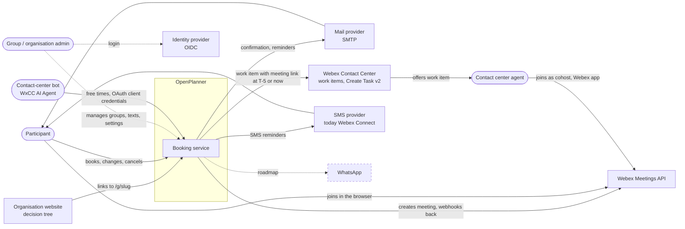

| External system | Direction | Purpose | Decision |
|---|---|---|---|
| Mail provider (SMTP) | out | Confirmation, change, reminder, cancellation | ADR 0009; per organisation in the admin UI (ADR 0008, 0022) |
| Webex Contact Center | out, in | Work item per booking or direct call; task events by signed webhook | ADR 0018 (supersedes 0007 in part) |
| Webex Meetings | out, in | Meeting per booking on behalf of the group's host; status by signed webhook | ADR 0017, 0010 |
| Identity provider | in | Admin login with roles | HANDOVER B8, O3 |
| SMS provider (Webex Connect) | out | SMS reminders, per organisation and provider | ADR 0022, 0028 |
| WhatsApp | out | Reminders | ADR 0009 (roadmap) |
| Contact-center bot (WxCC AI Agent) | in | Free times through `/api/agent/v1`; changes through the participant's confirmation (next step) | ADR 0023 |

## 4. Containers and deployment

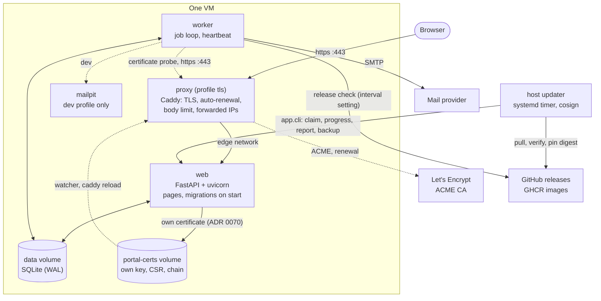

- **TLS at the edge (ADR 0030, ADR 0064).** With `--profile tls` (the installer's default) the
  `proxy` service (Caddy) gets a certificate for `TLS_DOMAIN` from Let's Encrypt and renews it
  on its own, or serves an own certificate from `./certs`; port 80 only redirects. It runs as
  uid 10001 on a read-only filesystem, keeps certificates in the `proxy-data` volume and has a
  fixed address on the `edge` network, the only address `web` accepts `X-Forwarded-For` from.
  The worker probes the public address every few hours and shows the certificate's issuer,
  expiry and one finding on *System status*; a failing one is a system event. The superuser
  chooses the source there (ADR 0070): Let's Encrypt, or an own certificate whose key `web`
  makes in the `portal-certs` volume (a signing request for the CA; the chain comes back
  through the portal, the key never enters the database) and whose pair the entrypoint's
  watcher reloads Caddy with on change. Without the profile (`--no-tls`), a
  load balancer of the host does TLS and the source is not the portal's.
- **One image, two roles.** `web` runs `alembic upgrade head` and then uvicorn; `worker` runs
  `python -m app.jobs.worker` and starts only when `web` is healthy. Both run as uid 10001
  with a read-only root filesystem, no capabilities and `no-new-privileges`.
- **SQLite in WAL mode** on a shared volume: readers never wait; writers take
  `BEGIN IMMEDIATE`. Postgres is not a target (decided 2026-10-23).
- **Health.** `web`: `/healthz` (liveness) and `/readyz` (database). `worker`: a heartbeat file
  checked by `python -m app.jobs.healthcheck`.
- **Configuration** comes from the environment only. `ENVIRONMENT` defaults to `prod`, which
  requires `MANAGEMENT_TOKEN_KEY` and an `https` `PUBLIC_BASE_URL`.
- **Images** are built in CI, pushed to GHCR, signed keyless with cosign and carry an SBOM
  attestation (ADR 0006): the application image `ghcr.io/<owner>/<repo>` and, since ADR 0064
  step 2, the HTTPS proxy image `ghcr.io/<owner>/<repo>-proxy` from `deploy/proxy/`, both for
  every release and release candidate. A host pulls, verifies and pins both by digest
  (`.env.update`) and never builds Caddy; `docker compose` builds the proxy locally only in
  development and in `scripts/check-proxy.sh`. Hosting and backups: open point O7.
- **Updates** (ADR 0029): the worker checks the latest release every `update_check_minutes`
  (default 60) or at once after "Check now" (ADR 0067 point 7); a superuser requests an
  update or a restore in the portal; the host updater (outside the containers, with the Docker
  socket) verifies the signatures of both images, backs up, switches the pinned digests and
  rolls back on its own when the new version (web, worker or proxy) does not become healthy.
- **Releases** (ADR 0052): only a tag `vX.Y.Z` on `main` is a version; a merge to `main` only
  builds a test image. Every image carries its commit (`APP_COMMIT`), shown on `/admin/updates`.

## 5. Code structure

### Layers

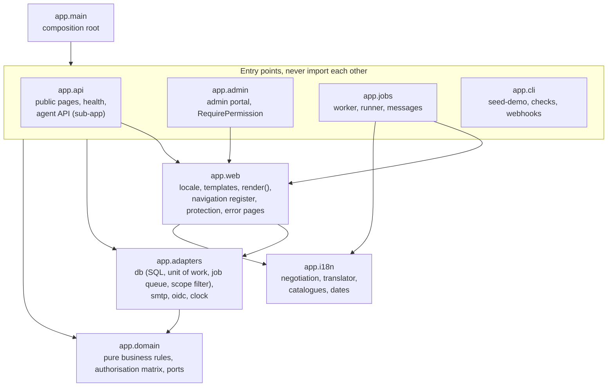

import-linter enforces these arrows in CI (ADR 0005):

- `app.domain` imports no framework and no other `app` package.
- `app.i18n` imports nothing from the rest of `app` (ADR 0004).
- The entry points (`api`, `admin`, `jobs`, `cli`) never import each other.

### Ports and adapters

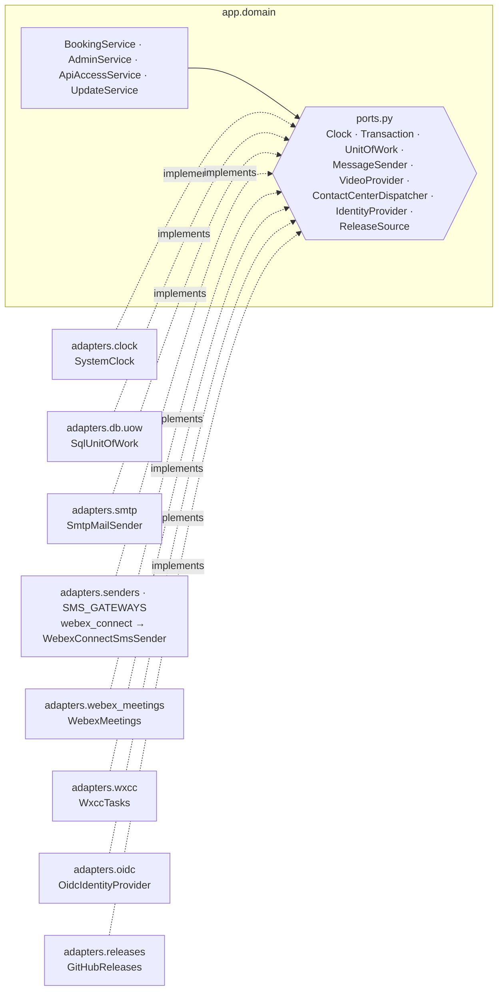

Tests replace every adapter with a fake from `tests/fakes/`. The in-memory unit of work has the
same commit and rollback behaviour as the SQL one.

### Module map

| Concern | Module |
|---|---|
| Staffing blocks (formerly opening hours, ADR 0027), groups | `app/domain/scheduling.py` |
| Slot calculation (time zones, daylight saving) | `app/domain/availability.py` |
| Bookings, contact validation | `app/domain/booking.py` |
| Book, cancel, reschedule (use cases) | `app/domain/services.py` |
| Emergency closure, bookings on hold (ADR 0024) | `app/domain/closure.py`, `app/domain/closure_service.py`, `app/admin/closure_routes.py`, `app/admin/closure_image_routes.py`, `app/web/closure_labels.py` |
| Closure scenarios (ADR 0037 §4) | `app/domain/scenarios.py`, `app/domain/scenario_service.py`, `app/admin/scenario_routes.py`, `app/adapters/db/scenarios.py` |
| Uploaded images: type from the bytes, metadata stripped, text alternative (ADR 0020, 0037 §3) | `app/domain/images.py`, `app/admin/uploads.py`, `app/adapters/db/images.py` |
| Alternative contact options (ADR 0037) | `app/domain/contacts.py`, `app/domain/contact_service.py`, `app/admin/contact_routes.py`, `app/web/contact_labels.py`, `app/web/templates/_contact_block.html` |
| Embedding on host websites: allowed origins, opt-in per group (ADR 0035) | `app/domain/embedding.py`, `app/domain/embedding_service.py`, `app/admin/embedding_routes.py` |
| Widget API `/api/v1/widget` with CORS for allowed origins (ADR 0035) | `app/api/widget_api.py`, `app/api/widget_schemas.py` |
| `<gov-booking>` Web Component, its script route and SRI hash, test host page (ADR 0035) | `widget/src/`, `app/api/widget_script.py`, `app/web/widget_bundle.py`, `e2e/host/` |
| Which jobs, when | `app/domain/job_plan.py` |
| Channels, reminder rules | `app/domain/channels.py` |
| Management tokens | `app/domain/tokens.py` |
| Error codes | `app/domain/errors.py` |
| Authorisation matrix, scopes (ADR 0014) | `app/domain/authorization.py` |
| Admin use cases, audit events | `app/domain/admin.py`, `app/domain/audit.py` |
| System events of the worker, exact per level, and their retention (ADR 0031) | `app/domain/system_log.py`, `app/jobs/runner.py`, `app/admin/audit_routes.py` |
| Groups, staffing blocks (add, change, split, remove), staffing exceptions, preview (admin) | `app/domain/planning.py` |
| Holiday calendars and their resolution per group (ADR 0025) | `app/domain/holidays.py`, `app/domain/holiday_service.py`, `app/admin/holiday_routes.py` |
| What leaves for Webex/WxCC, timeline, call status, join window | `app/domain/calls.py` |
| Recording platform events, admin timeline and agenda | `app/domain/integration.py` |
| Creating meetings and work items (worker and direct calls) | `app/domain/call_service.py`, `app/jobs/calls.py` |
| Cap on open direct calls, place in line, usual wait (ADR 0026) | `app/domain/direct_queue.py` |
| Own queue: visible bookings, next up, claims, release, agent pseudonym (ADR 0043) | `app/domain/own_queue.py`, `app/domain/queue_service.py`, `app/admin/queue_routes.py`, `app/keys.py` |
| Updates from the admin portal: versions, requests, release check, banner, host updater (ADR 0029); live steps (ADR 0048) | `app/domain/updates.py`, `app/domain/update_service.py`, `app/adapters/releases.py`, `app/adapters/db/updates.py`, `app/adapters/db/backup.py`, `app/admin/update_routes.py`, `app/web/static/update-progress.js`, `app/cli.py`, `scripts/updater/` |
| Installing and repairing a host: packages, settings files, pinned release, host updater (ADR 0050) | `scripts/install.sh`, `docs/install.md` |
| Maintenance mode: switch, cache, refusals in `RequirePermission`, disabled buttons, participant and machine-API rules, alert (ADR 0038) | `app/domain/maintenance.py`, `app/domain/maintenance_service.py`, `app/adapters/db/maintenance_state.py`, `app/admin/maintenance_routes.py`, `app/admin/frozen_forms.py`, `app/api/maintenance.py`, `app/cli.py`, `scripts/updater/` |
| Webex and WxCC adapters, encrypted tokens, webhooks | `app/adapters/webex_auth.py`, `webex_meetings.py`, `wxcc.py`, `webhooks.py`, `crypto.py`, `db/credentials.py` |
| Operator commands: `register-webhooks`, `wxcc-check` probes, `wxcc-config-check` | `app/cli.py`, `app/adapters/webhook_registration.py`, `app/adapters/diagnostics.py`, `app/adapters/wxcc_config.py` |
| Operator commands: `webhooks-list`, `webhooks-reset`, `webhooks-health`; stored results | `app/cli.py`, `app/adapters/registrations.py`, `app/adapters/webhook_selftest.py`, `app/adapters/db/reports.py` |
| Verify button "Koppeling controleren" | `app/domain/checks.py`, `app/domain/integration_check.py`, `app/adapters/group_check.py`, `app/admin/check_routes.py`, `app/web/check_labels.py` |
| Simulator for platform events (not in production) | `app/domain/simulation.py`, `app/adapters/simulated_events.py`, `app/admin/simulator_routes.py` |
| Join page, direct call, webhook endpoints | `app/api/join_pages.py`, `direct_pages.py`, `webhooks.py` |
| Agenda per slot with agents and shortfalls, day and week view (ADR 0044) | `app/domain/agenda.py`, `app/domain/agenda_service.py`, `app/admin/agenda_routes.py`, `app/admin/shortfalls.py` |
| A planner's changes: move, cancel with a fixed reason, accept a shortfall (ADR 0044) | `app/domain/planner_service.py`, `app/admin/planner_routes.py` |
| Cancelling on the participant's behalf, shared by closure and planner; the planner's limits; asking to rebook and its lapse (ADR 0044) | `app/domain/booking_changes.py`, `app/jobs/runner.py` (`lapse_rebook`) |
| Rebooking assistant: which bookings of a short slot move and which slot each is proposed, same time on the nearest day first (ADR 0057) | `app/domain/rebooking.py` |
| Booking timeline, integrations page (last checks read-only) | `app/admin/call_routes.py`, `app/admin/routes.py`, `app/admin/integration_views.py` |
| OIDC login (ADR 0013) | `app/adapters/oidc.py` |
| Admin routes, permission dependency, session | `app/admin/routes.py`, `app/admin/authz.py`, `app/admin/session.py` |
| Machine API for bots: clients, credentials, tokens, scopes (ADR 0023) | `app/domain/api_clients.py`, `app/domain/api_access.py`, `app/adapters/db/api_clients.py` |
| Machine API over HTTP: token endpoint, `RequireScope`, routes, JSON errors, docs page | `app/api/agent/` |
| API clients and switches in the admin portal (superuser) | `app/admin/api_routes.py` |
| Group and planning screens, admin forms, shared page plumbing | `app/admin/group_routes.py`, `app/admin/forms.py`, `app/admin/pages.py` |
| Admin design (fixed look, no JavaScript, ADR 0016) | `app/web/static/admin.css`, `app/admin/templates/admin/` |
| Manual and context-sensitive help (ADR 0033) | `docs/manual/`, `app/web/help.py`, `app/admin/help_routes.py`, `with_manual` in `app/admin/pages.py` |
| Generated matrix document | `app/web/authz_report.py`, `app/cli.py` (`authz-matrix`) |
| Admin structure: side navigation, top bar, object tabs (ADR 0047) | `app/web/navigation.py`, `page` and `group_page` in `app/admin/`, `docs/admin-map.md` via `app/cli.py` (`admin-map`) |
| Tables, migrations | `app/adapters/db/models.py`, `migrations/versions/` |
| Transactions, write lock | `app/adapters/db/uow.py`, `app/adapters/db/engine.py` |
| Job queue | `app/adapters/db/jobs.py` |
| Participant pages | `app/api/booking_pages.py`, `app/api/participant.py`, `app/api/templates/` |
| Slot picker: month calendar and times (ADR 0020) | `app/api/slot_picker.py`, `app/web/static/calendar.js` |
| Organisations (superuser) | `app/domain/organisations.py`, `app/admin/organisation_routes.py` |
| Branding per organisation (O5, ADR 0041) | `app/domain/branding.py`, `app/domain/theme.py`, `app/domain/branding_service.py`, `app/web/branding.py`, `app/api/brand_assets.py`, `app/admin/branding_routes.py` |
| CSRF and rate limits | `app/web/protection.py` |
| Rendering and security headers | `app/web/templates.py`, `app/api/security_headers.py` |
| Translations and locale | `app/i18n/` |
| Messages and calendar files | `app/jobs/messages.py`, `app/jobs/calendar.py` |
| Channel settings per organisation (SMTP, SMS; ADR 0022) | `app/domain/channel_settings.py`, `app/domain/channel_service.py`, `app/admin/channel_routes.py` |
| Reminder rules and group texts (ADR 0022) | `app/domain/messaging_service.py`, `app/domain/message_texts.py`, `app/admin/message_routes.py` |
| Senders per organisation, SMS adapters per provider (ADR 0028) | `app/adapters/senders.py`, `app/adapters/sms.py`, `app/adapters/webex_connect_sms.py`, `app/adapters/smtp.py` |
| Sender domain check: SPF, DKIM, DMARC verdicts (ADR 0073) | `app/domain/mail_domain.py`, `app/adapters/mail_dns.py` |
| Job execution | `app/jobs/runner.py`, `app/jobs/worker.py` |
| Settings: registry, portal values with env lock, live reload, Advanced settings (ADR 0042) | `app/domain/settings_registry.py`, `app/domain/platform_settings.py`, `app/adapters/settings_report.py`, `app/adapters/live_settings.py`, `app/adapters/db/platform_settings.py`, `app/admin/settings_routes.py` |

## 6. Domain model

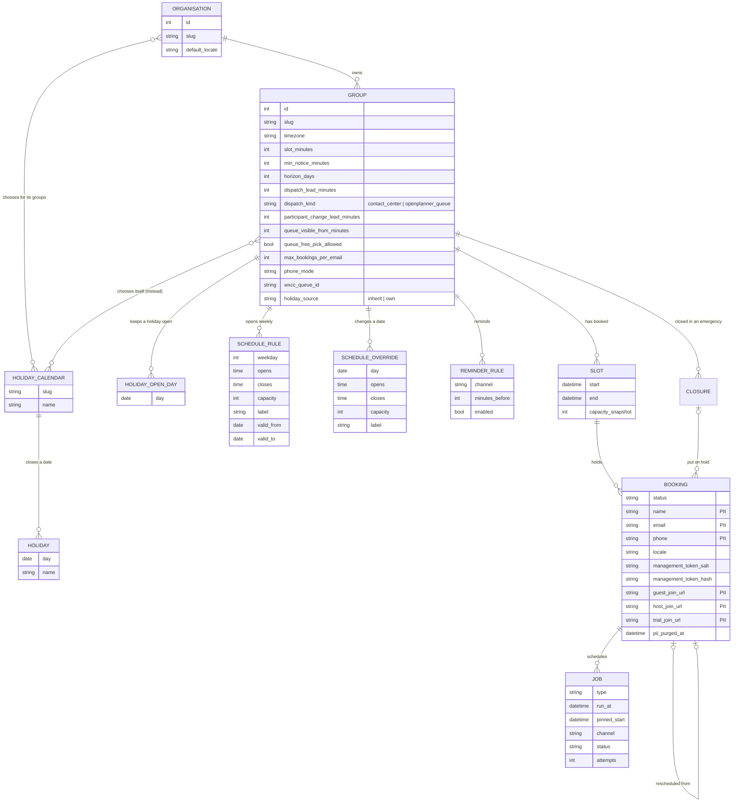

Rules that matter for the rest of the system:

- **Capacity** is one number per opening window (a staffing block: the number of agents,
  0 to 1000, ADR 0027), because the WxCC queue assigns the agent (HANDOVER B5). A block with
  0 agents (lunch) offers no slots and no direct calls, like a gap. Touching blocks with
  agents form one *run*: the slot grid continues across their borders and a slot straddling
  a border gets the lowest agent count. A slot row is created by the first booking and
  snapshots that capacity. Later schedule edits change new slots only. When an edit moves
  the grid while bookings on the old grid lie ahead, those bookings take a place in every
  new slot they overlap, so no moment has more appointments than agents.
- **An override replaces every rule on its date.** A closed override blocks new bookings,
  even in slots that already exist.
- **Holidays come from reusable calendars** (ADR 0025): the superuser maintains them, an
  organisation chooses the ones its groups follow, a group inherits or picks its own (or
  none) and may keep single holidays open. On a date the group's own override wins, then a
  holiday closes the day, then the weekly rules apply (`app/domain/holidays.py`).
- **The dispatch lead** (`dispatch_lead_minutes`, default 5) sets when the WxCC task is
  created. The minimum notice can never be shorter than it. The participant can cancel until the
  start and move until `participant_change_lead_minutes` (default 60, ADR 0069).
- **Dispatch kind per group** (ADR 0043): `contact_center` (the WxCC task above) or
  `openplanner_queue`, where agents sign in and claim bookings in the group's own queue
  (`app/domain/own_queue.py`, `queue_service.py`). An own-queue group sends no task; both
  kinds share the participant's change rule (`Group.change_deadline`, `Group.cancel_deadline`).
- **All times are stored in UTC.** They are converted to the group's time zone only when
  rendering and parsing.

## 7. Runtime views

### Booking

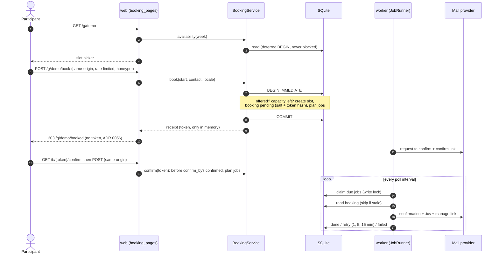

### Admin login and an authorised request

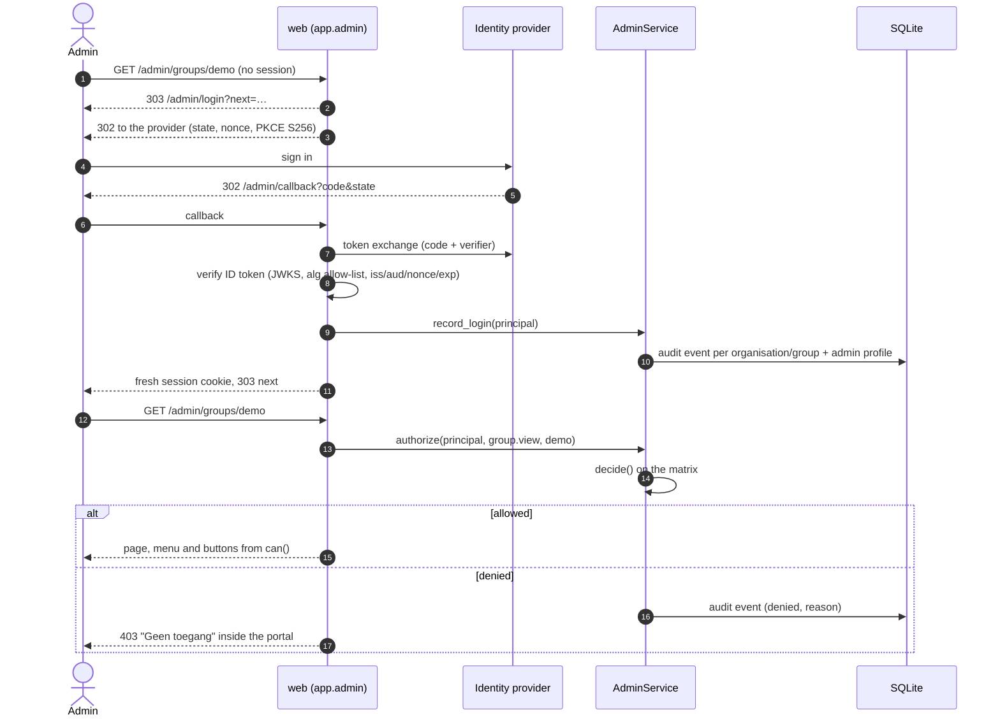

Listings never ask "may I see this row?" one by one: the matrix turns the permission into a
`Scope`, and the SQL adapter filters with it. A test checks exhaustively that the scope and the
single decision never disagree.

A change (WP7b) adds two steps to the authorised request: the route needs a login of at most
60 minutes (ADR 0015), and `PlanningService` authorises again before it validates the whole
schedule, writes and audits in one locked transaction.

### What happens to one booking over time

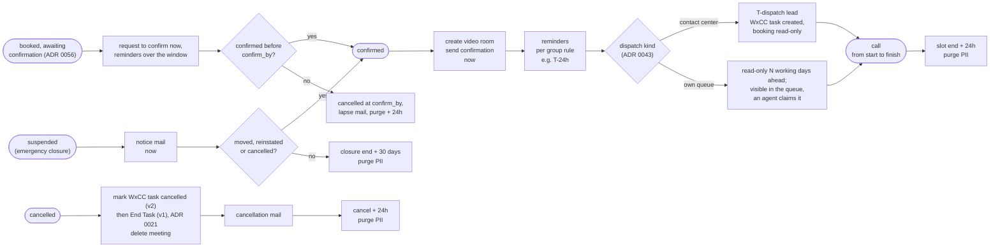

Every job that is tied to a start time stores that start (`pinned_start`). On run it does
nothing if the booking is no longer confirmed, its start changed, or its data was purged.
Cancelling or moving a booking replaces its pending jobs in the same transaction, including
deleting its meeting.

### A call: meeting, work item, agent and participant

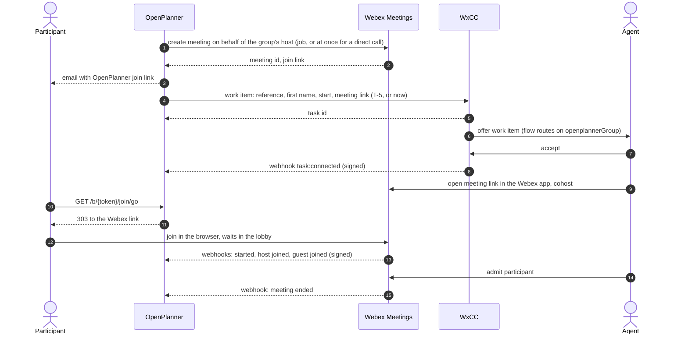

Every arrow back into OpenPlanner becomes a timeline event and updates the booking's call
status; the agenda in the admin portal shows it per day.

### Maintenance mode (ADR 0038)

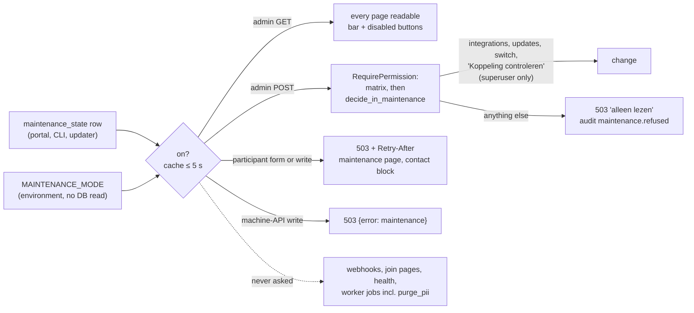

The host updater switches maintenance on before its backup and off after a healthy result, a
rollback or a restore; a failed update leaves it on. The worker reports maintenance that is on
longer than `MAINTENANCE_ALERT_HOURS` as the system event `maintenance.overdue`.

### Booking status

```mermaid
stateDiagram-v2
    [*] --> pending_confirmation: book (ADR 0056)
    pending_confirmation --> confirmed: confirm by email link
    pending_confirmation --> cancelled: lapse at confirm_by, or "this was not me"
    confirmed --> cancelled: cancel (before the dispatch lead)
    confirmed --> cancelled: reschedule (old booking; a new one is confirmed)
    confirmed --> completed: after the call (WP6)
    confirmed --> no_show: task not picked up (O2)
    confirmed --> suspended: emergency closure (ADR 0024)
    suspended --> confirmed: reinstate (closure over, before the dispatch lead)
    suspended --> cancelled: cancel, or move (a new booking is confirmed)
    cancelled --> [*]
    completed --> [*]
    no_show --> [*]
```

### Job status

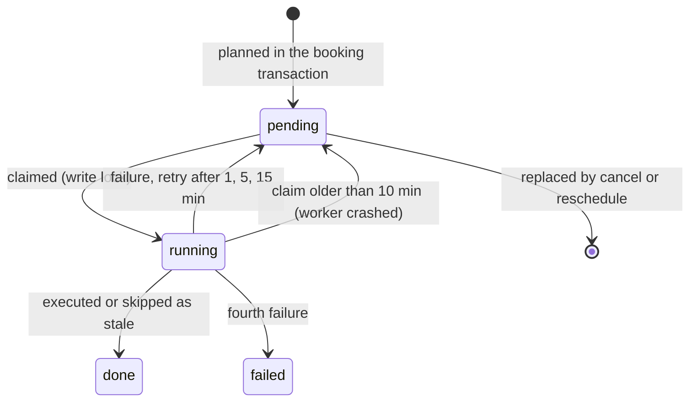

## 8. Security architecture

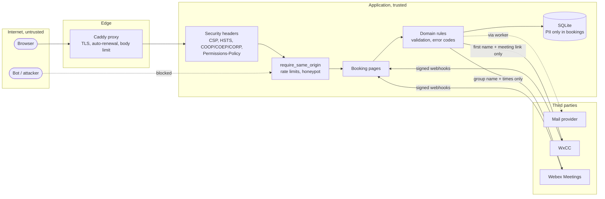

| Control | Where | Reference |
|---|---|---|
| Strict response headers: CSP without scripts, HSTS, frame denial, COOP/COEP/CORP, Permissions-Policy | `app/api/security_headers.py`, `app/web/templates.py` | threat model |
| CSRF through Fetch Metadata (`Sec-Fetch-Site`), with an Origin fallback, behind `SameSite=Lax` | `app/web/protection.py` | threat model, *Browser model* |
| Authentication paths (admin OIDC, bot `client_credentials`, participant link): strength, withdrawal, what lies with the IdP | `app/admin/`, `app/api/agent/` | `docs/authentication.md` |
| Rate limits (10 writes/hour, 60 reads/minute) and a honeypot field | `app/web/protection.py`, `booking_pages.py` | CLAUDE.md |
| Management tokens: 256 bits, HMAC-derived, only the salt and hash stored | `app/domain/tokens.py` | ADR 0011 |
| No PII in logs (masking processor and semgrep rule), errors, URLs or jobs | `app/logging.py`, `.semgrep/` | CLAUDE.md |
| Audit events shipped after commit as `log_type: audit` lines; security events deduplicated | `app/adapters/event_sink.py`, `app/domain/security_log.py` | ADR 0034 |
| One event schema (`openplanner.event/2`) for audit table and log lines; a trace id per request and job, set by the server only | `app/domain/event_schema.py`, `app/domain/event_context.py`, `app/api/trace.py` | ADR 0040 |
| Authorisation matrix: one `RequirePermission` per admin route, scoped SQL, audit of denials and logins | `app/domain/authorization.py`, `app/admin/authz.py` | ADR 0014 |
| OIDC with PKCE, nonce, asymmetric algorithms only; RP-initiated logout | `app/adapters/oidc.py` | ADR 0013 |
| Encrypted, write-only integration secrets | WP7 | ADR 0008 |
| Machine API: off by default (environment and superuser switch), OAuth client credentials, hashed secrets and 10-minute opaque tokens, one `RequireScope` per route, per-client grant and network allow-list, no personal data | `app/api/agent/`, `app/domain/api_access.py` | ADR 0023 |
| Signed images, SBOM, image and dependency scanning | CI | ADR 0006 |

### Shared trust boundaries

One installation serves one data controller (BP-4) and, inside it, any number of organisations.
These items are shared by all organisations of an installation; the separation between
organisations is application logic (scope in SQL), not physical:

```mermaid
flowchart LR
    subgraph shared [Shared by every organisation of one installation]
        su[Superuser]
        host[Host: Docker, volume, .env]
        keys[MANAGEMENT_TOKEN_KEY<br/>SETTINGS_ENCRYPTION_KEY]
        dbs[(One database)]
        cisco[One Webex Service App<br/>One WxCC org]
        smtpfb[SMTP fallback from env]
    end
    subgraph own [Per organisation, in the shared database]
        cfg[Settings, texts, branding, IdPs]
        sec[Own SMTP and SMS secrets]
        data[Groups, slots, bookings]
    end
    shared --> own
    ctrl[A second data controller] -. needs its own installation .-> shared
```

When an organisation needs an installation of its own is in `docs/threat-model.md`, section
*Shared trust boundaries*.

The STRIDE analysis per flow, with a test for every abuse case, is in
`docs/threat-model.md`.

## 9. Privacy

- **Personal data:** name, email, phone, guest and host join URL. These live only in
  `bookings`; jobs, slots and logs hold IDs.
- **Purge:** the `purge_pii` job sets them to NULL at slot end + 24 h, or 24 h after a
  cancellation. A booking on hold by an emergency closure keeps them until it is resolved, at
  most 30 days after the closure ends (ADR 0024). The nightly sweep (`app.domain.retention_sweep`, run by worker housekeeping) purges what the job
  missed and alerts on a backlog older than 48 h.
- **What leaves the system:** mails carry the first name, date, team and the management link;
  the calendar file carries no personal data. WxCC will receive only the first name and the
  host link.
- **The management page** shows no contact details, so a forwarded link reveals only the
  appointment.
- The DPIA input is in `docs/dataflow.md`.

## 10. Quality assurance

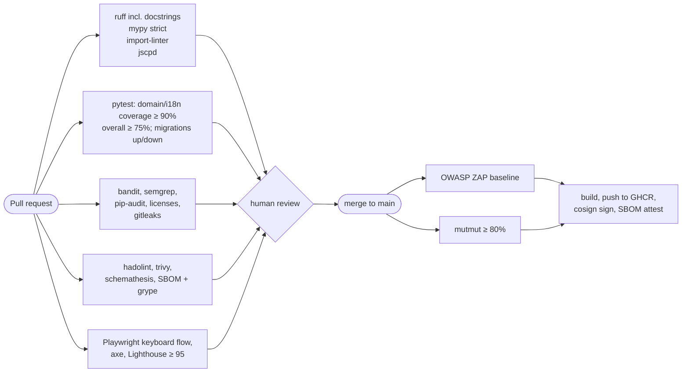

Per work package the plan is reviewed (`/plan-eng-review`) and the diff is checked with the
repository's `security-review` skill before the PR (`docs/skills.md`).

## 11. Decisions

| ADR | Decision |
|---|---|
| 0001 | Record decisions as numbered ADRs |
| 0002 | Runtime layout: web migrates, worker heartbeat, health endpoints, deny-by-default headers |
| 0003 | certifi (MPL-2.0) as the only license exception |
| 0004 | Self-contained i18n module: Dutch default, browser detection, admin overrides |
| 0005 | Modularity and docstrings, enforced in CI |
| 0006 | Test tooling outside the runtime; images signed with cosign |
| 0007 | WxCC tasks through the Tasks API (no dedicated Webex Connect) |
| 0008 | Integration secrets in the admin UI, encrypted and write-only |
| 0009 | Channels as data, reminder rules, templates as text blocks |
| 0010 | Live meeting status for group admins (aggregates only) |
| 0011 | Management tokens derived from a per-booking salt and a server key |
| 0012 | Claude Code merges only on explicit instruction of the product owner, with green CI |
| 0013 | Admin login with OIDC (PingFederate; Keycloak in development), httpx + PyJWT |
| 0014 | The authorisation matrix as the single source of rights |
| 0015 | Admin changes need a recent login (60 minutes) |
| 0016 | Admin forms without JavaScript; HTMX only where it adds something |
| 0017 | Video calls through the Webex Meetings API (cohost for staff, lobby for guests) |
| 0018 | Dispatch to WxCC as work items (Create Task API v2) |
| 0019 | Direct video call ("now") per group |
| 0020 | Participant calendar as progressive enhancement; branding through tokens |
| 0021 | Ending the work item of a cancelled booking |
| 0022 | Message channels per organisation, SMS through Webex Connect, editable texts |
| 0023 | Machine API for contact-center bots: OAuth client credentials, off by default, no personal data |
| 0024 | Emergency closure: appointments on hold, participants informed, no deletion |
| 0025 | Reusable holiday calendars with overrides per organisation and group |
| 0026 | Cap on open direct calls per group; queue feedback from our own data |
| 0027 | Staffing blocks with an agent count, including zero, instead of opening hours |
| 0028 | Provider-neutral SMS gateway; Webex Connect as one adapter |
| 0029 | Updates started from the admin portal, carried out by a signed-image host updater with rollback |
| 0030 | HTTPS with free, automatically renewed certificates (Caddy, Let's Encrypt) |
| 0031 | Audit log exact per role level, with system events of the worker for troubleshooting |
| 0032 | Provider-neutral contact-center integration (proposed; renumbered from 0021) |
| 0033 | Context-sensitive help: one Markdown manual, shown on GitHub and in the portal, (i) per field |
| 0034 | Audit events also on the log stream for an external log platform such as Splunk |
| 0035 | Embedding as a Web Component with a CORS allow-list per organisation; no iframes |
| 0036 | Scaling envelope of one VM with SQLite, triggers and seams for the step beyond |
| 0037 | Closure page: prepared scenarios, structured alternative contact options, an image with alt text |
| 0038 | Maintenance mode for the whole installation: data frozen, integrations open for the superuser |
| 0039 | Adjustable roles within fixed bounds (superuser only), and a read-only auditor role |
| 0040 | Standard event schema, log levels, role tags, CSV export and storage limits (log rotation, SQLite space reclaim, disk watch) |
| 0041 | Extended branding: allow-listed tokens with contrast checks, own WOFF2 fonts, header styles, theme file; no free CSS |
| 0043 | Dispatch option per group: contact center or OpenPlanner's own queue (claim by agents, optional calendar invite to a group address) |
| 0044 | Planner: group agenda with shortfalls; move, ask to rebook, cancel or accept per booking (`bookings.manage`) |
| 0048 | Live progress of updates: the host updater reports each step, the updates page polls a fragment |
| 0050 | One host installer that installs, repairs and re-checks a host; one layout under `/home/<user>/openplanner` |
| 0056 | A participant confirms a new booking by email link; it holds its place until `confirm_by`, then lapses |
| 0057 | Rebooking assistant: propose a new time for the excess of a short slot, held until the participant confirms |
| 0042 | Settings layers: code default, admin portal, environment lock |
| 0045 | Dedicated Webex site and an enforced meeting policy |
| 0046 | Staff directory: just-in-time records from OIDC, optional SCIM 2.0 provisioning |
| 0047 | Admin information architecture: scope, object, tab, and one navigation register |
| 0049 | Role and scope paired in one claim value |
| 0051 | Dependency currency: every module tracked, deprecations fail the build |
| 0052 | Releases, version numbers and knowing what runs |
| 0053 | Security events for attacks on public entry points |
| 0054 | OpenPlanner is EUPL-1.2, contributions under a contributor licence agreement |
| 0055 | Configurable booking form fields with validation and a PII tag |
| 0058 | A fast lane on the pull request, the full lane in the merge queue |
| 0059 | Release candidates on every merge, and an update channel per installation |
| 0060 | Product logo: the open-slot mark |
| 0061 | Live overview with widgets |
| 0062 | Personal overview layout |
| 0063 | Showing personal data in the admin portal |
| 0064 | HTTPS by default: the certificate watched, shown, replaceable and tested end to end |
| 0065 | Webex's reason on the timeline and in the chain; the group check schedules a probe meeting |
| 0066 | Bookings per email address |
| 0067 | Version management in the portal: channel, chosen version, history |
| 0068 | Troubleshooting per booking: requests, versions, retries and the worker in the group check |
| 0069 | The participant cancels until the start and moves until a lead per group |
| 0070 | The certificate source of the bundled proxy, managed by the superuser in the portal |
| 0071 | A trial call on Webex ahead of the appointment |
| 0072 | Direct calls per staffing block, live status for participant and agent, visible failures |
| 0074 | Organisation text overrides: allow-listed participant-page and message texts per organisation and locale |

What is built of each decision is not kept here: it is in `docs/adr-status.md` (checked against the code) and in the *Build status* of the ADR itself.

## 12. Status and roadmap

| Work package | Content | Status |
|---|---|---|
| WP1 | Skeleton, CI, containers, logging, health | done |
| i18n core | Language module, home page | done |
| WP2 | Domain, persistence, write lock | done |
| WP3 (slice 1) | Participant pages, mail, worker, demo | done |
| WP3b | Participant pages: month calendar grid, modern layout, branding (O5) | done |
| WP3c | Embeddable widget (Web Component, same tokens; ADR 0035, backlog EM-1 to EM-5) | done |
| WP4 | SMS reminders, message editors | done (ADR 0022) |
| WP5 | Webex Meetings, join page, live status (O1: Meetings API) | done |
| WP6 | WxCC work items, task events, direct call (O9) | done (O2 follow-up open) |
| WP6+ | Direct calls: cap per group, place in line and usual wait (ADR 0026); WxCC live queue statistics later | done (live statistics planned) |
| WP7a | Admin portal login, authorisation matrix, audit log | done |
| WP7b | Groups, opening hours, exceptions and capacity in the admin portal | done |
| WP7b+ | Organisations (create, rename, default language) for the superuser | done |
| ADR 0032 | Provider-neutral contact-center routing (migration off the `wxcc_*` columns; backlog CC-0 to CC-6) | planned |
| ADR 0029 | Updates from the admin portal: hourly release check, banner, host updater with rollback | done |
| ADR 0048 | Live update progress: steps reported by the host updater, shown live on the updates page | done |
| ADR 0052 | Releases and version numbers: rules, release PR plus tag, tag check in CI, commit in every image | done |
| ADR 0031 | Audit log per role level with system events (job outcomes), filters, 90-day retention | done |
| ADR 0033 | Manual and context-sensitive help: 20 topics in Dutch and English; 28 admin routes still without a topic | in progress |
| WP7b+ | Reusable holiday calendars (superuser), choice per organisation and group | done |
| WP7c–d | Texts and reminders, encrypted channel settings (ADR 0022); organisation-wide text overrides (ADR 0074); global overrides and `.po` import/export | partly done |
| WP8 | Purge sweep and alerting (sweep and backlog alert done), audit retention | partly done |
| WP9 | Hardening, pentest, accessibility audit (O10) | planned |
| ADR 0034 | Audit events to an external log platform (backlog AU-1 to AU-4) | done (AU-3, the client's security review, is open) |
| ADR 0036 | Scaling seams and measurements (backlog SC-1 to SC-5) | proposed; nothing built |
| ADR 0037 | Closure page with scenarios, contact options and image (backlog CB-1, CL-1 to CL-5) | done (CB-1, CL-1 to CL-5) |
| ADR 0038 | Maintenance mode (backlog MM-1 to MM-5) | done |
| ADR 0039 | Rights: (1) auditor role, reach, matrix page text; (2) retention overview; (3) custom roles within bounds | done |
| ADR 0040 | Logging and storage: step 1 rotation, reclaim and disk watch; steps 2–4 schema and levels, filters and CSV export, diagnostic mode and retention | done (parts 1–4) |
| O11 step 1 | Machine API for the WxCC AI Agent: clients, OAuth, scopes, free times, superuser page (ADR 0023) | done |
| O11 step 2 | Change requests by phone number, confirmed by the participant by email/SMS (ADR 0023) | planned |

Every other decision since ADR 0035 (settings layers, own queue, planner, staff directory, installer, releases and release candidates, TLS, the overview, troubleshooting and more) has its state in `docs/adr-status.md`; this table keeps the work packages only.

The open decisions (O1–O10) are listed in `docs/HANDOVER.md` §11.
