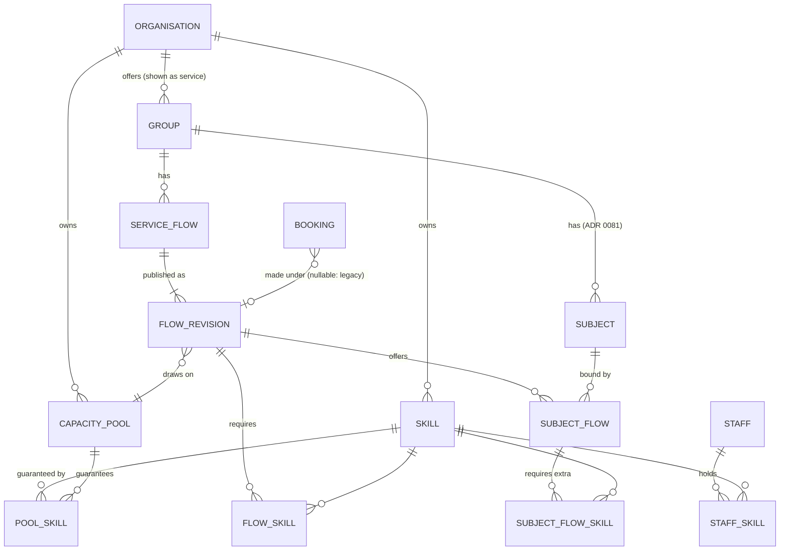

# Build brief: services, named flows and skills (ADR 0121)

Audience: the next implementation session. The decision is ADR 0121; this brief holds the detail it refers to. Written 2026-11-10 against `main` at `eb905c54`. Check current `main` and open PRs before each step. Defaults named here are proposals recorded in the ADR, not existing settings.

## Vocabulary

| Question | Dutch UI | English UI | Domain term |
|---|---|---|---|
| Which offering? | Dienst | Service | `ServiceOffering` |
| How is a request handled? | Flow | Flow | `ServiceFlow` |
| What is it about? | Onderwerp | Subject | `Subject` |
| What expertise? | Vaardigheid | Skill | `Skill`, `SkillRequirement` |
| Which shared supply? | Capaciteitspool | Capacity pool | `CapacityPool` |
| The concrete request | Verzoek | Request | `ServiceRequest` |
| Time reserved | Afspraak | Appointment | existing `Booking` |
| Waits for an operator | Werkitem | Work item | `WorkItem` |
| How people communicate | Contactkanaal | Contact channel | `InteractionKind` |
| How messages are sent | Berichtkanaal | Notification channel | existing `ChannelKind` |
| Where a request arrives | Aanmeldpunt | Intake point | `IntakeEndpoint` |
| Where work is distributed | Afhandeling | Dispatch | `DispatchTarget` |

Use *Vaardigheden* for every Dutch mention of the stored concept. In integration screens a flow of the contact center is called *Contactcenterflow / Contact-center flow*; the field is `contact_center_flow_ref`. A video request reaches the contact center as a task carrying a meeting action; do not invent a native video channel at the provider.

## Ownership

Organisation → ServiceOffering → ServiceFlow. Subject: per service (ADR 0081). SubjectFlow: many-to-many within a service, with extra skill requirements. Skill and CapacityPool: per organisation. Location and Workstation: optional, per organisation, free labels. Inherited execution settings are resolved at request creation and stored with the flow revision; credentials stay live organisation configuration and are never copied into a snapshot.

| Current group concern | Target owner |
|---|---|
| Identity, slug, IdP key, access, archive | Service |
| Subject codes | Service; combinations through SubjectFlow |
| Branding, sender, integration credentials | Organisation (unchanged) |
| Emergency closure | Service (all its flows); organisation closure covers all |
| Staffing quantity, exceptions, reservable time | Capacity pool |
| Duration, intake modes, interaction kind, data policy | Flow revision |
| Required skills | Flow plus SubjectFlow |
| Queue destination, provider mapping | Flow policy, default from the service |
| Agenda | A filtered view, not an ownership level |

## Flow contract (`FlowRevision`)

| Field | Meaning |
|---|---|
| `service_id`, `flow_id`, `revision` | ownership and version |
| `labels` | localised name, plain text, safe length |
| `intake_modes` | set of `appointment`, `on_demand` |
| `interaction_kind` | `video`, `telephone`, `in_person`, `none` |
| `duration_minutes` | reservation length; legacy values migrate unchanged |
| `capacity_pool_id` | one pool in v1 |
| `required_skill_ids` | ALL_OF |
| `subject_bindings` | allowed subjects and extra requirements |
| `dispatch_target` | own queue or an explicit organisation contact-center destination |
| `check_in_policy` | `explicit_check_in`, `media_presence`, `automatic` |
| `completion_policy` | `operator` (default), `provider_event` (validated mapping only), `legacy_video_observation` |
| `participant_data_policy` | required and optional fields, confirmation |
| `handling_action` | `open_video`, `view_request`, `call`, `assign_workstation` |
| `location_id` | required when attendance at a place is promised |
| `booking_policy`, `message_policy` | resolved limits and notification choices |

The allowed combinations of interaction kind, readiness and first action are the closed table of ADR 0121 point 4. Drafts default to appointment intake and are not bookable; publishing validates every subject combination against the pool's guaranteed skills, the organisation of every reference and that the chosen mechanism is implemented. Telephone numbers never appear in public displays or unassigned queue rows, and choosing telephone does not add a phone field to an outbound provider payload without an explicit contract change.

## Skills and capacity in one paragraph each

*Skills.* `required = flow ∪ subject_flow`; `claim allowed = authorised ∧ eligible ∧ assignable`, rechecked in the locked claim and at treatment start. Archiving a skill blocks new use but never weakens accepted work. A pool of count N promises N units each holding every guaranteed skill; the guarantee is never the union of two people's skills. Pool edits re-evaluate active assignments and future reservations under the write lock; a staffing loss is recorded as a shortage, never rewritten away.

*Capacity.* Interval accounting per pool; check-in reuses the reservation; waiting work takes admission capacity, not treatment capacity; immediate treatment may start only if its interval plus buffer fits without consuming a protected reservation; an assignment lease (proposed 5 min) is released exactly once; overruns stay visible and block conflicting starts. Example: two units, two reservations at 10:00, an immediate twenty-minute request at 09:55: a ticket may be issued, treatment may not start against the reserved units. This is a domain acceptance test.

## Lifecycle

Dimensions: reservation (existing booking states), attendance (expected, ready, departed, n/a), handling (pending, queued, assigned, called, in progress, recovery required, completed, cancelled, abandoned, expired, failed, no-show), media (not required, preparing, ready, connected, ended, failed), personal data (not collected, present, deleted). Keep separate arrival, queue, assigned, started and completed times. Idempotent check-in, ticket printing and provider events; one appointment never yields two active work items. Own queue and contact center never own the same assignment; a timed-out external create is `reconciliation_required` and not locally claimable until proven absent or fenced.

Watchdog, expiry, recovery and the deletion deadlines: ADR 0121 point 7. All derived provider ids, tickets and links belong to the deletion inventory (`app/domain/privacy.py`). The PII-on-Booking-only rule is amended when a request-level data record is introduced, in the same step as the purge inventory, masks and exports.

## Compatibility and rollback

What stays as it is: ADR 0121 point 8. Backfill: one Group, one ServiceOffering with the same identity; explicit legacy flow wrappers for the appointment and direct paths; no inferred skills, no shared pools from equal queue names; legacy direct and scheduled capacity stay apart; converting a service to the shared model is a reviewable operation listing affected future reservations. An omitted flow resolves to the configured default; an explicit unknown, foreign or archived flow is refused. Follow ADR 0116: additive schema and readers first, then backfill, then activation, contraction later, nothing in a patch. Test the previous image on the expanded database after the new image wrote records and jobs, including a booking and a claim after rollback.

## Fixture

Service *Persoonlijk advies / Personal advice*; subjects *Contract* and *Aanvraag / Request*; flows *Samen bespreken / Discuss together* (`video`) and *Persoonlijk gesprek / Meet in person* (`in_person`) on one pool of two units guaranteeing `general-advice`; a third flow *Documentcontrole / Document review* (`none`) on its own one-unit pool. `language-en` may be added to a SubjectFlow only if the pool guarantees it and the operator holds it.

## Acceptance matrix

| ID | Scenario |
|---|---|
| A01 | Arbitrary service and flow names change no behaviour, reference or routing code |
| A02 | Existing group links, entitlements, roles and widget configuration resolve unchanged |
| A03 | Legacy appointment and direct-video paths keep confirmation, dispatch, capacity, cancellation |
| A04 | Omitted flow resolves the default; invalid explicit flow is refused |
| A05 | Foreign organisation's flow, skill, subject or pool is refused in domain and persistence |
| A06 | Same subject on two flows follows the selected SubjectFlow requirements |
| A07 | Skills without permission: no access |
| A08 | Permission with a missing skill: cannot claim or start |
| A09 | Skill revoked between listing and claim: the locked claim refuses |
| A10 | Two concurrent claims: exactly one assignment |
| A11 | Two flows share a pool of two: never more than two commitments |
| A12 | Independent pools do not consume each other |
| A13 | Skills X and Y on two people do not make two X+Y units |
| A14 | Overlapping flows of different duration: interval accounting prevents overbooking |
| A15 | Double check-in: one request, one work item, reservation counted once |
| A16 | Ticket retried after response loss: same ticket |
| A17 | Immediate request before a fully reserved interval may wait, not start |
| A18 | Overrun stays visible with an explicit conflict |
| A19 | No-video own-queue flow needs no host, provider, meeting job or pending-video state |
| A20 | Request without collected email or name is valid, no invented data, correct expiry and deletion |
| A21 | Non-video external task: valid payload without meeting link, organisation credentials |
| A22 | Provider timeout then fallback then late callback: reconciliation, one fenced authority |
| A23 | Flow, skill or capacity edited after booking: stored meaning kept, operator eligibility rechecked |
| A24 | Service closes with treatment active while another service shares the pool |
| A25 | Cancel or move with pending jobs: no late meeting or task; allocations released once |
| A26 | REFUSED, suspended, awaiting rebook: no jobs, no capacity leak, no retention change |
| A27 | New completion and no-show reports from explicit evidence only |
| A28 | Archiving a referenced flow, skill or pool blocks new use, keeps history |
| A29 | Configuration export and import across versions keeps identities, mappings, revisions |
| A30 | Previous image on the expanded schema: book and claim stay safe |
| A31 | Device or public display cannot enumerate requests from a ticket number |
| A32 | Dutch and English, keyboard, scripts off, narrow screen |
| A33 | Never-checked-in and never-claimed requests expire and are deleted |
| A34 | Treatment across the watchdog and deletion deadlines: recovery state, deletion, occupancy kept |
| A35 | Late start after a claim or lease expiry: skills, ownership and capacity rechecked |
| A36 | Pool skills, staffing or binding changes with outstanding commitments: blocked, versioned or shortage recorded |

## Steps

See the *Build status* table of ADR 0121. Do not activate a normal flow while skill enforcement, capacity accounting, a completion path, bounded retention or a rollback proof is missing.

## Architecture for step 2 (phase 1 of the design, 2026-11-10)

### Decisions by the product owner

| # | Question | Decision | Consequence |
|---|---|---|---|
| D1 | Personal data of a request without an appointment | A new request-level record | Built in step 5, not step 2. `Booking` stays the store for existing appointments; a resolver reads one of the two, never both. CLAUDE.md's rule "PII only on `Booking`" and `app/domain/privacy.py` change in that same step, as a decision PR. |
| D2 | Who manages skills, skill grants and capacity pools | New organisation-level permissions | `skills.manage` and `capacity.manage` in the one matrix, level organisation, given to the organisation admin by default; a service admin refers to skills and pools but cannot change them. A change of `app/domain/authorization.py` is a decision PR. |
| D3 | First complete demonstration | One flow without video on the own queue | Steps 2 to 5 are cut along that path: video flows, the contact center (step 6) and immediate intake (step 7) follow after it works end to end. |

### Entities

`GROUP` is the existing `groups` table; there is no `service_offerings` table. Step 5 adds `SERVICE_REQUEST`, `WORK_ITEM` and the request-level personal-data record (D1); they are left out here on purpose.

### New tables in step 2 (all additive, ADR 0116 expand)

| Table | Columns that matter | Notes |
|---|---|---|
| `skills` | `id`, `organisation_id`, `code` (subject-code grammar, unique per organisation), `label_nl`, `label_en`, `archived_at` | archived, never deleted while referenced |
| `staff_skills` | `staff_id`, `skill_id`, `granted_at`, `granted_by` | unique pair; audited |
| `capacity_pools` | `id`, `organisation_id`, `name`, `mode` (`legacy_group`, `counted`), `archived_at` | `legacy_group` wraps one group's present staffing and is not shared |
| `capacity_pool_skills` | `pool_id`, `skill_id` | the set every counted unit guarantees |
| `service_flows` | `id`, `group_id`, `code` (unique per group), `state` (`draft`, `active`, `archived`), `is_default_appointment`, `is_default_direct`, `current_revision` | at most one default per entry path per group |
| `flow_revisions` | `flow_id`, `revision`, `label_nl`, `label_en`, `intake_modes`, `interaction_kind`, `duration_minutes`, `capacity_pool_id`, the policy fields as validated JSON, `published_at`, `published_by` | immutable after publishing |
| `flow_revision_skills` | `flow_id`, `revision`, `skill_id` | ALL_OF |
| `subject_flows` | `flow_id`, `revision`, `subject_code` | subject codes stay where ADR 0081 put them |
| `subject_flow_skills` | `flow_id`, `revision`, `subject_code`, `skill_id` | extra requirements of the combination |

One nullable column on an existing table: `bookings.flow_id` and `bookings.flow_revision`. No existing column changes meaning; nothing is dropped or renamed.

### Where the code lives

| Layer | Module | Responsibility |
|---|---|---|
| Domain | `app/domain/scheduling.py` (`Group`) | The service offering *is* the group; a `ServiceOffering` name in code arrives with its first caller (step 3 at the earliest), never as a second identity |
| Domain | `app/domain/skills.py` | `Skill`, code validation, `required ⊆ held`, archive rules |
| Domain | `app/domain/service_flows.py` | `ServiceFlow`, `FlowRevision`, the closed combination table, the readiness checklist as data, and the four constants of what a new flow may use so far; the flow resolver arrives in step 3 |
| Domain | `app/domain/capacity.py` | `CapacityPool`, the guarantee rule (never a union); interval accounting arrives in step 3 |
| Domain | `app/domain/ports.py` | new methods on the `Transaction` Protocol; no new port |
| Domain | `app/domain/authorization.py` | `skills.manage`, `capacity.manage` (D2); flows are edited under the existing `group.edit` |
| Adapter | `app/adapters/db/` | the rows above, scope-filtered queries, one reversible migration |
| Adapter | `app/adapters/db/configuration_document.py` | skills, pools and flows in the configuration package |
| Admin | `app/admin/`, `app/web/navigation.py` | screens of phase 2, placed as below |

No route outside the admin portal changes in step 2: the public page, the widget and the machine API keep resolving the legacy default flow, which is written by the backfill and behaves as today.

### Placement in the admin structure (ADR 0047)

| Screen | Scope → object → tab | Permission |
|---|---|---|
| Flows of a service | organisation → service → Settings, sub-tab *Flows* | `group.edit` |
| Flow detail and readiness | sub-page of that sub-tab | `group.edit` |
| Skill catalogue | organisation → organisation → Configuration, topic *Skills* | `skills.manage` |
| Capacity pools | organisation → organisation → Configuration, topic *Capacity* | `capacity.manage` |
| Staff skill grants | organisation → Staff → staff detail | `skills.manage` |

No new section, top-level entry or seventh tab.

### Backfill in the same migration

1. Per group, one `capacity_pools` row of mode `legacy_group`.
2. Per group, one flow `appointment` (default for `/g/{slug}`, widget and API) and, where the direct call is offered, one flow `direct` (default for the direct page); both `interaction_kind = video`, completion `legacy_video_observation`, no skills, state `active`, revision 1 from the group's present settings.
3. Existing bookings keep `flow_id` NULL; a reader treats NULL as the group's default for its entry path.
4. Downgrade drops the new tables and the two columns.

### What step 2 proves, and what it does not

Proves: A01, A02, A03, A05 (configuration side), A28, A29, and that no skill or shared pool is guessed. Does not prove, and therefore does not activate: skill enforcement (step 4), interval accounting (step 3), a flow without video (step 5). A new flow can be drafted and validated; the readiness checklist refuses activation of anything but the legacy wrappers until those steps are built.

## Screens (phase 2 of the design, 2026-11-10)

Seven screens were drawn as mockups and the product owner left four choices to the designer. They are decided as follows.

| # | Choice | Decision | Why |
|---|---|---|---|
| S1 | Where a service's flows live | Sub-tab *Flows* of the service's Settings tab | No seventh tab (ADR 0047); a flow is configuration of the service |
| S2 | Skills and capacity pools | Two topics on the organisation's Configuration tab, on one page | Both are short lists with one owner; split into sub-pages when either passes about twenty rows |
| S3 | Work an operator may see but not pick up | Stays in the queue, set apart, with the missing skill named | Visibility follows rights, not skills (decision 5 of ADR 0121); hiding it would make the queue length lie |
| S4 | Order on the participant page | Subject first, then the way of contact; a single valid flow skips the step | The subject narrows the flows (SubjectFlow), not the other way round |

| Screen | Content | Rule it carries |
|---|---|---|
| 1 Services | List with organisation, flows (active, draft), capacity, status | Today's list under the new name; legacy services say "existing" |
| 2 Flows of a service | Table: name, intake, contact channel, capacity, skills, state; banner for a draft that is not ready | The name decides nothing; state is `draft`, `active`, `archived` |
| 3 Flow editor | Four sections (name, intake and contact, capacity and skills, handling) and a readiness checklist of six points | Fields appear by interaction kind; readiness and first action are shown, not chosen; activation is refused until all six points are in order; a pool that does not guarantee a required skill is an error at the field |
| 4 Skills and capacity | Catalogue (name, code, staff, used by) and pools (staffing, guaranteed skills, flows) | A skill grants no rights; a pool guarantees its skills for every counted unit; the count warning is on the page |
| 5 Staff skills | Grants on the staff detail page and a table "what this person may pick up, and why" | Rights and skills are explained as two things; a change applies at the next claim or start |
| 6 Own queue | Work in treatment with the flow's action and *Complete*; waiting rows with required skills; a notice when a start would run into reserved appointments | Claim needs right and skill; completion is explicit; immediate work never consumes a reservation |
| 7 Participant | Subject, then flow by the administrator's names with one line of difference | No internal terms on the participant side |

As built in step 2c: skills and capacity pools are one sub-tab, *Skills and capacity*, under the organisation's Overview (choice S2 as one page; the sub-tab is `organisation.skills_capacity`, and the old address `/capacity` moves to its section). It is read under `organisation.view`; the add forms and the edit and archive links appear only for a viewer who holds `skills.manage` respectively `capacity.manage`, and every write route and every edit or archive page declares exactly one of those two permissions. The organisation's skills and counted pools have two platform limits (class C, `max_skills_per_organisation`, `max_capacity_pools_per_organisation`; archived ones, and existing pools, do not count). Existing (legacy) pools are shown read-only and only to a reader who reaches their service; they have no page and answer 404 to a change. A counted pool has no staffing numbers until step 3. The combined page reads usage per skill and per pool, bounded by the two limits (at most 500 skills and 200 pools); batching is a follow-up if the page becomes slow.

## Design review (phase 3, 2026-11-10)

Each screen was checked on paper against the admin structure, the matrix, the accessibility rules and the acceptance matrix. Findings are requirements for the step that builds the screen.

| Screen | Home (ADR 0047) | Permission | Width (ADR 0080) | Step | Acceptance |
|---|---|---|---|---|---|
| 1 | manage → services (exists) | `group.view` | wide | 2 (columns) | A01, A02 |
| 2 | service → Settings → Flows | `group.edit` | standard | 2 | A01, A28 |
| 3 | sub-page of 2 | `group.edit` | standard | 2 (draft, validate), 5 (activate without video) | A05, A06, A23, A36 |
| 4 | organisation → Configuration, topics *Skills*, *Capacity* | `skills.manage`, `capacity.manage` | standard | 2 | A05, A13, A28 |
| 5 | Staff → staff detail | `skills.manage` (read: `staff.view`) | standard | 2 (grants), 4 (the "may pick up" table) | A07, A08 |
| 6 | service → Agenda → Queue (exists) | `queue.work` | wide | 4 (skills), 5 (complete) | A08, A09, A10, A17, A19, A35 |
| 7 | public page and widget | none | not applicable | 3 | A04, A06, A32 |

Findings:

1. **Screen 3 works without JavaScript.** The mockup shows and hides fields in the browser. The built form is server-rendered: choosing a contact channel and saving the draft returns the form with the fields of that kind (a full page round trip, no script needed); an island may enhance it later (ADR 0118), the server stays the judge of readiness.
2. **Screen 3, pressed buttons.** The contact-channel choice is a radio group in a `fieldset`, not buttons with `aria-pressed`; the mockup's buttons are a drawing shortcut.
3. **Screen 6, colour.** The row an operator may not pick up is set apart by text ("not for you: you miss …"), not by the grey background alone.
4. **Screen 6, the reservation notice** needs interval accounting and therefore appears in step 3 at the earliest; before that the queue of a legacy flow is unchanged.
5. **Screen 5, personal data.** The page shows a staff member's skills, which is staff data, not participant data; grants are audited (`staff_skill.granted`, `staff_skill.revoked`) with the skill code, never a name.
6. **Screen 4, the count warning** stays until named staff allocations exist (follow-up row 13 of ADR 0121).
7. **Screen 7, widget.** The same two questions go inside the shadow root, with the heading receiving focus after the step, like the existing steps; the widget's `docs/widget.md` gains the optional `flow` attribute in step 3.
8. **Texts.** Every label in the mockups becomes a catalogue key with `nl` and `en` in the step that builds its screen; the manual topics follow at the next major release (follow-up row 9).
9. **No new section, top-level entry or seventh tab**; review question 7 of each PR points at this table.

Result: no screen needs a change of the model of phase 1. Step 2 can start with screens 1, 2, 3 (draft and validate), 4 and the grants of 5.
