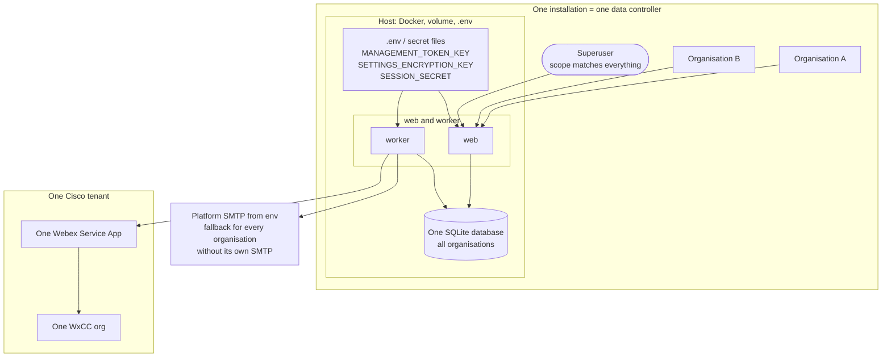

# Threat model

STRIDE per flow, plus abuse cases per public endpoint. Every abuse case has a test.
Every key, algorithm and certificate, with its owner, storage, rotation and destruction, is in
`docs/cryptography.md` (ADR 0094); a flow that adds one updates it.
Status: work packages 5 and 6 (video, WxCC, direct call).

## Flow: health checks

Public, unauthenticated: `GET /healthz`, `GET /readyz`.

| STRIDE | Threat | Mitigation | Test |
|---|---|---|---|
| Information disclosure | Readiness error reveals database path, driver message or connection string | Fixed body `{"status":"unavailable"}`; only the exception type is logged | `tests/api/test_health.py::test_readiness_reports_unavailable_without_leaking_details` |
| Information disclosure | Interactive docs expose internals and load third-party scripts | Swagger UI / ReDoc disabled | `test_interactive_docs_are_disabled` |
| Information disclosure | Readiness tells an outsider how full the disk is | Body is only `{"status":"degraded"}`; percentages and sizes go to the worker log and the superuser's audit log | `tests/api/test_health.py::test_readiness_reports_a_volume_short_of_space_as_degraded` |
| Denial of service | Logs or tables grow until the data volume is full and SQLite stops writing (e.g. a flood of failing jobs or rejected webhooks) | Container logs rotate (5 × 20 MB); system events pruned and pages reclaimed hourly; worker grades free space, logs and records a system event on change, `/readyz` degraded (ADR 0040) | `tests/jobs/test_housekeeping.py`, `tests/domain/test_storage.py` |
| Abuse | The trial call page is used to create Webex meetings without end, or to enter someone else's | The page needs a valid management token (unguessable, ADR 0011); at most `trial_calls_per_booking` meetings per booking (default 3, max 5); only for a confirmed booking before its start; one open meeting is reused; the meeting is deleted after it closes and at once on cancel or move; the link is PII, purged with the contact, followed only through a `https://` check | `test_the_number_of_trial_calls_is_limited_per_booking`, `test_an_open_trial_call_is_reused_until_it_closes`, `test_a_closed_trial_call_can_be_opened_again_until_the_limit`, `test_cancelling_plans_the_removal_of_the_trial_meeting`, `test_an_unknown_token_is_not_found`, `tests/domain/test_trial_call_service.py::test_a_trial_link_that_is_not_https_is_never_followed` |
| Denial of service | `/readyz` flooded to exhaust database connections | Cheap `SELECT 1` on a pooled connection; rate limiting at the reverse proxy *(TBD, O7)* | — |
| Tampering | Clickjacking / MIME sniffing on any response | Security headers middleware | `test_security_headers_on_every_response` |

## Flow: TLS termination (ADR 0030)

Public: ports 80 and 443 of the `proxy` service (`--profile tls`, the installer's default; ADR 0064).

| STRIDE | Threat | Mitigation | Test |
|---|---|---|---|
| Information disclosure | Traffic, session cookies or management tokens read on the network | HTTPS only: port 80 answers ACME challenges and otherwise redirects (308); HSTS from the app | `scripts/check-proxy.sh` (CI step "proxy check") |
| Spoofing / Information disclosure | The key of the internal authority (ADR 0112) leaks, so anyone can issue certificates for the lab's name | The authority lives in `proxy-data`, mounted only in the proxy (uid 10001, read-only root filesystem); only `root.crt` is copied to the volume `internal-ca`, which `web` and `worker` mount read-only; `internal` is a host decision (`proxy.env`) that the portal cannot switch on, and the installer warns in production | `scripts/check-proxy.sh` pass 3 (the published root holds no key), `tests/scripts/test_proxy_entrypoint.py::test_the_internal_authority_needs_no_mailbox_and_publishes_only_the_root`, `tests/scripts/test_install.py::test_the_internal_ca_in_production_is_allowed_with_a_warning` |
| Information disclosure | The admin's password and one-time code travel over plain http to the bundled Keycloak (ADR 0090) | With `IDP_UPSTREAM` the proxy serves Keycloak under `/idp` on the same https host; Keycloak runs with `KC_HOSTNAME=https://…`, `KC_PROXY_HEADERS=xforwarded`, so its cookies are secure and its links https; web talks to it only on the internal network | `scripts/check-proxy.sh` pass 3 (`/idp/` routed, app served next to it), `tests/scripts/test_render_keycloak_realm.py::test_an_https_address_puts_keycloak_under_idp_and_writes_the_login` |
| Spoofing | An `IDP_UPSTREAM` value injects Caddyfile directives (the value is spliced into the file by the entrypoint) | The entrypoint accepts only `[A-Za-z0-9.:_-]` and stops otherwise; the file is the host operator's, not a visitor's | `tests/scripts/test_proxy_entrypoint.py::test_an_upstream_with_an_odd_character_is_refused` |
| Denial of service | Certificate expires unnoticed: bookings, admin login and webhooks stop together | Caddy renews at a third of the lifetime with retries; certificates kept in `proxy-data`; the worker probes the public address every 6 h, shows the finding on System status and raises `tls.certificate` below 20 days left (ADR 0064) | `tests/domain/test_tls.py`, `tests/domain/test_tls_check.py`, `scripts/check-proxy.sh` (`tls-check`) |
| Information disclosure | An own certificate's private key readable by others on the host | `certs/` is git-ignored; the runbook sets the key to uid 10001 mode 600; the proxy mounts it read-only | `tests/scripts/test_install.py` (own certificate) |
| Information disclosure | The private key of an own certificate (ADR 0072) read from a database backup, a log, an audit event or the page | The key never enters the database: it is made on the host (CSR flow) or imported straight into the `portal-certs` volume; the database holds the chain and the public key only; `repr` of an imported key excludes it; audit events carry the fingerprint and expiry only; the page shows public data and the CSR (public) only; the volume is left out of the database backup | `tests/adapters/db/test_own_certificate_queries.py` (no key column), `tests/domain/test_tls_source.py` (`keys_never_appear_in_a_repr`, audited without content), `tests/admin/test_tls_source_routes.py` (key not in page, row or audit) |
| Information disclosure | The key at rest on the host volume readable by another container or user | A named volume mounted only in `web` (rw) and the proxy (ro), both uid 10001; `privkey.pem` and `pending.key` written mode 600 through a temporary name and a rename; same exposure as the ACME key in `proxy-data` | `tests/adapters/test_certificate_volume.py` |
| Information disclosure | An imported key read on the network | Upload only over the admin session (HTTPS, same-origin, recent login); the body is read once by the multipart reader and handed to the volume, never echoed or logged | `tests/admin/test_tls_source_routes.py` (migrating, cross-site refused) |
| Tampering / denial of service | A chain that takes the site down: for another key, for another name, expired, or garbage | Validated before storage (parses, public key equals the pending or served key, covers the host of `PUBLIC_BASE_URL`, validity dates); `own` is refused without a usable chain or with the key missing on this host; a failed Caddy reload keeps the previous certificate; removal is refused while in use | `tests/domain/test_tls_source.py`, `tests/adapters/test_certificate_pem.py`, `tests/scripts/test_proxy_entrypoint.py` |
| Elevation of privilege | Someone other than the superuser makes a request, changes the source or places a chain | `settings.platform.manage` (recent login on every change) on every route; the domain re-checks the matrix; cross-site posts refused; `TLS_CERTIFICATE_SOURCE` in `.env` locks the choice out of the portal; without the bundled proxy nothing applies | `tests/admin/test_authorization_matrix.py`, `tests/admin/test_tls_source_routes.py`, `tests/admin/test_tls_source_not_applicable.py` |
| Denial of service | Oversized or malformed uploads tie up the web process | 64 KB per file, refused before parsing; the multipart reader stops one byte past the limit | `tests/domain/test_tls_source.py` (oversized), `tests/admin/test_tls_source_routes.py` |
| Repudiation / availability | A database restored elsewhere silently serves nothing, or a key is lost without anyone noticing | The page shows *key missing on this server*, `own` cannot be chosen and `web` withdraws the pair so ACME applies; every request, import, upload and removal is audited | `tests/domain/test_tls_source.py` (`own_needs_the_key_on_this_host`, `sync_follows…`), `tests/admin/test_tls_source_routes.py` (restored database) |
| Spoofing | Client forges `X-Forwarded-For` to dodge or exhaust per-IP rate limits | Caddy sets the header itself (no `trusted_proxies`); `web` trusts it only from the proxy's fixed address on the `edge` network | `scripts/check-proxy.sh` `forged_header_check`, in every pass: a forged `X-Forwarded-For`, `-Proto` and `-Host` is replaced, read from the wire between proxy and web (configuration in `docker-compose.yml`) |
| Denial of service / spoofing | Every visitor over IPv6 shares one address, so one bot exhausts the booking and read limits for all of them and they all get one caller pseudonym (ADR 0053): on an IPv4-only `edge` network Docker's userland proxy re-opens IPv6 connections over IPv4 from the bridge's own address (seen on a dual-stack host on 5 November 2026) | The `edge` network is dual-stack (a unique local IPv6 subnet), so Docker forwards IPv6 to the proxy with NAT and the visitor's address stays; web listens on IPv4 only and keeps trusting the proxy's one IPv4 address. The installer warns when the engine is older than 27 or `ip6tables` is off, recreates an `edge` network that predates IPv6, and keeps it IPv4 only on a kernel without IPv6 (`OPENPLANNER_EDGE_IPV6=false`) | `scripts/check-proxy.sh` `ipv6_client_check` (pass 1): a request from an IPv6 address reaches web with that address in `X-Forwarded-For`, read from the wire; `tests/test_docker_compose.py`, `tests/scripts/test_install.py` |
| Information disclosure | Traffic between the proxy and `web` is read on the network (ADR 0091 points 2 and 3) | With the bundled proxy the hop is plain HTTP on the `edge` network of one host: a **recorded exception**, because whoever reads that bridge already has the host and the TLS keys. An own proxy on another machine gets HTTPS from uvicorn (`WEB_TLS_CERT_FILE`, `WEB_TLS_KEY_FILE`, class B, both or neither); System status warns while `FORWARDED_ALLOW_IPS` names another address than the bundled proxy's and web serves no TLS | `tests/domain/test_web_transport.py`, `tests/admin/test_overview_routes.py::test_the_status_widget_warns_about_a_proxy_hop_without_tls_adr_0091`, `tests/test_config.py::test_web_tls_needs_both_files_or_neither_adr_0091` |
| Denial of service | Oversized bodies on public forms | 64 KB on `/g/*` and `/b/*`, 1 MB elsewhere, up to 512 MiB on the two configuration imports only, where the app enforces the configured limit (HTTP 413) | `scripts/check-proxy.sh` |
| Denial of service | Slow-loris clients hold connections open | Header 10 s, body 30 s, write 60 s, idle 2 min in the Caddyfile | — |
| Information disclosure | A bot, Webex Connect or WxCC flow configured with `http://` sends its client secret or webhook body in clear text because port 80 redirects `/api/*` and `/webhooks/*` with a 308 that repeats the POST | The bundled proxy answers machine paths on port 80 with 403 and no `Location`; browser paths keep the redirect; a proxy of your own must do the same (runbook) | `scripts/check-proxy.sh` (`machine_paths_check`, run in CI with `ci:full`) |
| Information disclosure | Booking paths with tokens in proxy logs | No access log in the Caddyfile | — |
| Elevation | Compromised proxy gains host rights | uid 10001, read-only filesystem, `cap_drop: ALL`, `no-new-privileges`, unprivileged ports | `trivy` misconfiguration scan |

## Flow: public address and round trip (ADR 0086)

`GET /api/v1/instance[?probe={nonce}]` is public, needs no permission and answers the installation's `instance_id` to everyone. The worker calls it through `PUBLIC_BASE_URL` (and `WEBHOOK_BASE_URL` when that differs) on the certificate's cycle, with a nonce it stored first; the holder of the pending nonce also learns the scheme the app saw and whether the forwarded headers were honoured. The web process counts requests whose forwarded headers it ignored.

| STRIDE | Threat | Mitigation | Test |
|---|---|---|---|
| Information disclosure | The endpoint is used to learn how the proxy is configured (scheme, trusted headers) or to map addresses | Without the pending nonce the answer is the instance id only (a random UUID, no secret); the detail goes to the holder of a nonce that lives as a hash in the database for 5 minutes and works once; no address is ever in the answer, no cookie is set, `Cache-Control: no-store` | `tests/api/test_instance.py::test_a_stranger_gets_the_installation_id_and_nothing_else`, `test_the_answer_is_not_cached_sets_no_cookie_and_holds_no_address` |
| Spoofing | Nonce guessing | 128 random bits, one pending at a time, stored as `sha256`, compared in constant time, consumed on first use; a wrong guess does not burn the pending one; values longer than 64 characters are refused before the database | `tests/api/test_instance.py::test_abuse_a_guessed_nonce_gets_no_detail_and_does_not_burn_the_pending_one`, `test_abuse_a_nonce_works_once_only`, `test_abuse_an_oversized_probe_value_is_refused_before_it_reaches_the_database`, `tests/domain/test_address_check.py::test_a_nonce_older_than_its_lifetime_is_not_accepted` |
| Denial of service | The endpoint is flooded, or its nonce check is used to take the database's write lock | Falls under the availability-read limiter of ADR 0042 §7 (`request.rate_limited`, one security event per caller); a request without a nonce only reads | `tests/api/test_instance.py::test_abuse_the_endpoint_falls_under_the_availability_read_limit` |
| Spoofing | A name that points to another installation (stale DNS, a moved host, a copied `.env`) goes unnoticed: links in emails lead to the wrong place | The worker compares the answered `instance_id` with its own: `other_instance` is a system event `public_address` the first time and every `tls_alert_repeat_hours`, and shown on System status | `tests/domain/test_address_check.py::test_a_changed_problem_is_reported_at_once`, `tests/admin/test_address_status.py::test_a_finding_shows_with_its_time_the_reason_and_what_the_app_saw` |
| Spoofing | Every visitor shares the proxy's address and one bot exhausts the booking limit for everyone, because `FORWARDED_ALLOW_IPS` does not name the proxy (proven in the tunnel trial of 1 November 2026) | The round trip finds `proxy_not_trusted` (headers there, app kept the peer's address) and `no_proxy_headers`; independently the web process counts the first real requests with `X-Forwarded-For` or `X-Forwarded-Proto` that it ignored and raises one `public_address` event per repeat period, with the class of the peer (loopback, private, public) and never an address; System status shows the count and, for a private or loopback peer only, the proxy's address | `tests/domain/test_proxy_watch.py`, `tests/api/test_instance.py::test_forwarded_headers_that_are_ignored_leave_one_system_event_with_codes_only`, `test_a_public_peer_is_counted_without_its_address`, `tests/admin/test_address_status.py::test_forwarded_headers_that_were_ignored_are_shown_by_category_and_count` |
| Information disclosure | A visitor's address reaches the log, an event, the page or a stored row through that watch | A public peer is never stored or shown, only its class; the event carries `peer:<class>`; the stored check keeps the origin of the public address and codes | `tests/api/test_instance.py::test_a_public_peer_is_counted_without_its_address`, `tests/adapters/db/test_public_address_queries.py::test_only_a_hash_and_no_address_are_stored`, `tests/domain/test_address_check.py::test_an_event_names_codes_only` |
| Tampering | A forged `Host` header or a proxy that is not trusted turns the app's own redirects (`/admin` to `/admin/`) into links on another host or on `http://` | Every link is built on `PUBLIC_BASE_URL`; the one redirect Starlette builds on the request's origin is rewritten to the public address by `PublicRedirectMiddleware`; a test fails when a module under `app/` builds an address from the request | `tests/api/test_public_links.py`, `tests/admin/test_address_status.py::test_the_login_redirect_uri_is_the_public_address_whatever_the_host_header_says` |
| Denial of service | A network that cannot reach its own public name makes the probe raise alarms for ever | `PUBLIC_ADDRESS_CHECK_ENABLED=false` (class B, host's network); System status then says *not checked: switched off on the server*, never *ok* | `tests/jobs/test_worker.py::test_worker_leaves_the_public_address_alone_when_the_probe_is_switched_off`, `tests/admin/test_address_status.py::test_a_switched_off_probe_says_so_and_never_ok` |
| Elevation of privilege | Following a redirect from the public address sends the probe, with its nonce, elsewhere | The probe follows no redirect (`redirected` is a finding), sends no cookie or credentials, and the nonce is in the query only of that one request; the check stores the origin, not the query | `tests/adapters/test_instance_probe.py::test_a_redirect_is_a_finding_and_is_not_followed` |
| Tampering | A downgrade: the proxy accepts TLS 1.0 or 1.1, a weak suite, or the HSTS header is missing, too short or sent over plain HTTP (a change of the Caddyfile, a new base image, an own reverse proxy that strips it) | The standards of ADR 0086 are asserted, not assumed: TLS 1.2 and 1.3 only with AEAD suites (NCSC), HSTS of at least a year with `includeSubDomains` on HTTPS and none on port 80 (Forum Standaardisatie, RFC 6797), and the round trip through the proxy is `ok` in every certificate mode and `proxy_not_trusted` with a wrong `FORWARDED_ALLOW_IPS`; the yearly internet.nl test is the outside view (`docs/runbook.md`, *TLS audit*) | `scripts/check-proxy.sh` (CI step *proxy check*), `tests/scripts/test_check_proxy.py` |

## Flow: public pages and language choice

Public, unauthenticated: `GET /` (more pages from WP3), `GET /static/*`. Inputs from outside:
`?lang=`, the `lang` cookie, `Accept-Language`.

| STRIDE | Threat | Mitigation | Test |
|---|---|---|---|
| Tampering / XSS | Script injected through `?lang=`, the cookie or `Accept-Language` | Values are normalised to a strict locale pattern and must match an enabled locale; anything else is ignored | `tests/i18n/test_negotiation.py`, `tests/api/test_pages.py::test_unsupported_choice_is_ignored` |
| Tampering / XSS | Markup in a translation or admin override | Jinja2 autoescape, `StrictUndefined`; translations are plain text | `tests/i18n/test_formatting.py` |
| Elevation / information disclosure | Format-string injection through an override (`{x.__class__}`) | Own placeholder formatter without attribute, index or conversion access; overrides must keep the source's placeholders | `test_format_has_no_attribute_index_or_conversion_access`, `test_override_must_keep_the_same_placeholders` |
| Spoofing (open redirect) | Language-switcher link pointing to another host through a crafted path | Switcher links are query-only relative URLs (`?lang=en`) | `test_switcher_links_never_contain_the_request_path` |
| Denial of service | Very long `Accept-Language` header | Parsed up to 4096 characters and 32 entries | `test_parse_ignores_absurdly_long_headers` |
| Information disclosure | Cached page served in the wrong language or to another visitor | `Vary: Accept-Language, Cookie`, `Cache-Control: no-store` | `test_html_pages_get_a_csp_allowing_own_stylesheets` |
| Tampering | Injected script or inline style on HTML pages | CSP without `script-src`; only `style-src 'self'`; no inline styles | same |
| Tampering (stale or poisoned cache) | A browser or shared proxy keeps an old stylesheet or script after an update, or a crafted `?v=` makes a changed file look permanent | Every template links a static file through `static_url`, which adds the file's content hash as `?v=`; only a request whose `v` equals the file's current hash gets `immutable`, every other request (none, old, forged) gets `no-cache` with the ETag; the hash is recomputed when size or modification time changes; a path outside the static folder is refused | `tests/web/test_static_assets.py::test_an_unversioned_or_stale_url_is_revalidated_not_kept`, `test_the_version_changes_when_the_file_changes`, `test_no_template_writes_a_static_url_by_hand`, `test_a_missing_file_or_a_path_outside_the_folder_is_an_error` |
| Tampering (stored XSS) | A served brand SVG (`/static/brand/*.svg`, ADR 0060) carries script, event handlers or a reference to another host | The files are hand-written and reviewed in PRs; a test refuses `<script`, `on*=`, `href` and any URL other than the SVG namespace; pages load them as `` under `img-src 'self'`, where script never runs | `tests/web/test_brand.py::test_svgs_carry_no_script_handler_or_external_reference` |

## Dynamic scan (OWASP ZAP baseline, on merge to `main`)

ZAP scans the seeded booking page `/g/demo` and everything it links to. Accepted alerts are
listed with their reason in `.zap/rules.tsv`: non-storable content (deliberate `no-store`),
cookie poisoning and user-controllable attributes (only validated values are reflected), and
absent anti-CSRF tokens (Fetch Metadata is the CSRF defence, see above). Any other warning
fails the build.

## Browser model (ASVS V3.2.1, V3.4.3, V3.5.1-3.5.4, V3.7.2)

What the browser is allowed to do with OpenPlanner and why. Authentication paths are in
`docs/authentication.md`.

### CSRF in three layers

No form carries a CSRF token. Three independent layers stand in the way of a cross-site request:

1. **`SameSite=Lax` on the cookie.** The admin cookie (`__Host-op_admin` on https, `op_admin` over http) is not sent on a cross-site
   `POST`, `fetch` or subresource request, only on top-level `GET` navigations. This is the
   layer that protects a browser that sends neither header below.
2. **Fetch Metadata** (`require_same_origin`, `app/web/protection.py`). Every state-changing
   route, admin and public, depends on it (`SameOrigin`). `Sec-Fetch-Site` is sent by every
   current browser and cannot be set by a page; only `same-origin` and `none` pass, anything
   else is a `403` and a security event (ADR 0053).
3. **`Origin` comparison.** Only when `Sec-Fetch-Site` is absent, the `Origin` header is
   compared with this site. It is not trusted when `Sec-Fetch-Site` is present, because the
   referrer policy of some pages makes browsers send `Origin: null` for same-origin posts.

**The exception, on purpose.** A request with neither `Sec-Fetch-Site` nor `Origin` passes
layer 2 and 3. Browsers send at least one of them on every `POST` (`Origin` on every
cross-origin and every `POST` request in current browsers), so such a request is not a browser form post: it comes from a
script, `curl` or a very old client. It can reach the admin portal only with the admin
cookie, which it has only when the caller already holds it, and a browser that does hold it
withholds it from cross-site requests (layer 1). Refusing these requests would break health
probes and tests without closing a path. The behaviour is pinned by
`tests/admin/test_admin_flow.py::test_a_post_without_fetch_metadata_and_without_origin_is_let_through`.
Where `SameSite` is not enough because the cookie is not involved, there is nothing to
forge: the public forms act on a link or on a booking the caller creates, and the bot API
uses a bearer token that a page cannot attach (no CORS headers).

The widget's cross-origin `POST` (ADR 0035) is a different case: it is allowed only from the
origins an organisation configured, answered with an exact `Access-Control-Allow-Origin`, and
carries no cookie.

### `GET` routes with an effect (V3.5.3)

No `GET` changes a booking, a setting or a right. The routes below do something besides
returning a page; each is deliberate.

| Route | Effect | Why it is acceptable |
|---|---|---|
| `GET /b/m/{ref}/confirm`, `/cancel`, `/wait/leave` | None; shows a button. The `POST` confirms, cancels or leaves (ADR 0056). | Mail scanners and link previewers that follow the link change nothing. |
| `GET /b/m/{ref}/join`, `/join/go` | Writes a join-page or join-click event on the booking's timeline (ADR 0072). | Evidence for troubleshooting, no change to the booking. |
| `GET /b/m/{ref}/test/go`, `/wait/status` | Redirect into the open trial meeting; status poll. | Read-only. |
| `GET /admin/login`, `/admin/callback` | Start and finish an OIDC login. | The callback is a `GET` by the protocol; `state` and `nonce` bind it to the browser that started it. |
| `GET /admin/preferences` | Stores theme, menu width and alert choices in the caller's own session cookie, then redirects to `next`. | Only own presentation preferences; `next` is checked (see below); a third-party link can at worst change a theme. |
| `GET /admin/groups/{slug}/bookings/{id}?contact=show` | Shows the participant's contact details and writes the audit event `booking.contact_viewed`; one person's request past `contact_reveals_alert_per_hour` in an hour also writes the system event `booking.contact_reveals_alert` (ADR 0044 §2). | Reading, accounted for; only the button on the booking page itself counts (`from_this_page`), so a shared, bookmarked, crafted or prefetched address, or a link to it on another page of the portal, shows and writes nothing. |
| `GET /admin/updates/progress`, `/…/live` fragments | Poll status. | Read-only. |

### Redirects (V3.7.2)

Who decides the target of every redirect the application issues. No redirect target is taken
from a request without a check.

| Redirect | Target decided by | Control |
|---|---|---|
| After admin login or re-login, update snooze, preferences (`next`) | The request (`next` parameter; for a page opened without a session, its own path and query) | `safe_next`: must start with `/admin`, no `//`, no `\`, no `://`; else `/admin/`. The guard runs on the whole value; its query then keeps only the view parameters of the allow-list `RETURN_QUERY_PARAMS` (`app/admin/return_to.py`: dates, tabs, closed-list filters, slugs; value of letters, digits and `_.:-`; at most 8), so no `q` (typed text), no `done`/`count`, no token or code reaches the login URL or the session; an anchor comes back only as a plain name. Login and re-login use the same `return_path`. `test_next_cannot_leave_the_admin_portal`, `test_the_kept_query_holds_no_token_and_no_free_text`, `test_a_long_query_is_dropped_whole`, `test_a_recent_login_comes_back_with_the_view_query_only` |
| `GET /admin/login` to the IdP | The IdP's `authorization_endpoint` from the pinned discovery document (ADR 0097); organisation providers: the endpoint stored at registration | Issuer compared exactly; only `https` (or `http` in development) |
| Logout to the IdP's `end_session_endpoint` | Same discovery document | `post_logout_redirect_uri` is built by us; interstitial page keeps CSP `form-action 'self'` |
| `GET /b/m/{ref}/join/go`, `/test/go` | The join link of the Webex meeting, kept on the booking | `join_link` refuses anything but `https` and applies the group's client setting (ADR 0075); the value is written by the Webex adapter, never by a request |
| After a form post (`/g/{slug}/book`, `/b/m/{ref}/…`, direct call) | The application: path built from the slug or the reference of the booking the cookie holds | Relative paths only; references and slugs come from the database |
| After an admin form post | The application: the route's own URL plus `?done=`, optionally an anchor | Relative; `done` values come from a closed list |
| Moved screens (`/admin/groups/{slug}/hours`, `/admin/groups/{slug}/closure/contacts`, `/admin/closures`, old organisation paths) | The application | Fixed relative `301`/`308`, built from the authorised object's slug or a constant (`/admin/?closures=1`); same permission as the target. `test_the_old_contact_path_redirects_to_messages_contact`, `test_active_closures_are_a_filter_of_the_overview` |
| `GET /b/{token}…` (any old link): the exchange | The application: `/b/m/{ref}` plus the same page, and a well-formed `?lang=` | Relative; the reference comes from the database after the token was checked |
| `GET /b/m/{ref}/wait/status` without the cookie | None: the refusal page, no redirect | The 403 page; a poll (`redirect: manual`) just stops |

### Header policy per response type (V3.2.1, V3.4.3)

`SecurityHeadersMiddleware` (`app/api/security_headers.py`) puts deny-by-default headers on
every response and never overrides one a route set. HTML goes through `app.web.templates.render`,
which sets its own CSP and `no-store`.

| Response type | Content-Security-Policy | Other headers |
|---|---|---|
| JSON, plain text, CSV, errors, anything without its own policy | `default-src 'none'; base-uri 'none'; frame-ancestors 'none'` | `X-Content-Type-Options: nosniff`, `X-Frame-Options: DENY`, HSTS, `Referrer-Policy: same-origin`, `Permissions-Policy` off for camera, microphone, geolocation and more, COOP `same-origin`, COEP `require-corp`, CORP `same-origin` |
| Admin and public HTML | `HTML_CSP`: `default-src 'none'; style-src 'self'; img-src 'self'; font-src 'self'; form-action 'self'; base-uri 'none'; frame-ancestors 'none'` | `Cache-Control: no-store`, plus all of the above |
| HTML with own scripts (participant pages with polling, update progress, agenda) | `SCRIPT_CSP`: as `HTML_CSP` plus `script-src 'self'; connect-src 'self'` | Same; no inline script or style anywhere |
| Widget script (`/widget/v1/openplanner-booking.js`) | The default (the file is not a document) | `Access-Control-Allow-Origin: *`, `Cross-Origin-Resource-Policy: cross-origin` so any host site can load it; no cookie |
| Widget API | The default | `Access-Control-Allow-Origin` echoes an allowed origin with `Vary: Origin`; the public availability read uses `*` and `public, max-age=300` |
| Brand assets, theme CSS, fonts | The default | `public, max-age=3600` (static files: versioned URL through `static_url`); same-origin only, uploaded images and fonts served with their validated media type |
| Machine API | The default | `Cache-Control: no-store` on the token and errors; no CORS |

A browser honours `base-uri` and `form-action` only in a document, which is why they matter
for HTML and cost nothing to state on everything else; they close the case of a response that
is sniffed or rendered as a document by mistake. `frame-ancestors 'none'` and `X-Frame-Options:
DENY` hold everywhere: the widget is a Web Component loaded as a script, never an iframe.

### One origin for all organisations (V3.5.4)

All organisations, groups, the admin portal and the participant pages share one origin per
installation. This is a **deliberate limitation**: OpenPlanner is one application that
separates organisations by scope (ADR 0014, SQL filters on every query), not a set of
independent applications. The consequences are known: a script injection on any page would
reach every page of the origin, so the rest of the model compensates (no inline script,
no `unsafe-eval`, a CSP without third parties, `HttpOnly` cookies, output escaping by
Jinja2 autoescape, an organisation's uploads limited to validated images and fonts and served
with their own media type and `nosniff`). The admin cookie is scoped to `/admin`; participant
pages never read the session. A separate hostname per organisation is possible behind the
proxy and is only built when a client requires it.

## Shared trust boundaries (TEN-06, BP-4)

One installation serves every organisation in it. The separation between organisations is a
rule of the application (ADR 0014 scope on every query, per-organisation settings, markers
tested in the isolation sweeps), not a physical one. Everything below is shared by all
organisations of one installation. This section names each shared item, what a compromise of it
gives, what compensates, and what stays open. It is the input for the decision on when an
organisation needs an installation of its own.

**Decision (BP-4, product owner, 1 November 2026).** For the first client there is
**one installation per data controller** (verwerkingsverantwoordelijke). Several organisations
inside one controller on one installation stay allowed. Organisations of different controllers
never share an installation. The shared items below are therefore accepted as shared **within one
controller**, and are not accepted across controllers.

| Shared item | What it means | Compromise gives | Compensation in place | Open or accepted |
|---|---|---|---|---|
| **Superuser** | The platform role. Its scope matches every organisation and group (ADR 0014); it sets platform settings (class C), sees System status, runs updates, switches diagnostic mode and the machine API. Nothing in the matrix limits it per organisation. | Read and change of every organisation's configuration and, through the booking views its permissions allow, of personal data of every organisation. | Entitlements come from the IdP (ADR 0049), there is no local account and no break-glass login; every decision and change is an audit event, shipped after commit to the log platform outside the installation (ADR 0034), so the superuser cannot erase the trail; the role is held by few named people. | Accepted within one controller. Not acceptable across controllers: it is the main reason for BP-4. |
| **Host administration** (Docker, volume, `.env`) | Whoever can run `docker`, read the data volume or the environment of the containers. | Everything: the database file, the keys in `.env`, the decrypted secrets in process memory, the log lines. Also the host command `python -m app.cli` (closure, `oidc-check`, `purge-overdue`). | Non-root uid, read-only root filesystem, `cap_drop: ALL`, `no-new-privileges`; bootstrap secrets via env or `X_FILE` only, never in the repository; SQLite secure delete and WAL truncation after a purge (WP-A3); signed images, verified at deployment (ADR 0006). The host's access control is the hosting party's (external evidence, WP-C1). | Accepted: host administration is above the application in the trust order. The host team must not be a party of another controller. |
| **One database** | A single SQLite file in WAL mode holds all organisations. Isolation is `WHERE organisation_id` / `group_id` in the SQL adapter, derived from the permission's `Scope`. | A SQL injection or a missed filter reads across organisations; a stolen file or snapshot holds every organisation's bookings. | The authorisation sweep covers every role against every admin route, own and other group (CI); the concurrent A/B isolation test and the export marker sweep (WP-B1, WP-B2); no raw SQL outside `app/adapters/db/`; PII purged at `slot.end + 24h` and overwritten (WP-A3), so the file holds little personal data at rest. | Accepted within one controller. A database per organisation is not built and not planned. |
| **One `MANAGEMENT_TOKEN_KEY`** | Management tokens (ADR 0011) are HMAC-SHA256 of a per-booking salt under this one key. | Database plus key is enough to compute the token of any booking of any organisation; the key alone gives nothing. | Key in env only, never in a job payload or log; the salt is per booking and only `sha256(token)` is stored; rotation with a grace period without loss (ADR 0094). | Accepted. Rotation changes the key for all organisations at once. |
| **One `SETTINGS_ENCRYPTION_KEY`** | Every integration secret (Webex, SMTP and SMS passwords per organisation, log destinations, IdP client secrets) is AES-256-GCM under a key derived from this one value (ADR 0008). | Decrypts the secrets of all organisations in one database copy. | Secrets are write-only in the UI; the key lives outside the database and outside the backup; rotation re-encrypts everything (ADR 0094); the TLS private key is never in the database (ADR 0070). | Accepted. A key per organisation would not help: the process holds the derived key in memory for all organisations. |
| **One Webex Service App and one WxCC org** | `integration_credentials` is keyed by name, not by organisation (`app/adapters/integrations.py`); video meetings (Webex) and tasks (WxCC) of all organisations go through one app, one token store and one WxCC org in one Cisco tenant. | The Cisco tenant's administrators and the app's tokens can see meetings, tasks and statistics of every organisation. One organisation's misconfiguration (queue, entry point) or quota use affects the others; a Webex or WxCC outage hits all. | Outbound payloads carry only first name, host join URL and routing codes (ADR 0081); webhooks are verified; queue and entry point are mapped per group. | Accepted within one controller that owns the Cisco tenant. **Not acceptable** across controllers: they would share a processor tenant and its administrators. |
| **SMTP fallback through the environment** | An organisation without its own SMTP settings sends through `SMTP_HOST` of the platform (ADR 0022; `fallback_mail` in `app/adapters/senders.py`). | Mail of those organisations leaves from one sender identity and one mail account; the platform mail provider sees their message content and recipients. SPF, DKIM and DMARC are of the platform domain, so a reputation problem of one organisation affects the others. | The organisation's own SMTP wins when stored; the Channels screen shows the path in use; deliverability check (ADR 0073); no PII in the logs of a send. | Accepted within one controller. For a second controller the fallback must be off (leave `SMTP_HOST` unset) and each organisation brings its own SMTP, or it gets its own installation. |
| **Process memory, one origin, one log stream** | web and worker hold all organisations in one process; one origin serves all (see *One origin for all organisations*); one log platform receives every organisation's events. | A script injection or memory-sharing bug reaches all organisations. The log platform operator sees all organisations' event metadata (ids, slugs, codes, no PII). | Per-organisation caches keyed by organisation and group; request-scoped context variables; strict CSP; masking processor. Parallel isolation proof: WP-B1. | Accepted within one controller. |

### When an organisation needs its own installation

An organisation needs an installation of its own, not a place in a shared one, when **any** of
these holds:

1. **A different data controller.** Two controllers never share an installation (BP-4): they
   would share the superuser, the host administration, the keys, the database and the Cisco
   tenant, and the controller of the installation would become a processor for the other
   without an agreement.
2. **A separate Cisco tenant is required**, for instance because the organisation's WxCC org or
   Webex organisation is another legal entity, or its Cisco administrators may not see other
   organisations' tasks and meetings.
3. **Physical or logical separation is a stated requirement** (contract, accreditation, a
   classification of the data above what the shared host is approved for, a rule that data lie
   in a separate database or on a separate volume).
4. **A different trust domain for the people with full access**: the superuser or host team of
   the shared installation may not be able to see this organisation's participants, for example
   because they belong to another employer, ministry or group of companies.
5. **A different retention or log regime** that the platform settings (class C) cannot meet, for
   instance a log platform that another controller may not share.
6. **An availability or change regime of its own**: an update window, a maintenance window or an
   incident that must not affect the others (updates and maintenance mode are per installation,
   ADR 0029, ADR 0038).

None of these holds for several organisations of **one** controller, one Cisco tenant and one
operating team. Those stay on one installation. A new organisation is checked against this list
before it is created; a "yes" to any point means a new installation, not a new organisation.

An installation of its own costs little by design: the same images, its own `.env` keys,
database and volume, its own IdP registration and its own Cisco Service App. The configuration
package (ADR 0089) moves settings between installations.

## Cross-cutting

| Threat | Mitigation | Test |
|---|---|---|
| PII in logs | structlog processor masks PII fields, also for stdlib loggers; semgrep rule forbids PII fields in log calls | `tests/test_logging.py`, `.semgrep/rules.py` |
| Secrets in access logs (management tokens in paths) | uvicorn access log disabled | `test_uvicorn_logs_are_json_and_access_log_is_off` |
| A client sets its own trace id to merge its requests into someone else's trace (ADR 0040) | Trace ids are generated by the server per request; an incoming `traceparent` is ignored | `tests/api/test_trace.py::test_every_request_gets_its_own_trace_and_its_group` |
| A crafted path reaches the log as a group tag | Only a well-formed slug is bound as `group` | `tests/api/test_trace.py::test_a_malformed_slug_is_not_bound` |
| Tampering: a superuser with database access deletes audit rows (ADR 0034) | Every committed audit event is also a line on the log platform, outside the installation | `tests/adapters/db/test_event_emit.py`, `tests/admin/test_audit_routes.py::test_an_admin_action_is_shipped_once_as_an_audit_line` |
| Spoofing: a webhook for one contact-center platform is sent to another platform's address, or a task id of one platform matches a booking whose task is at another (ADR 0032) | `/webhooks/contact-center/{kind}` answers only for a kind with an adapter (404 otherwise, as without a secret), each verified by its own adapter; the task is looked up together with its platform | `tests/api/test_webhooks.py::test_a_platform_without_an_adapter_does_not_exist`, `test_a_forged_event_on_the_neutral_route_is_refused`, `tests/adapters/db/test_contact_center_rows.py::test_a_task_id_is_found_only_at_its_own_platform` |
| Spoofing: one organisation's platform (or someone holding its secret) reports events about another organisation's bookings at its own address (ADR 0032 point 10) | `/webhooks/contact-center/{kind}/{org}` verifies with that organisation's own generated secret, and the task is looked up among that organisation's bookings only; an unknown or unconnected organisation is a 404 (accepted: an unauthenticated caller can tell which organisation has its own connection; slugs are public already) | `tests/admin/test_contact_center_connection_routes.py::test_the_organisations_address_verifies_with_its_own_secret`, `tests/domain/test_integration.py::test_an_organisations_address_finds_only_its_own_bookings_tasks` |
| Information disclosure: an organisation's contact-center client secret, refresh token or webhook secret leaks through the portal, the audit log or a form echo (ADR 0032 point 9) | One AES-256-GCM record, write-only: the page shows only whether a secret is set and when the webhook secret was made; the webhook secret is generated, never typed or shown; audit events name fields, never values; a refused form never echoes a secret | `tests/domain/test_contact_center_connection.py::test_a_connection_is_kept_sealed_and_shown_without_its_secrets`, `tests/admin/test_contact_center_connection_routes.py::test_the_superuser_connects_an_organisation_and_never_sees_the_secrets`, `test_a_refused_field_is_shown_on_the_form` |
| Denial of service: a flood of forged webhooks fills the audit table | Rejections are one security event per kind per window, the rest counted | `tests/api/test_webhooks.py::test_a_flood_of_forged_webhooks_is_one_security_event_per_source`, `tests/domain/test_security_log.py` |
| Repudiation: attempts on public entry points (rate-limit floods, form bots, CSRF, failed logins, token and link guessing) leave no traceable record (ADR 0053) | Each is a security event with a caller pseudonym, shipped to the log platform | `tests/api/test_security_events.py`, `tests/domain/test_security_log.py` |
| Information disclosure: a caller's IP address in events or on the log platform (ADR 0053) | Only an HMAC pseudonym under a derived server key (IPv6 by /64); no request content in the detail | `tests/domain/test_client_pseudonym.py`, `tests/api/test_security_events.py::test_a_filled_in_honeypot_is_a_security_event_without_the_address` |
| Denial of service: a distributed attack fills memory or the audit table with security events (ADR 0053) | One event per kind and caller per window; at most `SECURITY_EVENT_MAX_SOURCES` windows, further callers count as `many` | `tests/domain/test_security_log.py::test_beyond_the_bound_further_clients_count_as_many`, `tests/api/test_security_events.py::test_a_rate_limit_flood_is_one_event_per_caller` |
| CSV injection: an exported cell runs as a formula in Excel (ADR 0040) | Cells starting with `=`, `+`, `-`, `@`, tab or CR get a leading `'` | `tests/domain/test_audit_export.py::test_a_formula_becomes_text` |
| An admin exports events outside their scope, or exports without trace | Export behind `audit.export`, scoped in SQL like the page; every export (and refusal) is an audit event | `tests/admin/test_audit_routes.py::test_the_export_is_the_current_filter_inside_the_scope`, `test_the_group_admin_may_view_but_not_export`, `test_every_export_is_itself_an_audit_event` |
| Denial of service through a huge export | At most `AUDIT_EXPORT_MAX_ROWS` rows and `AUDIT_EXPORT_MAX_DAYS` days; refused, never streamed without bound | `test_an_export_over_the_row_limit_is_refused_and_audited`, `test_an_export_over_the_period_limit_is_refused_on_the_page` |
| Debug detail leaks personal data or fills the disk (ADR 0040) | Debug events carry codes and ids only (same `AuditEvent`); only the superuser switches the mode; it ends after `DIAGNOSTIC_MODE_HOURS`; at storage grade critical the brake ends every mode; 7-day retention; never shipped | `tests/domain/test_diagnostics.py`, `tests/jobs/test_housekeeping.py::test_at_grade_critical_the_brake_ends_diagnostic_mode`, `tests/adapters/test_event_sink.py::test_diagnostic_events_never_leave_the_installation` |
| PII in logs through a library at DEBUG or TRACE (`aiosqlite` bound values, `httpcore` response headers, a library added later) | `configure_logging` is an allowlist: `LOG_LEVEL` governs `openplanner.*`, the structlog loggers and `uvicorn.error` only, the last down to INFO (below that uvicorn writes every connection's address, and the websockets library, which uvicorn hands the same logger, writes a WebSocket request's line and every header, cookies included); every other logger stays at WARNING at any level, after a live level change and when the library sets its own level (root level plus a handler filter), so the stream, the tap and log shipping never see it; `sql.slow` carries statement type and table only; engines are built with `hide_parameters` | `tests/test_logging.py::test_the_real_engine_logs_no_bound_value_at_any_level`, `test_a_foreign_logger_stays_at_warning_at_every_level`, `test_our_own_loggers_follow_the_level_and_the_trace_points_work` |
| Information disclosure: a library's own line names the visitor's address and the raw path, so both reach stdout, the tap and log shipping; for `/b/{token}` the path is the management token (ADR 0011). slowapi writes `ratelimit 60 per 1 minute (<address>) exceeded at endpoint: <path>` at WARNING on every rate-limit hit; uvicorn writes `<address> - "WebSocket <path>?<query>" 403` at INFO for any WebSocket request, with the address from `X-Forwarded-For` (found in the security review of PR #532, which makes IPv6 visitors keep their own address) | `configure_logging` drops the lines of `REQUEST_LINES` (logger and start of the message template) in a filter on the handler, at every level, so the stream, the tap and log shipping never see them; the hit stays visible as the security event `request.rate_limited` with a pseudonym (web, widget, machine API, unknown links; ADR 0053); slowapi's lines without request data (storage unreachable) and uvicorn's start-up and error lines still come through. Rewording in a library update fails the tests, which drive the real slowapi and a real uvicorn | `tests/test_logging.py::test_a_rate_limit_hit_leaves_no_address_and_no_path_in_any_line`, `test_a_websocket_request_leaves_no_address_path_or_header_in_any_line` (IPv4 and IPv6, INFO, DEBUG and TRACE), `test_a_slowapi_warning_without_request_data_still_reaches_the_log`, `tests/api/test_widget_api.py::test_a_rate_limit_hit_is_a_security_event_of_the_widget` |
| PII in event records or tags | The schema holds ids, slugs and codes only; no schema field is a PII field; masking runs over every line | `tests/domain/test_event_schema.py::test_record_has_no_pii_field`, `tests/test_logging.py` |
| Information disclosure: the visitor's browser tells GitHub its IP address when the website asks for the release list (ADR 0110) | One request to `api.github.com`, `credentials: omit`, `no-referrer`, no cookie, no storage; the CSP allows no other origin; the page works without it | `tests/scripts/test_build_site.py::test_the_release_section_is_refreshed_live_from_github_only` |
| Tampering: the public website is replaced through the deploy path (ADR 0087, ADR 0113) | The deploy key is a deploy-only SSH key in the GitHub environment `website`, readable only by the job `deploy-site`, and the environment accepts release tags `v*.*.*` only (a branch can never deploy); that job runs for `vX.Y.0` only; release tags come only from the release app (ADR 0107); the environment is part of the guardrail baseline (ADR 0109); the host key is pinned (`StrictHostKeyChecking=yes`); a fork or pull request never deploys; every deploy is a commit in the host's repository, so a change is visible and revertible; the site is static and takes no input | `tests/scripts/test_build_site.py::test_page_loads_nothing_from_another_origin`, `tests/scripts/test_deploy_site.py` |
| Container escape / tampering | non-root uid 10001, read-only rootfs, `cap_drop: ALL`, `no-new-privileges` | CI `container` job |

## Flow: booking, cancelling, rescheduling (domain and persistence, WP2)

HTTP endpoints follow in WP3; the rules below are enforced in `app/domain/services.py` and
`app/adapters/db/uow.py`, so every entry point inherits them.

| STRIDE | Threat | Mitigation | Test |
|---|---|---|---|
| Tampering | Two participants book the last place at the same time | `BEGIN IMMEDIATE` write lock around check and insert; unique `(group_id, start)` on slots | `tests/adapters/db/test_uow.py::test_concurrent_bookings_on_separate_connections` (fails without the lock), `test_slot_uniqueness_is_enforced_by_the_database` |
| Denial of service | Writers wait forever on the lock | `busy_timeout`, then `database_busy` (HTTP 503 in WP3); readers never wait in WAL mode | `test_lock_timeout_becomes_database_busy`, `test_reads_are_not_blocked_by_a_writer` |
| Elevation | Rescheduling into another group's slot | Reschedule takes only a start; the slot is looked up in the booking's own group | `tests/domain/test_services.py::test_reschedule_into_another_groups_slot_is_refused`, adapter equivalent |
| Tampering | Rescheduling into an archived group: an open reschedule form outlives the archiving, which passes while the last booking awaits a new time | `_place` refuses an archived group inside the locked placement transaction, so a move or planner relocation leaves the old booking untouched and places nothing (`group_not_found`, the same answer as the public page, ADR 0084) | `tests/domain/test_booking_changes.py::test_a_booking_awaiting_a_new_time_cannot_move_into_an_archived_group` |
| Spoofing | Guessing a management token | 32 random bytes; only SHA-256 stored; constant-time comparison; unknown and wrong tokens give the same `booking_not_found` | `tests/domain/test_tokens.py`, `test_unknown_tokens_are_not_found` |
| Information disclosure | PII in error messages or repr | `DomainError` carries a code and a field name only; contact fields and tokens are excluded from `repr` | `test_invalid_contact_names_the_field_only`, `test_booking_repr_hides_personal_data`, `test_receipt_repr_hides_the_token` |
| Tampering | Booking a time that is not offered (unaligned, closed day, past, beyond horizon) | Start must match a slot of the current schedule; notice and horizon checked; closing a day blocks new bookings in existing slots | `test_unbookable_starts`, `test_closing_a_day_stops_new_bookings_in_existing_slots` |
| Tampering | Cancelling or rescheduling after the task is in the WxCC queue, leaving an agent with a dead appointment | A move is refused from `change_deadline` (`participant_change_lead_minutes` before the start, default 60, never shorter than the dispatch lead) and a cancel from the start (`cancel_deadline`): `booking_locked` (ADR 0069). A cancel after dispatch ends the task and marks it cancelled (ADR 0021) | `test_booking_cannot_be_moved_from_the_change_lead`, `test_booking_cannot_be_cancelled_from_the_start`, `test_booking_can_be_cancelled_after_the_change_lead_and_dispatch` |
| Repudiation / integrity | Partial writes when a reschedule fails | One transaction; any error rolls back the cancellation of the old booking | `test_failed_reschedule_rolls_back` |

## Flow: public booking pages (WP3)

Public, unauthenticated: `GET /g/{slug}`, `GET/POST /g/{slug}/book`, `GET /g/{slug}/booked`,
`GET /b/{token}` (and every old subpath, `/confirm`, `/cancel`, `/reschedule`, `/wait`, `/join`,
`/test` and the rest, of mails already sent: the exchange of ADR 0093, which sets the participant
cookie and answers `303` to the same page), and under the booking reference `GET /b/m/{ref}`,
`GET/POST /b/m/{ref}/confirm` (ADR 0056), `GET/POST /b/m/{ref}/cancel`,
`GET/POST /b/m/{ref}/reschedule`, `GET/POST /b/m/{ref}/details` (ADR 0056 point 10), and the
video pages of the next flow.

| STRIDE | Threat | Mitigation | Test |
|---|---|---|---|
| Denial of service | Slot exhaustion by bots | slowapi: 10 writes/IP/hour, 60 reads/IP/minute, per visitor address over IPv4 and IPv6 alike (the dual-stack `edge` network, flow *TLS termination*); honeypot field; minimal form | `tests/api/test_booking_pages.py::test_bookings_are_rate_limited`, `test_honeypot_is_refused`; detection: `tests/api/test_security_events.py` (ADR 0053) |
| Denial of service | One person takes many places (double submits, hoarding) | Same address twice in one slot refused; at most `max_bookings_per_email` future bookings per address per group, checked in the locked booking transaction (ADR 0066) | `tests/domain/test_services.py::test_the_same_address_in_the_same_slot_is_refused`, `test_an_address_may_hold_up_to_the_group_maximum` |
| Information disclosure | The limit refusal reveals that someone else's address has an appointment | One code for both rules; the message does not say an appointment exists; only start times leave the adapter. Residual signal until ADR 0066 step 8 (refusal by email only) | `tests/api/test_booking_pages.py::test_the_same_address_twice_in_a_slot_is_refused_without_saying_why` |
| Tampering (CSRF) | A third-party site posts a booking or cancellation | Fetch Metadata: `Sec-Fetch-Site` must be same-origin/none; without it `Origin` must match. `Referrer-Policy: same-origin` (with `no-referrer` browsers send `Origin: null` on form posts) | `test_cross_site_posts_are_refused`, `test_same_origin_posts_are_accepted` |
| Information disclosure | PII through error responses | Error summary and error pages use catalogue texts only; submitted values are only re-filled into the visitor's own form | `test_invalid_input_is_explained_and_kept`, `test_honeypot_is_refused` |
| Denial of service | Slot exhaustion with unconfirmed bookings: a bot books with made-up addresses (ADR 0056) | Every new booking awaits confirmation by its email link and holds its place only until `confirm_by` (at most `booking_confirm_window_hours`, 72 h); then `expire_unconfirmed` cancels it and frees the place; the rate limits above stay | `tests/domain/test_services_confirmation.py::test_an_unconfirmed_booking_holds_its_place`, `test_a_confirmation_after_the_deadline_lapses_the_booking`, `tests/jobs/test_runner.py::test_an_unconfirmed_booking_lapses_at_its_deadline` |
| Spoofing | Someone books with another person's address, or a mail scanner "confirms" it by opening the link (ADR 0056 §8) | The token reaches only the mailbox: after booking the browser is sent to "check your email" without it; `GET /b/{token}/confirm` shows a page, only its same-origin POST confirms; the first mail carries no name, join link or calendar file | `tests/api/test_booking_pages.py::test_full_booking_flow`, `test_opening_the_confirm_link_never_confirms`, `test_confirming_needs_a_same_origin_post`, `tests/jobs/test_messages.py::test_a_request_to_confirm_links_the_confirm_page_and_names_nobody` |
| Information disclosure | Leaked management link shows personal data | The management page shows date, team and status only, never name, email or phone; old links of moved bookings show only "cancelled". The one exception is the correction page `/b/m/{ref}/details` (ADR 0056 point 10): it shows the participant's own name, phone, answers and email address so they can correct them, only to the browser that holds the link session (ADR 0093), only until the change deadline, with `cache-control: no-store` | `test_full_booking_flow`, `test_reschedule_flow`, `tests/api/test_correct_details.py` |
| Tampering | Someone with the management link changes the participant's details, or swaps the address to take over the booking (ADR 0056 point 10) | Name, phone and answers only, with the booking form's validation (ADR 0055); the email address cannot change (another address is another booking); same-origin `POST`, honeypot and the booking rate limit; until the change deadline; each change is a `booking.details_corrected` system event naming the fields, never their values; a contact-center task or queue entry that already exists is not updated | `tests/domain/test_services_correct_details.py`, `tests/api/test_correct_details.py` |
| Information disclosure (ASVS V14.2.1) | The management token stays in the browser history, the address bar, screenshots, browser sync, extensions and the URL logs of TLS-inspecting proxies | `GET /b/{token}` checks the token, sets the cookie `op_link` (`__Host-op_link` on https: `Secure`, `HttpOnly`, `SameSite=Lax`, no `Domain`; the database keeps only its SHA-256) and answers `303` to `/b/m/{public_ref}`, whose address holds no credential (the reference only names the booking); a browser keeps only the final address in its history. The page and the redirect are `no-store`; `Referrer-Policy: same-origin` stays. **After the exchange no participant page has a token in its address:** the booking, confirm, cancel, move, trial, join and waiting pages (including the poll URL of the waiting room) are on `/b/m/{ref}`, and a direct call or a rebooking sets the cookie itself, so no token is ever shown. **Residual risk, accepted by ADR 0093:** the first request from the email still carries the token (an out-of-band link, which the standard's intent allows) | `tests/api/test_participant_link.py::test_a_valid_token_is_exchanged_for_a_cookie_and_a_page_without_it`, `test_the_exchange_and_the_page_keep_the_referrer_policy_and_no_store`, `test_neither_the_token_nor_personal_data_reach_the_log`, `test_the_cookie_is_host_prefixed_over_https`; `test_an_old_link_with_a_token_trades_it_and_lands_on_the_reference` (every old subpath), `test_the_join_and_trial_pages_answer_under_the_reference`, `tests/api/test_direct_pages.py::test_starting_creates_meeting_and_work_item_at_once` (the call sets the cookie, no token), `test_the_poll_url_is_on_the_reference_and_works_for_as_long_as_the_cookie_lives`; `e2e/tests/a11y.spec.ts`, `booking-flow.spec.ts`, `video-journey.spec.ts`, `direct-call.spec.ts` (the final address and the poll URL hold no token) |
| Spoofing / elevation | A copy of a page address (`/b/m/{ref}`) shared or leaked is used on another device or for another booking | The reference authorises nothing: a request is allowed only when the cookie's session holds that booking; without it the page asks to open the email link again, with the same answer whether the booking exists or not; a session holds at most 20 bookings, lapses `participant_link_session_hours` after its last use, and a purged booking leaves every session. The cookie value is 32 random bytes, stored as SHA-256 only | `test_without_the_cookie_the_page_asks_for_the_email_link`, `test_a_cookie_for_one_booking_opens_no_other_booking`, `test_an_expired_session_needs_the_email_link_again`, `test_a_forged_or_cleared_cookie_value_opens_nothing`, `tests/adapters/db/test_participant_link_sessions.py` |
| Spoofing | Token guessing at `/b/{token}` | 256-bit tokens (HMAC, ADR 0011); lookup by SHA-256, constant-time compare; same 404 for every unknown token; repeated requests to one link are rate-limited per path; each unknown link is a security event with the caller's pseudonym (ADR 0053). slowapi buckets per path, so many different guessed tokens would each get a fresh bucket; links that match no booking are therefore also counted per client address in one bucket for all `/b/{token}` routes and for `/b/m/{ref}` pages that the cookie does not cover (guessing references draws on the same budget: `link_required`, reason `token.rejected`) (`rate_limit_unknown_links`, default 20/hour, class C, 5–100), and over the bound the answer is the 429 page and one `request.rate_limited` event (`surface:links`) per caller and window. Valid links are never counted, so participants behind a shared address keep their own pages; the lookup of each guess still happens (the bound limits the answers, not the 256-bit search space, which holds on its own) | `test_unknown_token_is_a_404_page`, `tests/domain/test_tokens.py`, `tests/api/test_security_events.py::test_an_unknown_management_link_is_a_security_event`, `tests/api/test_unknown_link_limit.py` (every `/b/{token}` route, shared bucket, valid tokens and other addresses unaffected, off switch, one event per caller), `tests/api/test_participant_link.py::test_guessing_references_draws_on_the_budget_for_unknown_links` |
| Tampering | Changing a booking after the WxCC task is dispatched | Moving closes at the change deadline (`participant_change_lead_minutes` before the start, never shorter than the dispatch lead): the move page and its POST go back to the booking page, which says moving is closed. Cancelling stays open until the start (ADR 0069) and ends the task (ADR 0021); from the start the cancel page redirects and its POST returns 409 | `tests/api/test_booking_pages.py::test_booking_cannot_be_moved_from_the_change_lead_but_can_be_cancelled`, `test_booking_cannot_be_changed_once_the_call_has_begun` |
| Tampering / information disclosure | Cross-origin windows or resources attach to our pages; pages use browser features they do not need | `Permissions-Policy` (camera, microphone, location … off), `Cross-Origin-Opener-Policy`, `-Embedder-Policy`, `-Resource-Policy` | `tests/api/test_health.py::test_security_headers_on_every_response`, ZAP baseline on `main` |
| Tampering (XSS) | Arbitrary query parameters reflected into links | The language switcher keeps only `start`, `month`, `day`, `days`, `from` and `until`; picker and filter parameters are parsed as dates, weekday digits and whole hours, and garbage falls back to defaults; output is autoescaped | `tests/api/test_pages.py::test_switcher_keeps_only_known_query_parameters`, `tests/api/test_booking_pages.py::test_month_navigation_is_clamped_and_ignores_garbage`, `test_filter_ignores_garbage_and_the_switcher_keeps_it`, `tests/api/test_slot_picker.py::test_parse_filter` |
| Tampering (XSS) | The calendar script (ADR 0020) is abused to run injected code | CSP allows only same-origin script files, no inline scripts or styles; the script inserts only markup fetched from the same page, which is autoescaped server-side | `tests/api/test_booking_pages.py::test_group_page_shows_the_month_and_the_first_free_day` (CSP), `e2e/tests/booking-flow.spec.ts` |
| Tampering | One click moves a booking to a wrong time | A chosen new time is confirmed first (from → to); only the POST moves it | `test_reschedule_flow`, `test_reschedule_confirmation_needs_a_free_other_time` |
| Information disclosure | Management token leaks through Referer or logs | `Referrer-Policy: same-origin`; uvicorn access log off; rejections log origins only | `test_security_headers_on_every_response`, `test_uvicorn_logs_are_json_and_access_log_is_off` |
| Information disclosure (privacy, ASVS V14.2.3) | A page loads a font, script, analytics tag or CDN file from a third party, so a participant's address and page visit reach someone who is not a processor | No template names a foreign origin; `HTML_CSP` and `SCRIPT_CSP` allow `'self'` only; the widget calls only the app host; the video link is followed only after a participant's click | `e2e/tests/no-third-parties.spec.ts` (every page of `e2e/pages.json` in nl and en: no request to an origin other than the app host and the page's own, and a CSP naming no other source). Processor agreements stay with the client |
| Information disclosure / denial of service | A database error while booking exposes personal data in a traceback, or leaves a half-made booking and no trace | Every engine is built with `hide_parameters` so the exception carries no bound values (ASVS V16.2.5); the transaction rolls back (slot, booking, jobs); the participant gets a 503 page with a catalogue text; the failure is the security event `database.error` with a code, or a stdout line when the write fails too | `tests/api/test_fault_injection_booking.py` (rollback, no link handed out, event with a code, stdout fallback, widget API), `tests/adapters/db/test_engine.py::test_a_failing_statement_shows_no_bound_values` |

## Flow: organisation branding (WP3b, ADR 0041)

Admin: `GET /admin/branding`, `GET/POST /admin/organisations/{org}/branding`,
`GET …/branding/theme.css`, `POST …/branding/theme`, `POST …/branding/logo`,
`POST …/branding/logo/remove`, `POST …/branding/font/{role}`,
`POST …/branding/font/{role}/remove`. Public: `GET /o/{slug}/theme.css`, `GET /o/{slug}/logo`,
`GET /o/{slug}/font/{role}`.

| STRIDE | Threat | Mitigation | Test |
|---|---|---|---|
| Elevation of privilege | An organisation admin changes branding (or another organisation's) | `branding.manage` is superuser only (HANDOVER §6); `RequirePermission(..., organisation_param=)` and the domain both decide; denials audited | `tests/admin/test_authorization_matrix.py`, `tests/domain/test_branding_service.py::test_org_admin_may_not_change_branding_handover_section_6` |
| Tampering (XSS / CSS injection) | A colour value breaks out of the theme stylesheet | Only `#RRGGBB` is accepted (domain); the stylesheet is generated from the validated value | `tests/domain/test_branding.py::test_only_six_digit_hex_colours_are_accepted`, `tests/api/test_brand_assets.py::test_theme_contains_only_the_validated_colour` |
| Tampering (stored XSS) | An uploaded SVG or HTML "logo" runs script | Type recognised from magic bytes (PNG, JPEG, WebP only); served with its own media type, `nosniff` and `default-src 'none'` | `tests/domain/test_branding.py::test_svg_html_gif_and_empty_files_are_refused`, `tests/admin/test_branding_routes.py::test_svg_and_oversized_logos_are_refused` |
| Denial of service | Huge uploads fill the disk or memory | `Content-Length` above 200 kB + 16 kB refused unread (413); at most one file is read, up to the limit | `test_svg_and_oversized_logos_are_refused` |
| Information disclosure | Branding unreadable for participants (contrast) | Accent must reach 4.5:1 against white | `test_accents_without_4_5_to_1_against_white_are_refused` |
| Repudiation | Who changed the branding | Audit event `branding.manage` with field names (never values) | `test_superuser_changes_name_and_colour_and_it_is_audited`, `tests/admin/test_branding_routes.py::test_name_and_colour_are_saved_shown_and_audited` |
| Tampering (CSRF) | A third-party site changes branding in a superuser's browser | Fetch Metadata check on every POST | `test_cross_site_branding_posts_are_refused` |
| Tampering (CSS injection) | A theme file carries selectors, `@import`, `url()` or `!important` to hide content, fake a confirmation or leak input values through attribute selectors | The file may hold only allow-listed `--booking-*` declarations; every value is checked against its type and bounds; the served stylesheet is generated by us from those values | `tests/domain/test_theme.py::test_anything_but_allowed_declarations_is_refused_with_its_line`, `tests/admin/test_branding_routes.py::test_free_css_in_a_theme_file_is_refused_with_its_line` |
| Tampering (CSS injection) | A font stack or length breaks out of its declaration (`Arial; } body {…}`, `url(…)`) | Font names: letters, digits, spaces, hyphens; lengths: number plus `px`/`rem` within bounds | `tests/domain/test_theme.py::test_invalid_values_and_tokens_are_refused_with_their_field` |
| Information disclosure (privacy) | Remote fonts or stylesheets send participants' IP addresses to third parties | Fonts are uploaded and served from our origin; `font-src 'self'`, no `url()` in any token | `tests/api/test_brand_assets.py::test_uploaded_fonts_are_declared_from_our_origin_and_put_first`, `test_participant_pages_allow_fonts_from_our_origin_only` |
| Tampering (disguised upload) | A TTF, HTML or script file is uploaded as a font | WOFF2 recognised from its `wOF2` signature and checked by structure (header `length`, `numTables` 1–64, `totalSfntSize` ≤ `max_font_unpacked_bytes`, table directory and blocks inside the file; ADR 0092); served as `font/woff2` with `nosniff`; browsers sanitise fonts (OTS) | `tests/domain/test_branding.py::test_fonts_must_be_woff2_and_small`, `tests/admin/test_branding_routes.py::test_disguised_and_oversized_fonts_are_refused` |
| Denial of service | Huge font or theme uploads | Font 250 kB, theme file 8 kB; `Content-Length` far above the limit refused unread (413) | `test_disguised_and_oversized_fonts_are_refused`, `tests/domain/test_theme.py::test_empty_oversized_or_non_utf8_files_are_refused_as_a_whole` |
| Information disclosure (accessibility) | Chosen colours make text, borders or focus unreadable | Contrast rules across all colour tokens on save (4.5:1 text, 3:1 borders and focus); spacing, target size and focus colours not editable; `prefers-contrast: more` restores the defaults | `tests/domain/test_theme.py::test_contrast_rules_blame_the_changed_colour`, `tests/admin/test_branding_routes.py::test_colours_without_contrast_are_refused_and_linked`, `tests/api/test_brand_assets.py::test_theme_colours_give_way_to_prefers_contrast_more` |

### Uploads without a virus scan (ASVS V5.4.3, ADR 0092)

**Recorded deviation.** OpenPlanner does not scan uploads for malware: there is no ClamAV, no ICAP
service and no `FileScanner` port. The decision and its reasons are in ADR 0092 (a scanner would add
a container, a daily signature download from the internet, a dependency and a failure mode on every
upload, and adds little for the closed list below). It is a limitation we accept, not an oversight, and
a client who requires a scan gets one behind a port by a new ADR.

The compensating controls, each with a test:

| Control | Where | Test |
|---|---|---|
| Only a closed list of types is accepted, recognised by structure (magic bytes, WOFF2 header and table directory), never by file name or client type; no format with active content (SVG, HTML, PDF, office files, archives) | `app/domain/images.py`, `app/domain/branding.py` | `tests/domain/test_images.py`, `tests/domain/test_branding.py`, `tests/fakes/woff2.py` (malformed fonts) |
| Sizes are bounded: per file, per request body before it is read, and the unpacked size of a font (`max_font_unpacked_bytes`) | `app/admin/branding_routes.py`, `app/domain/settings_registry.py` | `tests/admin/test_branding_routes.py` |
| Only an authenticated administrator with the matching permission uploads; every upload is audited and needs a recent login | `app/admin/authz.py`, the authorisation matrix | `tests/admin/test_authorization_matrix.py` |
| Served with the exact media type, `nosniff` and a CSP of `default-src 'none'`; metadata is stripped from images | `app/api/brand_assets.py`, `app/api/security_headers.py` | `tests/api/test_brand_assets.py`, `tests/api/test_health.py` |
| The name of a download comes from the server, in a fixed pattern; an uploaded file name is never used | the five modules pinned in the test | `tests/admin/test_download_headers.py` |

Residual risk: a font that passes the structural check can still hit a memory-safety bug in a browser's
font parser. Browsers sanitise fonts before use, only an administrator can upload, and the font reaches
participants only as `font/woff2` from our own origin.

## Flow: organisation management

Admin: `GET /admin/organisations` (a list, or a redirect to the one organisation in reach),
`GET /admin/organisations/new`, `POST /admin/organisations`, `GET /admin/organisations/{org}` (the
organisation's page with its groups and tabs, ADR 0047 step 3), `GET /admin/organisations/{org}/edit`
and `POST /admin/organisations/{org}`. The old per-organisation lists `/admin/branding`,
`/admin/embedding`, `/admin/organisation-settings` and `/admin/closures` answer with a permanent
redirect. Inputs from outside: name, slug and default language (form fields), `org` (path).

| STRIDE | Threat | Mitigation | Test |
|---|---|---|---|
| Elevation of privilege | An organisation admin creates organisations or renames their own | `organisation.manage` is a global permission of the superuser only (HANDOVER §6); `RequirePermission` and `OrganisationService` both decide; denials audited | `tests/admin/test_authorization_matrix.py`, `tests/domain/test_organisations.py::test_org_admin_may_not_create_or_edit_organisations` |
| Elevation of privilege | A changed slug moves an organisation under another identity-provider claim | The slug is fixed after creation; the form does not offer it and a submitted value is ignored; taken and reserved slugs (`new`) are refused | `tests/admin/test_organisation_routes.py::test_edit_saves_name_and_language_but_never_the_slug`, `tests/domain/test_organisations.py::test_a_taken_or_reserved_slug_is_refused` |
| Tampering | Control characters or unknown languages in stored settings | Name and slug validated in the domain (shared with groups); the default language must have a catalogue | `tests/domain/test_organisations.py::test_invalid_input_is_refused_with_its_field` |
| Repudiation | Who created or renamed an organisation | Audit event `organisation.manage` with `create` or the field names (never values) | `test_superuser_creates_an_organisation_and_it_is_audited`, `test_update_changes_name_and_locale_and_names_the_fields` |
| Tampering (CSRF) | A third-party site creates an organisation in a superuser's browser | Fetch Metadata check on every POST | `tests/admin/test_organisation_routes.py::test_cross_site_posts_are_refused` |
| Information disclosure / elevation | Opening the page of an organisation outside one's reach, or listing organisations of others, through the new read permission | `organisation.view` is an organisation-level permission: `RequirePermission(..., organisation_param="org")` decides on the path slug and the list is read with the database-side scope; a denial is audited; the tabs show only what the matrix grants, and the edit form and the create form stay behind `organisation.manage` | `tests/admin/test_authorization_matrix.py`, `tests/admin/test_organisation_routes.py::test_other_roles_cannot_open_an_organisation_outside_their_reach`, `tests/domain/test_organisations.py::test_an_organisation_outside_the_scope_cannot_be_opened_and_the_denial_is_audited` |
| Spoofing (open redirect) / elevation | The old list paths (`/admin/branding`, `/embedding`, `/organisation-settings`, `/closures`) are used to send an admin elsewhere, or to reach an organisation the admin has no right on | The redirects declare the same permission as the tab they lead to and build the location from the admin's own scope only: the one organisation in reach, else the organisations list; nothing is read from the request | `tests/admin/test_organisation_routes.py::test_the_old_lists_redirect_permanently_into_the_organisation`, `tests/admin/test_authorization_matrix.py` |
| Elevation (ADR 0084) | An organisation admin, or a custom role, deletes an organisation, or guesses the delete URL of another | `organisation.delete` is a locked global permission of the superuser only (no custom role can hold it); `RequirePermission` and `OrganisationService.delete` both authorise; an unknown slug is a 404 | `tests/admin/test_authorization_matrix.py::test_matrix` (`/organisations/{org}/delete`, both methods, every role), `tests/domain/test_organisations.py::test_deleting_needs_the_exact_name_and_the_superuser`, `tests/domain/test_authorization.py::test_locked_permissions_belong_to_the_superuser_only` |
| Tampering / information disclosure (ADR 0084) | Deleting an organisation cascades bookings, groups or API clients away, or leaves a group without its parent | The delete is refused with `organisation_has_groups` while any group exists, archived ones included, and with `organisation_has_api_clients` while a client exists; the schema keeps `ON DELETE RESTRICT` on both, so even a raw delete fails; bookings hang under groups only | `tests/domain/test_organisations.py::test_an_organisation_with_groups_or_api_clients_stays`, `tests/adapters/db/test_organisation_queries.py::test_an_empty_organisation_is_deleted_with_its_branding`, `tests/admin/test_organisation_routes.py::test_an_organisation_with_groups_or_a_wrong_name_stays` |
| Tampering (ADR 0084) | A slip of the mouse, or a cross-site page, deletes an organisation with its channels and their secrets | A separate confirmation page under `organisation.delete`, the name typed back, a recent login and the Fetch Metadata check on the POST | `tests/admin/test_organisation_routes.py::test_the_edit_form_offers_deleting_to_the_superuser_only`, `test_an_organisation_with_groups_or_a_wrong_name_stays` |
| Repudiation (ADR 0084) | Who deleted an organisation, and which one | The audit event `organisation.delete` (detail `deleted`) is written in the same transaction as the delete and carries the slug as text, so it survives the row | `tests/admin/test_organisation_routes.py::test_an_empty_organisation_is_deleted_and_audited`, `tests/domain/test_organisations.py::test_superuser_deletes_an_empty_organisation_by_typing_its_name` |

## Flow: groups list (ADR 0047 step 5)

Admin: `GET /admin/groups`, a list with a GET filter form. Inputs from outside: `q` (search text) and
`org` (organisation slug) as query parameters. It never holds an edit form and shows no personal data.

| STRIDE | Threat | Mitigation | Test |
|---|---|---|---|
| Information disclosure | The organisation filter or the search reveals groups or organisations outside the admin's scope | The rows are read with the database-side scope of `group.view`; `org` counts only when it is the organisation of one of those rows, any other value is dropped and never echoed; `q` only narrows what is already listed | `tests/admin/test_group_list_routes.py::test_a_filter_value_outside_the_scope_is_ignored_and_never_echoed`, `test_the_list_shows_only_the_groups_the_role_may_view` |
| Tampering (XSS), information disclosure | A crafted search text, or a personal-data value typed into it, is reflected into the page | The text is cut to 100 characters, used for matching only and never rendered again: the page says only that a search is active | `tests/admin/test_group_list_routes.py::test_a_long_search_text_is_cut_and_escaped`, `test_search_and_organisation_filter_narrow_the_list`, `tests/admin/test_privacy_sweep.py::test_a_pii_value_in_any_query_parameter_finds_nothing_and_is_not_reflected` |
| Information disclosure | The list leaks personal data of participants | It shows names, organisation, slot length and the shortfall count only; the privacy sweep renders every admin list with marker values | `tests/admin/test_privacy_sweep.py` |

## Flow: outgoing email (WP3, worker)

| STRIDE | Threat | Mitigation | Test |
|---|---|---|---|
| Information disclosure | PII in job payloads or logs | Jobs hold IDs only; the worker re-reads the booking; failures log the exception type | `tests/jobs/test_runner.py` |
| Tampering | Message sent for a moved or cancelled booking | Pinned jobs are skipped when the booking changed or was purged | `test_stale_jobs_send_nothing`, `tests/domain/test_job_plan.py::test_stale_jobs` |
| Injection | Group name or text with HTML in emails | Jinja2 autoescape for the HTML part; plain-text part separate | `tests/jobs/test_messages.py::test_html_is_escaped_and_semantic` |
| Information disclosure | Personal data in calendar files | `.ics` contains team, times and the management link only | `test_calendar_attachment` |
| Information disclosure (tracking) | The product mark in the HTML part (ADR 0060 §6) works as a tracking pixel | One fixed URL (`/static/brand/mark-48.png`) for every recipient, no per-booking or per-recipient parameter; the plain-text part carries no image; an organisation can switch the footer off (`PRODUCT_FOOTER`, class D) | `tests/jobs/test_messages.py::test_the_html_part_ends_with_the_product_footer_and_the_text_part_does_not`, `test_the_product_footer_follows_the_organisations_setting` |

## Flow: message channels, SMS reminders and message texts (ADR 0022, 0028)

Superusers configure SMTP and the SMS gateway (provider, today Webex Connect) per organisation at
`/admin/organisations/{org}/channels`; organisation admins add reminder rules per group at
`/admin/groups/{slug}/reminders`; group admins edit message texts at
`/admin/groups/{slug}/messages/{locale}`. The worker sends through the organisation's sender.
Superusers can send a test email through that same sender to an address they type in, and
check the sender domain's SPF, DKIM and DMARC records (ADR 0073).

| STRIDE | Threat | Mitigation | Test |
|---|---|---|---|
| Abuse | The sender domain check is used to make the server query DNS for arbitrary names | Only the domain of the stored sender address (or the fallback sender) is looked up, never a typed-in name; superuser only with a fresh login, Fetch Metadata check, rate-limited like a booking (10/IP/hour), audited per check | `tests/domain/test_channel_service.py::test_the_domain_check_uses_the_stored_sender_and_selector_and_audits_the_finding`, `test_the_domain_check_is_superuser_only`, `tests/admin/test_authorization_matrix.py` |
| Tampering | A crafted DNS answer reaches the page or a log as text | The records are reduced to a verdict and a reason code; the page and the audit event carry codes and translated texts only; a failed lookup logs the name and the error class | `tests/admin/test_channel_routes.py::test_the_sender_domain_check_shows_one_verdict_per_record_adr_0073`, `tests/adapters/test_mail_dns.py::test_a_failed_lookup_is_none_and_logged_without_the_answer` |
| Spoofing / injection | Header injection through the reply address | Same address check as the sender address (no line breaks or `<>",;`); the selector is DNS labels only | `tests/domain/test_channel_settings.py::test_invalid_smtp_settings_name_the_field`, `tests/admin/test_channel_routes.py::test_an_invalid_reply_address_or_selector_is_refused` |
| Information disclosure | Names, addresses and join links travel to the relay in clear text (ADR 0091 point 4) | In production saving SMTP without TLS is refused unless the host sets `SMTP_PLAINTEXT_RELAY_ALLOWED` (class B); an existing plain configuration (and the `SMTP_*` fallback) keeps sending for one minor release and shows as an error on System status | `tests/domain/test_channel_service.py::test_production_refuses_to_save_smtp_without_tls`, `test_a_stored_plaintext_relay_is_reported_after_an_upgrade` |
| Information disclosure | SMTP password or SMS API key leaks through the UI, logs or the database | Write-only fields (always empty, `autocomplete=new-password`); sealed with AES-256-GCM under a per-record name; never returned by the `Transaction` port; audit names fields only | `tests/admin/test_channel_routes.py::test_smtp_is_saved_and_the_password_never_shown`, `tests/adapters/db/test_messaging_queries.py::test_channel_settings_round_trip_with_sealed_secret` |
| Information disclosure | SMTP password sent unencrypted | A username requires STARTTLS or TLS, in the admin portal and for the `SMTP_*` fallback (the services refuse to start) | `tests/domain/test_channel_settings.py::test_invalid_smtp_settings_name_the_field`, `tests/adapters/test_senders.py::test_fallback_mail_refuses_a_login_in_clear_text` |
| Tampering | A sealed secret copied to another organisation or channel | The record name is the associated data; a moved ciphertext fails to open | `test_a_secret_cannot_be_moved_to_another_channel` |
| Elevation of privilege | An organisation admin changes where mail or SMS of the organisation goes | `integrations.manage` is superuser only; route and service both check | `tests/admin/test_authorization_matrix.py`, `test_org_admin_may_not_configure_channels_handover_section_6` |
| Spoofing / injection | Header injection through sender name, address or subject texts | No control characters or line breaks in sender fields and subject blocks; addresses without `<>",;` | `test_a_header_injection_in_the_sender_is_refused`, `tests/domain/test_message_texts.py::test_invalid_texts_name_the_block` |
| Abuse | The test email is used to send mail to arbitrary addresses | Superuser only with a fresh login, Fetch Metadata check, rate-limited like a booking (10/IP/hour), fixed subject and text, audited per send | `tests/admin/test_authorization_matrix.py`, `tests/domain/test_channel_service.py::test_a_test_email_goes_through_the_organisations_sender_and_is_audited` |
| Spoofing / injection | Header injection through the test recipient | Same address check as sender addresses (no line breaks or `<>",;`) | `test_a_test_email_needs_a_valid_address`, `test_a_test_email_needs_a_valid_recipient` |
| Information disclosure | The SMTP server's answer (which can name the recipient) reaches a log, job error or page | The adapter raises only a code (`unauthorized`, `unreachable`, …) without the original exception; the portal explains each code in its own words; the audit names the code, never the address | `tests/adapters/test_smtp.py::test_failures_are_reported_as_codes_without_details`, `test_a_failed_test_email_says_why`, `test_a_failed_test_email_returns_and_audits_only_the_code` |
| Tampering | SSRF or downgrade through the SMS API host | https only, host name check, no credentials, query or fragment | `tests/domain/test_channel_settings.py::test_invalid_sms_settings_name_the_field` |
| Information disclosure | A stored SMS API key or SMTP password is sent to a new provider or host after a settings change | The stored secret is kept only for the same provider and host (`secret_binding`); otherwise it must be entered again (ADR 0028) | `tests/domain/test_channel_service.py::test_a_stored_secret_never_follows_a_new_host` |
| Tampering | An unknown SMS provider is posted to route messages elsewhere | The provider must be a value of `SmsProvider`; each value has exactly one adapter | `tests/admin/test_channel_routes.py::test_an_unknown_sms_provider_is_refused`, `tests/adapters/test_senders.py::test_every_sms_provider_has_an_adapter` |
| Information disclosure | A group text pulls in other data (`{x.__class__}`, `{email}`) | Only placeholders from the block's allow-list; the formatter has no attribute access | `test_an_unknown_placeholder_is_refused_and_kept_in_the_form`, `test_used_placeholders` |
| Information disclosure | Phone number or text in logs or errors | Every SMS adapter logs a random correlation ID only; response bodies are neither logged nor raised | `tests/adapters/test_webex_connect_sms.py::test_refusals_map_to_integration_errors` |
| Denial of service | Reminder spam to participants | At most five rules per group, 5 minutes to 30 days, one per channel and offset | `tests/domain/test_messaging_service.py::test_at_most_five_reminders` |
| Repudiation | Who changed channels, reminders or texts | Audit events with field names or rule keys, never values or texts | `test_saving_smtp_with_password_is_audited_without_values`, `test_add_and_remove_an_sms_reminder_is_audited` |
| Elevation of privilege | Texts or reminders of another organisation's group | Group-level permission on the group slug; the service authorises again | `test_texts_of_another_organisation_are_out_of_reach`, `test_reminders_need_reminders_manage_on_the_group` |

## Flow: admin portal login and authorisation (WP7a)

Admins only; participants never log in. `GET /admin/login` → identity provider (PingFederate in
production, Keycloak in development, ADR 0013) → `GET /admin/callback` → session cookie
`op_admin`; `POST /admin/logout` → identity-provider logout → `GET /admin/logged-out`. Every
other `/admin` route declares one permission of the matrix (ADR 0014). Inputs from outside:
`code`, `state`, `next`, the ID token and its claims, the session cookie, path slugs.

| STRIDE | Threat | Mitigation | Test |
|---|---|---|---|
| Spoofing | Forged or replayed authorisation response | `state` compared in constant time and used once; PKCE S256; `nonce` in the ID token checked | `tests/admin/test_admin_flow.py::test_bad_state_or_missing_code_fails`, `test_a_login_can_be_completed_only_once`, `tests/adapters/test_oidc.py::test_nonce_mismatch_is_refused`, `test_full_flow_with_pkce` |
| Spoofing | Forged ID token: wrong key, `alg: none`, HS256 with the public key as secret | Only asymmetric algorithms from an allow-list; signature verified against the provider's JWKS; `iss`, `aud`, `azp`, `exp`, `iat`, `sub` required | `test_forged_signature_is_refused`, `test_unsafe_algorithms_are_refused`, `test_invalid_claims_are_refused` |
| Spoofing | Key rotation used to slip in an unknown key | Unknown `kid` triggers one JWKS refetch from the discovered URL, then refusal | `test_key_rotation_refetches_the_key_set` |
| Elevation | A claim grants rights it should not (organisation claim without the org-admin role, unknown group) | Rights come only from `decide()` on role × permission × scope; claims without the matching role or for unknown groups grant nothing | `tests/domain/test_authorization.py::test_decide`, `tests/domain/test_admin_service.py::test_claims_without_the_matching_role_give_no_context` |
| Elevation | An admin route without an authorisation check | Every admin route depends on exactly one `RequirePermission`; a test walks the router and the role × route × own/other-group table | `tests/admin/test_authorization_matrix.py::test_every_admin_route_declares_one_permission_and_is_in_the_table`, `test_matrix` |
| Elevation / information disclosure | A listing shows data of another organisation | Listing queries take a mandatory `Scope`, filtered in SQL; the scope and the per-object decision come from the same matrix | `tests/adapters/db/test_admin_queries.py::test_every_listing_query_requires_a_scope`, `tests/domain/test_authorization.py::test_database_scope_and_decision_never_disagree` |
| Spoofing | Session fixation or a stolen, long-lived session | Session cleared before login; signed cookie `HttpOnly; SameSite=Lax; Path=/admin` (`Secure` in production); the session lives in the register `admin_sessions` (ADR 0098): absolute lifetime of 8 h and idle limit enforced server-side on every request; tampered cookie means logged out | `test_successful_login_starts_a_fresh_session_and_is_audited`, `tests/admin/test_admin_sessions.py::test_the_absolute_lifetime_still_ends_the_session`, `test_idle_ends_the_session_and_is_audited`, `test_tampered_cookie_means_logged_out` |
| Spoofing | Replay of a copied admin cookie after logout, after a new login, or after the idle time (ASVS V7.4.1, V7.2.4, V7.3.1) | The cookie is only a reference; logout ends the session in the register before the cookie is cleared; every login ends the session the browser brought (`replaced`) and takes a new reference; a session idle longer than `admin_idle_minutes` ends with `idle` and an audit event; automatic polls of a page (header `X-Live-Poll`) validate the session but never count as activity (`test_automatic_polling_does_not_keep_the_session_alive`); a register that cannot be read gives no access | `tests/admin/test_admin_sessions.py::test_a_copied_cookie_is_dead_after_logout`, `test_a_new_login_ends_the_previous_cookie`, `test_idle_ends_the_session_and_is_audited`, `test_an_unreadable_register_gives_no_access` |
| Elevation of privilege | A restored database brings back a session that was ended after the backup (ASVS V7.4.1) | Every restore, by hand (runbook) or by the updater's rollback, is followed by `sessions end-all --reason restore`, which ends every live session and audits it once; the worker deletes ended and expired rows hourly | `tests/scripts/test_updater.py::test_a_rollback_ends_every_admin_session_before_the_old_version_starts`, `tests/test_cli_sessions.py::test_end_all_ends_every_live_session_with_one_audit_event`, `tests/adapters/db/test_admin_session_queries.py::test_delete_removes_only_ended_or_past_lifetime_rows` |
| Elevation of privilege | An organisation admin ends the sessions of a person outside the organisation (ASVS V7.4.5), or of a superuser, to lock them out | `staff.manage` is organisation level and applies to the staff overview's own scope: the person must be one the administrator sees (`list_staff` filters by the scope in SQL; superusers are visible to the superuser only); anyone else gives 403 and a denied audit event, an unknown number too (no probing of numbers); the action needs a recent login and a same-origin POST | `tests/admin/test_session_routes.py::test_ending_the_sessions_of_someone_outside_the_scope_is_refused`, `test_a_superuser_cannot_be_ended_by_an_organisation_admin`, `test_the_button_is_not_offered_without_the_permission`, `test_ending_a_person_needs_a_recent_login`, the matrix case `POST /admin/staff/{member_id}/sessions/end` |
| Elevation of privilege | A person ends or lists the sessions of someone else through "My sessions" (ASVS V7.5.2) | The list and "end other sessions" take the subject from the session of the request, never from the request; no identifier, address or device is listed; the end is audited with the count only | `tests/admin/test_session_routes.py::test_a_person_only_ends_their_own_sessions`, `test_my_sessions_lists_the_own_sessions_and_marks_the_current_one` |
| Information disclosure | The session reference or the login's claims leak through the cookie, a log or an audit event | The cookie holds the reference only (no name, organisation or role); only `sha256` of the reference is stored; the reference never reaches a log line or audit event; more than `admin_max_sessions_per_person` sessions end the one idle longest | `tests/admin/test_admin_sessions.py::test_the_cookie_holds_a_reference_and_no_claims`, `test_the_reference_is_never_logged_or_audited`, `test_more_sessions_than_the_limit_end_the_one_idle_longest`, `tests/adapters/db/test_admin_session_queries.py::test_the_table_holds_hashes_never_a_reference` |
| Spoofing | A discovery document or ID token with another issuer than expected (hostile or changed discovery endpoint) is trusted, because the issuer was taken from the document itself | The issuer is pinned (`OidcConfig.expected_issuer`: `OIDC_ISSUER`, else the discovery URL without its suffix; for an organisation provider the issuer stored at registration) and compared exactly in `_discover` and in the token check (`iss`); registration compares without trailing-slash tolerance; the log carries `oidc.issuer_mismatch` without values (ADR 0097) | `tests/adapters/test_oidc.py::test_a_discovery_document_with_another_issuer_is_refused`, `test_a_trailing_slash_is_another_issuer`, `test_a_token_with_another_iss_than_the_pinned_one_is_refused`, `test_an_organisation_provider_keeps_its_stored_issuer_when_discovery_changes`, `tests/domain/test_identity_providers.py::test_a_trailing_slash_on_the_issuer_is_a_mismatch`; `oidc-check` shows the same comparison on the host before a login fails (`tests/adapters/test_oidc_check.py::test_the_issuer_is_compared_exactly_with_the_one_the_login_pins`) |
| Spoofing | An admin logs in with a stolen password alone, or a hostile IdP policy silently drops the second factor | `ADMIN_MFA_REQUIRED` (class B, on for the bundled Keycloak, off for another provider until the IdP names its values): the login asks `acr_values` and the ID token must carry an `amr` out of `OIDC_MFA_AMR_VALUES` or an `acr` out of `OIDC_MFA_ACR_VALUES`, else `mfa_required` (401, security event without claim values, log `oidc.mfa_missing`); MFA itself stays at the IdP; no step-up per action and no four-eyes yet (ADR 0100) | `tests/domain/test_mfa.py`, `tests/adapters/test_oidc.py::test_a_token_without_proof_of_mfa_refuses_the_login`, `test_an_acr_that_was_not_requested_is_no_proof`, `test_the_refusal_logs_no_claim_values`, `tests/admin/test_admin_flow.py::test_a_login_without_a_second_factor_is_refused_with_a_clear_text`, `tests/adapters/test_oidc.py::test_the_accepted_amr_and_acr_values_are_configurable`, `tests/scripts/test_render_keycloak_realm.py::test_the_realm_asks_for_a_second_factor_and_says_so_in_the_token` |
| Spoofing | An organisation provider logs an admin in without a second factor and nobody notices | Per provider policy `record` (default) writes the security event `admin.login.mfa_missing` with `provider:<key>`, no personal data; `require` refuses with `mfa_required`; the test login shows whether a second factor showed (ADR 0100 point 5) | `tests/adapters/test_oidc.py::test_the_record_policy_lets_the_login_through_and_marks_it`, `test_a_test_login_reports_whether_a_second_factor_showed_and_never_refuses`, `tests/admin/test_admin_flow.py::test_a_login_without_a_second_factor_under_record_goes_on_and_is_recorded`, `tests/admin/test_idp_routes.py::test_the_mfa_policy_is_registered_shown_and_validated` |
| Spoofing | Silent re-login after logout through the identity provider's SSO session | RP-initiated logout at the provider's `end_session_endpoint`; an interstitial page keeps CSP `form-action 'self'` | `test_logout`, `tests/adapters/test_oidc.py::test_logout_url_uses_the_end_session_endpoint`, `e2e/tests/admin-roles.spec.ts` (outsider logs out, super must log in afresh) |
| Tampering (CSRF) | A third-party site logs an admin out | Logout is a POST with the Fetch Metadata check | `test_logout` |
| Spoofing (open redirect) | `next` sends the admin to another site after login | `next` must be a path under `/admin/`; the page's view query comes back with it, never a token or free text | `test_next_cannot_leave_the_admin_portal` |
| Information disclosure | A token or a typed search in the address of a page opened without a session lands in the login URL and the session cookie | Only the allow-listed view parameters of the query are kept (`RETURN_QUERY_PARAMS` in `app/admin/return_to.py`); `q`, `done`, tokens and codes are never on it, and values with spaces, `@` or `/` are dropped | `test_the_kept_query_holds_no_token_and_no_free_text` |
| Repudiation | An admin denies a login, a refused attempt or a change | Logins, logouts, failed logins and denials go to `audit_events`, per organisation/group in the admin's scope; the audit log shows names from `staff` (ADR 0046) | `test_denials_are_audited`, `test_identity_errors_are_audited`, `test_audit_log_shows_names_and_logins_within_the_organisation` |
| Information disclosure | A group admin reads the organisation's own events, or any admin reads another organisation's or group's events in the audit log (ADR 0031) | `audit.view` is a group-level permission; the scope from the matrix is applied in SQL and is exact per level (a group admin's scope has no organisations, so events with an empty group never match); the page's filters are ANDed with the scope and an out-of-scope group is ignored | `tests/adapters/db/test_admin_queries.py::test_audit_scope_is_exact_per_level`, `test_audit_filter_narrows_within_the_scope`, `tests/admin/test_audit_routes.py::test_each_role_sees_its_own_level_and_nothing_above_or_beside`, `test_a_filter_cannot_reach_outside_the_scope` |
| Information disclosure | The read-only auditor role (ADR 0039) reaches participants' personal data or changes something | The auditor's permissions are reading only and exclude every permission in `PII_PERMISSIONS` (`bookings.view`); in the audit log a booking id links to the timeline only with `bookings.view`; routes and services decide again on every request | `tests/domain/test_authorization.py::test_the_auditor_never_holds_personal_data_or_a_change`, `tests/admin/test_authorization_matrix.py::test_matrix` (auditor column), `e2e/tests/admin-roles.spec.ts` (auditor refused on agenda and settings) |
| Information disclosure | The group agenda (ADR 0044) shows another group's bookings, or contact data in the week view or the shortfall notices | Day and week view need `bookings.view` on the group, decided by the route and again by `AgendaService`; the week view, the shortfall notice and the dashboard show counts only; the day view first names only, as before; the dashboard sums only groups in the `bookings.view` scope | `tests/admin/test_authorization_matrix.py::test_matrix` (agenda week route), `tests/domain/test_agenda_service.py::test_another_groups_agenda_is_refused`, `tests/domain/test_agenda_service.py::test_summaries_cover_every_group_in_scope`, `tests/admin/test_agenda_routes.py::test_the_week_is_a_table_of_times_by_days` |
| Spoofing / repudiation | Staff confirm a booking without the participant (ADR 0056 point 11), skipping the address check | Only `bookings.manage` on the booking's own group, decided by the route and again by `PlannerService.confirm`; never after `confirm_by` (the booking lapses instead); audited as `booking.confirmed_by_staff` with the actor; the participant gets the full confirmation at the address given, so a wrong address shows | `tests/domain/test_planner_service.py::test_a_planner_confirms_for_the_participant_who_gets_the_full_confirmation`, `test_only_a_pending_booking_can_be_confirmed`, `test_after_its_deadline_a_pending_booking_lapses_instead`, `tests/domain/test_planner_service.py::test_another_groups_booking_is_not_found_through_this_group` (confirming through another group's address), `tests/admin/test_authorization_matrix.py::test_matrix` |
| Tampering / elevation | A planner moves a booking into another group's slot, or reaches another group's booking by guessing its id in an action URL (ADR 0044) | Every action needs `bookings.manage` on the group of the URL, decided by the route and again by `PlannerService`; the service loads the booking and refuses it unless it belongs to that group (`booking_not_found`, the same as an unknown id); a move only places into a slot of the same group through `BookingService.relocate` | `tests/domain/test_planner_service.py::test_another_groups_booking_is_not_found_through_this_group` (every use case on one booking; pending, confirmed, proposed and cancelled; a group of another organisation and a sibling group), `tests/domain/test_planner_service.py::test_every_use_case_on_one_booking_is_tried_through_another_group`, `tests/admin/test_authorization_matrix.py::test_matrix` (agenda action routes, own/other group) |
| Tampering / denial of service | A compromised planner account cancels or moves many bookings at once (ADR 0044) | Every change needs a fresh login (ADR 0015) and is audited with actor, group, booking id and reason code; above `PLANNER_CHANGES_ALERT_PER_HOUR` changes by one actor in an hour (a planner's change, a retried call, a fallback ended by hand: every successful `bookings.manage` event, recorded through `AdminService.record_change`, which runs the check with the one threshold `create_app` gives it; `record_change` and `AdminService.record` refuse a counted success, and the audit watch of the test run fails on one built anywhere else on the paths the tests reach; a fallback ended by hand names its group, not a booking; a burst at or below the threshold raises nothing, and lowering the threshold below a running burst's count raises nothing for that burst) a system event `planner.changes_alert` warns the group's admins; the participant is always told and can rebook | `tests/domain/test_planner_service.py::test_many_changes_by_one_planner_raise_one_system_event`, `tests/domain/test_call_retry.py::test_a_retry_counts_toward_the_alert_on_many_changes_by_one_person`, `tests/domain/test_fallback.py::test_ending_by_hand_counts_toward_the_alert_on_many_changes_by_one_person`, `tests/domain/test_activity_alert.py::test_without_its_threshold_a_counted_permission_is_refused`, `test_the_module_function_refuses_a_counted_permission`, `test_the_service_refuses_to_record_a_counted_success_by_hand`, `test_the_watch_refuses_a_counted_success_built_outside_admin_service_record_change`, `tests/admin/test_call_routes.py::test_a_retry_counts_toward_the_planners_alert_with_its_platform_setting`, `test_ending_a_fallback_by_hand_counts_toward_the_planners_alert` |
| Tampering / denial of service | A bulk request to rebook hits more bookings than the planner saw, or is replayed on a slot that changed (ADR 0044) | The confirmation page lists exactly the bookings concerned (the last-made ones, as many as the open shortfall); the POST carries those ids and the service refuses (`slot_changed`) unless the slot still yields exactly that list; ids are digits only, at most 100; fresh login; every booking is audited and counts towards the hourly alert | `tests/domain/test_planner_service.py::test_a_bulk_request_refuses_when_the_slot_changed_since_the_confirmation`, `tests/admin/test_planner_routes.py::test_a_bulk_request_for_a_changed_slot_shows_the_new_list`, `tests/admin/test_planner_routes.py::test_malformed_bulk_ids_are_rejected` |
| Information disclosure | Personal data kept too long for a booking whose participant never chooses a new time (ADR 0044) | The request plans the lapse at `rebook_by` and the purge 24 h later in the same transaction; the retention overview counts such bookings against `rebook_by` + 24 h | `tests/domain/test_booking_changes.py::test_a_request_to_rebook_frees_the_place_and_plans_its_messages`, `tests/domain/test_retention.py::test_a_booking_awaiting_a_new_time_is_purged_a_day_after_the_request_lapses` |
| Spoofing / tampering | A mail scanner or a stranger with the link "confirms" a proposed new time (ADR 0057 point 8) | `GET /b/m/{ref}/proposal` shows a page; only its same-origin `POST` under the link session (ADR 0093) moves the booking; silence never moves anything; the move goes through `relocate`, so the participant gets the change mail with a new link | `tests/api/test_proposal_pages.py::test_a_cross_site_confirmation_is_refused`, `test_confirming_moves_the_booking_to_a_new_reference` |
| Denial of service | Proposals hold places nobody uses (ADR 0057 point 7) | A proposal holds one place only while open and while its booking awaits a new time (the count joins on both); `EXPIRE_PROPOSAL` releases it at `confirm_by` (`reschedule_proposal_confirm_hours`, at most 168, never beyond the proposed slot's change deadline); answering, cancelling, moving or the lapse release it in the same transaction; a late confirmation is refused (`proposal_not_open`) | `tests/domain/test_reschedule_proposals.py::test_after_the_deadline_the_hold_is_released_and_choosing_stays_possible`, `test_cancelling_releases_the_hold`, `tests/adapters/db/test_reschedule_proposals.py` |
| Tampering | A proposal into a slot that is full, closed, too close or of another group (ADR 0057 points 1 and 3) | `BookingService.propose_in` reserves the slot with the same rules as a booking (`_reserve`: window, schedule, subject, closure, capacity with open proposals) under the write lock, after `rebooking.may_take` and the planner's `bookings.manage` on the URL's group and booking | `tests/domain/test_reschedule_proposals.py::test_a_full_slot_cannot_be_proposed`, `test_a_proposal_needs_another_slot_a_planner_may_still_fill`, `test_only_a_planner_may_propose` |
| Tampering / denial of service | A compromised planner account sends proposals for many bookings, or a review page is replayed on a slot that changed (ADR 0057 point 5) | Every proposal needs `bookings.manage` on the URL's group with a fresh login and is audited per booking (`planner.propose,…,bulk`), counting toward `planner_changes_alert_per_hour`; the review POST names its booking ids (digits, at most 100) and only ticked ones are sent; they must still be among the slot's excess and every chosen time must still fit under the write lock, else nothing is sent (`slot_changed`) and the fresh list is shown | `tests/domain/test_reschedule_proposals.py::test_a_review_of_a_changed_slot_sends_nothing`, `tests/admin/test_planner_routes.py::test_a_short_slot_is_reviewed_and_sent`, `tests/admin/test_authorization_matrix.py::test_matrix` (proposal routes, own/other group) |
| Elevation | A planner withdraws or confirms a proposal of another group's booking through their own group's URL (ADR 0057 point 10) | The service loads the booking and refuses it unless it belongs to the URL's group (`booking_not_found`); confirming moves only to the stored proposed time, through `relocate` | `tests/domain/test_planner_service.py::test_another_groups_booking_is_not_found_through_this_group` (withdraw and confirm_proposal on a booking with an open proposal), `tests/domain/test_reschedule_proposals.py::test_the_planner_withdraws_or_confirms_a_proposal` (confirming moves to the proposed time) |
| Information disclosure | Personal data in a planner's message to the participant (ADR 0044) | The reason is one of three fixed text blocks (`ChangeReason`), editable only as organisation texts; no free text field exists | `tests/admin/test_planner_routes.py::test_a_planner_cancels_with_a_fixed_reason`, `tests/jobs/test_messages.py::test_a_planners_cancellation_names_the_fixed_reason` |
| Information disclosure | A missed, failed or never planned `purge_pii` job (or a restored old backup) leaves personal data for ever | The worker's daily retention sweep purges every booking past its purge moment + 1 h directly, in its own transaction per booking, without a new job; a backlog older than 48 h raises `retention.backlog`; every status plans exactly one purge at the moment the sweep uses | `tests/domain/test_retention_sweep.py::test_a_booking_past_its_purge_moment_without_a_purge_is_purged`, `test_a_booking_whose_purge_job_failed_is_purged_too`, `tests/domain/test_purge_invariant.py::test_every_transition_leaves_one_purge_at_the_retention_moment`, `tests/jobs/test_housekeeping.py::test_a_sweep_that_purged_logs_counts_and_a_backlog_raises_the_alert` |
| Information disclosure | The retention overview (ADR 0039) shows participants' data, identifies a booking, or shows another organisation's groups | The adapter selects only counts, statuses and times (no personal data column, no booking id); `retention.view` is an organisation-level permission whose scope is applied in SQL; group admins do not hold it | `tests/adapters/db/test_retention_queries.py::test_the_scope_is_applied_in_sql`, `tests/admin/test_retention_routes.py::test_a_booking_past_its_purge_moment_needs_attention` (no name, email or phone on the page), `test_each_admin_sees_the_groups_of_their_own_organisation`, `tests/admin/test_authorization_matrix.py::test_matrix` |
| Information disclosure | The staff directory (ADR 0046) shows an admin of another organisation or group, a superuser, or where else a colleague works | `staff.view` is a group-level permission whose scope is applied in SQL (`scope_filter` on the memberships); superusers are listed only for the superuser's scope; memberships outside the viewer's scope are removed before rendering; filters are ignored outside the scope; a person outside the scope answers 404; links carry the record number, never the IdP subject | `tests/adapters/db/test_staff_queries.py::test_sql_applies_the_domain_rules`, `tests/domain/test_staff.py`, `tests/admin/test_staff_routes.py::test_each_viewer_sees_their_own_scope_and_no_superuser`, `test_a_person_outside_the_scope_does_not_exist`, `test_filters_outside_the_scope_are_ignored` |
| Repudiation | A role or membership change in the IdP goes unnoticed | Each login compares the claims with the staff record and audits the difference per organisation and group (`staff.membership_changed`), without slugs of other organisations in the detail | `tests/domain/test_staff.py::test_a_move_is_shown_to_both_organisations_without_the_other_ones_slug`, `tests/domain/test_admin_service.py::test_a_login_records_the_staff_member_and_what_changed` |
| Elevation of privilege | An organisation admin suspends a superuser, or a person of another organisation, or themselves, to lock someone out or to lock themselves out of an audit (ADR 0046 step 2) | `staff.manage` is organisation level and the person must be in the staff overview's own scope (SQL); a superuser is only in the superuser's scope; nobody suspends themselves; anyone outside answers 403 and a denied audit event, an unknown number too; the action needs a recent login and a same-origin POST | `tests/domain/test_staff_lifecycle.py::test_an_organisation_admin_cannot_suspend_a_superuser`, `test_nobody_suspends_themselves`, `test_a_person_outside_the_scope_is_refused_and_audited`, `tests/admin/test_staff_status_routes.py::test_an_organisation_admin_cannot_suspend_a_superuser_or_another_organisation`, the matrix cases `POST /admin/staff/{member_id}/suspend` and `/reinstate` |
| Elevation of privilege | A suspended person keeps working with an old cookie, or logs in again while the identity provider still grants rights (ADR 0046 point 7) | Suspending ends the person's sessions in the same transaction through the register of ADR 0098 (`end_admin_sessions_of`), so a copied cookie is dead; the login service refuses a suspended subject before it resolves the claims (`suspended`, audited as `admin.login`); reinstating is the only way back | `tests/admin/test_staff_status_routes.py::test_suspending_ends_the_sessions_and_refuses_the_next_login`, `tests/domain/test_login_staff_status.py::test_a_suspended_person_is_refused_whatever_the_claims_say` |
| Elevation of privilege | A non-superuser erases a staff record (ADR 0046 point 9) | `staff.erase` is global and locked (`LOCKED_PERMISSIONS`: only the superuser holds it, not a custom role); only a suspended record can be erased and never one's own | `tests/admin/test_staff_status_routes.py::test_the_organisation_admin_cannot_erase_only_the_superuser_can`, `tests/domain/test_staff_lifecycle.py::test_erasing_needs_a_suspension_first_and_never_the_own_record`, the matrix case `POST /admin/staff/{member_id}/erase` |
| Information disclosure | Staff names live on after the person left (ADR 0046 step 2, PI-07) | The worker's daily housekeeping erases name, roles, memberships and refused values of every record without a login for `staff_retention_days` (365 by default); idempotent; the audit log then shows "erased staff member"; the subject stays as a pseudonym and goes with the audit events | `tests/domain/test_staff_lifecycle.py::test_retention_erases_only_those_without_a_login_for_the_period`, `test_the_retention_run_is_idempotent`, `tests/jobs/test_housekeeping_staff.py`, `tests/adapters/db/test_staff_status_queries.py::test_an_erased_actor_is_flagged_and_has_no_name_in_the_audit_log` |
| Elevation | A permission that affects several organisations or secrets reaches a role other than the superuser (ADR 0039) | `LOCKED_PERMISSIONS` lists them; a test asserts that only the superuser holds each one; the matrix page and `docs/authorization.md` mark them | `tests/domain/test_authorization.py::test_locked_permissions_belong_to_the_superuser_only` |
| Elevation | A non-superuser creates, changes or deletes a custom role (ADR 0039 step 3) | Every editor route declares `roles.manage` (locked, global) with a fresh login; `RoleService` authorises again and audits the denial; Fetch Metadata on every POST | `tests/admin/test_authorization_matrix.py::test_matrix` (roles rows), `tests/admin/test_role_routes.py::test_non_superusers_cannot_post_to_the_editor`, `tests/domain/test_role_service.py::test_a_non_superuser_cannot_touch_roles_and_is_audited` |
| Elevation | A role definition smuggles in a locked permission, one above its reach, or personal data in a copy of the auditor (a crafted form or a tampered row) | `validate_role` refuses it when saved; `decide` clips every custom role to `delegable(template)` again on every request; unknown stored values grant nothing; a custom role never reaches everything | `tests/domain/test_custom_roles.py::test_whatever_validate_role_accepts_stays_inside_its_bounds`, `test_decide_never_allows_more_than_the_definition`, `test_an_auditor_copy_never_reaches_personal_data_even_if_stored_with_it`, `tests/admin/test_role_routes.py::test_the_editor_refuses_smuggled_permissions_with_linked_messages`, `tests/adapters/db/test_role_queries.py::test_unknown_stored_values_grant_nothing` |
| Elevation | A custom role's claim value equals the superuser's (or another built-in or custom role's), so the IdP grants more than intended | The service refuses a value equal to any `OIDC_ROLE_*` value or another custom role's, case-insensitively; the database keeps it unique; built-in values are matched first at login, so a custom role can never stand in for one | `tests/domain/test_role_service.py::test_a_claim_value_may_not_collide`, `tests/admin/test_role_routes.py::test_a_claim_value_of_the_superuser_is_refused` |
| Repudiation | A superuser hands out rights without a trace (ADR 0039, B5) | Every create, change and delete writes `role.created/updated/deleted` (global, with version and permission codes added and removed) in the same transaction; the matrix page shows this history to every admin and the auditor | `tests/domain/test_role_service.py::test_an_update_bumps_the_version_and_records_what_changed`, `tests/admin/test_role_routes.py::test_pages_show_the_role_names_and_the_history` |
| Tampering | A stale editor form overwrites a newer change | Each form carries the role's version; a different stored version refuses the save (`role_changed`) | `tests/domain/test_role_service.py::test_a_stale_form_is_refused`, `tests/admin/test_role_routes.py::test_a_stale_form_is_refused` |
| Information disclosure | Personal data of participants in system events | The worker records only the job type, outcome, error code (never exception text), attempt, channel and booking id | `tests/jobs/test_runner.py::test_a_sent_message_is_a_system_event_of_the_group`, `test_retries_and_the_final_failure_are_recorded_with_the_error_code` |
| Information disclosure | Personal data in logs or audit events | Logs and audit events carry the subject identifier only; the display name is stored once in `staff` and hidden from `repr` (`Principal`, `StaffMember`) | `tests/domain/test_authorization.py::test_principal_repr_hides_the_display_name`, `tests/test_logging.py` |
| Information disclosure | The lockout diagnostics (ADR 0042 §8 rule 4) copy ID-token claim values (names, email addresses, role or organisation values) into the log | `oidc.no_role` / `oidc.no_scope` carry the missing claim's configured name, a count of unmatched role values and the sorted names of the claims present (at most 50, each at most 64 characters); never a value | `tests/adapters/test_oidc.py::test_a_missing_role_claim_is_logged_by_name_without_any_claim_value`, `test_role_values_that_match_nothing_are_counted_never_shown`, `test_claim_names_in_the_diagnostics_are_bounded` |
| Information disclosure | `oidc-check` on the host prints the client secret or a key | It reports `set`/`not set` for the secret and a count of usable keys; it makes two GETs (discovery, JWKS) and never starts a login or requests a token | `tests/test_cli_lockout.py::test_oidc_check_prints_findings_and_the_mapping_with_its_source`, `tests/adapters/test_oidc_check.py::test_a_key_set_without_a_usable_asymmetric_key_fails` |
| Elevation | The host CLI for an IdP outage becomes a way into the portal | The CLI acts as `system:cli` only inside its own process through the portal's domain services; it creates no session, user or role grant and offers only closing and lifting (ADR 0042 §10); host access is the authorisation, as for backups | `tests/test_cli_lockout.py::test_the_cli_actor_is_no_login`, `test_closing_a_group_from_the_host_is_audited_as_the_cli` |
| Elevation | A development shortcut reaches production (login bypass, role switcher, test users) | No bypass or switcher exists in code; test users exist only in the Keycloak dev realm; production requires an `https` discovery URL and a client secret | `tests/test_config.py::test_production_is_the_default_and_refuses_development_defaults`, `e2e/tests/admin-roles.spec.ts` logs in through the real provider |
| Elevation / Information disclosure | The bundled identity provider of a test or lab installation (ADR 0090) ships with development secrets, or its admin console is reachable from the network | The realm template in `deploy/keycloak/` holds no `dev-only-` value; `scripts/render-keycloak-realm.sh` generates the admin console password, the client secret and the first password of `super` into `secrets/keycloak.env` (mode 600, never printed), and `super` must change the password at the first login; the compose profile `idp` publishes Keycloak on the host's loopback only, and its data volume holds the staff accounts | `tests/scripts/test_render_keycloak_realm.py::test_the_template_holds_no_development_secret`, `test_missing_values_are_generated_and_kept_private`, `test_super_must_change_the_password_at_first_login`, `test_the_compose_profile_idp_mounts_the_rendered_realm` |
| Elevation of privilege | An organisation admin grants a role above their own, or a role in another organisation, when inviting or editing staff (ADR 0095) | `refusal_of` allows only built-in roles, the shape of the role's reach, places inside the admin's `staff.manage` scope, and the superuser role only for the superuser; `plan_entitlements` replaces only values inside the scope and keeps every other value of the person; a person without a grant in scope answers "not found"; nobody changes or disables themselves; a person who works elsewhere is disabled only by the superuser | `tests/domain/test_staff_directory.py`, `tests/domain/test_staff_directory_service.py`, `tests/admin/test_staff_directory_routes.py::test_an_organisation_admin_cannot_invite_into_another_organisation`, `test_an_organisation_admin_cannot_invite_a_superuser`, `test_nobody_is_addressed_outside_their_scope` |
| Tampering | The `back` field of a staff action (ADR 0095) sends the admin to another site after the action, or puts a foreign address on the action's refusal page | `back` passes only as `/admin/staff` or one person's page (`_BACK` in `app/admin/staff_directory_routes.py`); anything else becomes the staff list, both as the redirect after the action and as the refusal page's link | `tests/admin/test_staff_directory_routes.py::test_a_foreign_back_falls_back_to_the_staff_list` |
| Elevation / Information disclosure | The service-account secret `KEYCLOAK_DIRECTORY_CLIENT_SECRET` (ADR 0095) leaks or has more rights than needed | Class A, only through the environment or `_FILE`; the service account has `manage-users` and `view-realm` and no browser flow; the provider's messages are never shown (codes only); audit events carry role names and places, no names or addresses | `tests/scripts/test_render_keycloak_realm.py::test_the_directory_service_account_may_only_manage_users`, `tests/adapters/test_keycloak_directory.py::test_a_mail_the_provider_cannot_send_is_reported_without_its_message`, `tests/domain/test_staff_directory_service.py::test_the_audit_event_holds_no_personal_data`, `tests/test_config_files.py::test_files_are_only_for_bootstrap_secrets` |
| Spoofing / Information disclosure | An organisation admin gives a new account a user name under another organisation's label, or a name that reveals a person in a log line (ADR 0106) | The label comes from the first grant, which `refusal_of` already keeps inside the admin's `staff.manage` scope, so it is always one of the admin's own organisations; only a global grant (superuser) gets a name directly under the suffix; a typed local part is checked against one fixed rule and never numbered; `username` is masked in every log line like `email`; refusals carry a code, never the name | `tests/domain/test_staff_directory_service.py::test_the_user_name_is_first_last_under_the_organisation`, `test_a_superuser_gets_a_name_directly_under_the_suffix`, `test_a_typed_local_part_is_used_and_checked`, `tests/test_logging.py::test_the_staff_user_name_is_masked` |
| Spoofing | B9: a provider claims an e-mail domain its organisation does not own, to receive the logins of that domain (ADR 0083 point 10) | Only the superuser claims a domain (`identity_providers.manage`, locked, fresh login); a claim routes only after the TXT record `_openplanner-challenge.<domain>` carries the claim's random token; one domain belongs to one provider on the installation | `tests/domain/test_identity_provider_domains.py::test_only_the_superuser_claims_a_domain`, `test_a_domain_belongs_to_one_provider`, `test_the_record_verifies_the_domain_and_its_loss_is_audited`, `tests/domain/test_login_domains.py::test_routing_prefers_the_reserved_suffix_then_the_longest_routing_claim` |
| Spoofing | B10: a verified domain lapses or changes owner, and its logins keep going to the old organisation's provider (ADR 0083 point 12) | The worker re-checks the TXT record of every routing domain every `idp_domain_recheck_hours`; a missing record makes the domain failing (system event), and after `idp_domain_grace_days` it lapses and routes to the platform provider again; a failed lookup changes nothing, so a resolver outage cannot be used to lapse a domain | `tests/domain/test_login_domain_watch.py::test_a_lost_record_fails_then_lapses_and_stops_routing`, `test_an_outage_of_the_resolver_lapses_nothing` |
| Elevation of privilege | B1, B2: an organisation provider hands out `superuser`, a global role or a role in another organisation (ADR 0083 point 2) | A login routed to an organisation provider resolves in `entitlements` mode with its prefix, confined to its organisation (`resolve(..., confined_to=...)`), at login and at every request; other values are refused as `outside_provider_scope` and audited as `auth.entitlement_refused` | `tests/domain/test_entitlements.py::test_an_organisation_provider_grants_only_inside_its_organisation`, `tests/admin/test_email_first_login.py::test_an_address_on_a_routed_domain_logs_in_at_the_organisation_only` |
| Spoofing | B3, B4: an organisation provider signs in an address of another organisation's domain, or one it never verified (ADR 0083 point 15) | The ID token must carry `email` with `email_verified: true`, on a domain that this provider itself routes; otherwise `email_domain_mismatch` or `email_not_verified`, audited, no session | `tests/domain/test_login_domains.py::test_an_organisation_provider_signs_in_only_its_own_verified_addresses`, `tests/admin/test_email_first_login.py::test_the_address_must_be_verified_and_on_the_provider_s_domain` |
| Spoofing | B5: mix-up, the answer of one provider replayed into a login started at another (ADR 0083 point 14) | The pending login records its provider; the callback completes only there; the `iss` parameter (RFC 9207) must equal the provider's issuer when sent and must be sent when the provider announces it | `tests/adapters/test_oidc.py::test_rfc_9207_refuses_another_or_a_missing_issuer`, `tests/admin/test_email_first_login.py::test_a_response_from_another_issuer_is_refused` |
| Information disclosure | B12: the address typed on the login page leaks into a URL or a log (ADR 0083 point 13) | `POST` only; only its domain chooses the provider; it is not stored or logged and goes only to the chosen provider as `login_hint` (OIDC Core) | `tests/admin/test_email_first_login.py::test_the_platform_suffix_and_unknown_domains_go_to_the_platform`, `tests/adapters/test_oidc.py::test_the_login_hint_goes_along_and_the_address_comes_back` |
| Information disclosure | B11: someone probes the login page to learn which domains have an organisation provider (ADR 0083) | Accepted, as at every service with home realm discovery: the redirect to the provider shows it anyway; the login page has the read rate limit; nothing about the person is returned and the address is not stored | `tests/admin/test_email_first_login.py::test_the_platform_suffix_and_unknown_domains_go_to_the_platform` (an unknown domain is not distinguished from the platform) |
| Elevation of privilege | B14: a provider is switched off, or the host switch `ORGANISATION_IDPS_ENABLED` is turned off, but sessions started there live on (ADR 0083 point 17) | Every request resolves the session's provider afresh; a provider that is off, deleted or not allowed by the host gives no principal and the session ends | `tests/admin/test_email_first_login.py::test_a_switched_off_provider_ends_its_sessions` |
| Spoofing / Elevation of privilege | An organisation provider claims the platform suffix of the bundled provider (or a domain above it), so platform user names such as superusers' would log in through the organisation's provider (ADR 0106 point 9) | The suffix and every domain that overlaps it are refused as a claim (`idp_domain_reserved`); the suffix setting is refused when it overlaps a claimed domain; routing sends the suffix to the platform provider before any claim | `tests/domain/test_identity_provider_domains.py::test_the_platform_suffix_and_garbage_are_refused`, `tests/admin/test_idp_domain_routes.py::test_the_suffix_setting_cannot_overlap_a_claimed_domain`, `tests/domain/test_login_domains.py::test_routing_prefers_the_reserved_suffix_then_the_longest_routing_claim` |
| Tampering (XSS, session poisoning, open redirect) | Profile-menu preferences arrive as query parameters of `GET /admin/preferences` (`theme`, `nav`, `alert_prefs`, `alert_banner`, `alert_popups`, `next`); a crafted value is stored in the session, reflected into a page, or `next` sends the admin to another site | A value is stored and shown only if it is one of the fixed choices (`THEMES`, `NAV_CHOICES`, `ALERT_POPUPS`); anything else is ignored and never echoed; the banner box counts only when the form's marker field arrived; the session holds a boolean and a choice, nothing typed; `next` goes through `safe_next` (admin paths only) and never back to the route itself; the forms' own `next` is the route path with the date filters of `kept_query` only, so a filter text or a personal-data value typed into the address bar is never echoed | `tests/admin/test_pages.py::test_an_unknown_theme_is_ignored_and_never_reflected`, `test_an_unknown_menu_width_is_ignored_and_never_reflected`, `test_an_unknown_pop_up_choice_is_ignored_and_never_reflected`, `test_an_unticked_banner_box_only_counts_when_the_form_was_sent`, `test_the_return_target_stays_inside_the_portal`, `test_the_forms_return_to_the_page_with_its_date_filters_only` |
| Information disclosure | The top bar offers a link to a screen the admin may not open, or its count tells more than the screen behind it | Each link is a register shortcut shown only when the matrix grants the permission of what it leads to (and, for a widget, only while the widget is on the admin's overview); the destination enforces its own permission anyway; the one count is a whole number, the same figure as the *Running tasks* widget under `dashboard.view`, never a name, type or booking | `tests/admin/test_top_bar.py::test_each_link_shows_only_to_who_may_open_what_it_leads_to`, `test_a_page_without_rights_has_no_links_to_screens`, `test_the_links_are_on_every_admin_page_and_the_count_is_a_number_only` |
| Information disclosure (filter value outside scope) | The scope filter's `org` and `group` values name an organisation or group the admin may not see, to read its rows, to learn that it exists, or to have the value echoed | A value is used only if it is one of the groups the matrix gives the admin (`admin_service.groups`, database-side scope); anything else is no choice, is not stored in the session and is not echoed; the options of the form are built from the same groups; the filter only removes rows from what each widget already returned, so it can never add a row; the form is a GET form and changes nothing | `tests/admin/test_scope_filter.py::test_a_value_outside_the_scope_is_ignored_and_never_echoed`, `test_a_value_outside_the_scope_is_not_kept_in_the_session`, `test_the_options_are_only_what_the_admin_may_see`, `test_the_overview_has_the_filter_as_a_get_form` |

### Entitlements: role and scope in one claim value (ADR 0049)

Inputs from outside: the entitlement claim (`OIDC_ENTITLEMENT_CLAIM`, values
`<prefix>:<role>:<org>[/<group>]`), the three legacy claims, the IdP values an admin types
for an organisation or group, and the session cookie's claims.

| # | STRIDE | Abuse | Mitigation | Test |
|---|---|---|---|---|
| A1 | Elevation | A role from organisation B leaks into A (`org_admin:org-a` and `auditor:org-b`) | `decide` looks at one grant at a time; `scope_for` is the union of covering grants; no step combines a role of one grant with the scope of another | `tests/domain/test_entitlements.py::test_a1_a_role_from_one_organisation_never_reaches_another` |
| A2 | Elevation | Same for groups: `group_admin:org-a/g1` and a read-only custom role on `org-a/g2` | as A1, with `Scope.groups` as `(organisation, group)` pairs | `test_a2_group_grants_stay_with_their_group` |
| A3 | Elevation | Ambiguous legacy claims (`roles=[org_admin, auditor]`, `organisations=[org-a, org-b]`) | `is_ambiguous`: the login is refused with `ambiguous_claims` and audited; the session is never started | `test_a3_ambiguous_legacy_claims_are_refused`, `tests/admin/test_entitlement_routes.py::test_a3_an_ambiguous_legacy_login_is_refused_and_audited` |
| A4 | Elevation | Group entitlement with a foreign organisation: `group_admin:org-b/<group of org-a>` | refused `group_not_in_organisation`; a group is looked up by IdP value within the named organisation | `test_a4_a_group_of_another_organisation_is_refused` |
| A5 | Elevation | Scope smuggled onto the superuser: `superuser:org-a`; a custom role with key `superuser` | refused `scope_not_allowed_for_role`; custom keys are `custom.<id>` by construction | `test_a5_the_superuser_takes_no_scope` |
| A6 | Elevation | Reach mismatch: `org_admin:org-a/g1`, `group_admin:org-a` | both refused `scope_not_allowed_for_role` | `test_a6_the_reach_decides_the_form` |
| A7 | Tampering | Case, whitespace or wildcard tricks (`OpenPlanner:ORG_ADMIN:org-a`, `org-a/*`, trailing control characters) | exact match against the grammar; anything else is refused or ignored, never a grant (property test over generated strings) | `test_a7_anything_outside_the_grammar_yields_no_grant` |
| A8 | Elevation | A production entitlement presented to acceptance (other prefix) | values without the installation's prefix are ignored | `test_a8_another_prefix_is_ignored` |
| A9 | Elevation | A slug rename, or a new group whose slug equals an old IdP value | access follows `idp_key`, which never changes with the slug; a new group starts with its own slug as value, unique within the organisation | `tests/admin/test_entitlement_routes.py::test_a9_access_follows_the_idp_value_not_the_slug` |
| A10 | Elevation | IdP value hijack: an org admin sets a group's value to one used in another organisation; a group admin changes their own group's value | every entitlement names its organisation, so the pair never matches across organisations; `idp_mapping.manage` is organisation level and not held by `group_admin` (matrix row) | `test_a10_a_group_admin_may_not_change_the_idp_value`, `tests/admin/test_authorization_matrix.py::test_matrix` (idp-key row) |
| A11 | Denial of service | Claim flood: thousands of values | more than `oidc_entitlements_max_values` refuses the login (`too_many_entitlements`); more than 60 recognised values too (session bound) | `tests/adapters/test_oidc.py::test_a11_a_claim_flood_refuses_the_login` |
| A12 | Elevation | An open session after the IdP value of its group changes, or after the group is deleted | the session holds values, not slugs; every request resolves them against the directory, so the next request holds no grant for it | `test_a12_a_changed_idp_value_takes_effect_on_the_next_request` |
| A13 | Elevation | `shadow` mode with a richer entitlement claim than the legacy claims | rights follow the legacy claims only; the difference is audited (`auth.entitlement_mismatch`), never granted | `test_a13_shadow_mode_grants_the_legacy_claims_only` |
| A14 | Information disclosure | A refused value naming an unknown organisation shown to an org admin | `StaffMember.within` keeps a refusal only when its organisation is in the viewer's scope; the superuser sees the rest | `tests/domain/test_entitlements.py::test_a14_refusals_naming_no_known_organisation_are_for_the_superuser_only`, `tests/admin/test_entitlement_routes.py::test_a14_an_org_admin_does_not_see_refusals_of_unknown_organisations` |

The entitlement claim is a new trust boundary input: it is extracted by the OIDC adapter
(`login_claims`), judged by the domain (`parse_entitlements`) against the directory, and
every refusal carries a reason code. Values hold prefixes, role keys and IdP values, never
personal data; they are kept on the staff record and in `auth.entitlement_refused` events.

### Identity providers per organisation (ADR 0083)

Inputs from outside: the provider a pending login started at (in the signed session), the
`sub` of every ID token, and, from step 2 on, the registration the superuser types in the
portal (provider addresses, client id, secret) and the answer of a guided test login. The
numbers are those of the ADR's abuse-case table; the rows below are built (steps 1 and 2),
the others arrive with steps 3 to 5.

| # | STRIDE | Abuse | Mitigation | Test |
|---|---|---|---|---|
| B5 | Spoofing | Mix-up: an answer is completed at a provider the login did not start at | the pending login records its provider; the callback completes it only there and refuses an unknown provider like a forged `state` | `tests/admin/test_login_provider.py::test_b5_a_callback_for_a_provider_that_is_not_known_is_refused` |
| B6 | Spoofing | Two providers hand out the same `sub` for two people | an organisation provider's subject is `idp:<key>:`; the platform keeps the bare `sub` | `tests/domain/test_identity.py::test_b6_the_same_sub_at_two_providers_is_two_identities`, `tests/adapters/test_oidc.py::test_b6_an_organisation_provider_qualifies_the_subject` |
| B7 | Elevation | A platform `sub` crafted as `idp:<key>:` poses as an organisation's admin | a platform `sub` starting with `idp:` refuses the login (`reserved_subject`); an empty or too long subject too | `tests/domain/test_identity.py::test_b7_a_platform_sub_shaped_as_a_qualified_one_is_refused`, `tests/adapters/test_oidc.py::test_b7_a_platform_sub_shaped_as_an_organisation_subject_refuses_the_login` |
| B8 | Information disclosure / elevation (SSRF) | A provider address pointing to cloud metadata, loopback or an internal host, a DNS answer that changes after the check, or a redirect inward | `guarded_request`: https only, no credentials in the URL, every resolved address public (IPv4-mapped IPv6 included), the request goes to the checked address with Host and TLS SNI keeping the name, no redirects, 1 MB cap, 10 s timeout; relaxed only in development and test. The discovery check at registration and every fetch of a registered provider (discovery, JWKS, token endpoint) go through it | `tests/adapters/test_outbound.py::test_b8_internal_addresses_are_not_public`, `test_b8_refused_before_anything_is_sent`, `test_b8_a_redirect_is_not_followed`, `test_the_request_goes_to_the_checked_address_with_the_name_for_tls`, `tests/adapters/test_discovery.py::test_b8_an_internal_address_is_refused_with_the_guards_reason`, `tests/adapters/test_oidc.py::test_b8_a_registered_providers_addresses_go_through_the_guard` |
| B13 | Elevation | An org admin adds or changes a provider for their own organisation, or the auditor does | `identity_providers.manage` is global and in `LOCKED_PERMISSIONS` (superuser only, fresh login); org admins and auditors hold `identity_providers.view` only; the service re-checks the matrix and audits every denial | `tests/domain/test_identity_provider_service.py::test_b13_only_the_superuser_registers_or_changes_a_provider`, `tests/admin/test_idp_routes.py::test_b13_the_organisation_admin_sees_the_status_but_changes_nothing`, `tests/admin/test_authorization_matrix.py::test_matrix` (login rows) |
| B15 | Information disclosure | The private key of `private_key_jwt` or the client secret leaks through a page, an audit event or a backup export | Both are sealed with AES-256-GCM under `SETTINGS_ENCRYPTION_KEY` with a record name bound to the provider and key id; the domain model carries neither (only `secret_set` and the public JWK); pages show the key id and the JWKS address; events carry the provider key | `tests/domain/test_identity_provider_service.py::test_b15_the_private_key_and_the_secret_never_reach_an_event_or_the_model`, `tests/adapters/db/test_identity_provider_queries.py::test_keys_are_sealed_published_in_the_window_and_the_current_one_is_opened`, `tests/admin/test_idp_routes.py::test_the_superuser_registers_a_provider_with_a_key_pair`, `test_a_client_secret_is_write_only` |
| B16 | Spoofing / tampering | A discovery document that announces another issuer, a plain-text PKCE method, HMAC signatures or no `private_key_jwt`, or a registration that reuses the platform's or another organisation's issuer | `check_discovery` refuses the document with a reason code (audited as a failed `idp.created` / `idp.updated`); an issuer is registered once on the installation, the platform's included | `tests/domain/test_identity_providers.py::test_a_document_that_fails_a_rule_of_point_7_is_refused`, `tests/domain/test_identity_provider_service.py::test_a_refused_discovery_document_is_audited_with_its_reason`, `test_an_issuer_is_registered_once_on_the_installation` |
| B17 | Spoofing | The answer of a guided test login is completed in another admin's session, or an organisation provider's answer completes a real login before routing exists (step 3) | The pending test names the superuser who started it and the provider; the callback completes it only in that admin's own session, starts no session and audits the verdict as `idp.test_login`; without a pending test an organisation provider is refused like a forged `state` | `tests/admin/test_idp_routes.py::test_a_test_login_shows_what_came_back_and_starts_no_session`, `test_a_test_login_belongs_to_the_admin_who_started_it`, `test_b5_an_organisation_provider_completes_only_its_own_test_login` |

## Flow: groups and planning in the admin portal (WP7b)

Admins only. `GET/POST /admin/groups/new`, `/admin/groups`, `/admin/groups/{slug}/settings`,
`/staffing`, `/staffing/{id}` (change a block), `/staffing/{id}/split` (split a block in two, ADR 0027), `/exceptions`
and their `/delete` actions; the old `/hours` and `/hours/{id}` GET paths answer with a permanent redirect to `/staffing`.
Inputs from outside: form fields (names, slug, time zone, numbers, times, dates, queue id, the optional label of a block,
the split time), path slugs, item ids and the `?weekday=` query parameter that preselects the day of the staffing form.

| STRIDE | Threat | Mitigation | Test |
|---|---|---|---|
| Elevation | A group admin changes routing or settings of their group, or anyone acts on another group | One `RequirePermission` per route (route level) and `PlanningService` authorises again (domain level); the matrix test covers every role × route × method × own/other group | `tests/admin/test_authorization_matrix.py::test_matrix`, `tests/domain/test_planning.py::test_group_admin_may_not_change_group_settings`, `test_schedule_of_another_group_is_out_of_reach` |
| Elevation | An org admin creates a group in another organisation by editing the form's organisation field | The chosen organisation is authorised in the domain (`group.create` at organisation level); the form only offers organisations in scope | `test_creating_outside_the_scope_is_refused_and_audited`, `tests/admin/test_group_routes.py::test_outsider_cannot_create_a_group_in_another_organisation` |
| Tampering (IDOR) | Changing, splitting or removing another group's staffing block by guessing an item id under one's own group | Reads, updates, splits and deletes are bound to the group (`WHERE id = ? AND group_id = ?`; the split looks the block up among the group's own rules); a miss is `schedule_item_not_found` | `test_schedule_of_another_group_is_out_of_reach`, `test_changing_a_window_of_another_group_is_refused`, `test_splitting_a_block_of_another_group_is_refused`, `tests/adapters/db/test_planning_queries.py::test_schedule_items_carry_ids_and_stay_within_their_group` |
| Tampering (CSRF) | A third-party site submits a change in an admin's browser | Fetch Metadata check on every POST; session cookie `SameSite=Lax` on `/admin` | `test_cross_site_changes_are_refused` |
| Elevation | A role revoked in the IdP keeps granting changes for the rest of the session | Changes and their forms need a login of at most 60 minutes (ADR 0015); a POST returns only to admin paths | `test_changes_need_a_recent_login`, `test_forged_referer_cannot_leave_the_portal` |
| Tampering | A change breaks existing appointments (capacity lowered, time grid moved) | Capacity is snapshotted per slot; time zone and slot length are frozen while confirmed bookings lie ahead; overlapping windows are refused for the whole schedule, also when a window is changed | `test_capacity_change_never_touches_existing_slots`, `test_a_changed_window_may_overlap_only_its_own_old_times`, `test_time_grid_is_frozen_while_future_bookings_exist`, `test_overlapping_opening_hours_are_refused` |
| Tampering (XSS) | A crafted `?weekday=` value reflected into the staffing form | Only the digits 0–6 are kept; anything else falls back to Monday; output is autoescaped | `tests/admin/test_group_routes.py::test_every_day_links_to_the_form_with_that_day_chosen` |
| Tampering | A split leaves the schedule inconsistent: a part of zero length, a split time outside the block, an invalid agent count or label for the second part, or a crash halfway that keeps only one part | The split time must lie strictly inside the block (`split_at`); the second part is a `TimeWindow` validated like a new block; both parts are validated against the whole schedule and written in one locked transaction with the audit event (`rule.split`), so either both parts exist or the old block does | `tests/domain/test_planning.py::test_a_block_is_split_strictly_inside_it`, `test_the_second_part_is_validated_like_a_new_block`, `test_splitting_a_block_replaces_it_with_two_touching_blocks`, `tests/admin/test_group_routes.py::test_a_split_outside_the_block_is_explained` |
| Tampering (open redirect) / elevation | The old `/hours` paths are used to redirect elsewhere or to skip the permission check | The redirects declare the same `schedule.manage` permission as the target, build the location from the authorised group's slug and the integer id only, and keep only a valid `?weekday=` digit; anything else in the query is dropped | `tests/admin/test_group_routes.py::test_old_hours_paths_redirect_permanently_to_staffing`, `tests/admin/test_authorization_matrix.py::test_matrix` |
| Tampering (XSS) | Markup in a group name or queue id | Jinja2 autoescape; names and queue ids without control characters | `test_names_are_escaped`, `tests/domain/test_scheduling.py::test_group_rejects_invalid_configuration` |
| Tampering (XSS) / information disclosure | Markup, line breaks or personal data in the label of a block (ADR 0027), or the label reaching participants or logs | At most 50 characters, no control characters or line breaks (domain check, `label` error); Jinja2 autoescape; the label is admin content like a group name: shown only in the admin portal, never to participants, never in logs, and audit events record only the `rule.add`-style key | `tests/domain/test_scheduling.py::test_a_block_rejects_an_invalid_label`, `tests/admin/test_group_routes.py::test_an_invalid_label_is_explained`, `test_a_block_without_agents_gets_a_label`, `test_group_admin_splits_a_block_for_lunch` |
| Tampering | A schedule change moves the slot grid, and new slots are booked on top of bookings on the old grid, so more appointments overlap than there are agents | Active bookings of overlapping slots (start less than one slot length away) take places in the new slot, counted at its busiest moment, in availability and again inside the locked booking transaction | `tests/domain/test_availability.py::test_bookings_on_an_old_grid_take_places_in_overlapping_slots`, `test_a_full_old_grid_slot_blocks_the_slots_it_overlaps`, `test_overlap_counts_the_busiest_moment_not_every_overlapping_slot`, `tests/domain/test_services.py::test_bookings_on_an_old_grid_count_against_overlapping_slots` |
| Tampering | A block with 0 agents (lunch) still offers slots or direct calls | A 0-block ends the run of the slot grid and makes `is_open` false, exactly like a gap; the database checks allow 0 to 1000 and the domain caps at `MAX_CAPACITY` | `tests/domain/test_availability.py::test_a_block_without_agents_offers_no_slots`, `test_a_block_without_agents_ends_the_run`, `tests/domain/test_direct_call.py::test_closed_during_a_block_without_agents` |
| Tampering | A crafted time zone (unknown name, fixed offset without summer time) is posted instead of a listed one | The form offers only `Region/City` zones and UTC; the domain accepts only zones of the tz database; a rejected value is not echoed back as an option | `tests/admin/test_group_routes.py::test_new_group_rejects_an_unknown_time_zone`, `tests/admin/test_timezones.py::test_an_unknown_submitted_value_is_not_echoed` |
| Spoofing | A new group takes an admin path as its slug (`/admin/groups/new`) | Reserved slugs | `test_reserved_slugs_cannot_be_taken` |
| Repudiation | An admin denies a change | Every change is audited in the same transaction, with the changed field names or `rule.add`-style keys (never values) | `test_settings_change_records_the_changed_fields`, `test_group_admin_manages_opening_hours_of_their_group` |
| Elevation (ADR 0084) | An admin archives a group of another organisation through a guessed slug, or a group admin archives their own group | `group.delete` is an organisation-level right of the superuser and the organisation admin; `authorize` resolves the group's organisation and the matrix refuses the rest; the domain authorises again | `tests/admin/test_authorization_matrix.py::test_matrix` (`/settings/archive`, both methods), `tests/domain/test_planning.py::test_a_group_admin_cannot_archive_and_an_archived_group_refuses_changes` |
| Information disclosure / tampering (ADR 0084) | A group is archived to drop its bookings' personal data without the purge job, or to lose appointments participants still hold | Archiving is refused while any booking holds a place in the future (`group_has_future_bookings`); past bookings stay until `purge_pii` has run; the row (and its slots, which purge and rollup leave behind) is erased only when no booking, closure, acceptance or API client refers to it, `group_erase_after_days` after archiving, with a system event `group.erased` | `tests/domain/test_planning.py::test_archiving_is_refused_while_bookings_lie_ahead`, `tests/domain/test_group_erase.py::test_a_group_with_a_booking_waits`, `tests/domain/test_group_erase.py::test_slots_nothing_books_do_not_keep_an_archived_group`, `tests/adapters/db/test_admin_queries.py::test_an_archived_group_is_erasable_once_nothing_refers_to_it` |
| Tampering (ADR 0084) | A slip of the mouse archives a group during daily settings work, or a cross-site page does | A separate confirmation page under `group.delete`, the name typed back, a recent login and the Fetch Metadata check on the POST | `tests/admin/test_group_routes.py::test_a_wrong_name_keeps_the_group`, `test_the_settings_offer_archiving_to_those_who_may` |
| Information disclosure (ADR 0084) | The public page reveals that a group existed, or a new group takes the slug and inherits the client's links | An archived and an unknown slug answer the same 404; the slug stays taken until the row is erased | `tests/domain/test_services.py::test_an_archived_group_is_not_found_in_public`, `tests/domain/test_planning.py::test_an_archived_group_keeps_its_slug_and_leaves_the_list` |
| Tampering (IDOR) (ADR 0084) | Changing another group's exception or reminder rule by guessing an id, channel or offset under one's own group | Reads and updates are bound to the group (`WHERE id = ? AND group_id = ?`; a reminder is found by channel and offset inside the group); a miss is `schedule_item_not_found` or `reminder_not_found` | `tests/domain/test_planning.py::test_an_exception_of_another_group_is_out_of_reach`, `tests/domain/test_messaging_service.py::test_a_changed_reminder_may_not_become_another_rule_or_a_bad_channel`, `tests/adapters/db/test_planning_queries.py::test_schedule_items_carry_ids_and_stay_within_their_group`, `tests/adapters/db/test_messaging_queries.py::test_a_reminder_rule_is_changed_in_place`, `tests/admin/test_authorization_matrix.py::test_matrix` |
| Tampering (ADR 0084) | A changed reminder rule takes a promised reminder away from a participant, or moves an exception into the past | A change applies to new bookings, like adding and removing (ADR 0022 point 5): planned reminders of existing bookings stay; an exception's date may not lie in the past and the schedule is validated against the other exceptions and the weekly blocks | `tests/domain/test_planning.py::test_a_changed_exception_may_not_clash_or_move_into_the_past`, `tests/domain/test_messaging_service.py::test_a_reminder_is_changed_in_place_and_audited` |

## Flow: manual and context-sensitive help (ADR 0033)

Admins only. `GET /admin/help` (topics of the screens the admin can open) and
`GET /admin/help/{topic}`, both `dashboard.view`; the (i) disclosures and the "Help with this
page" link are part of the documented screens. The text is the Markdown in `docs/manual/`,
reviewed in PRs and shipped in the image. Inputs from outside: the `{topic}` path segment and
the language (`?lang=`, cookie, header; already resolved to a known locale). No personal data.

| STRIDE | Threat | Mitigation | Test |
|---|---|---|---|
| Information disclosure (path traversal) | `{topic}` reads another file (`../`, an encoded path, a trailing newline) | Only registered topics are served (`TOPICS`); a slug must fully match `[a-z0-9-]`; the locale is a known code | `tests/web/test_help.py::test_manual_falls_back_to_dutch_and_knows_missing_topics`, `tests/admin/test_help_routes.py::test_unknown_topic_is_not_found` |
| Tampering (stored XSS) | Markup in the manual runs in the portal | Raw HTML is off in the renderer; the only markup added is a heading id from the marker pattern; the CSP has no scripts or inline styles | `tests/web/test_help.py::test_raw_html_in_the_manual_is_escaped`, `test_the_manual_needs_no_inline_styles` |
| Elevation | The help page is used to reach a screen or data beyond the admin's rights | Help pages only show static text; the topic list follows the matrix; every screen still checks its own permission | `tests/admin/test_authorization_matrix.py` (`/admin/help` rows), `tests/admin/test_help_routes.py::test_topic_list_shows_only_screens_the_admin_can_open` |
| Information disclosure | Participants are sent to GitHub or the admin manual | Participant pages explain themselves through `_()`; a test forbids links to GitHub, `/admin/help` or `docs/manual` in participant templates | `tests/web/test_help.py::test_the_manual_never_links_participants_away` |

## Flow: holiday calendars (ADR 0025)

Admins only. `GET/POST /admin/holidays`, `/admin/holidays/{calendar}` with `/days`,
`/national`, `/days/{id}/delete` and `/delete`; `GET/POST /admin/organisations/{org}/holidays`;
`GET/POST /admin/groups/{slug}/holidays` with `/{day}/open` and `/{day}/close`. Inputs from
outside: calendar name and slug, holiday date and name, a year, ticked calendar ids
(`calendar-<id>`), the source choice, path slugs, ids and dates. No personal data.

| STRIDE | Threat | Mitigation | Test |
|---|---|---|---|
| Elevation | An organisation or group admin changes a calendar that every organisation uses | `holidays.manage` is global and superuser only; route and `HolidayService` both decide | `tests/admin/test_authorization_matrix.py::test_matrix`, `tests/domain/test_holiday_service.py::test_only_the_superuser_maintains_calendars` |
| Elevation | An organisation admin sets the calendars of another organisation, or a group admin those of another group | `holidays.assign` at organisation level and `schedule.manage` at group level, decided on the path's target | `test_org_admin_cannot_choose_for_another_organisation`, `test_group_admin_cannot_touch_another_group` |
| Tampering (IDOR) | Removing another calendar's holiday by guessing its id; choosing a calendar id that does not exist | Deletes are bound to the calendar (`WHERE id = ? AND calendar_id = ?`); chosen ids must exist | `test_remove_a_holiday_only_from_its_own_calendar`, `test_unknown_calendars_are_refused`, `tests/admin/test_holiday_routes.py::test_unknown_source_and_calendar_are_refused` |
| Denial of service (of the service to participants) | Deleting a calendar in use silently reopens every holiday | Refused in the domain (`holiday_calendar_in_use`) and by `ON DELETE RESTRICT` | `test_a_calendar_in_use_cannot_be_deleted`, `tests/adapters/db/test_holiday_queries.py::test_a_calendar_in_use_is_protected_by_the_database` |
| Tampering | A typo year (20026) or a malformed date creates junk | Years 2000–2100 only; dates parsed strictly; "keep open" only for an upcoming holiday of the group's own calendars | `test_generator_refuses_implausible_years`, `test_only_upcoming_holidays_of_the_group_can_be_kept_open`, `test_a_malformed_day_is_not_found` |
| Tampering (XSS) | Markup in a calendar or holiday name | Jinja2 autoescape; names without control characters | `tests/domain/test_holidays.py::test_calendar_validates_slug_and_name` |
| Tampering (CSRF) | A third-party site changes holidays in an admin's browser | Fetch Metadata check on every POST; changes need a recent login | `tests/admin/test_holiday_routes.py::test_cross_site_holiday_changes_are_refused` |
| Repudiation | Who changed a calendar or a group's choice | Audit events `holidays.manage` (`<calendar>:holiday.add`), `holidays.assign` (`calendars`) and `schedule.manage` (`holidays.calendars`, `holiday.open`), never names or dates | `test_superuser_creates_and_fills_a_calendar`, `test_org_admin_chooses_calendars_for_their_organisation` |
| Elevation / tampering (ADR 0084) | Someone other than the superuser renames a calendar, or a rename changes which days are closed | `holidays.manage` is locked to the superuser; a rename stores only the name, the slug and the dates stay (`save_holiday_calendar`) | `tests/admin/test_authorization_matrix.py::test_matrix` (`POST /holidays/{calendar}`), `tests/domain/test_holiday_service.py::test_renaming_needs_a_valid_name_the_superuser_and_a_calendar`, `tests/adapters/db/test_holiday_queries.py::test_a_calendar_is_renamed_and_keeps_slug_and_dates` |

## Flow: emergency closure (ADR 0024)

Admins: `GET/POST /admin/groups/{slug}/closure` and its `update`, `lift`, `reinstate`,
`cancel`, `bookings/{id}/…` actions; `/admin/closures`, `/admin/organisations/{org}/closure`
and `/lift`. Participants: the notice on `/g/{slug}`, and `/b/{token}` for a booking on hold.
Inputs from outside: notice texts, date-times, booking ids in paths, a chosen slot.

| STRIDE | Threat | Mitigation | Test |
|---|---|---|---|
| Elevation | An admin closes, or handles the bookings of, a group or organisation outside their scope | One `RequirePermission` per route and `ClosureService` authorises again; `closure.manage` (group) and `organisation.closure` (organisation, not for group admins) in the matrix | `tests/admin/test_authorization_matrix.py::test_matrix`, `tests/domain/test_closure_service.py::test_other_groups_admin_cannot_close_or_touch_bookings`, `test_group_admin_cannot_close_the_organisation` |
| Tampering (IDOR) | Moving, reinstating or cancelling another group's booking, or opening its move form, by putting its id under one's own group | The booking must belong to the authorised group, else `booking_not_found` (no hint it exists), checked before whether it is on hold; only suspended bookings can be handled | `tests/domain/test_closure_service.py::test_another_groups_booking_is_not_found_through_this_group` (on hold and not; a group of another organisation and a sibling group), `tests/domain/test_closure_service.py::test_every_use_case_on_one_booking_is_tried_through_another_group`, `test_reinstate_one_booking` |
| Tampering (XSS) | Markup or scripts in the notice, shown on public pages and in mail | Plain text only, no control characters, at most 1000 characters; Jinja2 autoescape on pages and in the HTML mail; never a template (ADR 0009) | `tests/domain/test_closure.py::test_invalid_notice_texts_are_refused`, `tests/admin/test_closure_routes.py::test_group_admin_closes_the_team_and_participants_see_why`, `tests/jobs/test_messages.py::test_suspension_carries_the_notice_and_no_join_link_or_calendar` |
| Information disclosure | Personal data kept longer than needed while bookings are on hold | Purge at the earlier of closure end + 30 days (ADR 0024) and the maximum after the original slot (ADR 0102); the admin list shows references and times only; the audit keeps keys and counts | `test_closing_suspends_covered_bookings_and_keeps_their_data`, `test_open_ended_closure_purges_at_the_maximum_and_sooner_once_it_ends`, `test_update_mails_everyone_on_hold_and_suspends_newly_covered` |
| Information disclosure | A forgotten open-ended closure keeps names, addresses and join links without limit (PI-02) | `closure_max_retention_days` (class D, 30 to 180, cannot be switched off) caps every suspended booking, also under an open closure; the job plan, the retention overview and the nightly sweep use the same `suspended_purge_moment`; the sweep purges what the job missed; administrators are told `closure_max_notice_days` ahead (counts and a date only) | `tests/domain/test_closure_retention.py`, `tests/domain/test_retention_sweep.py::test_an_open_closure_cannot_hold_data_past_the_maximum`, `tests/domain/test_retention_sweep.py::test_the_administrators_are_told_before_the_maximum_with_counts_and_a_date`, `tests/domain/test_purge_invariant.py` |
| Denial of service | Bots book into a closed team, or start direct calls while it is closed | No slot inside a closure is offered or accepted (`group_closed`); direct calls off while active | `test_closed_group_offers_and_accepts_no_slots`, `test_no_direct_call_while_closed`, `tests/admin/test_closure_routes.py::test_closed_team_cannot_be_booked` |
| Tampering | An update mail reaches participants whose booking was already moved or cancelled | Closure mails only run while the booking is still suspended | `tests/domain/test_closure.py::test_closure_notices_only_go_to_bookings_still_on_hold`, `tests/jobs/test_runner.py::test_closure_notice_goes_only_to_bookings_on_hold` |
| Tampering (CSRF) | A third-party site closes a team in an admin's browser | Fetch Metadata check on every POST; changes need a recent login (ADR 0015) | `tests/admin/test_group_routes.py::test_cross_site_changes_are_refused` (same dependency) |
| Repudiation | An admin denies closing a team or cancelling appointments | Audited in the same transaction, per group, with counts | `test_closing_suspends_covered_bookings_and_keeps_their_data`, `test_org_admin_closes_and_lifts_every_group_of_the_organisation` |
| Repudiation / tampering | A closure started from the host during an IdP outage (ADR 0042 §10) is untraceable or skips the portal's rules | `closure start/lift` call the same `ClosureService` (validation, suspension, mails, purge) and are audited with actor `system:cli`; `--end` must carry an offset; lifting never reinstates | `tests/test_cli_lockout.py::test_closing_a_group_from_the_host_is_audited_as_the_cli`, `test_the_domain_rules_are_the_portals`, `test_the_command_line_needs_one_target_both_notices_and_an_end_with_offset` |

## Flow: alternative contact options (ADR 0037 §2)

Admins: `GET/POST /admin/organisations/{org}/contacts` (`organisation.closure`) and a group's
own block at `GET/POST /admin/groups/{slug}/contact` (`closure.manage`; *Messages › Contact*,
ADR 0047 step 4, the old `GET …/closure/contacts` answers 308 under the same permission and
builds the location from the authorised group's slug only); a closure
copies the block that applies when it starts, with an optional heading per locale (CL-1).
Participants (CL-2): the closure page `GET /g/{slug}/closure`, shown in place of the calendar on
`GET /g/{slug}` while the team is closed and linked from the banner before; the management page
of a booking on hold (`GET /b/{token}`) shows the closure's copy above its actions. The
maintenance page follows in MM-3. Inputs from outside: kind, details, labels, opening hours and
headings of up to six options; closure headings; on the participant side only the slug and token
in the path. The e2e examples come from `python -m app.cli seed-closures`. The image of a
closure (CL-3): `POST /admin/groups/{slug}/closure/image` and `…/image/remove`
(`closure.manage`, multipart), public `GET /g/{slug}/closure/image`. Closure scenarios
(CL-4): `/admin/organisations/{org}/closure/scenarios…` (`organisation.closure`) and
`/admin/groups/{slug}/closure/scenarios…` (`closure.manage`), the closing forms with
`?scenario=` and a hidden `scenario_id`. Closure mails (CL-5): the suspension and update mails
carry the closure's contact options and a link to the closure page.

| STRIDE | Threat | Mitigation | Test |
|---|---|---|---|
| Tampering (XSS) | A `javascript:`, `data:` or `http:` link, or markup, in a contact option shown on public pages | Fixed kinds with their own validation: links only `https` with a host, no credentials, quotes, spaces or control characters; phone and email by pattern; texts single line; Jinja2 autoescape; `tel:`/`mailto:` built by the domain, never typed | `tests/domain/test_contacts.py::test_links_other_than_plain_https_are_refused`, `test_malformed_email_addresses_are_refused`, `test_phone_numbers_with_letters_or_odd_lengths_are_refused`, `tests/web/test_contact_labels.py::test_the_partial_renders_links_and_addresses_escaped`, `tests/admin/test_contact_routes.py::test_a_javascript_link_is_refused_with_a_message_linked_to_its_row` |
| Elevation | A group admin or another organisation's admin changes what participants of an organisation read | One `RequirePermission(organisation.closure)`; `ContactService` authorises again | `tests/admin/test_authorization_matrix.py::test_matrix`, `tests/domain/test_contact_service.py::test_group_admins_and_other_organisations_are_refused_and_audited` |
| Elevation | Another team's admin changes or reads a team's own block | One `RequirePermission(closure.manage)` on the group; `ContactService.view_group`/`save_group` authorise again | `tests/admin/test_authorization_matrix.py::test_matrix`, `tests/domain/test_closure_content.py::test_another_groups_admin_cannot_read_or_change_the_groups_block` |
| Tampering (XSS) | A `javascript:` link in a team's own block, or markup in a closure heading | Same `ContactBlock` validation as the organisation default; headings single line, at most 120 characters, autoescaped | `tests/admin/test_closure_content_routes.py::test_a_javascript_link_in_the_teams_block_is_refused`, `tests/domain/test_closure_content.py::test_a_heading_that_is_too_long_multi_line_or_in_another_locale_is_refused` |
| Tampering | Editing a block later changes what a running closure shows, so the page no longer matches the mail participants got | The closure keeps its own copy, taken at the start; only an explicit "take over" on update replaces it | `tests/domain/test_closure_content.py::test_the_groups_own_block_wins_and_later_edits_leave_the_closure_alone`, `test_an_update_keeps_the_copy_unless_asked_to_take_over_the_current_block` |
| Information disclosure | A personal number or address published as contact option | The form warns that everything is public and asks for general numbers only; the manual repeats it | `tests/admin/test_contact_routes.py::test_six_empty_rows_and_a_public_warning_are_shown` |
| Tampering | Stored JSON from another version breaks the page or smuggles an invalid link | Options are validated again when read; invalid ones are left out | `tests/adapters/db/test_contact_queries.py::test_options_another_version_wrote_are_left_out` |
| Tampering (CSRF) | A third-party site changes the block in an admin's browser | Fetch Metadata check; a recent login (ADR 0015) | `tests/admin/test_contact_routes.py::test_cross_site_posts_are_refused` |
| Repudiation | Who changed the contact options | Audited in the same transaction with counts per kind, never values | `tests/domain/test_contact_service.py::test_organisation_admin_saves_the_block_and_it_is_audited_with_counts` |
| Information disclosure | The closure page reveals a closure participants should not see yet, or a past one | It shows only what the banner shows (active, or upcoming and announced); the URL has only the slug, so past closures cannot be listed; without one it redirects to the calendar | `tests/api/test_closure_pages.py::test_the_closure_page_of_an_open_team_goes_back_to_the_calendar`, `test_an_upcoming_closure_keeps_the_calendar_and_links_to_its_page` |
| Information disclosure | The page of a booking on hold shows the participant's details next to the contact options | The management page shows the appointment, never contact details | `tests/api/test_closure_pages.py::test_a_booking_on_hold_shows_the_contact_options_above_its_actions` |
| Information disclosure | The e2e example booking (a made-up participant) ends up in a production database | `seed-closures` refuses when `ENVIRONMENT=prod` | `tests/test_cli.py::test_seed_closures_refuses_production` |
| Tampering (stored XSS) | An HTML or SVG file named `.png` uploaded as closure image runs script on our origin | Type recognised from the magic bytes (PNG, JPEG, WebP only, `app/domain/images.py`, shared with the logo); served with that type, `nosniff` and `default-src 'none'`; the page links it only in an `` | `tests/domain/test_images.py::test_html_svg_gif_and_other_files_are_refused`, `tests/admin/test_closure_image_routes.py::test_html_or_svg_named_png_is_refused`, `test_group_admin_adds_an_image_that_participants_see_without_metadata` |
| Denial of service | A huge upload fills memory or disk | `Content-Length` above 500 kB + 16 kB refused unread (413); one file read up to the limit; malformed files refused, never stored | `tests/admin/test_closure_image_routes.py::test_a_file_above_the_limit_is_refused_unread`, `tests/domain/test_images.py::test_malformed_files_are_refused` |
| Information disclosure (privacy) | A photo publishes where it was taken or who took it (EXIF GPS, XMP creator, PNG text) | Metadata stripped on upload without decoding the image: PNG keeps only display chunks, JPEG drops APP1, APP3–13, APP15 and COM (also after a scan), WebP drops EXIF and XMP and their flags | `tests/domain/test_images.py::test_metadata_is_stripped`, `tests/admin/test_closure_image_routes.py::test_group_admin_adds_an_image_that_participants_see_without_metadata` |
| Information disclosure | An image is shown before its closure is announced, or after it ended | Served only for the group's visible closure, `no-cache` so browsers ask again; 404 otherwise | `tests/admin/test_closure_image_routes.py::test_the_image_of_a_lifted_closure_is_no_longer_public`, `test_without_a_closure_there_is_no_image`, `tests/domain/test_closure_image.py::test_the_image_of_an_ended_closure_is_no_longer_public` |
| Information disclosure (accessibility) | Information only in the image, or an image without a text alternative | Alt text in nl and en required (one line, at most 250 characters) unless "decorative" (`alt=""`); the form and manual say never to put information in the image only | `tests/domain/test_images.py::test_alt_text_is_required_in_every_locale`, `tests/admin/test_closure_image_routes.py::test_an_image_without_a_text_alternative_is_refused`, `test_a_decorative_image_gets_an_empty_alt` |
| Information disclosure (privacy) | A third-party image host sees who opens the closure page | No external image URLs: only uploads, served from our origin; the CSP keeps `img-src 'self'` | `tests/admin/test_closure_image_routes.py::test_the_closure_page_keeps_its_csp` |
| Elevation | Another organisation's admin sets or removes a team's closure image | One `RequirePermission(closure.manage)` on the group; `ClosureService` authorises again | `tests/admin/test_closure_image_routes.py::test_another_organisations_admin_is_refused`, `tests/domain/test_closure_image.py::test_another_organisations_admin_cannot_set_or_remove_the_image` |
| Tampering (CSRF) | A third-party site uploads an image in an admin's browser | Fetch Metadata check; a recent login (ADR 0015) | `tests/admin/test_closure_image_routes.py::test_cross_site_uploads_are_refused` |
| Elevation | A group admin changes, deletes or re-illustrates an organisation scenario | Through the group only the group's own scenarios can be changed (`scenario_not_found` otherwise); through the organisation the matrix refuses `closure.manage`-only admins; `ScenarioService` authorises again | `tests/domain/test_scenarios.py::test_a_group_admin_cannot_change_an_organisation_scenario`, `tests/admin/test_scenario_routes.py::test_a_group_admin_uses_but_cannot_change_an_organisation_scenario`, `tests/admin/test_authorization_matrix.py::test_matrix` |
| Information disclosure | An id in a URL or a hidden `scenario_id` reaches another group's or organisation's scenario (to read it or to start a closure with it) | Every lookup checks organisation and group; anything else is `scenario_not_found` (404), without saying it exists; listings take the permission's `Scope`, applied in SQL (`tests/adapters/db/test_scenario_queries.py::test_listing_follows_the_scope`) | `tests/domain/test_scenarios.py::test_another_groups_or_organisations_scenario_is_not_found`, `test_a_closure_cannot_use_another_groups_scenario`, `tests/admin/test_scenario_routes.py::test_an_unknown_or_foreign_scenario_cannot_start_a_closure` |
| Information disclosure | A prepared scenario ("strike") leaks before it is used | Scenario images are served only on admin routes with the scenario's permission and `private, no-store`; nothing of a scenario is on a public page until a closure copies it | `tests/admin/test_scenario_routes.py::test_a_scenario_image_is_not_public` |
| Tampering | Editing or deleting a scenario changes a running closure, so the page no longer matches the mail | The closure copies texts, contact block and image (its own image row) at the start | `tests/domain/test_scenarios.py::test_a_closure_copies_the_scenario_and_later_edits_leave_it_alone`, `tests/adapters/db/test_scenario_queries.py::test_a_scenario_image_is_kept_on_save_copied_on_start_and_deleted_with_it`, `tests/admin/test_scenario_routes.py::test_deleting_a_scenario_keeps_a_running_closure` |
| Tampering (XSS) | A `javascript:` link, markup or an SVG in a scenario | Same validation as closures: `ContactBlock`, single-line headings and names, `ImageFile` by magic bytes; autoescape | `tests/admin/test_scenario_routes.py::test_scenario_errors_are_linked_to_their_fields` |
| Repudiation | Who prepared or used a scenario | Audited with the scenario id and counts (`closure.start,scenario:N,bookings:N`), never names or texts | `tests/domain/test_scenarios.py::test_contacts_image_and_deletion`, `tests/admin/test_scenario_routes.py::test_start_closure_picks_a_scenario_and_copies_it` |
| Tampering (HTML injection in mail) | Markup or a `javascript:` link from a notice, heading or contact option in the suspension or update mail (CL-5) | Fixed layout (ADR 0009); every value autoescaped; contact links are the domain's own `tel:`/`mailto:`/`https:` (validated when stored and read); the plain-text part never interprets HTML | `tests/jobs/test_messages.py::test_suspension_carries_the_notice_and_no_join_link_or_calendar`, `test_closure_mails_match_their_snapshots`, `test_the_plain_text_part_has_the_contact_options_and_the_closure_page` |
| Information disclosure (privacy) | The closure image in a mail lets a third party (remote image host) see who opens it, or makes the mail heavy | The image is never mailed; the mail links to the closure page on our own origin | `tests/jobs/test_messages.py::test_closure_mails_match_their_snapshots` (no `` in the snapshots) |
| Information disclosure | Contact options or the closure link in mails that are not about a closure | Only suspension and update mails carry the block and the link | `tests/jobs/test_messages.py::test_other_mails_have_no_contact_block_or_closure_link` |

## Flow: custom booking form fields (ADR 0055)

Admin: `GET/POST /admin/groups/{slug}/settings/form[/{key}[/move|/retire]]` behind
`group.edit`. Public: the answers on `POST /g/{slug}/book`, `POST /g/{slug}/direct` and the
widget's `POST …/bookings`. Inputs from outside: field definitions (an administrator) and
answers (anyone).

| STRIDE | Threat | Mitigation | Test |
|---|---|---|---|
| Information disclosure | An administrator adds a question that collects a SSN, an identity document or special categories of personal data | Blocklist on keys, labels, help texts and option labels (nl and en); manual topic; every change audited by key | `tests/domain/test_form_fields.py::test_forbidden_terms_are_refused_in_keys`, `test_forbidden_terms_are_refused_in_labels`, `tests/admin/test_form_routes.py::test_refusals_are_linked_to_their_inputs` |
| Information disclosure | A field holding personal data is tagged *not personal data* and its answers reach logs, audit, exports, messages or the queue | Default `pii`; email, phone and free text can never be lowered; lowering needs an explicit confirmation; raising or retiring rewrites stored answers at once; one enforcement point `Answers.visible(purpose)`; purge clears all answers whatever the tag | `tests/domain/test_form_fields.py::test_other_purposes_see_only_non_pii`, `test_contact_details_and_free_text_are_always_pii`, `tests/domain/test_form_service.py::test_not_pii_needs_a_confirmation`, `test_raising_a_tag_makes_earlier_answers_pii_at_once`, `tests/adapters/db/test_form_field_queries.py::test_answers_are_stored_raised_to_pii_and_purged` |
| Information disclosure | Answers through errors, logs or `repr` | Errors name the field key only; an unknown key is reported as `unknown`; `Answers` has no values in `repr`; the log masker masks `form_answers`, `answers`, `first_name`, `last_name` | `tests/domain/test_form_fields.py::test_errors_never_contain_the_value`, `test_unknown_keys_are_refused_without_echoing_the_key`, `test_answers_never_show_values_in_repr`, `tests/test_logging.py::test_pii_fields_cover_the_booking_pii_columns`, `tests/api/test_custom_field_pages.py::test_an_unknown_answer_is_refused_without_naming_it` |
| Denial of service / tampering | Oversized or many answers, control characters, a regular expression that backtracks | No administrator regex (closed type catalogue); lengths bounded per type; the widget body caps answers at 18 (15 fields plus the routing questions of ADR 0081) and 1001 characters; control characters refused | `tests/domain/test_form_fields.py::test_short_text_is_trimmed_and_bounded`, `tests/api/test_custom_field_pages.py::test_oversized_answers_are_refused_before_the_domain` |
| Tampering | A stored answer changes meaning because its question changed | Key and type are fixed after saving; a retired key is never used again; answers keep the form version | `tests/domain/test_form_service.py::test_update_keeps_key_and_type_and_reports_a_change`, `test_retiring_keeps_the_label_blocks_the_key_and_makes_answers_pii` |
| Elevation of privilege | A group admin or another organisation's admin changes a form | `group.edit` on the route and again in `FormService`; denials audited | `tests/admin/test_authorization_matrix.py` (rows `/settings/form`), `tests/domain/test_form_service.py::test_only_who_edits_the_group_may_change_its_form` |

## Flow: subjects and routing attributes (ADR 0081)

Admin: `GET/POST /admin/groups/{slug}/settings/routing[/subjects[/{code}[/move|/remove]]|
/attributes|/mapping/{source}]` behind `group.edit`. Public: the subject and attribute answers
(`q__subject`, `q__<attribute>`) on `POST /g/{slug}/book`, `POST /g/{slug}/direct` and the
widget's `POST …/bookings`; `?subject=` on `GET /g/{slug}`, `GET /g/{slug}/book` and the widget's
availability. Outbound: the routing variables in the WxCC task's `flowSettings`. Inputs from
outside: subjects, attribute switches and the mapping (an administrator), the answers and the
query parameter (anyone).

| STRIDE | Threat | Mitigation | Test |
|---|---|---|---|
| Information disclosure | Something a participant typed reaches the contact center through a routing variable | An answer is accepted only when it is one of the group's subject codes or the catalogue's codes; the dispatcher receives only the mapped `{name: value}` pairs, values from the mapping the administrator wrote (code grammar, no spaces or markup); free-text and ADR 0055 fields never route | `tests/domain/test_routing.py::test_a_crafted_answer_is_refused_by_its_key_only`, `test_a_value_is_a_code_never_free_text`, `tests/adapters/test_wxcc_routing_payload.py::test_no_other_booking_field_or_label_reaches_the_payload`, `test_every_routing_value_is_a_mapped_code_of_the_group_or_the_catalogue` |
| Tampering | A mapping overwrites `openplannerGroup` and sends the work item to another group's queue | The name is reserved in the mapping, and the task body writes the group's routing value last | `tests/domain/test_routing.py::test_a_variable_name_follows_the_grammar`, `tests/adapters/test_wxcc_routing_payload.py::test_the_routing_key_of_openplanner_cannot_be_overwritten` |
| Tampering | A crafted `?subject=` or answer books a slot of a block that does not offer the subject | The booking service checks the chosen subject against the slot's blocks under the write lock; an unknown code in the query is ignored (the plain agenda) | `tests/domain/test_subject_blocks.py::test_a_slot_whose_block_does_not_offer_the_subject_is_unavailable`, `test_an_unknown_subject_in_the_query_shows_the_plain_agenda` |
| Information disclosure | A subject label or answer turns out to be personal data | Subjects and attributes are short choices from a list the organisation or OpenPlanner wrote; new attributes need an ADR; the code is stored, never a label | `tests/domain/test_routing.py::test_the_catalogue_offers_the_locales_with_a_catalogue` |
| Elevation of privilege | A group admin or another organisation's admin changes the routing | `group.edit` on the route and again in `RoutingService`; denials audited, changes audited by code or source, never a label or value | `tests/admin/test_authorization_matrix.py` (rows `/settings/routing`), `tests/domain/test_routing_service.py::test_only_who_edits_the_group_may_change_its_routing` |

## Flow: embedded booking (ADR 0035, EM-2)

Public, unauthenticated, called by `<openplanner-booking>` on a host website:
`GET /api/v1/widget/{org}/{group}/`, `GET …/availability`, `POST …/bookings` and the CORS
preflight `OPTIONS …/bookings`. Inputs from outside: path, `month`, `day`, `lang`, the JSON
booking body and the `Origin` header.

| STRIDE | Threat | Mitigation | Test |
|---|---|---|---|
| Tampering (CSRF) / spoofing | A foreign origin, `null`, a lookalike or a script without `Origin` posts bookings | `require_allowed_origin`: a booking must carry an `Origin` exactly on the organisation's list (EM-1); no cookies are used, so there is no session to ride | `tests/api/test_widget_api.py::test_a_booking_from_any_other_origin_is_refused_and_books_nothing` |
| Spoofing | A copied script tag on another site reads the calendar | Reads with a foreign `Origin` are refused; CORS answers only listed origins, never `*`, never with credentials | `tests/api/test_widget_api.py::test_reads_from_a_foreign_origin_are_refused`, `test_the_preflight_answers_only_allowed_origins` |
| Information disclosure | The API reveals a group that is not embeddable or belongs to another organisation | One `404 group_not_found` for unknown, switched-off and other organisation's groups | `tests/api/test_widget_api.py::test_a_group_that_is_off_or_in_another_organisation_is_not_found`, `tests/domain/test_embedding_service.py::test_the_widget_group_needs_the_right_organisation_and_the_switch` |
| Denial of service | Slot exhaustion from a host page | The same slowapi limits per IP as the standalone page (10 bookings/hour, 60 reads/minute), honeypot, body capped at 4 kB; the widget answers its own 429, so it also records the hit as `request.rate_limited` (`surface:widget`, ADR 0053) | `tests/api/test_widget_api.py::test_slot_exhaustion_from_a_host_page_hits_the_same_rate_limit`, `test_the_honeypot_and_malformed_bodies_are_refused`; detection: `test_a_rate_limit_hit_is_a_security_event_of_the_widget` |
| Information disclosure | The host page reads confirmation data: a management token or personal data | The answer holds start, end, a label and a fixed message; the management link goes by email only | `tests/api/test_widget_api.py::test_a_booking_from_an_allowed_origin_returns_no_token_and_no_personal_data` |
| Information disclosure | PII through error responses | Errors are `{"error": code, "field": name}`; FastAPI's validation answer (which repeats input) is replaced; unknown body fields are refused | `tests/api/test_widget_api.py::test_a_bad_email_is_named_without_echoing_it`, `test_the_honeypot_and_malformed_bodies_are_refused` |
| Tampering | A booking during an emergency closure or outside the horizon | The same `BookingService.book` as the standalone page: `group_closed`, `outside_booking_window`, `slot_full` | `tests/api/test_widget_api.py::test_a_taken_slot_is_a_conflict`, `tests/domain/test_services.py` |
| Information disclosure | A cached answer of one origin served to another | `Cache-Control: no-store` and `Vary: Origin` on every answer | `tests/api/test_widget_api.py::test_the_group_comes_with_its_form_and_texts_for_an_allowed_origin` |
| Tampering | A booking through the widget while maintenance mode is on (ADR 0038) | The maintenance rule closes the group, availability and booking routes (`503 maintenance`), as it closes `/g/{slug}`; a test fails when a public route is neither closed nor explicitly open | `tests/api/test_widget_api.py::test_during_maintenance_the_group_routes_close_but_texts_and_preflight_stay_open`, `tests/api/test_maintenance_pages.py::test_every_public_route_is_closed_or_explicitly_open` |

## Flow: islands, the scripts that enhance an admin or participant page (ADR 0118)

A page may load an own, same-origin script that enhances server-rendered content; the page is
complete without it. The scripts are listed in `docs/islands.md`.

| Abuse case | Control | Test |
|---|---|---|
| Script injection through text from outside the page (a group name, a subject, a label) | Scripts set text with `textContent` and never build markup or code from a string; Jinja escapes the server's output; the content security policy allows only `script-src 'self'`, no inline script, no `eval` | `tests/web/test_static.py::test_a_script_never_turns_text_into_markup_or_code`, the semgrep rule `no-script-markup-sink` (cases in `.semgrep/rules.js`, run by `make semgrep` and CI), `tests/admin/test_overview_routes.py` for the policy |
| An uploaded file used as a script source, because `'self'` trusts the same origin | Uploads are served with the exact media type, `nosniff` and `default-src 'none'`, from a closed list of types with no active content (the uploads section above) | `tests/api/test_brand_assets.py` (media type, `nosniff`), `tests/api/test_health.py` (default `default-src 'none'`) |
| A script grows into a second framework or a pile of code on a page | A budget of 30 KB per script and 100 KB in all, gzipped; every script has an entry in `docs/islands.md` | `tests/web/test_static.py` (size and listing tests) |
| Data the person may not see reaches the browser and is hidden there | Scope and suppression happen on the server; ADR 0118 point 8; reports follow ADR 0117 | The scope and suppression tests of each report step |

## Flow: widget script on host websites (ADR 0035, EM-3)

Public: `GET /widget/v1/openplanner-booking.js`, loaded by host pages as a module script.

| STRIDE | Threat | Mitigation | Test |
|---|---|---|---|
| Tampering | A changed script runs on many sites | The bundle is built in CI from `widget/src/` (no CDN, no runtime dependencies) and shipped in the signed image (ADR 0006); the admin portal gives hosts its SRI hash to pin | `tests/api/test_widget_script.py::test_the_integrity_is_the_sha384_of_the_file`, `tests/admin/test_embedding_routes.py::test_the_code_for_the_host_has_the_script_its_hash_and_each_embedded_group` |
| Tampering (XSS) | Data from the API becomes markup inside the host page | The component builds DOM with text nodes only, never `innerHTML`; the shadow root keeps its markup apart from the host's | `e2e/tests/widget.spec.ts` (strict host CSP, no script errors) |
| Elevation | The widget asks hosts to weaken their CSP (`unsafe-inline`, `unsafe-eval`) | A constructable stylesheet (not governed by `style-src`), no inline scripts, no `eval`: hosts add only `script-src` and `connect-src` for our origin | `e2e/tests/widget.spec.ts::book through the widget with the keyboard only` on a host page with exactly that CSP |
| Information disclosure | The script response is readable by any origin | It is public code: `Access-Control-Allow-Origin: *` without credentials and `Cross-Origin-Resource-Policy: cross-origin` on this one path; every other response keeps `same-origin` | `tests/api/test_widget_script.py::test_the_script_is_served_for_any_host_page`, `tests/api/test_health.py::test_security_headers_on_every_response` |

## Flow: allowed origins for embedding (ADR 0035, EM-1)

Admins: `GET /admin/embedding` and `GET/POST /admin/organisations/{org}/embedding`
(`embedding.manage`); a group's switch **Embed on websites** in its settings (`group.edit`).
Input from outside: the origins textarea. The widget API that reads the list (EM-2) has its own
flow, "embedded booking".

| STRIDE | Threat | Mitigation | Test |
|---|---|---|---|
| Spoofing | A wildcard, a lookalike or a plain `http` origin lets another site use the widget API | Exact origins only: `https`, a host of letters, digits and hyphens, an optional port; no `*`, paths, credentials or non-ASCII; normalised to what a browser sends and compared exactly | `tests/domain/test_embedding.py::test_anything_else_is_not_an_origin`, `test_allows_is_an_exact_match` |
| Spoofing | `http://localhost` allowed in production, so any local page on a participant's machine passes | Local hosts only when `ENVIRONMENT` is `dev` or `test`; not a portal setting | `tests/domain/test_embedding.py::test_local_hosts_only_where_allowed`, `tests/domain/test_embedding_service.py::test_localhost_only_where_the_installation_allows_it` |
| Elevation | A group admin or another organisation's admin puts a group on a website | One `RequirePermission(embedding.manage)` with the organisation; `EmbeddingService` authorises again; the group switch needs `group.edit` | `tests/admin/test_authorization_matrix.py::test_matrix`, `tests/domain/test_embedding_service.py::test_group_admins_and_other_organisations_are_refused_and_audited` |
| Elevation | A group appears on the website before anyone decided so | Both the organisation's list and the group's own switch are needed; the switch is off for every existing and new group | `tests/domain/test_embedding_service.py::test_a_group_is_allowed_only_when_switched_on_and_the_origin_is_listed`, `tests/test_migrations.py::test_existing_groups_are_not_embeddable_and_origins_go_on_downgrade` |
| Tampering (CSRF) | A third-party site changes the list in an admin's browser | Fetch Metadata check; a recent login (ADR 0015) | `tests/admin/test_embedding_routes.py::test_cross_site_posts_are_refused` |
| Repudiation | Who added a website | Audited in the same transaction with the numbers added, removed and remaining | `tests/domain/test_embedding_service.py::test_organisation_admin_saves_origins_and_it_is_audited_with_counts` |
| Denial of service | A huge list slows every widget request | At most `EMBEDDING_MAX_ORIGINS` (20, bounded 1–100) of at most 200 characters | `tests/domain/test_embedding.py::test_more_origins_than_the_limit_are_refused` |

## Flow: video meetings, work items and direct calls (WP5/WP6)

Public: `GET /b/m/{ref}/join`, `GET /b/m/{ref}/join/go`, `GET/POST /g/{slug}/direct`,
`GET /b/m/{ref}/wait`, `GET /b/m/{ref}/wait/status` (the fragment the page polls, ADR 0072), all
with the participant cookie (ADR 0093).
Machine: `POST /webhooks/webex`, `POST /webhooks/contact-center/{kind}` (alias
`POST /webhooks/wxcc`, ADR 0032). Outbound:
Webex Meetings API, WxCC Create Task v2. Inputs from outside: tokens in paths, the contact
form, webhook bodies and headers, API responses.

| STRIDE | Threat | Mitigation | Test |
|---|---|---|---|
| Spoofing / tampering | Forged or altered webhook changes a call's status | HMAC over the raw body before parsing (WxCC SHA-256, Webex SHA-1, constant-time); endpoints exist only with a secret; 64 KB cap; rate limit | `tests/adapters/test_webhooks.py::test_wxcc_signature_timestamp_and_window`, `test_webex_signature`, `tests/api/test_webhooks.py::test_forged_or_stale_webhooks_are_refused`, `test_oversized_bodies_are_refused`, `test_without_a_secret_the_endpoints_do_not_exist` |
| Repudiation / tampering | Replayed WxCC webhook | Header and body timestamp must match and lie within 300 s; inside that window a redelivered or replayed event is recorded once (its `event_key`, a digest of type, task and CloudEvent id, remembered for `WEBHOOK_MEMORY`, ADR 0082 point 5) | `test_wxcc_signature_timestamp_and_window`, `test_forged_or_stale_webhooks_are_refused`, `tests/api/test_webhooks.py::test_a_replayed_wxcc_event_changes_the_timeline_once_and_is_noted` |
| Denial of service | Reconcile flood: during an outage the worker would ask WxCC about every open task each run (ADR 0082 point 6) | At most `RECONCILE_LIMIT` (50) tasks per run, the longest unchanged first, every `task_reconcile_interval_minutes`; an unreadable task is skipped, never retried in the run | `tests/domain/test_integration_health.py::test_unreadable_or_unknown_tasks_are_left_alone` |
| Denial of service | Alert flood: a flapping condition sends a message per report to every target (ADR 0082 point 9) | One message per streak and level; the same alert again only after `alert_repeat_hours` (reports in between are counted and named in the next message); a failed delivery is retried three times, then waits for the repeat; a delivery failure is the system event `alert.delivery_failed`, never an alert of its own; at most 10 targets per scope | `tests/domain/test_alert_delivery.py::test_the_notifier_sends_once_counts_and_repeats`, `test_a_failed_delivery_is_an_event_and_never_an_alert`, `test_a_scope_has_at_most_ten_targets` |
| Information disclosure | Bot token leak: the Webex bot token shown, logged or put in a payload (ADR 0082 point 9) | Sealed with the integration credentials (ADR 0008), write-only (`type="password"`, never rendered back, only *set* or *not set*), audited as `alert_bot.set` without the token; the bot is its own app with `spark:messages_write` only, so a leaked token cannot create meetings or tasks; requests to Webex log status and tracking id, never a body | `tests/domain/test_alert_delivery.py::test_targets_are_managed_audited_and_tested`, `tests/adapters/test_alert_senders.py::test_a_refusing_space_is_an_error_code_without_the_body` |
| Information disclosure | An alert message carries participant data to an email inbox or a Webex space (ADR 0082 point 10) | An alert holds only action and reason codes, slugs, times, a count, the version and a portal link; the message is a fixed layout of i18n blocks over those | `tests/web/test_alert_text.py::test_the_rendered_alert_holds_codes_a_link_and_the_version_only` |
| Elevation of privilege | Someone other than the platform's or the organisation's integration manager changes where alerts go | `settings.platform.manage` for the platform's targets and bot, `integrations.manage` on the organisation for its own (superuser only, ADR 0039); checked on the route and again in `AlertTargetService`; changes and test alerts audited by target id and kind | `tests/admin/test_authorization_matrix.py` (rows `/alerts`), `tests/domain/test_alert_delivery.py::test_only_who_may_manage_the_scope_changes_its_targets` |
| Tampering | A crafted webhook ends a group's fallback, or starts one (ADR 0082 point 11) | The fallback follows only the health state, which is derived from OpenPlanner's own requests (never an inbound event), or a person with `bookings.manage` on the group; every transition is the system event `dispatch.fallback` and an alert | `tests/domain/test_fallback.py::test_the_group_falls_back_while_the_contact_center_is_down_and_returns`, `test_ending_by_hand_needs_bookings_manage_and_is_audited` |
| Information disclosure | The team's Webex space keeps the host join link or more than the first name of a fallback booking (ADR 0082 point 12) | The line holds the start time, the first name and a link to the queue; claiming gives the join link (ADR 0043 point 6); only a group that chose the fallback and set its own space gets lines | `tests/web/test_fallback_text.py::test_a_line_holds_time_first_name_and_the_queue_never_the_join_link` |
| Spoofing | A participant books with a first name such as `[Open de wachtrij](https://…)` or a mention, so the organisation's trusted bot posts a phishing link in the team space (ADR 0082 point 12) | The first name and the group name are markdown-escaped before the bot posts them: they show as typed, never as a link, mention or formatting | `tests/web/test_fallback_text.py::test_a_first_name_never_becomes_a_link_or_a_mention_in_the_space` |
| Elevation of privilege | An agent of a fallback group claims by id a booking that is still at the contact center and gets its host join link (ADR 0082 point 12) | A fallback queue lists and hands out only the bookings flagged `fallback`; a free-pick claim of any other booking of the group is `booking_not_found` | `tests/domain/test_queue_service.py::test_a_fallback_queue_hands_out_only_the_bookings_that_fell_back` |
| Denial of service | A booking is lost between the queue and the contact center when the fallback ends and the first dispatch fails | Ending the fallback gives each unclaimed booking a fresh dispatch job in the same locked transaction; its retries apply and a final failure puts it back in the queue | `tests/domain/test_fallback.py::test_the_group_falls_back_while_the_contact_center_is_down_and_returns` |
| Tampering | A crafted webhook makes a connection look healthy or ends a health alert | The health state is derived only from the request events OpenPlanner itself made (and its own token refresh and probe), never from an inbound event; an inbound event changes only the *last event* line | `tests/domain/test_integration_health.py::test_failures_turn_a_connection_down_and_write_one_event` |
| Tampering | Replayed Webex webhook (Webex signs no event time) | Signature still required; each event's key (digest of resource, event, `data.id`, join/leave time) is remembered for 30 days in `webhook_events` in the same transaction, so a replay or redelivery is recorded once; counts never go below zero; only aggregates are stored | `tests/domain/test_integration.py::test_a_replayed_webex_event_changes_the_counts_once`, `test_participants_never_go_below_zero_and_failures_are_kept`, `tests/api/test_webhooks.py::test_a_replayed_participant_event_counts_once` |
| Information disclosure | Personal data to Webex or WxCC | Meeting request: group name and times only; work item: reference, first name, start, group, link, kind | `test_meeting_request_carries_no_personal_data`, `test_work_item_carries_only_first_name_and_meeting_link`, `tests/adapters/test_wxcc.py::test_task_body_matches_the_create_task_v2_contract` |
| Information disclosure | Participant names or emails from webhooks stored or logged | Parsers read ids, event types, the host flag and reasons only | `test_webex_events_map_to_call_events_without_names` |
| Tampering | Webex events of the trial meeting (ADR 0071) make the appointment look started, or are recorded twice (ADR 0076) | They match only a booking's open trial meeting and are recorded as their own kinds (`trial_entered`, `trial_left`), never as participants of the appointment; start and end are ignored; the same signature check and event key as every Webex event; only ids, a host flag and times are read | `tests/domain/test_integration.py::test_a_guest_entering_the_trial_call_is_on_the_timeline_not_in_the_call_status`, `test_the_trial_meetings_start_and_end_are_ignored`, `test_an_instance_id_and_a_replay_of_a_trial_event_count_once`, `test_a_closed_trial_call_no_longer_matches` |
| Information disclosure | Personal data to WxCC when a cancelled task is marked | The cancellation message carries only `bookingReference` and `kind`; the task id is URL-escaped so it cannot change the API path | `tests/adapters/test_wxcc.py::test_cancellation_message_carries_the_reference_only`, `test_a_task_id_cannot_change_the_path` |
| Information disclosure | `wxcc-check` output shows tokens or user data | Prints status and a scope hint only; bodies are never read into the report | `tests/adapters/test_diagnostics.py::test_report_has_status_and_hint_but_no_token_or_body`, `tests/test_cli.py::test_wxcc_check_reports_todays_403s_and_fails` |
| Information disclosure | `settings list` / `settings show` print a secret, so a screenshot or support ticket carries it | Secrets (kind `secret` in the registry, `SecretStr` in `app/config.py`) print only `set` or `not set`; a test fails if a secret field is not registered as secret; the commands run on the host only (`docker compose exec`), read-only | `tests/adapters/test_settings_report.py::test_secrets_show_only_whether_they_are_set`, `tests/test_settings_registry_config.py::test_kinds_match_the_annotation` |
| Tampering | `init` replaces existing keys, so every stored secret becomes unreadable | `init` opens the file with `O_EXCL` and refuses an existing one; it never runs at start-up | `tests/adapters/test_bootstrap.py::test_an_existing_file_is_never_overwritten`, `tests/test_cli_settings.py::test_init_refuses_an_existing_file` |
| Information disclosure | Generated keys reach the terminal, a log or other users on the host | Keys go only into the file (mode 0600, directory 0700, `secrets/` in `.gitignore`); `init` prints names, never values | `tests/adapters/test_bootstrap.py::test_writes_three_random_keys_to_a_private_file`, `tests/test_cli_settings.py::test_init_writes_the_keys_and_never_prints_them` |
| Information disclosure / tampering | `X_FILE` leaks a secret or its path through an error, or two sources disagree silently | Errors name the variable only; `X` together with `X_FILE` is refused, as is a missing or empty file; a file others can read is logged by variable name | `tests/test_config_files.py::test_errors_never_show_the_value_or_the_path`, `test_both_the_variable_and_its_file_are_refused`, `test_a_file_readable_by_others_is_accepted_and_reported_by_name` |
| Information disclosure | `wxcc-config-check` leaks secrets or agent data from the configuration | Queues and entry points are listed with selected attributes only; asset webhook secrets are dropped when parsing; flows are reduced to variable and activity names | `tests/adapters/test_wxcc_config.py::test_config_is_fetched_with_selected_fields_and_no_secrets` |
| Information disclosure | `webhooks-list` or **Koppelingen** shows secrets, or tokens that other integrations put in their target URLs | Only selected fields are kept; `secret` becomes "set/not set"; targets lose credentials, query and fragment, and foreign targets keep only scheme and host; the stored report is built from the same reduced fields | `tests/adapters/test_registrations.py::test_the_report_never_shows_secrets_or_foreign_query_strings`, `test_the_stored_report_round_trips_without_secrets` |
| Tampering / denial of service | `webhooks-reset` deletes another application's webhook, or a current one, and stops delivery | Only `STALE` registrations (OpenPlanner's path or name, wrong in a named way) are deleted; a dry run unless `--yes`; foreign and current ones are never touched; refusals are reported per item | `test_delete_removes_only_stale_registrations_and_reports_refusals`, `test_a_dry_run_deletes_nothing_and_says_what_it_would_delete`, `tests/test_cli.py::test_webhooks_reset_is_a_dry_run_without_yes` |
| Tampering / SSRF | A listing's id or `Link: next` header steers the Service App token to another path or host | Ids must match `[A-Za-z0-9_=-]{1,256}` before they go into a DELETE path; next pages are followed over https on the API host only, at most 10 | `test_an_id_that_is_not_an_api_id_is_never_put_in_a_path`, `test_a_next_page_is_followed_on_the_same_https_host_only` |
| Tampering | The delivery self-test changes a booking or leaks a secret | Test events carry `openplanner-selftest-<random>` ids that match no meeting or task (acknowledged as unknown, nothing stored); no bearer token is sent; the secret never leaves the process, only the HMAC | `tests/adapters/test_webhook_selftest.py::test_the_test_events_carry_no_bearer_token_and_unknown_ids`, `test_signed_events_are_accepted_and_unsigned_ones_refused` |
| Elevation | The admin portal offers a way to delete registrations | **Koppelingen** shows the stored reports read-only (`integrations.manage`); deleting stays on the command line in the `web` container | `tests/admin/test_call_routes.py::test_integrations_page_shows_the_last_checks_read_only` |
| Spoofing (open redirect) | `/join/go` sends the participant to an attacker's site | Redirect only to the stored Webex link and only `https://`, built by one function for the appointment and the trial call that adds only Webex's own `launchApp=true` (ADR 0075); only while the join window is open | `tests/api/test_join_pages.py::test_never_redirects_to_a_non_https_link`, `test_page_waits_until_fifteen_minutes_before`, `tests/domain/test_join_link.py::test_a_link_that_is_not_https_is_never_handed_out`, `test_the_browser_link_adds_the_parameter_and_keeps_the_rest` |
| Information disclosure | Meeting link leaks or outlives the booking | Link is a PII field: excluded from `repr`, purged with the contact; the email links to OpenPlanner, not to Webex; `Referrer-Policy: same-origin` | `tests/adapters/db/test_call_queries.py::test_purge_removes_the_join_link_but_keeps_the_ids` |
| Denial of service | Bots start direct calls and flood the WxCC queue | Same rate limit and honeypot as booking; only while open and switched on per group; optional cap on open direct calls per group, checked in the booking's write lock (ADR 0026); WxCC limits active digital contacts | `tests/api/test_direct_pages.py::test_honeypot_and_cross_site_are_refused`, `test_not_offered_when_switched_off`, `test_full_when_every_agent_is_taken`, `tests/domain/test_direct_call.py::test_direct_call_only_when_enabled_and_open`, `test_direct_call_is_refused_when_every_agent_is_taken` |
| Denial of service | Bots take every open direct-call place so participants see "all agents busy" | Rate limit and honeypot bound one source; a waiting call stops counting after `not_picked_up_minutes`, an ended, failed or cancelled one at once | `tests/domain/test_direct_queue.py::test_phase_of_a_direct_call`, `tests/domain/test_direct_call.py::test_an_ended_call_frees_its_place` |
| Information disclosure | Queue feedback reveals other participants | Only counts and a median wait; computed from call status without personal data | `tests/domain/test_direct_queue.py::test_position_counts_waiting_calls_that_started_earlier` |
| Tampering (CSRF) | A third-party site starts a direct call in the participant's browser | Fetch Metadata check on the POST | `test_honeypot_and_cross_site_are_refused` |
| Spoofing / tampering | Another participant's direct call is cancelled by guessing or altering a management token or a reference on `/b/{token}/wait/leave` or `/b/m/{ref}/wait/leave` (ADR 0019 point 4) | 256-bit derived tokens (ADR 0011), lookup by SHA-256 and constant-time compare; every unknown token gets the same 404 and a security event (ADR 0053); a reference works only with the cookie whose session holds it (the same refusal for a booking that does not exist); only that booking changes; POST only, same-origin, booking rate limit | `tests/api/test_direct_pages.py::test_a_wrong_token_leaves_nothing_and_says_nothing`, `test_a_reference_without_the_cookie_leaves_nothing_and_says_nothing`, `test_someone_elses_token_cannot_end_my_call`, `test_leaving_is_rate_limited_like_booking`, `tests/domain/test_direct_leave.py::test_a_token_cancels_only_its_own_call`, `test_a_wrong_token_finds_nothing_and_changes_nothing` |
| Elevation | An appointment's management link is used on the direct-call leave route to cancel it outside the cancel rules of ADR 0069 | The route sends a scheduled booking's token to its own page and changes nothing; the domain refuses it as not found | `tests/api/test_direct_pages.py::test_the_token_of_an_appointment_is_not_a_way_to_leave_it_as_a_call`, `tests/domain/test_direct_leave.py::test_a_scheduled_booking_cannot_be_left_this_way` |
| Tampering (CSRF) | A third-party site makes the participant's browser stop their call | Fetch Metadata check on the POST (`require_same_origin`); the cookie is `SameSite=Lax`, which a cross-site POST does not carry, and the reference alone authorises nothing | `tests/api/test_direct_pages.py::test_leaving_is_refused_across_sites` |
| Tampering | Repeating or racing the request ends the work item twice, or reopens a call | One locked transaction; a booking that is no longer confirmed is returned unchanged with no jobs, no event; the end of the work item is the idempotent job of ADR 0021 | `tests/domain/test_direct_leave.py::test_leaving_twice_changes_nothing_the_second_time`, `tests/api/test_direct_pages.py::test_leaving_twice_and_visiting_afterwards_is_harmless` |
| Denial of service | An agent in the call is cut off because the participant (or someone with the link) leaves | After an agent took the call the meeting is not deleted; only the participant's access and the work item end | `tests/domain/test_direct_leave.py::test_leaving_after_an_agent_came_keeps_the_meeting_for_the_agent` |
| Information disclosure | The result of leaving puts personal data or the token in a URL, log or job | The redirect carries the reference already in the path plus a fixed word (`left`, `left_agent`); jobs carry the booking id only; the timeline detail is `waiting` or `agent`; no cancellation mail is sent | `tests/api/test_direct_pages.py::test_leaving_a_waiting_call_ends_the_work_item_and_says_so` |
| Spoofing (mitigated) | Many different management links are tried from one address: slowapi counts per request path, so each `/b/{token}` path had its own counter and unknown links were not bounded per address (found while building AG-2) | Guessing stays infeasible (256-bit tokens, ADR 0011; same 404; each unknown link is a security event with a caller pseudonym, ADR 0053). Links that match no booking are now also counted per client address in one bucket for all `/b/{token}` routes (`rate_limit_unknown_links`, class C, ADR 0042 §7; ADR 0053 point 7); over the bound the answer is the 429 page and one `request.rate_limited` event (`surface:links`) per caller and window. Keying the limit by route was not used: participants behind one address would share 60 status polls a minute. The lookup of each guess still happens | `tests/api/test_unknown_link_limit.py` |
| Denial of service (poll flood) | Many waiting pages, or a script, poll `/wait/status` without pause | Same read rate limit as the page (60 per IP per minute, ADR 0042 §7); the interval is a platform setting with a floor of 5 s; the server answers 204 without rendering while nothing changed | `tests/api/test_direct_pages.py::test_the_page_polls_a_status_fragment_without_reloading`, `tests/test_settings_registry_config.py` (bounds) |
| Information disclosure | The waiting page tells the participant who picked up, or the provider's reason for a failure | The page says only *accepted* / *failed*; the pseudonym and the reason (ADR 0065) stay in the admin portal | `tests/domain/test_direct_queue.py::test_what_the_waiting_page_says`, `tests/api/test_direct_pages.py::test_a_failed_meeting_is_told_instead_of_waiting_for_nothing` |
| Elevation (IDOR) / information disclosure | An admin opens another group's booking through their own group's URL, or tells from the answer that the id exists there | `bookings.view` on the URL's group, decided by the route and again by `IntegrationService.timeline`, never on the booking's own group; the booking is read through `lookups.group_booking`, so another group's booking is `booking_not_found` (404), the same answer as an unknown id, and no refusal is filed under the other organisation. Until 2026-11-09 the service decided on the booking's own group: such an id was refused (403) where an unknown one was not found, and the refusal went into the other organisation's audit log in the prober's name | `tests/admin/test_call_routes.py::test_a_booking_cannot_be_opened_through_another_groups_url`, `test_a_group_admin_cannot_tell_another_groups_booking_from_an_unknown_id`, `tests/domain/test_integration.py::test_another_groups_booking_is_not_found_through_this_groups_address` |
| Information disclosure | Integration secrets readable from the database or logs | Tokens AES-256-GCM with the record name as associated data (ADR 0008); response bodies never logged; the admin page shows expiry only | `tests/adapters/test_crypto.py`, `tests/adapters/db/test_credentials.py`, `tests/adapters/test_webex_auth.py::test_first_use_refreshes_with_the_bootstrap_token` |
| Information disclosure | Webex echoes submitted participant data in a refusal that is logged or stored on the timeline (ADR 0065) | A refusal logs status and `trackingId` only; Webex's reason is logged and kept (`message` on the timeline and system event) only for Meetings requests, which carry no participant data, with email addresses masked and cut at 300 characters; requests with participant data never set `IntegrationError.reason` | `tests/adapters/test_webex_auth.py::test_without_explain_only_the_tracking_id_is_logged_and_the_error_has_no_reason`, `test_a_refusal_logs_webexs_reason_and_tracking_id_without_addresses`, `tests/adapters/test_webex_meetings.py::test_a_refused_meeting_logs_and_carries_webexs_reason`, `tests/jobs/test_call_jobs.py::test_webexs_reason_goes_with_the_failure_to_the_timeline_and_the_system_event` |
| Tampering (stored text) | Webex's reason carries markup or a script that runs in the admin's browser | The message is text from an external party: rendered through autoescaped templates, never as HTML, never interpreted | `tests/admin/test_call_routes.py::test_a_failed_meeting_explains_what_to_check` (escaped quotes) |
| Tampering | The request and the worker both create the meeting and the work item of a direct call: two meetings and two tasks, agents in different rooms, one id overwritten | The request takes the booking's pending `create_video_room` / `dispatch_wxcc_task` job (`claim_booking_job`, under the write lock) before the external call; the worker claims only pending jobs, so it skips a claimed one; a failed step puts its job back; a crashed request is taken over only after `STALE_CLAIM` | `tests/domain/test_call_service_claim.py`, `tests/adapters/db/test_call_queries.py::test_a_booking_job_is_claimed_once_and_settled` |
| Denial of service | Webex or WxCC slow or down blocks bookings | Bookings commit first; meetings and work items are idempotent jobs with backoff; direct calls defer to the worker | `tests/jobs/test_call_jobs.py`, `tests/api/test_direct_pages.py::test_platform_failure_defers_to_the_worker` |
| Denial of service | Opening the agenda (or its live region, every 30 s, on many open pages) makes OpenPlanner ask Webex for every meeting at once, so Webex rate-limits the service app or the admin page hangs (ADR 0010) | Only bookings that can have a running meeting are asked (confirmed, meeting, 15 min before the start to 30 min after the end, not ended); only a status older than `MEETING_STATUS_REFRESH_SECONDS` (class C, 10–300 s, default 30); each booking at most once per window per process, whether Webex answered or not, so five open pages or a fast poller cost one request; at most 25 bookings per view and 5 requests in flight (fixed protections: raising them only multiplies Webex's load); a refused or unreachable Webex leaves the page as it was and is recorded on the timeline once per distinct failure | `tests/domain/test_meeting_status.py::test_a_booking_is_asked_once_per_window_however_often_the_page_asks`, `test_only_bookings_that_can_have_a_running_meeting_are_asked`, `test_one_view_asks_for_at_most_the_ceiling`, `test_a_refusal_shows_the_providers_reason_on_the_timeline_once`, `tests/admin/test_agenda_live.py::test_polling_does_not_hammer_the_provider`, `test_a_refusal_by_the_provider_reaches_the_timeline_with_its_reason` |
| Information disclosure | The status poll stores or shows participants' names, addresses or IPs from Webex's participant list, or another group's meetings | The adapter reduces the list to a count, a host flag and two times before anything leaves it (`MeetingStatus`); the request carries the meeting id and the group's host address, never participant data; the fragment shows first names only, like the page; the fragment route has the page's `bookings.view` check on the group in the URL and the service authorises again before it asks Webex, so a refused principal triggers no request | `tests/adapters/test_webex_meetings.py::test_a_running_meeting_is_reported_as_counts_and_whether_the_agent_joined`, `tests/admin/test_agenda_live.py::test_the_fragment_has_no_personal_data`, `test_the_fragment_is_refused_without_the_page_permission`, `tests/admin/test_authorization_matrix.py::test_matrix` (`agenda/live` rows), `tests/domain/test_meeting_status.py::test_another_groups_admin_neither_sees_nor_triggers_a_refresh` |
| Tampering | A webhook for an event the poll already recorded, or the poll's answer against a late webhook, double-counts participants (Webex signs no event time, so there is no 300 s window to check, ADR 0010 point 4 notwithstanding) | Replays and redeliveries stay caught by the webhook `event_key`; the poll sets absolute values and records only transitions (started, host joined, ended) as events marked `polled`, so a late webhook can drift the count by one until the next poll replaces it within a window | `tests/domain/test_meeting_status.py::test_a_poll_replaces_the_counts_a_lost_webhook_left_behind`, `tests/domain/test_integration.py::test_a_replayed_webex_event_changes_the_counts_once` |
| Tampering | A schema migration fails half-way on production data | SQLite rebuilds run with foreign keys off and must pass `foreign_key_check` | `tests/test_migrations.py::test_upgrade_and_downgrade_with_data` |

## Flow: own queue (ADR 0043)

Admin: `GET /admin/groups/{slug}/queue`, `GET …/queue/live`, `POST …/queue/next`,
`POST …/queue/{booking_id}/claim`, `GET …/queue/{booking_id}`, `GET …/queue/{booking_id}/live`,
`POST …/queue/{booking_id}/release`, all `queue.work` on the group (the two `live` paths are the
fragments the page polls, ADR 0072).
Inputs from outside: the slug and booking id in the path. Agents are portal users (role
`agent`, ADR 0013 login); they see first names and, after a claim, the meeting link.

| STRIDE | Threat | Mitigation | Test |
|---|---|---|---|
| Elevation | An agent claims or reads in another group's queue | `queue.work` checked per group by the route and again by `QueueService`; denials audited | `tests/admin/test_authorization_matrix.py::test_matrix` (queue rows), `tests/domain/test_queue_service.py::test_others_are_refused_and_audited` |
| Elevation (IDOR) | Guessing booking ids in claim, open or release URLs | The booking must belong to the URL's group, else `booking_not_found` (404) | `tests/domain/test_queue_service.py::test_another_groups_booking_is_not_found_through_this_group` (unclaimed, claimed and cancelled; a sibling group), `tests/domain/test_queue_service.py::test_every_use_case_on_one_booking_is_tried_through_another_group`, `tests/domain/test_queue_service.py::test_an_unknown_booking_does_not_exist_here` |
| Tampering (race) | Two agents claim the same booking at once | Locked transaction (`BEGIN IMMEDIATE`) and a conditional `UPDATE … WHERE claimed_at IS NULL AND status = 'confirmed'`; the loser gets "already picked up" | `tests/adapters/db/test_queue_queries.py::test_only_the_first_claim_wins_and_a_release_reopens`, `tests/domain/test_queue_service.py::test_two_agents_never_claim_the_same_booking` |
| Information disclosure | The meeting link is read without a claim, so two agents start the same meeting | The list never contains the link; the claimed page shows it to the claiming agent only (pseudonym match) | `tests/domain/test_queue_service.py::test_the_join_link_is_for_the_claiming_agent_only`, `tests/admin/test_queue_routes.py::test_pick_up_next_opens_the_meeting_for_that_agent_only` |
| Information disclosure | Email, phone or note shown to agents | The queue row carries first name, reference, time and states only; `queue.work` is a PII permission (never for the auditor) | `tests/admin/test_queue_routes.py::test_the_queue_shows_first_names_and_hides_the_meeting_link`, `tests/domain/test_authorization.py::test_bookings_and_the_queue_are_the_permissions_that_show_personal_data` |
| Repudiation | Who picked up or released a booking | `queue.claimed` and `queue.released` audit events with actor, group and booking id; `claimed_by` is an HMAC pseudonym of the subject under an HKDF-derived key, removed by the purge | `tests/domain/test_queue_service.py::test_pick_up_next_claims_the_participant_waiting_in_the_lobby`, `tests/adapters/db/test_queue_queries.py::test_the_purge_removes_the_agent_pseudonym`, `tests/test_keys.py::test_agent_pseudonym_key_is_derived_and_differs_from_the_token_key` |
| Denial of service | An agent hoards claims or leaves without releasing | Group admins (`bookings.view`) release any claim; unclaimed bookings past `not_picked_up_minutes` are flagged, recorded once as the system event `queue.not_picked_up` and counted on the overview | `tests/domain/test_queue_service.py::test_release_by_the_agent_or_a_group_admin_only`, `test_not_claimed_in_time_is_flagged`, `tests/domain/test_queue_wait.py::test_a_booking_nobody_claimed_in_time_is_reported_once` |
| Tampering (fairness) | A participant joins the meeting long before the start to be picked up before an earlier appointment | "Pick up next" orders the lobby by the join, but counts it from the booking's start at the earliest | `tests/domain/test_own_queue.py::test_joining_early_does_not_move_ahead_of_an_earlier_appointment` |
| Elevation / information disclosure | The live fragment shows another group's queue, or a claimed booking's link to someone else | The fragments run the same `queue.work` check and the same service calls as their pages; the claimed fragment needs the claim like the page | `tests/admin/test_authorization_matrix.py::test_matrix` (`queue/live` rows), `tests/admin/test_queue_routes.py::test_the_claimed_page_follows_the_participant` |
| Denial of service (poll flood) | Every open queue page asks the server every few seconds | Interval is a platform setting (5–60 s); 204 without rendering while the key is current; one indexed read per poll | `tests/admin/test_queue_routes.py::test_the_list_refreshes_through_a_fragment` |
| Tampering (CSRF) | A third-party site makes an agent claim or release | Fetch Metadata check (`SameOrigin`) on every POST, as on all admin forms | `tests/admin/test_authorization_matrix.py` (POSTs need `sec-fetch-site: same-origin`) |
| Information disclosure | The team invite carries more than needed, or the meeting link | Fixed layout with i18n text blocks; first name (invite only), reference, time, queue link; the cancel carries no name | `tests/jobs/test_messages.py::test_team_invite_goes_to_the_team_with_first_name_reference_and_queue_link`, `test_team_cancel_withdraws_the_same_event_without_the_name` |
| Information disclosure | An admin typo sends first names to an address outside the organisation | Email syntax checked; changing it needs `group.edit` with a fresh login and is audited; the address is shown on the group overview; invites stop at once when it is cleared or the group leaves the own queue | `tests/domain/test_dispatch_kind.py::test_the_invite_address_must_be_an_email_address`, `tests/jobs/test_runner.py::test_team_invite_goes_to_the_teams_address_only_while_the_group_sends_one`, `tests/admin/test_group_routes.py::test_group_switches_to_the_own_queue` |

## Flow: overview and alerts (ADR 0061)

Admin: `GET /admin/` (`dashboard.view`), the widget fragments `GET /admin/overview/w/{widget}`
(each with its widget's permission; the live ones take `?seen=KEY`, `view` and for *Alerts*
`alerts-level`), and `GET /admin/alerts/close?token=…&next=…` (`dashboard.view`). Every admin
page also reads the open alerts in reach for the banner (`load_alerts`). Inputs from outside: the
query parameters. An alert is an open streak of condition events (system events) or the
worker's stale heartbeat; it carries codes, slugs and times only.

| STRIDE | Threat | Mitigation | Test |
|---|---|---|---|
| Information disclosure (widget fragment outside scope) | An admin reads alerts, queues or bookings of a group outside their reach through a fragment or the banner | Each fragment carries its widget's permission (matrix); alerts are read per rule inside `scope_for` of the rule's permission, platform alerts only with a global permission; links to the log only where `audit.view` reaches | `tests/admin/test_authorization_matrix.py::test_matrix` (`overview/w/alerts`), `tests/domain/test_alerts.py::test_platform_alerts_reach_only_who_may_see_the_platform`, `test_an_agent_sees_the_wait_alerts_of_their_own_groups`, `tests/admin/test_alert_routes.py::test_a_platform_outage_is_not_shown_outside_the_platform_reach` |
| Information disclosure | Personal data in an alert, a pop-up or a widget | Alerts hold action, reason code, slugs, counts and times; pop-ups copy the server-rendered widget text with `textContent` | `tests/admin/test_overview_routes.py::test_no_pii_in_any_fragment` (includes *Alerts*) |
| Denial of service (poll flood) | Every open overview asks each live widget every few seconds | Interval `overview_poll_seconds` (5–60 s, platform) and an off switch `overview_live_enabled`; `204` while the key is current; the alert read uses the index `ix_audit_events_action_at` (migration 0089). No per-IP limit on these polls: a contact center's staff share one address, and a limit would blank their overview; the polls need a live admin session | `tests/admin/test_alert_routes.py::test_a_live_widget_answers_204_while_nothing_changed`, `test_with_live_off_the_overview_has_no_script`, `tests/test_settings_registry_config.py` (bounds) |
| Denial of service | A full disk or a database error takes every admin page down with the banner | The banner read is wrapped: a failure is logged (`alerts.read_failed`) and the page shows without a banner | `tests/admin/test_alert_routes.py` (banner tests); `app/admin/alerts.py::load_alerts` |
| Tampering (open redirect, injection) | `next` or `token` of the close link used to redirect elsewhere or to echo markup | `next` through `safe_next`; `token` stored only when it is 16 hex characters; `alerts-level` and `view` from a closed list, length-bounded. Closing is a GET like the preferences (maintenance must not refuse it): a link from another site can at most hide one banner alert in that session, never end the condition or remove it from the widget | `tests/admin/test_alert_routes.py::test_closing_ignores_a_malformed_token_and_a_foreign_next`, `test_the_widget_filters_by_level` |
| Repudiation | An alert that was closed hides a problem from the record | Closing only hides the banner in that session; the condition events stay in the audit log and the widget keeps listing the alert until it ends | `tests/admin/test_alert_routes.py::test_closing_hides_this_streak_and_a_new_one_shows_again` |

## Flow: verify button and simulator (admin)

`POST /admin/groups/{slug}/check` ("Koppeling controleren"),
`POST /admin/integrations/service-app-check` (the probes of `wxcc-check`, ADR 0082) and
`POST /admin/groups/{slug}/bookings/{id}/simulate` (simulator, not in production).

| STRIDE | Threat | Mitigation | Test |
|---|---|---|---|
| Elevation of privilege | A group admin or another organisation's admin checks or simulates | `group.edit` on the route (`RequirePermission`, fresh login) and again in the domain; the booking must belong to the group | `tests/admin/test_authorization_matrix.py`, `tests/domain/test_integration_check.py`, `tests/domain/test_simulation.py::test_a_booking_of_another_group_is_not_found` |
| Information disclosure | A check reveals another organisation's groups (shared asset) | Peers come from the group's own organisation only | `tests/domain/test_integration_check.py::test_run_stores_the_result_and_audits_it` |
| Tampering at the platforms | The check changes Webex or WxCC | Besides one probe meeting, scheduled for the group's host as a booking would and deleted at once (ADR 0065), only GET (and the token refresh) go to the platforms; self-test events go to our own endpoints without a bearer token | `tests/adapters/test_group_check.py::test_the_probe_meeting_is_scheduled_as_a_booking_would_and_deleted_again`, `test_besides_the_probe_nothing_is_written_and_no_token_leaves_for_our_endpoints`, `test_a_probe_that_cannot_be_deleted_is_a_warning_naming_it` |
| Information disclosure / tampering | The check's visit to a link from Webex's answer (ADR 0075) is turned against another host, or carries data | Only for a group that opens the web app, only the probe meeting's link, only `https://`, no credentials, no redirect followed, no participant data in it (a probe meeting has none); the finding says the status and whether the redirect kept `launchApp=true`, nothing of the answer's body; the request is logged by path without its query | `tests/adapters/test_group_check.py::test_the_browser_link_is_followed_once_before_the_probe_is_deleted`, `test_a_probe_link_that_is_not_https_is_never_visited`, `test_a_group_that_keeps_webexs_choice_is_not_asked_about_the_browser_link` |
| Denial of service | Repeated checks hammer the platforms | 6 runs per minute per address, fresh admin login; the Service App check shares the limit | rate limit setting `checks` |
| Tampering at the platforms / information disclosure | The probe work item (ADR 0082) reaches an agent, or carries data | One work item per run, `kind: probe`, a fixed first name and a reference that is no booking's, the probe meeting's (deleted) link; the flow's `probe` branch ends it, else OpenPlanner ends it with End Task and warns; its events are noted in a report row and never on a booking; the Service App probes stay the harmless ones of `wxcc-check` (an empty task, a nil id) | `tests/adapters/test_group_check.py::test_the_probe_work_item_is_a_bookings_work_item_without_a_participant`, `test_a_probe_that_gets_no_events_fails_and_is_ended_by_openplanner`, `tests/domain/test_integration.py::test_a_bookings_task_new_is_ignored_and_a_probes_events_are_noted` |
| Spoofing | A forged `task:new` or `task:ended` passes a check that should fail | Only a verified webhook (HMAC, 300 s) reaches the registry, and only the open probe's task id is noted; another id is `unknown` | `tests/api/test_webhooks.py::test_forged_or_stale_webhooks_are_refused`, `tests/adapters/db/test_reports.py::test_the_probe_registry_notes_events_of_the_open_probe_only` |
| Denial of service | The automatic check (ADR 0065 step 2) floods Webex with probe meetings | The worker runs the same probe, one meeting per group per `integration_check_interval_hours` (lower bound one hour, class C: no admin can set it lower), and once after a host address is saved; only groups with a host or a contact-center mapping (ADR 0082), only with a Service App | `tests/domain/test_integration_check.py::test_the_sweep_checks_only_groups_with_a_host_that_are_due`, `test_the_watch_looks_every_ten_minutes_at_most`, `tests/jobs/test_worker.py::test_worker_checks_every_group_with_a_host_once_per_interval` |
| Information disclosure | The automatic check's system event shows a group's failure to the wrong admins | Recorded at the group's level (organisation and group slug) by `SystemLog`, so the matrix scopes it like a job event; the message is Webex's masked reason only | `tests/domain/test_integration_check.py::test_the_system_check_stores_the_result_and_records_an_event_at_the_group` |
| Denial of service | A crashing checker blocks saving a group's settings | The post-save check runs after the save and catches every error; the save is never undone | `tests/admin/test_check_routes.py::test_a_crashing_check_never_blocks_the_save` |
| Spoofing | The simulator forges events in production | Off unless `SIMULATOR_ENABLED=true`; production refuses to start with it; without it the route answers 403 and the card is hidden | `tests/test_config.py::test_production_is_the_default_and_refuses_development_defaults`, `test_the_simulator_is_off_unless_switched_on`, `tests/admin/test_simulator_routes.py::test_without_the_switch_there_is_no_simulator` |
| Repudiation / human error | An admin changes settings in the wrong environment | A striped environment bar on every admin page outside production; none in production | `tests/web/test_environment_bar.py`, `tests/admin/test_environment_bar.py` |
| Tampering | Simulated ids overwrite a real meeting or task | `prepare` sets ids only where none exist; stand-ins are marked `simulated` on the timeline | `tests/domain/test_simulation.py::test_real_platform_ids_are_never_overwritten` |
| Tampering (CSRF) | A third-party site triggers a check or a simulated event | Fetch Metadata check on both POSTs | `tests/admin/test_check_routes.py::test_cross_site_check_is_refused`, `tests/admin/test_simulator_routes.py::test_unknown_events_and_cross_site_posts_are_refused` |

## Flow: usage reports (ADR 0117)

`GET /admin/reports`, `GET /admin/organisations/{org}/usage` and `GET /admin/groups/{slug}/usage`
(and, with `reports.export`, the two `.../usage/export.csv` routes) read the hourly counts the worker builds from the facts of booking changes (`usage_hour`). Inputs
from outside: the path slugs and the `from` and `to` query dates. The tables hold counts and sums
per hour and cut, never one line per booking; the pages show no name, address, number or booking.

| STRIDE | Threat | Mitigation | Test |
|---|---|---|---|
| Information disclosure | An admin reads another organisation's or group's figures | `reports.view` on the route, decided again in the service with the scope it gives; the adapter filters every read by that scope through `scope_filter`; a denial is audited | `tests/adapters/db/test_usage_reports.py::test_another_organisations_group_is_out_of_scope_and_audited`, `tests/admin/test_usage_routes.py::test_another_organisations_group_is_refused`, `test_an_organisation_admin_cannot_read_another_organisations_page` |
| Information disclosure | A small cell points at one person | Every count below the threshold (platform value, raised by the organisation, never under 3) is shown as `< n`; one hidden cell takes the next smallest with it, and a total that would give a hidden cell back is hidden too | `tests/domain/test_usage_suppress.py` (the property tests), `tests/domain/test_usage_report.py::test_a_day_below_the_threshold_is_hidden_with_its_neighbour`, `tests/admin/test_usage_routes.py::test_a_small_count_reads_less_than_the_minimum` |
| Information disclosure | A report is rebuilt into one booking | The facts hold the hour and allow-listed codes only, times to the quarter hour; no booking id, reference or free text; the tables hold no line per booking | `tests/domain/test_usage_recording.py::test_no_fact_holds_a_name_an_address_a_number_or_a_token`, `tests/domain/test_usage.py::test_no_usage_field_is_a_personal_data_field` |
| Information disclosure | Two reports over adjacent ranges are subtracted into one day | Ranges are whole days; a table's total is hidden when it would give a hidden cell back; a single day shows nothing below the threshold. **Residual risk, accepted for this step:** each range is suppressed on its own, so a reader who may ask for any range can subtract two ranges that differ by one day and learn that day's count in the outcome, lead-time, cancellation and reschedule tables; the day series itself stays suppressed per day. The reader holds `reports.view` and sees the group anyway; a minimum range for the cuts comes with the screens of ADR 0117 point 8 | `tests/domain/test_usage_report.py` |
| Information disclosure | A provider's error text, a recipient, a link or a name reaches a fact through a call event, a failure or a message | A failure is reduced to a code of the closed list `FAILURE_CODES` (anything else is `other`); a message fact holds the channel kind and a purpose of `PURPOSES`, never the recipient or the sender's answer; no booking id, reference, agent pseudonym or link is in any fact; a test produces every fact kind through the real producers for participants with distinctive data and fails when any of it appears in a fact or a cell | `tests/domain/test_usage_facts_pii.py`, `tests/domain/test_call_facts.py::test_a_failure_is_reduced_to_a_code_of_the_closed_list`, `tests/jobs/test_runner_usage.py::test_a_refused_message_is_one_failure_without_the_senders_text` |
| Tampering | A replayed webhook or a repeated poll counts a call twice | A fact follows a change of the call status, and a webhook event key is remembered by `claim_webhook_event`; a trial step counts once per booking | `tests/domain/test_call_usage.py::test_a_replayed_webhook_writes_no_second_fact`, `test_a_whole_call_writes_each_fact_once`, `tests/domain/test_slot_close_service.py::test_a_slot_is_closed_after_the_delay_and_only_once` |
| Repudiation / human error | A failing fact write hides or fails the action it describes | `record_usage` runs in a savepoint and never raises; a fact is written in the same transaction as the change and rolled back with it; the message fact is written after the send and a failure there is only logged | `tests/domain/test_call_usage.py::test_the_fact_is_rolled_back_with_the_event`, `tests/jobs/test_runner_usage.py::test_a_failing_fact_never_changes_the_outcome_of_the_job` |
| Elevation of privilege | An agent or a role without `reports.view` opens a report | The route's permission and the service's check; the matrix grants it to the superuser, organisation admin, group admin and auditor only | `tests/admin/test_usage_routes.py::test_the_agent_has_no_reports`, `tests/domain/test_authorization.py::test_matrix_follows_handover_section_6` |
| Denial of service | A huge range or repeated requests load the database | A range is at most 400 days; the page reads the small hourly table with an index, never the bookings | `tests/adapters/db/test_usage_reports.py::test_a_backwards_or_too_wide_range_is_refused` |
| Tampering | A crafted `from` or `to` | Parsed as a date; anything else is refused with a code (400) and no echo of the value | `tests/admin/test_usage_routes.py::test_a_date_that_is_no_date_is_refused` |
| Tampering | A crafted `view` | The family is one of a closed list (`volume`, `queue`, `capacity`, `channels`); anything else, `team` included until its step, is refused with a code (400) and no echo | `tests/admin/test_usage_screens.py::test_an_unknown_family_is_refused_without_an_echo` |
| Information disclosure | A hidden count is read from a chart (bar height, scale, hover text, description) or from a data table | The chart model holds `None` for a hidden cell and nothing else: a gap marker of one fixed height labelled `< n`, a scale made from the shown values only; the table beside the chart is made from the same model | `tests/web/test_charts.py::test_nothing_in_the_geometry_depends_on_a_hidden_value`, `tests/web/test_charts.py::test_a_hidden_cell_is_a_marker_of_a_fixed_height_with_its_label`, `tests/admin/test_usage_screens.py::test_a_small_count_is_hidden_in_the_table_and_the_chart_and_cannot_be_read` |
| Information disclosure | Two adjacent days differ by one hidden day in a chart | A day below the threshold breaks the line and reads `< n`; the shown day is drawn, the hidden one carries no number anywhere in the page | `tests/admin/test_usage_screens.py::test_a_one_point_difference_between_two_reports_does_not_show_a_hidden_day` |
| Information disclosure | The busiest-hours or language table is used to find one booking ("the only English booking on Tuesday at 10:00") | The weekday-by-hour table needs a range of at least 7 days and a group with at least five times the threshold in bookings; the locale cut needs the same group total; a group below that is left out and counted; suppression runs along both axes | `tests/domain/test_usage_report_capacity.py::test_the_busiest_hours_need_a_range_of_seven_days`, `tests/domain/test_usage_report_capacity.py::test_a_group_below_five_times_the_threshold_is_not_cut_by_hour`, `tests/domain/test_usage_report_channels.py::test_the_only_english_booking_of_a_small_group_is_not_visible` |
| Information disclosure | A percentage or mean of a few people shows the people behind it | A share, mean or utilisation is shown only when every figure it is made from is shown; a utilisation of 1 to threshold - 1 bookings reads as hidden | `tests/domain/test_usage_report_capacity.py::test_a_percentage_of_a_few_bookings_is_a_small_cell_too`, `tests/domain/test_usage_report_queue.py::test_a_mean_is_not_shown_when_its_total_is_a_small_cell`, `tests/domain/test_usage_report_queue.py::test_a_share_with_a_hidden_part_is_not_shown` |
| Information disclosure | Another organisation's figures through a family | The same `reports.view` check and `Scope` in the one `load` that every family reads through | `tests/admin/test_usage_screens.py::test_another_organisation_and_the_agent_see_no_family` |
| Tampering (script injection, R12) | A label in a chart or table carries markup | Labels come from codes and the i18n catalogue and are escaped by the template; the drawing has no inline script and no inline style; `report-charts.js` (step 12) reads only the table beside the chart and `data-*` words the server wrote, sets text with `textContent`, uses no markup sink (`tests/web/test_static.py`), and runs under the script CSP of the Usage pages only | `tests/admin/test_usage_screens.py::test_the_queue_screen_shows_charts_each_followed_by_its_table`, `::test_report_pages_load_the_chart_script_under_the_script_csp_and_others_do_not`, `tests/web/test_static.py` |
| Information disclosure | The digest goes to someone who may not see the reports, or to an address nobody vetted (R5) | Recipients are staff rows chosen from a list of who holds `reports.view` for the scope; the right is checked when the subscription is made and again when the mail goes out (a person who lost it is skipped); there is no free address field; no attachment, only a link into the signed-in portal | `tests/adapters/db/test_report_digest.py::test_a_colleague_who_may_not_read_the_reports_cannot_be_named`, `test_a_recipient_without_an_address_or_without_the_right_is_skipped` |
| Information disclosure | An address or a figure reaches a job payload, a log line or an audit event | There is no job payload: the runner reads the subscription, the staff row and, at send time, the address (`staff.email` of the last login, else the bundled directory), in memory; the log lines hold counts and error types; the audit event holds the permission, the scope and `create:<period>` or `delete` | `tests/adapters/db/test_report_digest.py::test_a_due_digest_is_mailed_once_to_a_recipient_who_may_still_read`, `tests/admin/test_usage_digest_routes.py::test_a_subscription_is_added_listed_audited_and_deleted` |
| Information disclosure | A staff address is stored from an unverified or stale claim, or outlives the person (ADR 0117 step 10b) | Only `email_verified` boolean `true` and a plausible value are kept; every login replaces or clears it; erasure clears it; it is not in the session claims, an audit event, a log line (masked as `email`) or a job; shown only to `staff.view` on the person's page, not in the list | `tests/adapters/test_oidc.py::test_only_a_verified_plausible_email_claim_becomes_the_login_address`, `tests/domain/test_admin_service.py::test_a_login_stores_the_verified_address_and_the_next_login_replaces_it`, `tests/adapters/db/test_staff_status_queries.py::test_the_address_is_stored_replaced_and_erased_with_the_person`, `tests/test_logging.py::test_the_staff_address_is_masked_in_a_log_line` |
| Information disclosure | The load of a person is written, shown or exported when the organisation did not switch it on, to a reader without the right, ranked, or rebuilt from a small cell (ADR 0117 step 7, R6) | No team fact is written while `reporting_staff_view_enabled` (class D, off) is off; the view needs `reports.staff.view` (organisation admin only) and answers 404 while off; one table by name, no ranking, no total, no cut by group or hour; every figure under the threshold reads `< n` and the minutes go with the calls; removal folds the person's rows and waiting facts into *former team members*; never in the CSV, the API or `usage.fact` | `tests/adapters/db/test_usage_staff.py`, `tests/admin/test_usage_team.py`, `tests/domain/test_usage_report_team.py`, `tests/domain/test_usage_staff.py` |
| Information disclosure | A tile, the late-cancellation share or a split rebuilds a small cell or singles out a group (ADR 0117 step 6b) | Tiles are made from the suppressed tables only; the late share is hidden when any hidden bucket holds people; a group takes part in a split only above five times the threshold of its bookings created, and the page counts the groups left out; `split` is a closed list, never echoed; overlapping ranges remain the accepted residual risk of every report | `tests/domain/test_usage_report.py`, `tests/admin/test_usage_screens.py` |
| Information disclosure | The mail shows a figure the screen hides | The figures come from the same suppressed report builders as the screens (`build_volume`, `build_queue`, `build_capacity`); a hidden figure reads as a dash; with `reporting_digest_include_numbers` off the mail holds only the link | `tests/test_digest_text.py::test_a_hidden_figure_reads_as_a_dash_and_no_figures_means_only_the_link` |
| Tampering | A second worker or a retry sends the same digest twice | The run record is unique on (subscription, due date) and is claimed in a transaction before the mails go out | `tests/adapters/db/test_report_digest.py::test_a_due_digest_is_mailed_once_to_a_recipient_who_may_still_read` |
| Elevation of privilege | A group admin or an auditor subscribes someone, or changes another organisation's subscriptions | `reports.digest.manage` is organisation level and only the organisation admin holds it; the route and the service both check it on the organisation of the path, and a subscription of another organisation is not told apart from one that does not exist | `tests/admin/test_usage_digest_routes.py::test_the_form_needs_the_same_origin_and_the_permission`, `tests/adapters/db/test_report_digest.py::test_a_subscription_is_deleted_only_in_its_own_organisation`, the matrix rows for both digest routes |
| Denial of service | Many subscriptions, or a mail storm | At most `reporting_digest_max_subscriptions` per organisation, at most 50 recipients per subscription, one run per due date, and a digest later than `reporting_digest_late_hours` is skipped, not sent in a burst | `tests/adapters/db/test_report_digest.py::test_the_most_a_organisation_may_have_is_enforced`, `test_a_digest_that_is_too_late_is_skipped_and_noted` |
| Information disclosure (R8) | The log line `usage.fact` carries a person, a booking or an exact time to the customer's log platform | The line is built by `usage_log.fact_fields` from the allow-listed fields only, with the UTC hour and the duration bucket instead of seconds; team facts are never written; a masked-stream test asserts nothing is masked and nothing outside the allow-list appears | `tests/domain/test_usage_log.py::test_no_field_of_the_line_is_personal_data_or_something_the_fact_lacks`, `tests/adapters/db/test_usage_to_log.py` |
| Information disclosure | With `reporting_usage_events_to_log` the customer's log platform holds one line per fact, which has no small-cell threshold, and can be joined on the hour with other lines there | **Residual risk, accepted by ADR 0117 point 15:** the setting is off by default and class C (the superuser decides, knowing it); the lines hold no booking id, name or time under the hour, only the group, the hour and codes; the customer's retention and access control there are theirs, and `docs/dataflow.md` names it for the DPIA | none (accepted) |
| Information disclosure | A CSV shows more than the screen: a small cell, a total that gives one back, another scope | The screen file walks the same suppressed report objects the page renders, so there is no second rule; the tidy file writes `show_cell` for every hourly cell and leaves a small one out of the file altogether, with no total to subtract; both load through `UsageReportService.load` with `reports.export`, so the `Scope` filter is the same | `tests/domain/test_usage_report_csv.py::test_a_small_cell_is_an_empty_value_with_the_note_hidden`, `test_the_tidy_file_has_one_row_per_hourly_cell_and_leaves_small_cells_out`, `tests/admin/test_usage_export_routes.py::test_the_file_holds_the_small_cell_rule_of_the_screen`, `test_another_organisation_cannot_be_exported` |
| Information disclosure | The tidy file's hourly cuts point at one person in a very small group | Only cells at or above the threshold are written, so each shown hour holds that many facts; a group that never reaches it has no rows. **Residual risk, accepted:** hour grain with cuts is finer than a screen (ADR 0117 point 12 asks for it); the export needs `reports.export`, which the organisation admin, group admin and auditor hold | `tests/domain/test_usage_report_csv.py::test_the_tidy_file_has_one_row_per_hourly_cell_and_leaves_small_cells_out` |
| Information disclosure | The screen CSV and the tidy CSV of one range are subtracted to size hidden hourly cells | **Residual risk, accepted:** each file keeps the suppression rule inside itself; the difference of the two gives the combined size of the hidden hourly cells, and one cell only when exactly one is hidden. The same class of risk as differencing adjacent ranges above; both files need `reports.export` and are audited with their range | none (accepted) |
| Information disclosure | An API client reads the figures of a group outside its grant, or learns that one exists | The groups come from `ApiAccessService.groups` (the client's organisation, narrowed by its groups, decided by `decide_client`) and the cells are read with a `Scope` of exactly those groups; a foreign and an unknown `group` give the same `group_not_found` | `tests/api/test_agent_api_usage.py::test_a_client_narrowed_to_other_groups_cannot_read_a_foreign_one` |
| Information disclosure | The API shows a small cell, or a cut that makes one | The rows are the tidy file's: `cut` adds the other cuts up first and then the threshold leaves small cells out; a cell under the threshold is not returned and not counted by cut | `tests/api/test_agent_api_usage.py::test_a_cell_under_the_threshold_is_not_returned`, `test_a_cut_keeps_that_column_and_adds_up_the_rest` |
| Information disclosure | A client compares a call without `cut` and one with `cut` to recover a hidden cell by subtraction | **Residual risk, accepted:** each answer applies the threshold to its own aggregation; the difference of two answers sizes the hidden cells of the finer one, the same class as the screen-and-file and adjacent-range differencing above. The client is a registered machine with a scope granted by the superuser, calls are rate-limited and audited | none (accepted) |
| Elevation of privilege | A client with another scope, or none, reads usage; the team metrics through the API | The route needs `reports:read` (`RequireScope`); only metrics that are not about a team member are accepted | `tests/api/test_agent_api_usage.py::test_a_client_without_the_scope_is_refused`, `test_without_a_token_there_is_no_answer` |
| Denial of service | A client pages through everything quickly or asks a huge range | A page is at most `reporting_api_page_size` rows, the range at most `reporting_export_max_days`, calls `reporting_api_rate_per_minute` a minute per client through the common limiter | `tests/api/test_agent_api_usage.py::test_pages_follow_the_cursor_and_end`, `test_the_range_is_limited_by_the_setting` |
| Tampering | A crafted cursor, metric, cut or date | A cursor must decode to the key of a row (13 columns) or it is `invalid_range`; metric and cut are closed lists; nothing is echoed | `tests/api/test_agent_api_usage.py::test_bad_parameters_are_refused_without_an_echo` |
| Elevation of privilege | A role with `reports.view` only (a custom role, the agent) downloads | `reports.export` is its own permission, requires `reports.view`, and is checked on the route and again in the service; the page offers the links only to who holds it | `tests/admin/test_usage_export_routes.py::test_the_auditor_may_export_and_the_agent_may_not`, the matrix rows for both export routes |
| Tampering | A formula in a cell runs in a spreadsheet | One writer (`app.domain.csv_export`) for every export: text starting with `=`, `+`, `-`, `@`, tab or CR gets a leading `'`; numbers are numbers; every cell is a code, a number or a slug, never free text | `tests/domain/test_csv_export.py::test_a_cell_that_reads_as_a_formula_gets_a_leading_quote` |
| Repudiation | An export leaves no trace or cannot be matched to the file | Every export and every refusal is the audit event `reports.export` with the family, range, row count and the SHA-256 of the file (also in `X-Content-SHA256`); the event holds no figure | `tests/admin/test_usage_export_routes.py::test_the_checksum_header_is_the_sha256_of_the_file_and_the_audit_event_keeps_it` |
| Denial of service | One huge export holds the database or the browser | `reporting_export_max_rows` (default 100 000) and `reporting_export_max_days` (400) refuse an export over the limit with a code, never cut short; the refusal is audited | `tests/admin/test_usage_export_routes.py::test_an_export_over_the_day_limit_is_refused_on_the_page_and_audited` |
| Tampering | A crafted `view` on the export | One of `volume`, `queue`, `capacity`, `channels` or `tidy`; anything else is refused with a code (400) and no echo | `tests/admin/test_usage_export_routes.py::test_an_unknown_view_is_refused_and_never_echoed` |

## Flow: troubleshooting per booking (ADR 0068)

`POST /admin/groups/{slug}/bookings/{id}/retry` plans a failed meeting or work item job again;
every request to Webex and WxCC becomes an `integration.request` system event; the worker
writes a heartbeat row that the group check reads.

| STRIDE | Threat | Mitigation | Test |
|---|---|---|---|
| Elevation of privilege | An auditor, agent or another organisation's admin plans jobs | `bookings.manage` on the route (fresh login) and again in the domain; the booking must belong to the group | `tests/admin/test_authorization_matrix.py`, `tests/domain/test_call_retry.py::test_only_who_manages_the_groups_bookings_may_retry`, `test_another_groups_booking_is_not_found_through_this_groups_address` |
| Denial of service | Repeated clicks flood Webex or WxCC | One pending job per type: a click replaces it; only for an active booking that still lacks the meeting or task; messages cannot be retried | `tests/domain/test_call_retry.py::test_a_failed_meeting_is_planned_again_now_and_audited`, `test_nothing_is_retried_that_exists_is_not_retryable_or_is_cancelled` |
| Information disclosure | A request event leaks personal data or a token | Only method, path (no query), status, duration, tracking id, version; never body, query or header | `tests/adapters/test_webex_auth.py::test_every_request_is_reported_without_query_or_body` |
| Information disclosure | Request events show a booking to the wrong admins | Written at the booking's organisation and group from the trace; read through `list_audit_events` with the `bookings.view` scope | `tests/domain/test_request_log.py::test_a_request_is_a_system_event_at_the_bookings_level_in_its_trace` |
| Denial of service | Request events fill the disk | Own retention `INTEGRATION_REQUEST_RETENTION_DAYS` (1–365, default 30) before the other system events | `tests/domain/test_request_log.py::test_request_events_are_pruned_on_their_own_retention` |
| Tampering (CSRF) | A third-party site triggers a retry | Fetch Metadata check on the POST | `tests/admin/test_authorization_matrix.py` (same-origin header required) |
| Repudiation | Nobody knows who retried | Audited as `bookings.manage` with detail `retry.<job type>` and the booking id, so the audit log lists it under the booking | `tests/domain/test_call_retry.py::test_a_failed_meeting_is_planned_again_now_and_audited`, `tests/admin/test_call_routes.py::test_retry_plans_the_meeting_again_and_says_so` |

## Flow: machine API for contact-center bots (ADR 0023)

Machine: `POST /api/agent/v1/oauth/token` (client credentials), `GET /api/agent/v1/me`,
`/groups`, `/groups/{slug}/availability`, `POST /groups/{slug}/change-requests` and `GET /change-requests/{id}` (step 2, scope `bookings:request_change`), `GET` and `PUT /configuration` (ADR 0089 point 7,
scope `configuration:transfer`; see the flow *configuration package*), `/openapi.json`,
`/docs`. Admin (superuser): `/admin/api` and `/admin/api/clients/...`. Inputs from outside:
the `Authorization` header (Basic or Bearer), the token form, path slugs, query dates and
language, the `X-Passphrase` header and the package body, a change request's phone number,
code, action and start, the caller's IP address; in the admin portal the client form.

| STRIDE | Threat | Mitigation | Test |
|---|---|---|---|
| Elevation | The API becomes a back door into bookings or personal data | No route returns personal data or accepts a management token; a change request takes a phone number and code only to match, never stores or returns them; changes only through the participant's own confirmation; no superuser equivalent for machines | `tests/api/test_agent_api.py::test_docs_exist_only_while_published` (the spec lists every path), `tests/domain/test_authorization.py::test_decide_client` |
| Elevation | A deployment exposes the API without anyone deciding to | Two switches, both off by default: `AGENT_API_ENABLED` (routes do not exist) and the superuser's switch (tokens refused) | `test_without_the_environment_switch_the_api_does_not_exist`, `tests/domain/test_api_access.py::test_the_switches_stop_tokens_and_calls` |
| Spoofing | Guessing a client secret or token | 256-bit random values; constant-time comparison of SHA-256 hashes, also for unknown clients; token endpoint rate-limited per IP; every refusal audited | `tests/domain/test_api_clients.py::test_credentials_are_random_prefixed_and_only_their_hash_is_compared`, `test_tokens_are_rate_limited_per_ip`, `test_every_credential_problem_looks_the_same_but_is_audited_apart` |
| Information disclosure | Client enumeration through different errors | Every credential problem answers `invalid_client`; the reason is only in the audit log | `test_every_credential_problem_looks_the_same_but_is_audited_apart`, `test_wrong_secret_is_invalid_client_and_audited_without_the_secret` |
| Spoofing | A stolen secret or token used from elsewhere | Optional network allow-list per client, checked at token issue and on every call; tokens live 10 minutes; secrets expire (90–365 days) | `test_a_stolen_token_from_another_network_is_refused_and_audited`, `test_tokens_expire` |
| Elevation | A revoked or disabled client keeps working | Opaque tokens checked against the database on every call; disabling, rotating or changing the grant revokes tokens in the same transaction; emergency stop | `test_disabling_rotating_and_revoking_end_every_token`, `test_changing_the_grant_revokes_tokens_but_renaming_does_not`, `test_the_emergency_stop_refuses_tokens_and_calls` |
| Elevation | Scope escalation or another organisation's group | Requested scopes must be granted; `decide_client` checks organisation and the client's groups; every route declares one `RequireScope`; removing a group cannot widen a narrowed client (`RESTRICT`) | `test_scope_escalation_is_refused`, `test_calls_stay_inside_the_grant`, `test_another_organisations_group_is_insufficient_scope`, `test_every_route_declares_one_scope_except_token_and_docs`, `tests/adapters/db/test_api_client_queries.py::test_a_group_with_clients_cannot_be_removed` |
| Elevation (ADR 0089) | A bot's client, registered for free times, reads or replaces every secret of the platform through the configuration routes; or a global scope is narrowed by mistake to a client's organisation and refused for the wrong reason | `configuration:transfer` is a separate scope at level *global*, granted by the superuser only; `decide_client` decides a global scope on `Target.everything()` without the client's organisation or groups; a token without the scope is `403 insufficient_scope` and audited under the client | `tests/domain/test_authorization.py::test_a_global_scope_acts_on_the_whole_installation`, `tests/domain/test_api_access.py::test_a_global_scope_is_decided_on_the_whole_installation`, `tests/api/test_agent_api.py::test_the_configuration_routes_need_the_transfer_scope` |
| Information disclosure | Secrets in the database, logs, URLs or caches | Only SHA-256 stored; the secret is shown once in the POST response (`no-store`), never in a URL; every API response `no-store`; no secret or token in logs or audit | `tests/admin/test_api_routes.py::test_register_shows_the_secret_once_and_stores_only_its_hash`, `test_client_credentials_flow_end_to_end` |
| Information disclosure | Personal data echoed in validation errors | The API's own handler answers `invalid_request` with no input; only parameter names are logged | `test_invalid_input_is_refused_without_echoing_it` |
| Denial of service | A bot floods the API or piles up tokens | Rate limit per client; at most 5 live tokens per client; range of at most 62 days per availability call | `tests/domain/test_api_access.py::test_tokens_do_not_pile_up`, `test_invalid_input_is_refused_without_echoing_it` |
| Elevation / tampering | Someone other than the superuser registers or changes a client, or a third-party site does it in their browser | `api_clients.manage` is superuser-only, with a fresh login; Fetch Metadata check on every POST; the service authorises again | `tests/admin/test_authorization_matrix.py::test_matrix`, `tests/domain/test_api_access.py::test_only_the_superuser_manages_clients`, `tests/admin/test_api_routes.py::test_cross_site_posts_are_refused` |
| Repudiation | Who issued a client, who used it, what was refused | Client changes, token issues, refused tokens and refused calls are audit events (actor = admin subject or client id) | `test_superuser_registers_a_client_and_only_the_hash_is_stored`, `test_valid_credentials_get_a_short_lived_token` |
| Elevation / repudiation (ADR 0084) | A live bot is deleted to cut it off without a trace, or by someone other than the superuser, or its token is replayed after deletion | A client must be switched off first (`api_client_enabled`), which revokes its tokens; `api_clients.manage` is superuser-only; the audit event `client.delete,<client_id>` is written in the same transaction; the token rows cascade with the client, so a replayed token finds nothing | `tests/domain/test_api_access.py::test_a_client_is_deleted_only_after_it_was_switched_off`, `test_only_the_superuser_deletes_a_client`, `tests/adapters/db/test_api_client_queries.py::test_a_deleted_client_takes_its_tokens_and_grants_and_frees_its_group`, `tests/admin/test_api_routes.py::test_a_client_is_deleted_only_when_it_is_switched_off`, `tests/admin/test_authorization_matrix.py::test_matrix` |
| Information disclosure (ADR 0023 step 2) | A bot finds out who has an appointment by trying phone numbers, or which code belongs to a number | A request needs the phone number **and** the eight-digit code; a wrong pair, an unknown number, a booking past its deadline and a match all get `202 pending` with the same `expires_at`; the status of any request stays `pending` until its own `expires_at` unless the participant confirmed it, also when a newer request replaced it (`superseded_at` is internal); every code of the number's bookings is compared, so the time does not tell which of them matched (a match does add a few writes, the message jobs; a small timing difference, sampled at most `agent_change_requests_per_hour` times per client); refusals before the match (`invalid_contact`, `invalid_appointment_code`, `slot_unavailable`, `change_requests_disabled`) depend on no booking | `tests/domain/test_change_requests.py::test_a_wrong_pair_gets_the_same_answer_and_reaches_nobody`, `test_refusals_never_depend_on_a_booking`, `test_a_newer_request_replaces_the_open_one`, `tests/api/test_agent_change_requests.py::test_a_change_request_answers_the_same_with_or_without_a_match`, `test_refusals_say_nothing_about_a_booking` |
| Spoofing (ADR 0023 step 2) | Guessing the code for a known phone number to cancel someone's appointment | 10^8 codes per number, HMAC of the booking's salt under the server key (a database copy alone does not give it); `agent_change_requests_per_hour` per client next to the call limit; every request audited with `matched`/`no_match` under the client id; nothing changes without the participant's confirmation through their own message | `tests/domain/test_change_requests.py::test_the_code_is_eight_digits_derived_from_the_salt_and_key`, `test_a_matching_pair_asks_the_participant_and_changes_nothing` |
| Tampering (ADR 0023 step 2) | A change request moves a booking without the participant, or after it lapsed, or after the booking moved; a mail scanner confirms it by opening the link | The change is applied only by `POST /b/m/{ref}/change` behind the participant's link cookie and the same-origin check, through the participant's own cancel and move rules (ADR 0069); the request must still be current (not replaced, not expired) and pinned to the booking's current start, the organisation must still take change requests, and the asking client must still be enabled and granted `bookings:request_change` on the group with the API switched on (step 2b; all checked again at confirmation and before the message goes out); a GET only shows it; a newer request replaces the open one | `tests/domain/test_change_requests.py::test_an_expired_or_moved_request_cannot_be_confirmed`, `test_switching_off_hides_the_code_and_stops_open_requests`, `test_a_request_of_a_client_that_may_no_longer_ask_cannot_be_confirmed`, `tests/jobs/test_runner.py::test_a_change_request_goes_only_while_it_may_still_be_asked`, `test_a_newer_request_replaces_the_open_one`, `tests/api/test_change_request_pages.py::test_an_expired_request_changes_nothing`, `test_a_cross_site_confirmation_is_refused` |
| Information disclosure (ADR 0023 step 2) | One bot reads another bot's requests, or the phone number or code reaches a log, the audit log or the database | `GET /change-requests/{id}` only for the client that asked (`change_request_not_found` otherwise); the request row holds ids and times only; the audit event holds the client id, the action and `matched`/`no_match`; the job carries the booking id only | `tests/domain/test_change_requests.py::test_only_the_asking_client_reads_the_status`, `tests/api/test_agent_change_requests.py::test_the_status_belongs_to_the_asking_client` |
| Denial of service (ADR 0023 step 2) | A bot floods a participant with confirmation messages | A message goes out only for a matching pair (the participant's own number and code); a newer request replaces the open one and drops its message if that has not gone out yet, so every request sends at most one message; the per-client hourly limit bounds how many; after a request reached a booking, a new one within `agent_change_request_cooldown_minutes` sends nothing (step 2b), so someone who knows both the number and the code reaches the participant at most once per quiet period. Change request rows are deleted `agent_change_request_retention_days` after expiry, so a bot cannot grow the table without end | `tests/domain/test_change_requests.py::test_a_newer_request_replaces_the_open_one`, `test_within_the_cooldown_a_new_request_sends_nothing`, `test_expired_requests_are_deleted_after_the_retention`, `tests/jobs/test_runner.py::test_expired_change_requests_are_pruned_after_their_retention` |

## Flow: updates from the admin portal (ADR 0029)

Worker: `GET https://api.github.com/repos/{UPDATE_REPOSITORY}/releases?per_page=30` (every
`update_check_minutes`, or at the next poll after "Check now"; the channel is applied in the
domain, ADR 0059 and 0067).
Admin (superuser): `GET /admin/updates`, `POST /admin/updates/check`, `/update`, `/restore`,
`/requests/{id}/cancel`, `/snooze`, and `GET /admin/updates/progress?seen=` polled by the
page's script (ADR 0048). Host updater: `python -m app.cli update-claim`, `update-progress`,
`update-report`, `backup-db`, `restore-db` inside the web container. Inputs from outside: the
release body from GitHub (tag, page), the snooze's return path, a request id in the path, the
poller's `seen` key, and the updater's step, status and reason. No personal data, except in the
database backups.

| STRIDE | Threat | Mitigation | Test |
|---|---|---|---|
| Elevation | A compromised web process replaces its own image or runs any image | The containers have no Docker socket; the application only stores requests; the host updater installs only images of this repository's release tags that pass `cosign verify`, the proxy image included (ADR 0064 step 2) | `tests/scripts/test_updater.py::test_invalid_signature_leaves_the_running_version`, `test_an_unsigned_proxy_image_leaves_both_images_as_they_are`; `tests/domain/test_update_service.py::test_superuser_requests_the_available_update_and_it_is_audited` |
| Elevation | A compromised container feeds shell code to the host updater (claim line, Alembic revision) | The updater checks every value from the container against a strict pattern (id, versions, revision, image references) and reads its state file with `sed`, never sourcing it | `tests/scripts/test_updater.py::test_a_claim_is_never_executed`, `test_an_alembic_revision_is_never_executed`, `test_a_tampered_state_file_is_never_executed`, `test_the_state_file_is_never_sourced`, `test_a_listed_image_name_is_never_executed`; shellcheck in CI |
| Elevation | An organisation or group admin updates or restores the installation | `system.update` is global and superuser only; route and `UpdateService` both decide; requests need a fresh login | `tests/admin/test_authorization_matrix.py::test_matrix`, `tests/domain/test_update_service.py::test_org_admin_cannot_request_an_update`, `tests/admin/test_update_routes.py::test_requests_need_a_fresh_login` |
| Tampering | A downgrade disguised as an update, or two requests racing | Update targets must be newer than the running release build; at most one open request, checked under the write lock; a restore only to the version the latest update replaced, within 24 hours | `test_no_update_request_without_a_newer_release`, `test_only_one_open_request`, `test_no_restore_after_the_window` |
| Spoofing | A forged release (other repository, foreign release page, odd tag) | `UPDATE_REPOSITORY` must be `owner/name`; tags must be `vX.Y.Z`; the release page must be this repository's GitHub page, else the release is ignored | `tests/adapters/test_releases.py::test_a_release_that_is_no_version_or_has_a_foreign_page_is_none`, `tests/test_config.py::test_update_repository_must_be_owner_and_name` |
| Tampering | A release tag on a commit outside `main` (an unreviewed branch) is signed and offered to installations, or a release says another version than it contains | `main.yml` refuses a tag whose commit is not on `main` or does not match `pyproject.toml`, before it builds or pushes (ADR 0052); `main` is protected (PR, review, green CI) | CI step "release tag matches main and pyproject.toml" (workflow, no unit test); `tests/scripts/test_release_plan.py` for the numbering |
| Elevation / tampering | Someone with write access pushes a `v*` tag (a release or a candidate) on a commit of their own branch, whose own copy of `main.yml` leaves out the checks, so an image is signed and offered to installations on the `rc` or `release` channel | The tag ruleset `release tags` lets only the release app and repository administrators create, move or delete a `v*` tag; the app's key lives in the environment `release`, usable from `main` only (ADR 0107) | `tests/scripts/test_release_git_identity.py::test_the_release_jobs_take_the_apps_token_in_the_release_environment`, `test_the_candidate_is_tagged_by_the_app_and_does_not_start_main_yml_again`; the ruleset is a GitHub setting (ADR 0107 step 3) |
| Tampering | A production installation is moved onto release candidates (code that skipped the mutation gate) or onto unattended updates, from the portal or by a hand-edited `.env` | With `ENVIRONMENT=prod` the portal values `rc` and auto-apply are not usable: refused when set, ignored and flagged if stored (ADR 0067); the application refuses to start with them in the environment, and the installer flags a hand-edited production `.env`; a production host's updater trusts release tags only (installer mode) | `tests/domain/test_platform_settings.py::test_production_never_applies_candidates_or_auto_apply_from_the_portal`, `tests/domain/test_settings_service.py::test_production_refuses_the_rc_channel_and_auto_apply`, `tests/test_config.py::test_production_is_the_default_and_refuses_development_defaults`, `tests/scripts/test_install.py::test_a_production_host_trusts_release_tags_only_and_refuses_a_candidate` |
| Spoofing | A pre-release (or a draft) offered to an installation on the `release` channel; an `rc` image signed on another branch | The worker lists the newest releases and skips drafts; on the `release` channel the domain never offers a candidate, even though it is listed; every version must parse as `vX.Y.Z` or `vX.Y.Z-rc.N`; the updater's identity on a test or lab host accepts `refs/heads/main` and release tags only, on a production host release tags only (installer mode, ADR 0067) | `tests/domain/test_updates.py::test_a_candidate_is_offered_on_the_rc_channel_only`, `tests/adapters/test_releases.py::test_a_release_that_is_no_version_a_draft_or_a_foreign_page_is_skipped`, `test_the_channel_decides_what_the_check_calls_the_latest`, `tests/scripts/test_install.py::test_a_lab_host_trusts_images_signed_on_main_and_may_pin_a_candidate`, `test_a_production_host_trusts_release_tags_only_and_refuses_a_candidate` |
| Tampering | A release candidate tagged by hand (any commit, any number) is built, signed and offered to installations | `main.yml` refuses an `-rc.` tag before it builds anything: candidates are made only by the candidate job, from a commit on `main` after the ZAP baseline, and its tag is pushed with `GITHUB_TOKEN`, which starts no workflow (ADR 0059) | CI step "release tag matches main and pyproject.toml" (workflow, no unit test); `tests/scripts/test_release_plan.py::test_candidate_number_is_one_above_the_highest_existing_one`, `test_candidate_follows_the_rules_unless_the_release_pr_already_raised_pyproject` |
| Elevation | Someone without write access, or a dispatch from an unreviewed branch, opens a release PR or tags a commit through the `release` workflow (ADR 0079, ADR 0107) | `workflow_dispatch` needs write access on the repository; a real run is refused outside the default branch (a dry run changes nothing); the release PR still passes CI, the decision gate and the label `po:approved` before it merges; the `tag` job tags only the squash-merged `chore(release): vX.Y.Z (#N)` found on `main`, after `pyproject.toml` and the audit check, and `main.yml` checks the tag again | `tests/scripts/test_release_pr.py::test_the_release_commit_is_the_squash_merged_release_pr`, `test_a_release_pr_that_is_not_merged_or_says_another_version_is_refused`, `test_tag_check_finds_the_release_and_refuses_an_existing_tag`; the guard steps of `release.yml` (workflow, no unit test) |
| Information disclosure | The reviewed code, or a prompt injected through the diff or a commit message, makes the audit model read `OPENAI_API_KEY` or a repository token | The key lives only in the action's proxy process; the audit job drops `sudo`, runs the review in a read-only sandbox, checks out with `persist-credentials: false` and holds no `RELEASE_TOKEN`; its only write is the PR body with the job's `GITHUB_TOKEN` (`pull-requests: write`) | `tests/scripts/test_release_audit.py::test_the_audit_reviews_against_the_last_release_not_a_candidate` (read-only sandbox); the job's permissions and `safety-strategy: drop-sudo` in `release.yml` (workflow, no unit test) |
| Tampering | A prompt injection in the diff makes the audit "pass", or the workflow writes the passing verdict itself | The workflow always writes `Verdict: open`; only a person changes it to `pass` in the PR description, and `main.yml` refuses a `vX.Y.0` tag without that line | `tests/scripts/test_release_pr.py::test_the_audit_section_is_added_or_replaced_and_ends_open`, `test_a_minor_release_body_carries_an_open_audit_section_a_patch_does_not`, `tests/scripts/test_release_audit.py::test_a_minor_or_major_tag_needs_the_audit_in_its_release_pr` |
| Repudiation | A version change outside the portal (installer pin, rollback by hand, a replaced image) goes unnoticed, or an update cannot be traced to the administrator who asked for it | At start-up the web process compares its version and commit with the last `running_versions` row and audits a difference as `system.version` (actor `host-updater` for a running request, else `host`); every request carries the requester and the versions in its detail; the updates page shows the history with *By* and warns about a change from outside (ADR 0067) | `tests/domain/test_update_service.py::test_a_version_change_outside_the_portal_is_audited_as_the_host`, `test_a_version_change_the_updater_made_carries_its_request`, `test_the_history_is_the_audit_log_of_updates_milestones_only`, `tests/admin/test_update_routes.py::test_the_history_names_who_did_what_and_warns_about_a_change_from_outside` |
| Tampering | A chosen version that is not in the listing, older than the running one, or a candidate on the `release` channel (a downgrade or an unreviewed build disguised as an update) | `request_update(target)` accepts only a version in the stored listing, newer than the running one and allowed by the channel; the form value must parse as a version; going back is the 24-hour restore only (ADR 0067) | `tests/domain/test_update_service.py::test_a_chosen_version_must_be_offered`, `tests/admin/test_update_routes.py::test_a_version_that_is_not_offered_is_refused` |
| Information disclosure | Release notes carry names (GitHub authors) into the portal and the database | The adapter keeps only PR titles and numbers: authors, links and headings are stripped before storage (`plain_notes`), at most 4000 characters | `tests/adapters/test_releases.py::test_notes_become_plain_pr_titles_and_numbers` |
| Information disclosure | The running commit tells an attacker which fixes are missing | Shown only to holders of `system.update` (superuser) and on the host CLI; never on public pages or in health responses | `tests/admin/test_update_routes.py::test_no_banner_and_no_page_for_an_organisation_admin`, `test_page_names_the_commit_the_image_was_built_from` |
| Tampering | The updater (or anyone with a shell in the container) reports success for the wrong version | "succeeded" is only accepted from the target version; otherwise recorded as `failed`/`version_mismatch`; reasons must be short codes | `test_success_reported_by_the_wrong_version_is_recorded_as_failed`, `tests/domain/test_updates.py::test_finish_refuses_reasons_that_are_not_codes` |
| Tampering (CSRF, open redirect) | A third-party site requests an update in an admin's browser; the snooze sends the admin elsewhere | Fetch Metadata check on every POST; the snooze's return path must be an admin path | `test_requests_need_the_same_origin`, `test_snooze_never_redirects_off_the_portal` |
| Denial of service | Every release the updater pulls stays on the host until the disk is full and SQLite writes fail (docker01, 2026-11-02: 97%) | After a successful update or restore the updater removes the other releases of its own image (and proxy image), keeping the running one and the previous one a restore needs; never `-f`, never another repository; the worker's storage alert (ADR 0040) still warns | `tests/scripts/test_updater.py::test_a_successful_update_keeps_only_the_running_and_the_previous_release`, `test_a_successful_restore_keeps_only_the_release_it_returned_to`, `test_an_update_that_rolls_back_removes_nothing` |
| Denial of service | A broken release takes the booking pages down | Backup before the switch; health wait of `HEALTH_TIMEOUT` for web, worker and the proxy; automatic return to the previous digests (application and proxy) and the backup | `tests/scripts/test_updater.py::test_unhealthy_update_restores_the_backup_and_the_previous_digest`, `test_an_unhealthy_proxy_rolls_both_images_back`, `test_restore_downgrades_the_schema_then_runs_the_previous_digest`, `test_restore_returns_both_images`; runbook "Updates" |
| Information disclosure | Database backups (personal data) outlive the retention rules | Backups only in the data volume, mode 600, deleted after 24 hours on every updater run | `tests/adapters/db/test_backup.py::test_backup_is_a_private_consistent_copy`, `test_prune_deletes_backups_older_than_a_day` |
| Tampering (supply chain) | The installer installs a forged cosign, Docker or release image | Docker's apt key is checked against its pinned fingerprint; the cosign package against its release checksums; both release images (application and HTTPS proxy, ADR 0064 step 2) with `cosign verify` before they are pinned; no host builds the proxy from Go modules; host tools come from apt at their newest version | `tests/scripts/test_install.py::test_a_foreign_docker_key_stops_the_installation`, `test_a_cosign_package_with_a_wrong_checksum_is_never_installed`, `test_an_invalid_signature_changes_nothing`, `test_an_unsigned_proxy_image_changes_nothing` |
| Elevation | The root-run updater can change more of the host than it needs | The unit hides `/home` and the installer's drop-in opens only the checkout (`ReadWritePaths`); the signing identity is single-quoted in `updater.env`, so it stays strict when sourced | `test_the_updater_points_at_the_checkout_and_may_write_only_there`, `tests/scripts/test_updater.py::test_the_example_config_keeps_the_signature_identity_strict` |
| Information disclosure | Generated secrets or registry logins readable by other accounts | The bootstrap keys in `secrets/secrets.env` (600, directory 700), apart from `.env` and from the database backup; `.env`, `proxy.env`, backups of `.env` and `updater.env` mode 600; a bootstrap key is never overwritten; the ghcr.io login copy in `/var/lib/openplanner-updater` (700/600); secrets are read without echo and never put on a command line | `test_production_install_from_scratch`, `test_an_existing_env_is_repaired_where_no_person_is_needed`, `test_keys_in_env_move_to_the_secrets_file_with_their_values`, `test_a_key_with_two_different_values_needs_a_person` |
| Tampering | A backup name used as a path | Backup names are plain words (`[A-Za-z0-9_-]{1,64}`) | `test_backup_name_is_a_plain_word` |
| Tampering | The updater (or a shell in the container) reports nonsense steps to mislead the superuser, or a step that goes back | Steps must be in the action's plan (also a database check) and only move forward; the CLI only accepts known step names | `tests/domain/test_updates.py::test_steps_only_move_forward_and_belong_to_the_action`, `tests/test_cli_updates.py::test_progress_records_the_step` |
| Elevation (XSS) | The live progress script becomes a way to run injected markup on an admin page | The script runs only on the updates page while a request is open, loads from our origin (`script-src 'self'`, no inline), fetches only the same-origin fragment and inserts autoescaped server HTML; `seen` is only compared, never echoed unescaped | `tests/admin/test_update_routes.py::test_page_shows_the_steps_and_loads_the_poller_while_a_request_is_open`, `test_progress_fragment_answers_only_when_something_changed` |
| Elevation | An organisation admin reads the update progress | The fragment needs `system.update` like the page | `test_progress_fragment_refuses_an_organisation_admin`, `tests/admin/test_authorization_matrix.py::test_matrix` |
| Denial of service | "Check now" or a tiny interval turns the installation into a GitHub rate-limit offender, or lets the web process call out | The web process never calls GitHub: "Check now" only marks the stored check (`requested_at`), the worker runs at most one lookup per poll and clears the mark; the portal floor of `update_check_minutes` is 5 (GitHub allows 60 anonymous calls an hour); the mark needs `system.update` and the same origin (ADR 0067 point 7) | `tests/domain/test_update_service.py::test_a_requested_check_runs_at_the_next_poll_and_is_audited`, `test_org_admin_cannot_request_a_check`, `tests/domain/test_settings_registry.py` (bounds), `tests/admin/test_update_routes.py::test_check_now_is_refused_when_nobody_checks` |
| Repudiation | Who started an update and what the updater did | Requests and cancellations audited (`system.update`, `update.request`, `restore.request`, `request.cancel`); every updater step audited as `host-updater` with its reason | `test_cancel_a_waiting_request`, `test_updater_claims_the_waiting_request_once` |
| Denial of service | A window that never opens (a range in the wrong zone, a typo), so an installation with auto-apply never updates and misses security fixes (ADR 0116) | `update_window` is parsed on save and at start (`UPDATE_WINDOW` refuses a range it cannot read, shorter than 30 minutes or more than seven); the updates page shows the window and its next opening in the portal's zone, and the running line's support status; a superuser's click is never held by the window | `tests/domain/test_update_policy.py::test_a_window_is_up_to_seven_ranges_of_at_least_half_an_hour`, `test_the_next_opening_is_now_inside_and_the_next_range_outside`, `tests/admin/test_update_routes.py::test_the_page_shows_the_line_the_window_and_its_next_opening` |
| Tampering | Auto-apply moves a production installation at any moment, or an updater claims an automatic request outside the agreed window | In production auto-apply takes effect only with a window (`auto_apply_effective`; the environment refuses `UPDATE_AUTO_APPLY` without `UPDATE_WINDOW`); the worker requests and the updater claims a request the worker made only inside the window; `apply_after` holds a superuser's request until its moment | `tests/domain/test_update_policy.py::test_auto_apply_works_in_production_only_with_a_window`, `test_a_click_is_claimed_at_once_and_an_automatic_request_in_the_window`, `tests/domain/test_update_service.py::test_the_updater_claims_an_automatic_request_only_in_the_window`, `tests/test_config.py::test_production_is_the_default_and_refuses_development_defaults` |
| Denial of service | A database too old for the new image is migrated over several minors at once, along a path no release tested (ADR 0116 point 6) | `MIN_UPGRADE_FROM` in the image: `web` runs `upgrade-path-check` before `alembic upgrade`, and the updater asks the running version before the backup (`upgrade_path_required`, nothing changed); the stop read from the image is checked against a version pattern and passed as an argument only | `tests/domain/test_update_policy.py::test_a_database_older_than_the_stop_must_upgrade_through_it_first`, `tests/test_cli_upgrade_path.py`, `tests/scripts/test_updater.py::test_a_database_older_than_the_stop_is_refused_before_anything_changes`, `test_a_stop_that_is_no_version_is_refused` |
| Information disclosure | An upgrade fixture with real personal data (ADR 0116 point 7): a database copied from an installation attached to a release or fed to the upgrade matrix | The fixture is written by `python -m app.cli seed --upgrade-fixture` (made-up `example.org` participants only), which refuses production and a database that already has organisations; the release job writes it with the released image and uploads it with its SHA-256; the matrix takes only a fixture uploaded by `github-actions[bot]` with its checksum file (`scripts/upgrade_window.py`). The uploader is the control: the checksum lives in the same release and only catches a damaged download (`scripts/upgrade-matrix.sh`) | `tests/test_cli_upgrade_fixture.py::test_the_seed_refuses_production`, `test_the_seed_writes_the_fixture_once`, `tests/scripts/test_upgrade_window.py::test_releases_without_a_fixture_from_the_release_job_are_skipped` |
| Denial of service | A migration that works on a fresh database breaks a database a released version wrote, or a downgrade leaves a schema the previous image cannot start on, or a schema step outlasts the updater's health wait on a large installation | The upgrade matrix (ADR 0116 point 7, `ci.yml` job `upgrade-matrix`, merge queue and every PR touching `migrations/` or `app/adapters/db/`) runs every fixture in the support window through `alembic upgrade head`, the invariants (rows per table, personal data on live and not on purged bookings, pending jobs claimable, settings within bounds), this checkout's start, `alembic downgrade` to the fixture's revision, the released image's start and the upgrade again; the schema step on 100,000 generated bookings fails above 300 s. Until an administrator adds `upgrade matrix (released fixtures)` to the required checks of the `main` ruleset and `.github/guardrails.json`, a red run reports and does not block the merge (ADR 0116 step 3, follow-up) | `tests/adapters/db/test_upgrade_fixture.py::test_a_lost_row_or_personal_field_is_a_finding`, `test_findings_name_every_broken_invariant`, `tests/test_cli_upgrade_fixture.py::test_the_check_fails_on_a_lost_row` |

## Flow: maintenance mode (ADR 0038)

Admin (superuser): `GET /admin/maintenance`, `POST /admin/maintenance/on` (reason code,
optional expected end), `POST /admin/maintenance/off`. Host: `python -m app.cli maintenance
on|off|status --reason R --by host-cli|host-updater` inside the web container. Environment:
`MAINTENANCE_MODE`. While maintenance is on, every admin request that is not a GET passes
`decide_in_maintenance` in `RequirePermission`. No personal data: the state holds a subject
identifier or a host actor, times and a reason code.

| STRIDE | Threat | Mitigation | Test |
|---|---|---|---|
| Tampering | An organisation admin writes during maintenance (data that a rollback would lose) | `RequirePermission` refuses every non-GET request unless its permission is in `MAINTENANCE_WRITABLE` (or the route is `maintenance_safe`) and the principal reaches everything; one place, so no route can forget it | `tests/admin/test_authorization_matrix.py::test_matrix_during_maintenance` (every admin endpoint × role), `tests/domain/test_authorization.py::test_maintenance_freezes_every_other_role` |
| Elevation | The superuser treated as a bypass: changing groups, closures or users during maintenance | The superuser too may only change integrations, updates and the switch, and run "Koppeling controleren" | `tests/domain/test_authorization.py::test_maintenance_freezes_everything_else_also_for_the_superuser`, `test_matrix_during_maintenance` |
| Elevation | An organisation admin switches maintenance on (denial of service) or off (during an update) | `system.maintenance` is global, locked to the superuser; route and `MaintenanceService` both decide; a fresh login and the Fetch Metadata check | `tests/domain/test_maintenance_service.py::test_organisation_admin_cannot_switch`, `tests/admin/test_maintenance_routes.py::test_switching_needs_a_fresh_login`, `test_switching_is_refused_cross_site` |
| Tampering | The portal switches off what the operator forced on with `MAINTENANCE_MODE` (database being restored) | The environment override is read without the database and cannot be switched off in the portal; the button is disabled with the reason | `tests/domain/test_maintenance_service.py::test_environment_override_cannot_be_switched_off_in_the_portal`, `tests/admin/test_maintenance_routes.py::test_the_environment_override_cannot_be_switched_off` |
| Tampering | Free text in the audit log or the host's arguments (reason, actor) | Reasons and host actors are fixed codes (`MaintenanceReason`, `--by host-cli|host-updater`); the CLI refuses anything else | `tests/test_cli_maintenance.py::test_the_parser_refuses_free_text`, `tests/admin/test_maintenance_routes.py::test_an_unknown_reason_is_refused` |
| Information disclosure | A refused change leaks the form content into the audit log | `maintenance.refused` records the permission and target only, never the input | `tests/domain/test_maintenance_service.py::test_refusal_is_audited_with_the_permission_only`, `tests/admin/test_maintenance_routes.py::test_a_refused_change_shows_the_maintenance_page_and_is_audited` |
| Repudiation | Who switched maintenance and when | `maintenance.on` / `maintenance.off` audited with the actor (subject or host actor) and the reason; refusals as `maintenance.refused` | `tests/domain/test_maintenance_service.py::test_superuser_switches_on_and_off`, `test_host_switches_are_audited_as_the_actor` |
| Tampering | A participant POST (book, reschedule, cancel, direct call) slips past maintenance and is lost by the rollback | A fixed list of rules (`app/api/maintenance.py`) guards every public router from `app.main`; every public route is either closed or explicitly open | `tests/api/test_maintenance_pages.py::test_participant_forms_and_writes_answer_503_with_retry_after`, `test_every_public_route_is_closed_or_explicitly_open` |
| Tampering | A machine-API write during maintenance | `machine_gate` on the whole machine API refuses every non-read except the token endpoint: `503 {"error": "maintenance"}` with `Retry-After` | `tests/api/test_maintenance_pages.py::test_machine_writes_answer_503_maintenance_reads_stay_open`, `test_machine_token_endpoint_stays_open` |
| Information disclosure | The maintenance page under a management link tells whether a token exists (branding of its organisation) | Pages under `/b/{token}` show the installation's page without looking the token up | `test_a_management_link_page_never_tells_whether_the_token_exists` |
| Denial of service | Maintenance stops what must continue: health checks for the updater, webhooks of running calls, the `purge_pii` jobs | Health, join and waiting pages, brand assets and webhooks are open by rule; the worker never reads the switch | `test_reads_health_and_webhooks_stay_open`, `test_purge_jobs_are_not_touched` |
| Tampering | A booking made between the updater's backup and a rollback disappears with the rollback | The updater switches maintenance on before the backup and off only after a healthy result, a rollback or a restore; a failed update leaves it on | `tests/scripts/test_updater.py::test_maintenance_is_on_before_the_backup_and_off_after_success`, `test_maintenance_is_off_after_a_rollback`, `test_maintenance_is_on_around_a_restore_and_off_after_it`, `test_a_failed_update_leaves_maintenance_on` |
| Denial of service | Maintenance forgotten after the work: participants cannot book for days | No automatic end (ADR 0038 §6), but the worker records `maintenance.overdue` after `MAINTENANCE_ALERT_HOURS` and repeats it every `MAINTENANCE_ALERT_REPEAT_HOURS`; runbook "Onderhoudsmodus" | `tests/domain/test_maintenance_service.py::test_long_maintenance_is_reported_once_per_repeat_period`, `tests/jobs/test_worker.py::test_worker_reports_maintenance_that_has_been_on_too_long` |
| Denial of service | A switch made elsewhere (CLI, another process) is not seen, so writes slip through | The web process reads the switch with a cache of at most `MAINTENANCE_CACHE_SECONDS` (≤ 5 s); a switch in the same process clears the cache | `tests/domain/test_maintenance_service.py::test_status_is_cached_for_at_most_the_cache_period`, `test_a_switch_in_this_process_is_seen_at_once` |

## Flow: build supply chain and dependency updates (ADR 0051)

Renovate proposes every update as a PR; CI builds, scans and tests it; a human approves it.
Actions are pinned by commit SHA, images by digest, Python and npm packages by lock file.

| STRIDE | Threat | Mitigation | Test |
|---|---|---|---|
| Tampering | An action's tag is moved to malicious code after we started using it | Every remote action pinned to a full commit SHA with a `# vX.Y.Z` comment; Renovate moves SHA and comment together | `tests/scripts/test_check_pins.py::test_action_on_a_tag_or_without_version_comment_fails`, `make pins` in CI |
| Tampering | A freshly hijacked release is pulled in by the next update | `minimumReleaseAge` 3 days in `renovate.json` (security fixes excepted); every update still needs green CI (pip-audit, npm audit, trivy, grype) and human approval | `renovate-config-validator --strict` in `make pins`; review |
| Elevation | A known-vulnerable or deprecated module stays because nobody sees the warning | Every pinned version tracked by Renovate (`make pins`); any deprecation annotation fails CI (`no deprecation warnings`); `freshness` fails when Renovate stops or an update PR rots | `tests/scripts/test_check_pins.py::test_repository_has_no_untracked_pins`; `scripts/check-deprecations.sh` (manual run against CI run 40849795763 found the Node 20 warning in all 7 jobs) |
| Information disclosure | A CI job token is left on disk for later steps | The new jobs check out with `persist-credentials: false` and hold read-only permissions | review of `.github/workflows/` |
| Elevation | A file name under `.claude/skills/<skill>/scripts/` carries shell code that the lint step `make shellcheck` runs in CI, in the merge queue and on `main` as well, added in a build-work PR that merges on green CI without a person | The shell expands the skill pattern, so a name reaches shellcheck as one argument and is never parsed as a command (make's `$(wildcard)` would paste it into the command as text); a skill script that fails shellcheck fails the fast lane like a host script | `tests/test_makefile.py::test_a_skill_script_name_is_never_run_as_code`, `test_the_scripts_that_skills_ship_are_linted`, `test_a_shellcheck_failure_fails_the_target` |
| Elevation / repudiation | An administrator, a compromised account or a newly installed app weakens a guardrail in GitHub's settings (a ruleset switched off or given a bypass, push protection off, a new administrator, an app on every repository), or passes a ruleset by bypass, and nobody notices | An hourly audit compares the live settings with `.github/guardrails.json` and every bypass of the last day with the expected ones, with a read-only app; any difference, unreadable section or unexpected bypass opens the issue `Guardrail drift <date>`, mailed to the product owner; the baseline itself changes only in a decision PR (ADR 0109) | `tests/scripts/test_guardrail_audit.py::test_a_ruleset_that_is_switched_off_is_drift`, `test_a_new_bypass_actor_or_a_removed_check_is_drift`, `test_a_new_administrator_or_app_is_drift`, `test_only_the_expected_bypass_is_quiet`, `test_a_section_that_cannot_be_read_is_reported` |
| Elevation | A collaborator with write or triage access, or an app such as Renovate, sets `po:approved` on a decision and merges it without the product owner | `main` has a ruleset without bypass, with *decision gate* required on the pull request and in the merge queue; the gate counts the label only when an administrator of the repository set it last, read from the label events through the API (ADR 0104) | `tests/scripts/test_decision_gate.py::test_a_label_from_anyone_else_is_no_approval`, `test_the_gate_stops_a_decision_until_an_administrator_sets_the_label`, `test_a_merge_group_with_a_new_adr_fails_without_the_label` |
| Tampering | A decision changes after the product owner approved it, and merges as approved | A push by anyone who is not an administrator takes `po:approved` off in the same run, which counts no approval (ADR 0104) | `tests/scripts/test_decision_gate.py::test_a_push_by_someone_else_withdraws_the_approval`, `test_the_workflow_reads_who_set_the_label_and_withdraws_it_after_a_foreign_push` |
| Tampering | A hand-made `release/X.Y` branch or tag ships code that never passed the queue (ADR 0116 point 3) | The ruleset `release lines` gives `release/[0-9]*` the rules of `main` (pull request, required checks, no force push, no deletion) without any bypass, the merge queue replaced by an up-to-date branch and the full lane on the pull request (GitHub has no merge queue on a wildcard ref), and a test keeps its rules equal to `main`'s otherwise; a separate ruleset `release line creation` lets only the release app and administrators create a line, and the guardrail audit expects that bypass on `refs/heads/release/` only; the tag ruleset keeps `v*` tags to the app; `main.yml` builds a release only from a tag on `main` or a patch tag on its own line, and a line's candidate job refuses a `feat` or a migration | `tests/scripts/test_release_line.py::test_a_tag_is_allowed_on_main_or_its_own_line`, `test_a_cherry_picked_feature_makes_no_candidate`, `test_cut_is_allowed_once_and_only_after_a_feature`, `tests/scripts/test_guardrail_audit.py::test_a_line_has_mains_rules_without_a_bypass_and_only_creation_is_bypassed`; the guardrail audit compares the ruleset with `.github/guardrails.json` hourly |
| Elevation | The backport workflow runs on `pull_request_target` with the release app's token, so a pull request could try to run its own code with it | The workflow and its checkout come from `main`; it runs only for a merged pull request, and takes from it only the merge commit on `main` (git data, cherry-picked, never executed) and label names (after `--`, validated by `release_line.py backport-lines`, never globbed); the title reaches the new PR only as a quoted variable; the cherry-pick PR runs the full lane, must be up to date with the line, and passes the decision gate | `tests/scripts/test_release_line.py::test_backport_labels_name_lines`, `test_an_option_shaped_label_is_only_a_label`, review of `.github/workflows/backport.yml` |

## Flow: platform settings, System status and Advanced settings (ADR 0042 steps 3 and 4)

Admin (superuser, auditor): `GET /admin/settings` (`settings.platform.view`). Host: `python
-m app.cli settings list|show KEY`. Storage: `platform_settings` (one JSON value per class C
setting) and `settings_version`; written by `POST /admin/settings/{key}` and
`/reset` (`settings.platform.manage`, recent login) and by `settings set|reset` on the host. Web reloads them every
10 seconds, the worker once per loop. No personal data. Input from outside: the stored rows
(through the database) and the process environment.

| STRIDE | Threat | Mitigation | Test |
|---|---|---|---|
| Information disclosure | The auditor or a screenshot of *Advanced settings* shows a secret or a bootstrap value | Class A and B show only set / not set and the source; secrets of class C only set / not set; `SettingState.value` is `None` for a secret | `tests/admin/test_settings_routes.py::test_secrets_and_bootstrap_values_are_never_shown`, `tests/adapters/test_settings_report.py::test_secrets_show_only_whether_they_are_set` |
| Elevation | A role other than the superuser and the auditor reads the platform's configuration | One `RequirePermission(settings.platform.view)`; the matrix grants it to superuser and auditor only; `settings.platform.manage` and `settings.login.manage` are locked to the superuser and never delegable (ADR 0039) | `tests/admin/test_authorization_matrix.py` (`GET /admin/settings`), `tests/domain/test_authorization.py::test_locked_permissions_belong_to_the_superuser_only` |
| Tampering | A hand-edited row in `platform_settings` loosens a protection (a rate limit of 10 000/hour, a 1-minute retention, a secret in clear text) | Every stored value passes the registry's type and portal bounds before it applies; secrets and class A/B keys are never taken from the table; a broken value is ignored and flagged | `tests/domain/test_platform_settings.py::test_a_stored_value_that_breaks_the_rules_is_ignored`, `test_a_deployment_setting_is_never_locked_nor_taken_from_the_portal`, `tests/adapters/test_settings_report.py::test_the_effective_settings_take_unlocked_portal_values_only` |
| Tampering | Stored values that are valid one by one break a rule together (critical storage not below low, an SMTP login without TLS) | The effective settings are checked with the same cross-field rules as `app/config.py`; if they fail, no portal value applies, `settings.portal_values_refused` is logged with the version only and the page says so | `tests/adapters/test_live_settings.py::test_values_that_break_a_rule_together_are_refused_together` |
| Tampering | A portal value overrules what the operator set in the environment | The environment always wins (the lock); the page names the variable | `tests/domain/test_platform_settings.py::test_the_environment_locks_the_setting_and_wins_over_the_portal`, `tests/admin/test_settings_routes.py::test_an_environment_lock_names_its_variable` |
| Denial of service | The database is away (restore, not migrated) and the settings reload takes web or worker down | A failed read keeps the last values and logs only the exception type; the CLI says the portal values were not read | `tests/adapters/test_live_settings.py::test_a_failed_read_keeps_the_last_values`, `tests/test_cli_settings.py::test_without_a_database_the_list_says_so_and_still_shows_everything` |
| Elevation / tampering | A compromised superuser loosens a protection: 10 000 bookings an hour, a 1-day retention, sessions of a week | Every value passes the portal bounds of ADR 0042 §7 (for example 1–30 bookings per hour, sessions 1–8 h, retention 30–3650 days); the off switches (`RATE_LIMIT_ENABLED`, `AGENT_API_ENABLED`) stay in the environment; a fresh login is required; each change is audited with old and new value | `tests/domain/test_settings_service.py::test_parse_refuses_what_the_portal_does_not_accept`, `test_a_change_is_stored_bumps_the_version_and_is_audited`, `tests/admin/test_authorization_matrix.py` (`POST /admin/settings/{key}`) |
| Information disclosure | `LOG_LEVEL` turned to DEBUG to fish personal data out of the log | The PII masking of `app/logging.py` applies at every level; a portal log level always expires after at most 24 hours and falls back without a new change | `tests/test_logging.py::test_the_level_can_change_while_running_and_masking_stays`, `tests/domain/test_settings_service.py::test_the_log_level_needs_an_expiry_of_at_most_24_hours`, `tests/adapters/test_live_settings.py::test_a_log_level_falls_back_once_its_expiry_passes` |
| Tampering | The portal overrules a value the operator locked in the environment | A locked key has no form and is refused by the domain (`setting_locked`), also from the CLI | `tests/domain/test_settings_service.py::test_a_locked_setting_is_refused_and_the_refusal_audited`, `tests/test_cli_settings.py::test_set_refuses_what_the_environment_locks`, `tests/admin/test_settings_routes.py::test_a_locked_setting_has_no_form` |
| Tampering (CSRF) | A third-party site changes a setting in the superuser's browser | Fetch Metadata check (`SameOrigin`) and a recent login on both POST routes | `tests/admin/test_authorization_matrix.py` (POST rows), `tests/admin/test_settings_routes.py::test_the_superuser_changes_a_setting_and_it_applies_at_once` |
| Repudiation / information disclosure | Who changed what is lost, or the audit log carries arbitrary text from a crafted request | `settings.platform.manage` events carry the key, old and new value (numbers, rates, codes; no personal data); a refusal carries the code and a registered key or `unknown`, never the submitted text | `tests/domain/test_settings_service.py::test_an_invalid_value_never_reaches_the_store_or_the_audit_detail`, `tests/test_cli_settings.py::test_set_refuses_a_value_outside_the_bounds_by_name_only` |

## Flow: configuration package (ADR 0089)

Admin (superuser, recent login): `POST /admin/settings/package/import` (the file, the passphrase,
a confirmation) applies an old SQLite package as a replacing document of the platform. The
package is no longer written: the portal's export and `config export` produce the JSON
document (flow *configuration document*). Machine (ADR 0089 point 7): `PUT
/api/agent/v1/configuration` with the scope `configuration:transfer`, the passphrase in the
`X-Passphrase` header, the package as the body; the same `ConfigurationPackageService` as the
portal, the client id as actor. Host: `python -m app.cli config show|import|env
--passphrase-file PATH`; a new host: `scripts/install.sh --configuration FILE --passphrase-file
PATH` (ADR 0089 point 8), which writes the login to `secrets/config.env` and applies the file
once web is healthy. The service opens the package on a temporary copy (mode 600, removed
again), seals its secrets under the installation's key, reads the configuration tables with the
readers of the live database, and plans and applies the resulting document with the actor's
rights per change (flow *configuration document*). Input from outside: the uploaded file (a
SQLite database the server opens read-only) and the passphrase. No participant data: every PII
field is on `bookings`, a state table the conversion never reads.

| STRIDE | Threat | Mitigation | Test |
|---|---|---|---|
| Information disclosure | A package leaks (mail, a shared drive) and with it every SMTP password, Webex token, provider secret and signing key | The secrets are sealed under a key derived from the passphrase with scrypt (N 2¹⁶) and AES-256-GCM, never under the installation's key; a passphrase is at least 16 characters; the manual tells the superuser to keep file and passphrase apart | `tests/adapters/db/test_configuration_package.py::test_a_package_secret_is_sealed_under_the_passphrase_not_the_installation_key`, `tests/domain/test_configuration_service.py::test_a_short_passphrase_is_refused` |
| Information disclosure | Personal data of participants travels in the package, or stays in its free pages after the rows are deleted | Every state table is emptied and the file is vacuumed before it leaves the server; a test looks for a deleted record's text in the bytes; the registry test refuses a table in neither set, so a new table with personal data cannot slip in as configuration | `tests/adapters/db/test_configuration_package_privacy.py::test_the_package_holds_no_booking_and_no_secret_in_clear_text`, `tests/adapters/db/test_configuration_package.py::test_every_table_of_the_model_is_configuration_or_state` |
| Information disclosure | The passphrase ends up in a log, the audit log, the shell history or the process list | The portal never echoes it; the audit detail carries counts and codes only; the CLI reads it from a file, never from an argument; a wrong passphrase is reported by code | `tests/test_cli_config.py::test_a_wrong_passphrase_is_refused_by_code`, `tests/admin/test_settings_routes.py::test_the_superuser_applies_an_old_package_as_a_replacing_document` |
| Elevation | A role other than the superuser replaces the platform's configuration with a package, or reads every secret of the platform | One `RequirePermission(settings.platform.manage, fresh=True)` on the import route; the permission is locked to the superuser and never delegable (ADR 0039); the document planner then asks the permission of each changed object's screen | `tests/admin/test_authorization_matrix.py` (`POST /admin/settings/package/import`), `tests/admin/test_settings_routes.py::test_the_auditor_sees_no_package_block` |
| Tampering | A crafted "package" (another SQLite file, a file with extra tables or triggers, a database of a newer schema) is imported and breaks the installation or runs code | The server checks the SQLite header, requires the format table and the verifier, the same Alembic revision as the running schema, the very column set of every configuration table and no trigger or view the running database lacks, turns `trusted_schema` off before it touches the file, and reads the configuration tables only through the readers of the live database on a temporary copy (no table is copied into the live database); a damaged file is `configuration_package_invalid`, never a server error; the result is a document that passes every validator and integrity rule of the planner before anything is written; a failure writes nothing | `tests/adapters/db/test_configuration_package.py::test_another_schema_revision_and_rubbish_are_refused`, `tests/admin/test_settings_routes.py::test_an_import_without_the_confirmation_or_with_rubbish_is_refused` |
| Tampering | An import wipes the configuration of a running installation under its bookings | The package becomes a `replace` document; the planner never deletes an object that bookings, closures, shortfall acceptances or API grants refer to and refuses the whole import with the reason; a confirmation checkbox on the form; the plan is applied in one write transaction | `tests/admin/test_settings_routes.py::test_an_old_package_that_would_delete_what_is_in_use_is_refused_in_words`, `tests/domain/test_configuration_service.py` |
| Denial of service | A huge upload fills the disk or memory | The declared body is refused above `CONFIGURATION_PACKAGE_MAX_MB` (class C, 1–512) before it is read; the temporary copy is written with mode 600 next to the database and removed again | `tests/domain/test_configuration_service.py::test_import_refuses_an_empty_or_oversized_package`, `tests/adapters/db/test_configuration_package.py::test_another_schema_revision_and_rubbish_are_refused` |
| Tampering (CSRF) | A third-party site triggers an import in the superuser's browser | Fetch Metadata check (`SameOrigin`) and a recent login on both routes | `tests/admin/test_authorization_matrix.py` (POST rows) |
| Repudiation | Who exported or imported what is lost | The import is audited as `settings.platform.manage` with the detail `configuration.import,<counts>`, and every applied change as in the document flow; a refusal with its code | `tests/domain/test_configuration_service.py::test_import_applies_the_converted_document_and_audits_the_counts`, `test_import_is_refused_for_an_actor_without_the_rights_and_audited` |
| Information disclosure | On a new host the installer shows the passphrase in `ps`, the shell history or its output, or leaves the login or the package readable | The installer takes the passphrase from a file and feeds it to the containers on standard input only; the login goes to `secrets/config.env` (mode 600, directory 700) and is never printed; the copy of the package the container reads (mode 644, no secret in clear text without the passphrase) is removed on exit, and the copy inside the web container after the import, whatever the outcome; a wrong passphrase stops the script before `.env` is written | `tests/scripts/test_install.py::test_the_package_answers_the_login_questions_and_is_imported_once_healthy`, `test_a_wrong_passphrase_stops_before_anything_is_written` |
| Tampering | A rerun of the installer with a package wipes the configuration of an installation in use | A plan with a refusal (an object in use, a right missing) stops the script after the start with the report; nothing is applied and the running installation keeps its configuration | `tests/scripts/test_install.py::test_a_refused_import_stops_the_installation_with_a_clear_error` |
| Elevation / information disclosure (ADR 0089 point 7, ADR 0099 step 4) | A machine client reads every secret of the platform or replaces its configuration without the right, or the passphrase ends up in a URL, a log or an error | One `RequireScope(configuration:transfer)` on all four routes (`GET`, `POST …/plan`, `POST …/apply`, `PUT`), a global scope the superuser grants on purpose, equal to a superuser for configuration (no per-object rights bind the client; ADR 0099 step 4 amendments); the passphrase is a header, never a query parameter; without it an export holds no secret, a short or wrong one is reported by code; every API response is `no-store`; the audit actor is the client id, the detail the codes and the plan hash prefix, never a value | `tests/api/test_agent_api.py::test_the_configuration_routes_need_the_transfer_scope`, `test_the_configuration_is_exported_as_a_document`, `test_an_export_with_a_short_passphrase_is_refused_by_code`, `tests/api/test_privacy_sweep_api.py::test_the_configuration_document_holds_no_booking_no_token_and_no_client_secret` |
| Tampering / denial of service (ADR 0099 step 4) | A pipeline applies a document other than the one reviewed, a document that deletes, rubbish, a SQLite package of another revision, or a body that fills memory | `POST …/apply` plans again inside the write lock and refuses a plan that is not the one named by `X-Plan-Hash` (`409 configuration_plan_stale`), and a plan that deletes without it; a plan with a refusal writes nothing (`422` with the refusals); the document must be of the platform scope (`configuration_out_of_scope`); the body is refused with `413` from the declared length, or as soon as the read passes `CONFIGURATION_PACKAGE_MAX_MB`, before all of it is held; `PUT`/`POST …/apply` are writes and are refused during maintenance (ADR 0038); a SQLite package is converted to a `replace` document and goes through the same plan | `tests/api/test_agent_api.py::test_an_apply_is_refused_when_the_plan_is_not_the_reviewed_one`, `test_a_plan_that_deletes_needs_the_reviewed_hash`, `test_a_refused_plan_is_a_422_with_its_refusals_and_writes_nothing`, `test_a_document_is_refused_by_code_never_echoing_the_file`, `test_a_sqlite_package_is_still_read_as_a_replacing_document`, `test_a_sqlite_package_is_refused_by_code` |

## Flow: configuration document, plan and apply (ADR 0099)

Host: `python -m app.cli config export --format json|plan|apply` (actor `system:cli`, which the
matrix does not bind; the passphrase from a file). The portal (step 3) is *Advanced settings ›
Configuration package* and *Organisation › Overview › Configuration*: export, upload → plan table
→ apply, every POST needing a recent login; the machine API follows in step 4. All use the same
`ConfigurationDocumentService`. A document is JSON that states the
desired configuration by natural keys; a plan reads it and the installation's configuration and
returns the changes and the refusals without writing; an apply plans again inside the write
lock and writes all or nothing. Input from outside: the document (bytes up to
`CONFIGURATION_PACKAGE_MAX_MB`) and the passphrase. Rights come from the matrix per change.
No participant data: a document holds configuration only, and business addresses as keys.

| STRIDE | Threat | Mitigation | Test |
|---|---|---|---|
| Tampering | A crafted document (a repeated key, NaN, deep nesting, a typo that silently does nothing) is read differently from what its author saw | Duplicate keys, NaN, infinity and nesting above 32 are refused at decode; an unknown field is refused with its JSON path; a secret must be `{"sealed": ...}`, a file must match its SHA-256 | `tests/domain/test_configuration_document.py`, `tests/adapters/test_configuration_json.py` |
| Elevation | An organisation's document reaches the platform or another organisation (names it, moves a client in, deletes below the top level) | `scope` is checked for every top-level object and `replace` deletes only inside the scope; every change asks the permission of the screen that edits it, on the right target | `tests/domain/test_configuration_plan.py::test_an_organisation_document_cannot_name_anything_outside_its_organisation`, `test_each_change_is_checked_against_the_permission_of_its_own_screen` |
| Information disclosure | The plan tells an actor who may not manage a secret whether a guess is right | Naming a secret needs the permission of its screen whether or not it changes | `tests/domain/test_configuration_plan.py::test_naming_an_unchanged_secret_still_needs_its_permission` |
| Information disclosure | A secret reaches a log, a plan line, an error or an audit event | `Secret`, `Sealed` and `Binary` keep their content out of `repr`; a plan lists field names; refusals carry a path and a code; the audit detail names an alert target by a digest | `tests/domain/test_configuration_values.py`, `tests/domain/test_configuration_plan.py::test_a_secret_that_is_the_same_is_no_change_and_one_that_differs_never_shows` |
| Tampering | A sealed value is moved to another object or field, or the header asks for a cheaper key derivation | Kind, natural key and field are the associated data of each sealed value; the scrypt parameters are checked against fixed ones, never taken from the header | `tests/adapters/test_configuration_seal.py` |
| Tampering | A document that was reviewed deletes or changes something else when it is applied | The apply plans again inside the write lock; the plan hash covers the document, the settings version and the list of changes; a plan with deletions needs the hash | `tests/adapters/db/test_configuration_document.py::test_a_document_with_deletions_needs_the_hash_of_the_reviewed_plan` |
| Denial of service | A mistaken `replace` document deletes or rewrites too much | Objects that bookings, closures or API grants refer to are never deleted; a plan above `CONFIGURATION_APPLY_MAX_CHANGES` is refused | `tests/adapters/db/test_configuration_document.py::test_a_plan_with_more_changes_than_the_limit_is_refused` |
| Repudiation | Who applied which change is lost | Every applied change is an audit event under the permission that allowed it, with the plan hash prefix, action, kind and natural key | `tests/domain/test_configuration_document_service.py` |
| Tampering (portal) | An admin applies a document other than the one whose plan they read, or another admin's | The upload is kept server-side under a random 192-bit token bound to the admin and the scope, one per admin and scope, for `CONFIGURATION_REVIEW_MINUTES`; the apply form carries only the token, the apply plans again and refuses a plan that is not the reviewed one (`configuration_plan_stale`) | `tests/admin/test_configuration_routes.py::test_an_apply_needs_the_token_of_the_plan_that_was_shown`, `test_the_next_upload_replaces_the_one_under_review`, `test_a_token_belongs_to_the_admin_who_uploaded_the_document`, `tests/admin/test_reviewed_documents.py` |
| Elevation (portal) | An organisation admin plans a platform document, another organisation's, or uses a stale session | Each route pins the scope (`configuration_out_of_scope`); the routes declare `settings.platform.manage` or `settings.organisation.manage` on `{org}`; export, plan and apply need a recent login | `tests/admin/test_configuration_routes.py::test_a_document_of_another_scope_is_refused`, `test_an_organisation_admin_exports_and_plans_only_their_own_organisation`, `test_export_plan_and_apply_need_a_recent_login`, `tests/admin/test_authorization_matrix.py` |
| Information disclosure (portal) | A secret or value reaches the plan page, the response cache or the passphrase is echoed or kept | The plan lists paths and field names, never values; the page is `no-store`; the passphrase is read from the form per request and kept nowhere; the kept upload holds secrets still sealed | `tests/admin/test_configuration_routes.py::test_a_plan_page_is_not_cached_and_holds_no_value`, `tests/admin/test_privacy_sweep.py`, `tests/admin/test_privacy_sweep_exports.py::test_the_configuration_document_holds_no_personal_data_no_state_and_no_clear_secret` |
| Information disclosure | An export carries objects or secrets the exporting admin could not change | `visible_to` removes the objects and fields whose permission the actor lacks, on the target they sit on | `tests/domain/test_configuration_visibility.py`, `tests/adapters/db/test_configuration_document.py::test_an_organisation_admin_exports_what_they_may_change_and_no_integration_secrets` |
| Server-side request forgery | A document names a discovery address that points inside the network | The issuer of a new or moved provider is fetched through the outbound guard (https, public address, no redirect) outside the write lock; a refusal is `discovery_refused` and refuses the plan | `tests/adapters/test_configuration_discovery.py`, `tests/domain/test_configuration_document_service.py` |

## Flow: personal data in the admin portal (ADR 0063)

Admin, every role: overview and list pages, the audit log and its export, search and filter
parameters, alert texts. Personal data of participants lives only on `Booking`
(`app/domain/privacy.py`: the fixed list and its classification, no setting) and may be
shown only on the booking detail page and the queue item, to roles with `bookings.view` or
`queue.work`; the group's own agenda and queue show the first name only. The booking detail
page shows the answers, and the participant's name, email address and phone number only after
*Show contact details* (`?contact=show`), each request audited, and one person's requests past
`contact_reveals_alert_per_hour` in an hour raise one system event (ADR 0044 §2, the product
owner's choices of 2026-11-08; `app/domain/participant_contact.py`). Input from outside:
the query parameters of every list and filter.

| STRIDE | Threat | Mitigation | Test |
|---|---|---|---|
| Information disclosure | A list, overview, export or alert page shows a name, address, phone number, note, answer or join link (a widget added later, a column added to a table) | Every list is a view without personal data; the marker-value sweep renders every admin template with bookings full of marker values and fails on a marker outside the allowed pages; a template never reached fails too | `tests/admin/test_privacy_sweep.py::test_no_marker_leaves_the_allowed_pages_and_every_template_is_swept` |
| Information disclosure | The participant's name, address and number reach whoever opens a booking page to trace a failure, or a screenshot of it sent to Webex support (ADR 0044 §2) | The booking page shows them only after *Show contact details*, never by default, and *Hide contact details* takes them off the screen again; the address the button leads to (`?contact=show`) shows nothing when it is shared in a mail or chat, bookmarked or typed (next row); the sweep allows the answers alone on the plain page and the contact details only on the requested one | `tests/admin/test_privacy_sweep.py::test_no_marker_leaves_the_allowed_pages_and_every_template_is_swept`, `tests/admin/test_call_routes.py::test_the_contact_details_show_only_on_request_and_each_request_is_audited` |
| Repudiation / information disclosure | A planner, or a stolen planner session, looks up the contact details of many participants unseen | Every request is an audit event under `bookings.view` (detail `booking.contact_viewed`, actor, group, booking id, never the data), written in the transaction that reads the booking, so nothing shows that is not on record; only bookings of a group in the `bookings.view` scope, and another group's booking id answers `booking_not_found`; the auditor never holds `bookings.view` but reads these events; deleted data is nothing to show and audits nothing; past `contact_reveals_alert_per_hour` successful requests by one actor within an hour (class C, default 20, 5–500, cannot be switched off) one system event `booking.contact_reveals_alert` names the actor and the count, written in the transaction of the request that crossed it (`app/domain/activity_alert.py`, shared with the planner's change alert); a refused request does not count, and the alert never refuses a request. What stays: the warning is an audit-log row (*System*, *problems only*) and an `error` record on the log stream for a log-platform rule (`docs/audit-events.md`), not a portal alert; a walk at or below the threshold raises nothing, a sustained one raises one event when it crosses, and lowering the threshold below a running walk's count raises nothing for that walk; the count covers every scope the person works in, so the event, written in the group of the crossing request, can show a larger count than the rows that group's admins see (a count, never data: detection needs the whole walk) | `tests/domain/test_participant_contact.py::test_each_request_shows_the_contact_and_is_audited_without_the_data`, `test_the_request_past_the_hourly_limit_raises_one_system_event_and_still_shows`, `test_requests_older_than_an_hour_no_longer_count`, `test_only_shown_contact_details_count_not_a_refused_request`, `test_each_person_is_counted_on_their_own`, `test_a_booking_of_another_group_is_not_found_through_this_group`, `test_without_bookings_view_on_the_group_nothing_is_shown_and_the_denial_audited`, `test_after_the_purge_there_is_nothing_to_show_and_nothing_is_audited`, `tests/adapters/db/test_admin_queries.py::test_successes_are_counted_per_actor_and_action_since_a_moment`, `tests/admin/test_call_routes.py::test_without_bookings_view_the_contact_details_are_refused`, `test_the_alert_on_many_requests_follows_the_platform_setting` |
| Tampering / repudiation (abuse: a crafted, shared or planted link writes a view in someone's name) | An address with `?contact=show` (crafted on another site, sent in a mail, copied from a colleague's address bar, or entered as a contact option that the portal itself shows) makes a signed-in staff member's browser ask for the contact details, so they show without a request and the audit log names someone who never asked | Only the button on the booking page itself counts (`from_this_page` in `app/web/protection.py`): `Sec-Fetch-Site` must be `same-origin` when sent, and the `Referer` must be this booking page's own path (the `same-origin` referrer policy sends it; a browser without Fetch Metadata must send this site's origin in it too); `none` (typed, bookmarked, opened from a mail or chat program), `same-site`, `cross-site`, a link on another page of the portal, a missing `Referer` and a prefetch or prerender (`Sec-Purpose`) get the page without the details and write nothing (fails closed) | `tests/admin/test_call_routes.py::test_only_the_button_on_the_page_shows_the_contact_details`, `test_an_older_browser_shows_them_from_the_page_itself` |
| Tampering (abuse: a participant's address fills a staff member's mail draft) | An address such as `a?cc=x@example.org&body=…` (legal before the `@`) turns the `mailto:` link into a draft with extra recipients, a subject or a body | The link percent-encodes the address (RFC 6068), keeping only the `@`; the `tel:` link carries the E.164 number only | `tests/admin/test_call_routes.py::test_the_mail_link_encodes_what_could_fill_other_fields_of_the_draft` |
| Information disclosure, tenant isolation (abuse: a file or API answer of organisation A holds organisation B or a personal-data value) | An export (audit CSV, machine API, configuration package) or a route that names an organisation or group is added without a check | The export sweep stores marker bookings in two organisations and fetches every download as every role that may; a route naming an organisation or group that is not in the authorisation matrix, or has no case refusing the other organisation, fails the build; the configuration package is an installation export by design and is tested for exactly what ADR 0089 promises: no state, no personal data, no secret in clear text | `tests/admin/test_privacy_sweep_exports.py`, `tests/api/test_privacy_sweep_api.py`, `tests/adapters/db/test_configuration_package_privacy.py`, `tests/admin/test_authorization_matrix.py::test_every_route_with_an_organisation_or_group_is_in_the_matrix_sweep` |
| Information disclosure (abuse: PII through list search or export) | An admin without `bookings.view` types an email address or name into a filter and learns from the result that the person has an appointment, or the export carries personal data | No list filter or query parameter is a personal-data field (`AuditFilter`, `StaffFilter`, every route); a personal-data value in any parameter finds nothing; the audit export carries the event schema only (ADR 0040); a typed value is never echoed: the language switcher keeps only date-shaped values and a malformed parameter gets the error page, not FastAPI's JSON echo | `test_no_list_filter_or_query_parameter_names_a_pii_field`, `test_a_pii_value_in_any_query_parameter_finds_nothing_and_is_not_reflected`, `tests/web/test_templates.py::test_a_kept_parameter_with_text_in_it_is_dropped_not_echoed`, `tests/web/test_error_pages.py::test_a_malformed_query_parameter_on_a_page_is_not_echoed` |
| Tampering | The field list or its classification is loosened from the portal or a stored row | A constant in `app/domain/privacy.py`, no setting, no form; the *Data fields* card is read-only for `settings.platform.view` | `tests/domain/test_privacy.py::test_the_list_cannot_be_changed_at_run_time`, `tests/admin/test_settings_routes.py::test_the_data_fields_card_is_read_only_and_links_to_the_manual` |
| Information disclosure | The log mask, the purge job or the semgrep rule name a different list than the domain | One home: the mask and the purge test import the list, the rule's regex is asserted equal to it | `tests/test_logging.py::test_pii_fields_cover_the_booking_pii_columns`, `tests/adapters/db/test_uow.py::test_salt_is_stored_and_purge_clears_personal_data`, `tests/test_semgrep_rules.py` |

## Flow: organisation settings (ADR 0042 step 5)

Admin (org admin for the own organisations, superuser for all): `GET /admin/organisation-settings`,
`GET /admin/organisations/{org}/settings`, `POST /admin/organisations/{org}/settings/{key}` and
`/reset` (`settings.organisation.manage`, recent login for changes). Storage:
`organisation_settings` (one JSON value per organisation and class D setting). The values follow
a request (participant page of a group, management link, the admin's single organisation) and a
message job. No personal data.

| STRIDE | Threat | Mitigation | Test |
|---|---|---|---|
| Elevation | An org admin changes another organisation's settings, or a group admin or the auditor changes any | One `RequirePermission(settings.organisation.manage, organisation_param="org")`; `SettingsService` authorises the organisation again | `tests/admin/test_authorization_matrix.py` (organisation-settings rows), `tests/domain/test_settings_service.py::test_an_org_admin_may_not_set_another_organisation` |
| Tampering | A crafted time zone (`../../etc/passwd`) or format reaches the formatting code | Only class D keys; values pass the registry kind and bounds, a time zone must be an IANA zone known to the installation; a stored value that fails is ignored | `tests/domain/test_platform_settings.py::test_a_time_zone_must_be_a_real_iana_zone`, `tests/admin/test_organisation_settings_routes.py::test_an_invalid_time_zone_is_refused_at_its_row` |
| Information disclosure | One organisation's time format or settings leak into another organisation's pages or mails | A clock scope per request (`ClockScopeMiddleware`) and per message job; outside a scope the platform style applies | `tests/i18n/test_dates.py::test_an_organisation_clock_applies_inside_its_scope_only`, `test_use_clock_outside_a_scope_changes_nothing` |
| Repudiation | Who changed an organisation's setting | `settings.organisation.manage` audited with the organisation, key, old and new value; refusals with the code | `tests/domain/test_settings_service.py::test_an_org_admin_sets_a_value_for_their_own_organisation` |

## Flow: organisation texts (ADR 0074)

Admin (org admin for the own organisations, superuser for all):
`GET /admin/organisations/{org}/texts`, `GET` and `POST /admin/organisations/{org}/texts/{locale}`
(`texts.organisation.manage`, recent login for changes). Storage: `organisation_texts`. The texts
are read into a per-process cache and shown to every participant of the organisation's groups, on
pages and in emails and text messages. Inputs from outside: the locale and the text of each
allow-listed key. No personal data is stored or logged.

| STRIDE | Threat | Mitigation | Test |
|---|---|---|---|
| Tampering (XSS) | Markup or a script in a text, rendered to participants on a page or in the HTML mail | Plain text only; Jinja2 autoescape on pages and in the HTML part; the plain-text part is text; the text is never a template (ADR 0009) | `tests/admin/test_organisation_text_routes.py::test_the_organisation_text_is_escaped_on_the_participant_page`, `tests/jobs/test_messages.py::test_an_organisation_text_is_escaped_in_the_html_part` |
| Tampering | A key off the allow-list (`home.title`, an admin string, a button) replaced to deface or mislead | Only keys of `EDITABLE_TEXTS`; the service refuses others with `invalid_configuration`; the form ignores them | `tests/domain/test_text_overrides.py::test_refused_texts`, `tests/admin/test_organisation_text_routes.py::test_a_key_off_the_allow_list_is_ignored` |
| Information disclosure | A text pulls in other data (`{x.__class__}`, `{email}`, `{ssn}`) through the placeholder syntax | Placeholders only from the key's allow-list, exactly those its page or message provides; the formatter has no attribute access; malformed braces are refused | `tests/domain/test_text_overrides.py::test_refused_texts`, `tests/i18n/test_editable_texts.py::test_a_page_text_allows_exactly_the_placeholders_its_page_provides` |
| Tampering | Header injection through a subject; a megabyte text; control characters | Single-line subjects and titles, a length per key, no control characters | `tests/domain/test_text_overrides.py::test_refused_texts` |
| Elevation | A group admin, the auditor or another organisation's admin changes an organisation's texts | One `RequirePermission(texts.organisation.manage, organisation_param="org")`; `OrganisationTextService` authorises again; the cache is keyed by organisation id | `tests/admin/test_organisation_text_routes.py::test_others_cannot_open_or_change_the_texts`, `tests/domain/test_organisation_text_service.py::test_others_are_refused_and_the_refusal_is_audited`, `tests/jobs/test_messages.py::test_another_organisations_text_does_not_apply` |
| Tampering (CSRF) | A cross-site form changes a text | Fetch Metadata check on the POST; recent login | `tests/admin/test_organisation_text_routes.py::test_a_change_needs_a_cross_site_safe_request` |
| Repudiation | Who changed the wording participants see | Audit event with organisation, locale and key names, never the texts | `tests/domain/test_organisation_text_service.py::test_organisation_admin_saves_texts_and_it_is_audited_with_keys_only` |
| Denial of service | Many large texts exhaust memory in the per-process cache | At most the allow-list's keys per locale and organisation, each bounded in length | `tests/domain/test_text_overrides.py::test_keys_are_unique_and_page_texts_are_on_pages` |
| Tampering | The agent term (ADR 0077) is used to mislead: a role renamed to look like another, or a word that smuggles a placeholder, markup or a line break into every text | Two words per locale, 2 to 40 characters, one line, no control characters and no braces; plain text and escaped on output; the term is a label and `app.domain.authorization` never reads it, so no right changes (the import-linter contract keeps the domain free of `app.i18n`); the audit log and `docs/authorization.md` keep the role codes | `tests/domain/test_agent_term.py`, `tests/admin/test_agent_term_routes.py::test_a_word_with_braces_or_one_letter_is_refused`, `tests/test_authorization_doc.py::test_the_term_changes_no_rights_document` |
| Elevation | A group admin sets the term of another group or of the organisation | The group's words go through `MessagingService.save_texts` with `texts.manage` on the group; the organisation's through `texts.organisation.manage`; a group's word is looked up with its own `group_id` only | `tests/admin/test_agent_term_routes.py::test_the_group_term_beats_the_organisation_term`, `tests/admin/test_agent_term_routes.py::test_the_organisation_term_does_not_reach_another_organisation` |
| Information disclosure | The words appear in the audit log or in exports | The audit detail names the keys (`term.agent`, `term.agents`), never the words | `tests/admin/test_agent_term_routes.py::test_the_audit_log_names_the_keys_but_not_the_words` |
| Tampering | The name of a role misleads: the organisation admin named "Group admin", or the group admin named like the organisation admin, to hide who may do what | A name may not equal, ignoring case, the shipped name of another role or the other name of the form; the shipped name stays visible in brackets next to every name that stands beside rights (matrix, *My rights*); the audit log and `docs/authorization.md` keep the shipped names | `tests/domain/test_role_names.py::test_a_name_may_not_be_the_name_of_another_role_whatever_the_case`, `tests/admin/test_role_name_routes.py::test_a_name_of_another_role_is_refused_whatever_its_case`, `tests/admin/test_role_name_routes.py::test_the_chosen_name_shows_next_to_the_rights_with_the_standard_name` |
| Elevation | The superuser or the auditor is renamed to hide a platform role or the auditor's read-only promise | Only `authz.role.org_admin` and `authz.role.group_admin` are on the allow-list; the form ignores other keys | `tests/admin/test_role_name_routes.py::test_the_superuser_and_the_auditor_cannot_be_renamed` |

## Flow: secrets of class C and taking values over (ADR 0042 step 6, §12)

Admin (superuser, recent login): `POST /admin/settings/{key}` for the fallback mail server's
password and the update check's token; `POST /admin/settings/{key}/adopt` takes a value the
environment locks into the portal. Storage: sealed in `integration_credentials` under
`setting:<key>` (AES-256-GCM, ADR 0008). The host CLI never sets a secret (§10).

| STRIDE | Threat | Mitigation | Test |
|---|---|---|---|
| Information disclosure | A secret set in the portal reaches a page, the CLI, the audit log or a log line | Write-only password field (never pre-filled); `SettingState.value` is `None` for a secret; audit detail `set:<key>:secret`; `PortalValues.secrets` has no `repr` | `tests/admin/test_settings_routes.py::test_a_secret_is_written_but_never_shown`, `tests/domain/test_settings_service.py::test_a_secret_is_sealed_and_audited_without_its_value`, `tests/domain/test_platform_settings.py::test_secrets_never_show_in_the_repr_of_the_portal_values` |
| Information disclosure | A secret is stored in plain text, or read from the JSON table | Sealed under the settings key; a secret found among the JSON values is ignored; without a key nothing is stored (`setting_no_key`) | `tests/adapters/db/test_platform_settings_queries.py::test_a_secret_is_sealed_never_stored_in_plain_text`, `tests/domain/test_platform_settings.py::test_a_secret_comes_only_from_the_sealed_store`, `tests/domain/test_settings_service.py::test_without_a_settings_key_a_secret_is_refused` |
| Tampering | The fallback mail server is replaced to intercept mail | Superuser only, recent login, audited with old and new host; the SMTP login still needs TLS (cross-field rule) | `tests/domain/test_settings_service.py::test_a_change_is_stored_bumps_the_version_and_is_audited`, `test_values_that_break_a_rule_together_are_refused` |
| Elevation | Taking over turns into overruling the operator's lock | Taking over only copies the environment's own value; the setting stays locked until the variable is removed and the containers restart; audited `adopt:<key>` | `tests/domain/test_settings_service.py::test_a_locked_value_is_taken_over_from_the_environment`, `test_only_a_locked_setting_can_be_taken_over`, `tests/admin/test_settings_routes.py::test_a_locked_value_is_taken_over_and_names_the_variable_to_remove` |
| Information disclosure | The host CLI sets or prints a secret | `settings set` refuses secrets; `list` and `show` print only set / not set | `tests/domain/test_settings_service.py::test_the_cli_never_sets_a_secret`, `tests/adapters/test_settings_report.py::test_secrets_show_only_whether_they_are_set` |
| Tampering / spoofing | A compromised superuser swaps the Webex Service App or the WxCC host to receive meeting links or work items | Superuser only, recent login; the WxCC host must be https; the client secret and refresh token are sealed and audited without value, the client id and host with old and new value; the webhook secrets stay out of the portal (generated by the server, ADR 0042 inventory) | `tests/domain/test_settings_service.py::test_the_wxcc_host_must_use_https`, `test_webhook_secrets_are_never_typed_in`, `tests/admin/test_settings_routes.py::test_a_webex_service_app_set_in_the_portal_wires_the_integrations` |

## Flow: login mapping with a dry run (ADR 0042 step 7, §8)

Admin (superuser, `settings.login.manage`, recent login): `POST /admin/settings/login/test`
checks a proposed mapping and keeps it in the signed session; the next login (`prompt=login`,
`max_age=0`) maps the same ID-token claims with the current and the proposed mapping; the
proposal is saved only if it resolves the same person to superuser. Host: `settings set|reset
OIDC_*` (§10). No claim values are stored or logged.

| STRIDE | Threat | Mitigation | Test |
|---|---|---|---|
| Denial of service | A wrong mapping locks every admin out of the portal | Saved only after the dry run on the superuser's own fresh login resolves to superuser; refused otherwise (`login_lockout`, audited); the host can set or reset the mapping without a login | `tests/domain/test_settings_service.py::test_a_mapping_that_would_lock_the_superuser_out_is_refused`, `test_the_host_can_set_and_reset_the_mapping_to_recover`, `tests/admin/test_settings_routes.py::test_a_mapping_that_would_lock_out_is_not_saved` |
| Spoofing | Another person completes the dry-run login, or a proposal is replayed | The proposal holds its proposer's subject and is consumed by the next login; a login by anyone else counts as a failed dry run | `tests/domain/test_settings_service.py::test_a_dry_run_of_another_person_does_not_count` |
| Elevation | A role other than the superuser changes the mapping, or a mapped value grants two roles | `settings.login.manage` is locked to the superuser and never delegable (ADR 0039); one role value per role; claim names and values are plain tokens | `tests/admin/test_settings_routes.py::test_only_the_superuser_sees_and_posts_the_login_mapping`, `tests/domain/test_login_mapping.py::test_an_invalid_mapping_is_refused_by_key` |
| Tampering | The portal overrules a mapping the operator locked | Any locked key hides the form and refuses the whole change (`setting_locked`) | `tests/domain/test_settings_service.py::test_a_locked_key_of_the_mapping_refuses_the_whole_change` |
| Tampering (CSRF) | A third-party site starts a dry run in the superuser's browser | Fetch Metadata check and a recent login; the dry run still needs the superuser to authenticate again | `tests/admin/test_authorization_matrix.py` (`POST /admin/settings/login/test`) |

## Flow: log destinations (ADR 0085)

Admin (superuser, `logging.manage`, recent login): `POST /admin/logging[/{id}[/enable|delete|test]]`
creates, changes, switches, deletes a destination and sends one test line; the auditor reads
(`logging.view`). Both processes (web, worker) read the enabled destinations every 15 seconds
and deliver copies of the masked log lines in the background to a syslog server, Splunk, Elastic
or an HTTP collector the superuser named. Inputs from outside: the form (address, PEM,
credential, filters) and, in the other direction, a platform's answer, of which only the status
code is read (and, for Elastic's bulk answer, one boolean). Host: `LOG_SHIPPING_ENABLED=false`
stops every destination and every test line at once.

| # | STRIDE | Abuse | Mitigation | Test |
|---|---|---|---|---|
| L1 | Information disclosure / elevation (SSRF) | A destination address points at an internal service, or a platform answers with a redirect inward | Only the superuser types an address (locked permission, recent login, audited with the actor); only log lines are posted, with a timeout; redirects are not followed; of the answer only the status code (and Elastic's `errors` flag) is read, so a hostile answer reads nothing back; no user name, password or query in the address | `tests/adapters/test_log_senders.py::test_redirects_are_not_followed`, `::test_statuses_map_to_a_reason_and_whether_the_batch_is_hopeless`, `tests/domain/test_log_destinations.py::test_bad_addresses_are_refused` |
| L2 | Information disclosure | The token or key leaks through a page, an audit event, a status row, an error or a backup export | Sealed with AES-256-GCM under a record name bound to the destination id; write-only (the field is always empty, a refused form never echoes it); the model carries only `secret_set`; audit details hold the kind, the id and field names; reasons are a closed list and the platform's text is never kept | `tests/admin/test_logging_routes.py::test_nothing_secret_reaches_any_page_or_the_audit_log`, `tests/adapters/db/test_log_destination_queries.py::test_a_destination_round_trips_and_its_credential_is_sealed`, `::test_a_ciphertext_cannot_be_moved_to_another_destination`, `tests/domain/test_log_destination_service.py::test_nothing_secret_reaches_the_audit_log_or_the_overview` |
| L3 | Information disclosure | Personal data leaves the installation through a destination | A destination receives exactly the lines stdout carries, after the mask; trace points take registered fields only; diagnostic events and trace lines go only to a destination that opts in | `tests/test_logging.py` (tap and trace point tests), `tests/adapters/test_event_sink.py::test_the_tap_gets_the_audit_line_and_diagnostic_events_only_the_tap`, `tests/adapters/test_log_shipping.py::test_the_tap_sees_exactly_the_masked_lines_stdout_sees` |
| L4 | Denial of service | A slow, down or hostile platform slows a booking page or a job, fills memory, or a malformed batch blocks every later line | Delivery runs in background tasks, never in the request; a bounded queue drops the oldest line and counts it; a timeout and exponential backoff; a batch the platform will never accept (400, 413, 422, bulk item errors) is dropped, not retried; a line over 64 KiB is not queued | `tests/adapters/test_log_shipping.py::test_a_full_queue_drops_the_oldest_line_and_counts_it`, `::test_the_wait_doubles_up_to_the_maximum_and_resets_on_success`, `::test_a_batch_the_platform_will_never_accept_is_dropped_not_retried_forever` |
| L5 | Elevation | An organisation admin, a group admin or the auditor creates, changes, tests or deletes a destination | `logging.manage` is global and locked (superuser only, recent login); the service re-checks the matrix and audits every denial | `tests/domain/test_log_destination_service.py::test_only_the_superuser_changes_anything`, `tests/admin/test_authorization_matrix.py` (the `/admin/logging` rows) |
| L6 | Repudiation / tampering | A destination is changed or switched off to hide activity, or starts failing unseen | Every change, test and switch is the audit event `logging.destination`; a failure and the recovery are system events (at most one failure event per window); the page shows the status of each process | `tests/domain/test_log_destination_service.py::test_switching_on_and_off_is_audited_once_per_change`, `tests/adapters/test_log_shipping.py::test_a_flapping_destination_does_not_fill_the_audit_log` |
| L7 | Information disclosure / tampering | The lines are read or changed on the way to the platform | TLS is verified against the system roots and the destination's own authorities; a production installation refuses `http://`, TCP and UDP syslog; a certificate that is not trusted is the reason `tls` | `tests/adapters/test_log_senders.py::test_tls_syslog_trusts_the_destination_authority_and_refuses_an_unknown_one`, `tests/domain/test_log_destination_service.py::test_a_production_installation_refuses_unencrypted_addresses` |
| L8 | Denial of service | `TRACE` is left on and fills disks, the queue and the platform | `TRACE` set in the portal or from the host falls back after at most `TRACE_LEVEL_MAX_HOURS`; the container logs rotate; a destination takes trace lines only when it asks | `tests/domain/test_settings_service.py::test_trace_expires_within_trace_level_max_hours` |
| L9 | Denial of service (self-inflicted) | The platform's own traffic is the problem during an incident and the portal cannot be reached | `LOG_SHIPPING_ENABLED=false` on the host stops every pipeline within 15 seconds and refuses test lines, keeping the configuration; the screen says so | `tests/adapters/test_log_shipping.py::test_shipping_off_stops_every_pipeline`, `tests/admin/test_logging_routes.py::test_the_kill_switch_stops_test_lines_and_the_screen_says_so` |
| L10 | Information disclosure | The readable sentence of a line (ADR 0103) carries a value the line's fields do not, or personal data through a template | The sentence is rendered after the PII mask, from the line's own fields only (a template names only fields its register entry declares, `tests/test_log_events_scan.py`); a missing field reads `-`; an audit sentence adds only outcome, reason, organisation and group, which the record already carries; templates are code, never a setting | `tests/test_logging.py::test_the_sentence_carries_a_masked_value_never_the_value`, `tests/domain/test_event_schema.py::test_a_missing_field_reads_as_a_dash_and_never_fails` |
| L11 | Tampering / spoofing in a viewer | A sentence with a newline or control character splits a syslog message and forges a second line in the viewer | Control characters in the sentence become a space before it is put in front of the JSON line; the JSON line itself is escaped; TCP and TLS frames are octet-counted | `tests/adapters/test_log_senders.py::test_a_newline_in_the_sentence_cannot_split_the_syslog_message` |
| L12 | Information disclosure | `actor.role` or `actor.type` names the admin | They hold a role key (`org_admin`, `custom.3`) and a kind, never a display name or email; a system event inside an admin's request does not take the role | `tests/admin/test_audit_routes.py::test_the_decision_line_says_under_which_role_the_admin_acted`, `tests/domain/test_event_schema.py::test_an_admins_event_carries_the_role_bound_to_the_request_and_a_system_event_does_not` |
