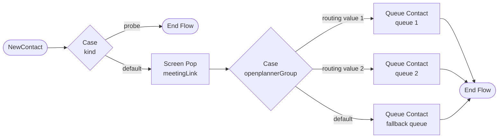

# Sample Webex Contact Center flow

OpenPlanner sends every booking to Webex Contact Center (WxCC) as a **work item** (ADR 0018,
0082). A flow in Flow Designer decides what happens to it: which queue, which priority, and
what the agent sees. This page describes a sample flow that does all of that, how to generate
it for your groups and how to import it. The runbook (section 3, "WxCC work items") lists the
Control Hub setup around it: channel, asset, schema, entry point and queues.

## What the flow does



| Step | Activity | Why |
|---|---|---|
| Case on `kind` | `case-statement` on the work item's `kind` | `probe` is the group check's probe work item (ADR 0082): it ends before any queue, so no agent sees it. Everything else (`scheduled`, `direct`) goes on. |
| Screen Pop | `screen-pop` of `meetingLink`, in a new browser tab | the agent opens the Webex meeting in one click (in the Webex app, signed in: cohost). |
| Case on `openplannerGroup` | `case-statement` on the flow variable `openplannerGroup` | OpenPlanner fills this variable with the group's routing value (`flowSettings`); one branch per group. |
| Queue Contact | `queue-contact` on a Work Item queue per branch | the default branch catches a routing value without a branch, so no work item is lost. |

**Optional, by hand: priority for direct calls.** Add a Case branch `direct` on the first Case
(value `direct`), and behind it a **Set Contact Priority** (P1) that leads on to the Screen
Pop. The generated file leaves it out: no export holds that activity's id, and a wrong id can
break the import.

The flow declares one variable, `openplannerGroup` (String). It reads `kind` and `meetingLink`
from the work item data, which Flow Designer offers on the start node as
`NewContact.MediaPayload.workItemData` (Cisco's Work Item guide, "Flow Support"). The flow
holds routing values and queue names only, never participant data.

The flow passes OpenPlanner's own flow check (**Check integration** and `wxcc-config-check`)
without warnings: routing variable, a branch per group, queues of type Work Item named after
the routing value, the probe branch and the Screen Pop (`tests/adapters/test_wxcc_sample_flow.py`).

## Generating it for your groups

On the host, in the `web` container:

```sh
docker compose exec web python -m app.cli wxcc-sample-flow --group aangifte \
  --queue aangifte=ORG_videoafspraak_aangifte_01 --fallback-queue ORG_videoafspraak_overig \
  > openplanner_aangifte.json
```

- `--group` names one group (its web address). The flow gets a branch for its routing value
  and for every other group with the same **WxCC business address**: one asset, one entry
  point and one flow for all of them, the layout the runbook recommends.
- `--queue VALUE=QUEUE` (repeatable) sets the queue of a routing value: the queue's name as
  it appears in Control Hub. Without it the queue is named after the routing value itself,
  which follows the naming rule of `wxcc-config-check` but must then exist under that name.
- `--fallback-queue` sets the queue of the default branch; without it, the first branch's
  queue.

The command reads the groups from the database only; it calls nothing at Webex. The flow is
named `openplanner_<group>`; rename it on import if that name is taken.

## Importing it

1. Control Hub → **Contact Center** → **Customer experience** → **Flows** → **Import**, and
   choose the generated file.
2. Open the flow. Check that each **Queue Contact** shows the queue you meant (the command fills in the queue ids
   from WxCC; a queue it did not find has to be chosen again) and that the Case branches show your routing values.
3. In the flow's **Global Flow Properties**, check that `openplannerGroup` may be set from
   outside (flow settings), then **Validate** and **Publish**.
4. **Channels** → your Work Item entry point → set this flow and its version label (Live).
5. In OpenPlanner, press **Check integration** on the group's settings: the flow lines and the
   probe line should all be OK.

## What is verified, and what still needs a live check

- The file has the format of Flow Designer's own export screen (`process.activities` and
  `links` plus a `diagram` that places every activity and link). Taken from a flow exported
  from the lab organisation on 2026-11-02; a first version in the API's FlowV2 format
  imported as an empty canvas and was replaced.
- OpenPlanner's flow check reads the file without warnings (`tests/adapters/test_wxcc_sample_flow.py`).
- The command reads the queue ids from the organisation's configuration (read only, like
  `wxcc-config-check`). A queue it cannot find stays a name: choose it again in Flow Designer.

Still to confirm on the first import:

- that the links of the Screen Pop and the Case branches show as connected, and that the canvas
  is tidy enough (move activities as you like);
- that `NewContact.MediaPayload.workItemData.kind` resolves. **Check integration** shows it:
  when the probe line is OK, the flow ended the probe and the `kind` branch works. When it
  says the probe was not ended, the expression did not resolve and the probe went on to a
  queue (an agent may see it): adjust the path in the Case `kind` and the Screen Pop, which
  reads `meetingLink` the same way.

## Changing it

Edit the flow in Flow Designer as you like; the check only needs the variable
`openplannerGroup`, a Case branch per routing value, Work Item queues, a branch on `probe` and a
Screen Pop. To add a group later, add a branch and a queue, or generate the flow again and
import it under a new name.
